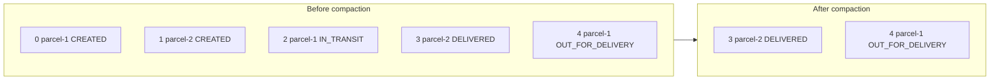

# Retention and Log Compaction

## Introduction

A queue deletes a message once somebody reads it. Kafka does not. Reading a record leaves it exactly where it was, so something else has to decide when data leaves the disk. That something is the topic's cleanup policy, and it comes in two flavours: **delete**, which throws away old data by age or size, and **compact**, which keeps the newest record for each key and discards the older ones.

Choosing the right policy changes what a topic is. A delete topic is a time window of history: "the last seven days of clicks." A compacted topic is closer to a table: "the current address of every customer." This page explains how each policy works on disk, which settings control it, how to combine them, and the timing surprises that catch almost everyone the first time. You will finish able to choose and configure a cleanup policy for any topic you design.

The scenarios are a logistics company with two kinds of data: a high-volume stream of GPS pings from delivery vans, and the current status of each parcel.

## Delete Retention: Time and Size

With `cleanup.policy=delete` (the default), Kafka removes data that is old enough or that pushes a partition over a size limit:

- `retention.ms` (default 604,800,000 ms, seven days): a segment becomes eligible for deletion when its newest record's timestamp is older than this. `-1` means keep forever.
- `retention.bytes` (default `-1`, unlimited): if set, the oldest segments are deleted until the partition is under this size. The limit is **per partition**, not per topic.

Both can be set; a segment is deleted when either rule makes it eligible. The broker checks every `log.retention.check.interval.ms` (default five minutes).

The crucial detail is that deletion works on whole **segments**, never individual records. A partition's log is split into segment files (the [next page](./4-kafka-segments-and-indexes.mdx) covers them), and a segment is judged by its newest record: it expires only when even that record is older than `retention.ms`. A segment that is still receiving records, the active segment, therefore never expires while writes keep arriving. (If a topic goes completely quiet, the broker rolls and deletes an expired active segment too.) A segment rolls when it reaches `segment.bytes` (default 1 GiB) or when it is `segment.ms` old (default seven days).

That has a practical consequence. Suppose a quiet topic has `retention.ms` of one day but receives only 50 MB a day. The active segment will not roll on size for weeks, it rolls on age only after seven days, and because it keeps receiving records its newest timestamp is always fresh. The oldest records in it can therefore stay on disk for up to `segment.ms` plus `retention.ms`, around eight days, despite the one-day setting. If the retention period is a compliance requirement, lower `segment.ms` as well.

```bash
# Keep GPS pings for 3 days, and roll segments every 6 hours so deletion is timely.
kafka-topics.sh --bootstrap-server localhost:9092 --create \
  --topic van-gps \
  --partitions 24 \
  --replication-factor 3 \
  --config retention.ms=259200000 \
  --config segment.ms=21600000
```

:::note
Retention is a minimum, not an exact deadline. Kafka promises to keep data at least as long as configured; it deletes it some time afterwards, when every record in the segment has expired and the next retention check runs. Consumers that fall too far behind lose data they never read, and they get an "offset out of range" response handled by their `auto.offset.reset` setting.
:::

### Which Timestamp Counts

Time retention uses record timestamps, specifically the largest timestamp in each segment. With the default `message.timestamp.type=CreateTime`, that is whatever the producer put in the record. A producer with a wrong clock can therefore keep a segment alive far too long (timestamps in the future) or get records deleted immediately (timestamps in the past). Kafka 4.x guards against the first case by default: `message.timestamp.after.max.ms` defaults to one hour, so records stamped more than an hour ahead are rejected. Setting `message.timestamp.type=LogAppendTime` makes the broker stamp records on arrival, which ties retention strictly to when data was written.

## Log Compaction: Keep the Latest per Key

With `cleanup.policy=compact`, Kafka keeps at least the most recent record for every key and removes older records with the same key. It is a way to store a changelog without it growing forever.



Several properties follow from how it works:

- **Offsets never change.** Compaction removes records, leaving gaps. Offset 4 is still offset 4. A consumer that asks for offset 2 receives the next record that exists, offset 3.
- **Order is preserved** among the records that remain.
- **The active segment is never compacted**, so the latest records are always present in full, and recent duplicates for a key are normal.
- **Keys are required.** A producer that sends a record without a key to a compacted topic gets an error.
- **Any consumer starting from the beginning sees the final value of every key**, plus possibly some older values that have not been cleaned yet.

That last property is the point. A new service that needs the status of every parcel can read the compacted topic from offset 0 and build its own table, without calling a database or replaying years of history. Kafka itself relies on this: consumer group offsets are stored in the compacted internal topic `__consumer_offsets`, and Kafka Streams and Kafka Connect keep their state and configuration in compacted topics.

### How the Log Cleaner Works

Compaction is done by background log cleaner threads on each broker (`log.cleaner.threads`, default 1). The cleaner divides a partition into a **clean** part, already compacted, and a **dirty** part, written since the last pass. It picks the partition with the highest dirty ratio (dirty bytes divided by total bytes), builds an in-memory map of the latest offset for each key in the dirty part, then rewrites the older segments, keeping only records that are still the newest for their key. Rewritten segments replace the old ones in an atomic swap.

The settings that control timing:

| Setting | Default | Effect |
|---|---|---|
| `min.cleanable.dirty.ratio` | 0.5 | A partition is cleaned only when at least this fraction of it is dirty. Lower means more frequent cleaning and more I/O. |
| `min.compaction.lag.ms` | 0 | A record is never compacted until it is at least this old. Guarantees consumers a window to see every intermediate value. |
| `max.compaction.lag.ms` | effectively infinite | A record becomes eligible for compaction after this time even if the dirty ratio is low. Useful for deadlines such as data deletion requests. |
| `delete.retention.ms` | 86,400,000 (1 day) | How long tombstones are kept after compaction, see below. |
| `segment.ms` / `segment.bytes` | 7 days / 1 GiB | Records in the active segment cannot be compacted, so these also bound compaction latency. |

### Tombstones: Deleting a Key

To remove a key from a compacted topic, produce a record with that key and a `null` value. This is a **tombstone**. The cleaner removes all older records for the key, then keeps the tombstone itself for `delete.retention.ms` so that consumers who are reading through get to see the deletion, and only then removes it.

```java
// Parcel parcel-1 was withdrawn: delete it from the compacted status topic.
producer.send(new ProducerRecord<String, String>("parcel-status", "parcel-1", null));
```

If a consumer is offline for longer than `delete.retention.ms` and then resumes, the tombstone may already be gone, and the consumer never learns that `parcel-1` was deleted. Set `delete.retention.ms` longer than the longest outage you want consumers to survive.

## Combining Delete and Compact

`cleanup.policy=compact,delete` applies both: the cleaner compacts, and segments older than `retention.ms` (or beyond `retention.bytes`) are removed entirely. Use it for keyed data where only recent keys matter, for example "the latest position of each van, but forget vans that have not reported for a week." Kafka Streams uses this policy for windowed state changelogs, where windows older than the retention period are useless.

Since Kafka 4.2, `cleanup.policy` also accepts an empty list, meaning no cleanup at all: segments are kept indefinitely (with tiered storage, local retention limits still move old segments off the broker disk).

| Policy | Topic behaves like | Typical use |
|---|---|---|
| `delete` | A rolling time window of history | Events, logs, clickstream, metrics |
| `compact` | A table of the latest value per key | Entity state, reference data, configuration, CDC snapshots |
| `compact,delete` | A table that forgets inactive keys | Recent per-key state, windowed aggregations |
| `delete` with `retention.ms=-1` | A permanent log | Event sourcing, audit trails |

## Worked Scenario: Van Pings and Parcel Status

**`van-gps`.** Each of 4,000 vans sends a GPS ping every five seconds: 800 records per second, about 100 bytes each, roughly 7 GB a day before replication. Analytics jobs consume it within minutes; the data science team occasionally replays a few days. Policy: `delete`, `retention.ms` three days, `segment.ms` six hours so expired data actually goes. Disk needed: about 21 GB times a replication factor of 3, plus a segment of slack per partition. Compaction would be wrong here: keeping only the last ping per van destroys the history that the route-analysis team needs.

**`parcel-status`.** Each parcel's status changes a handful of times between creation and delivery. The customer notification service, the tracking website and the billing service all need the current status of every live parcel, and new services join every quarter. Policy: `compact`, keyed by parcel ID. A new service reads from the beginning and has a complete status table in minutes. When a parcel is archived 90 days after delivery, the archiving job sends a tombstone. `delete.retention.ms` is set to seven days, longer than any planned outage of a consumer. `min.compaction.lag.ms` is one hour, so the notification service, which reacts to every status transition, never misses one to compaction even when it lags briefly.

**The alternative not chosen.** The team considered keeping parcel status only in PostgreSQL and having each service query it. That works, but every new service adds load to the database and needs its own change notification mechanism. The compacted topic lets services read state and subscribe to changes through a single interface. The database is still the system of record; the topic is fed from it through [change data capture](../8-kafka-connect/5-kafka-connect-debezium-cdc.mdx).

Checking the result:

```bash
kafka-configs.sh --bootstrap-server localhost:9092 --describe \
  --entity-type topics --entity-name parcel-status
```

```text
Dynamic configs for topic parcel-status are:
  cleanup.policy=compact sensitive=false synonyms={DYNAMIC_TOPIC_CONFIG:cleanup.policy=compact, DEFAULT_CONFIG:log.cleanup.policy=delete}
  delete.retention.ms=604800000 sensitive=false synonyms={DYNAMIC_TOPIC_CONFIG:delete.retention.ms=604800000, DEFAULT_CONFIG:log.cleaner.delete.retention.ms=86400000}
  min.compaction.lag.ms=3600000 sensitive=false synonyms={DYNAMIC_TOPIC_CONFIG:min.compaction.lag.ms=3600000, DEFAULT_CONFIG:log.cleaner.min.compaction.lag.ms=0}
```

## Common Mistakes

- Expecting `retention.ms=3600000` to delete data after exactly one hour, when segments only roll after `segment.ms` (seven days) on a low-volume topic.
- Setting `retention.bytes` as if it were a per-topic limit; it applies to each partition, so a 24-partition topic can hold 24 times that amount per replica.
- Producing records without keys to a compacted topic, which the broker rejects.
- Expecting a compacted topic to contain exactly one record per key; the active segment and not-yet-cleaned segments still hold duplicates.
- Using compaction for event history, losing the intermediate events that downstream consumers needed.
- Keeping `delete.retention.ms` shorter than consumer outages, so lagging consumers never see some deletions.
- Treating a compacted topic as a GDPR deletion mechanism without setting `max.compaction.lag.ms`; without it, there is no deadline for when old values disappear.
- Letting producers with skewed clocks write `CreateTime` timestamps on topics where retention timing matters.

## Summary

- `cleanup.policy=delete` removes whole closed segments when they exceed `retention.ms` or push a partition past `retention.bytes`.
- Retention is a lower bound judged per segment by its newest record, so `segment.ms` and `segment.bytes` decide how promptly data actually goes.
- `cleanup.policy=compact` keeps at least the newest record per key, preserves offsets and order, and turns a topic into a replayable table.
- Tombstones (null values) delete a key; they are kept for `delete.retention.ms` so consumers can observe the deletion.
- `compact,delete` combines both for per-key state that should still expire.
- Pick the policy from what the data means: history uses delete, current state uses compact.

## Further Reading

- [Kafka documentation: Log Compaction](https://kafka.apache.org/documentation/#compaction) describes compaction guarantees, the cleaner and tombstones.
- [Kafka topic configuration](https://kafka.apache.org/documentation/#topicconfigs) lists `cleanup.policy`, `retention.ms`, `retention.bytes`, `segment.ms`, `min.cleanable.dirty.ratio` and the compaction lag settings with their defaults.
- [KIP-354: Add a Maximum Log Compaction Lag](https://cwiki.apache.org/confluence/display/KAFKA/KIP-354%3A+Add+a+Maximum+Log+Compaction+Lag) explains `max.compaction.lag.ms` and its use for deletion deadlines.
- [KIP-937: Improve Message Timestamp Validation](https://cwiki.apache.org/confluence/display/KAFKA/KIP-937%3A+Improve+Message+Timestamp+Validation) introduced `message.timestamp.before.max.ms` and `message.timestamp.after.max.ms`.
