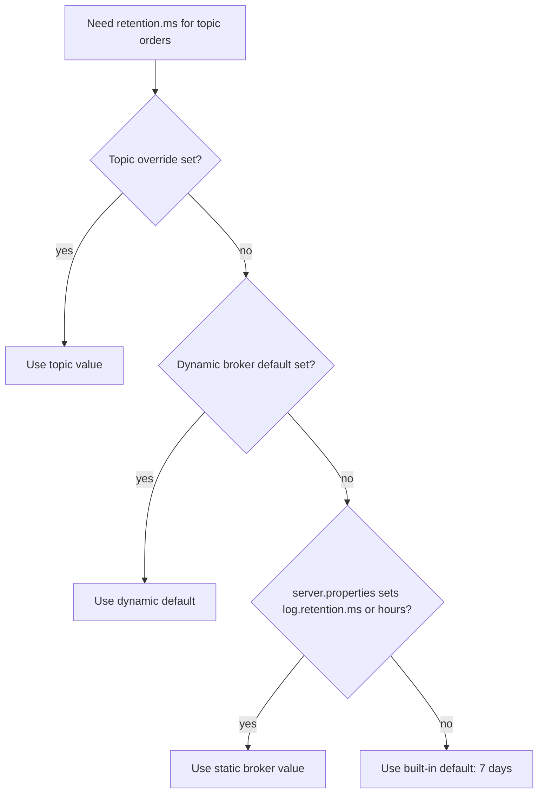

# Topic-Level Configuration

## Introduction

Brokers have hundreds of settings, but most of what makes one topic different from another lives in a much smaller set: topic-level configuration. Retention, cleanup policy, durability requirements, maximum record size, compression and timestamp handling can all be set per topic, changed at runtime, and changed back, without restarting anything.

That flexibility is also a trap. A topic config that silently falls back to a broker default, or a size limit raised on the topic but not on the clients, produces failures that are hard to trace. This page explains how Kafka decides the effective value of a topic setting, groups the settings that matter by purpose, shows how to inspect and change them with `kafka-configs.sh`, and walks through a platform team designing standard topic profiles for many product teams. Afterwards you will be able to read any topic's effective configuration and change it without surprises.

## How a Topic Setting Is Resolved

Every topic setting has a corresponding broker setting that acts as its default, usually with a `log.` prefix. When a broker needs a topic's value, it looks in this order and takes the first one it finds:

1. A **topic override** set on that topic (stored in the cluster metadata).
2. A **dynamic broker default** set for one broker, then for all brokers, with `kafka-configs.sh --entity-type brokers`.
3. The **static broker setting** in `server.properties`.
4. Kafka's built-in default.



The important consequence: a topic without an override **follows the broker default, including future changes to it**. If an operator lowers `log.retention.hours` from 168 to 24 across the cluster to save disk, every topic without its own `retention.ms` loses six days of data at the next retention check. Topics whose retention matters to the business should carry an explicit override.

Names differ between the two levels, which confuses everyone at least once:

| Topic config | Broker default | Built-in default |
|---|---|---|
| `retention.ms` | `log.retention.ms` (or `log.retention.hours`) | 7 days |
| `retention.bytes` | `log.retention.bytes` | -1 (unlimited) |
| `cleanup.policy` | `log.cleanup.policy` | `delete` |
| `segment.bytes` | `log.segment.bytes` | 1 GiB |
| `segment.ms` | `log.roll.ms` (or `log.roll.hours`) | 7 days |
| `max.message.bytes` | `message.max.bytes` | 1,048,588 bytes |
| `min.insync.replicas` | `min.insync.replicas` | 1 |
| `compression.type` | `compression.type` | `producer` |
| `delete.retention.ms` | `log.cleaner.delete.retention.ms` | 1 day |
| `message.timestamp.type` | `log.message.timestamp.type` | `CreateTime` |

Note the trap in row six: the topic setting is `max.message.bytes`, the broker setting is `message.max.bytes`.

## The Settings That Matter, by Purpose

### Retention and Cleanup

`cleanup.policy`, `retention.ms`, `retention.bytes`, `segment.ms`, `segment.bytes`, `delete.retention.ms`, `min.compaction.lag.ms`, `max.compaction.lag.ms` and `min.cleanable.dirty.ratio`. These decide what stays on disk and are covered in [Retention and Log Compaction](./3-kafka-retention-and-compaction.mdx). Tiered storage adds `remote.storage.enable`, `local.retention.ms` and `local.retention.bytes`, covered in [Tiered Storage](./7-kafka-tiered-storage.mdx).

### Durability and Availability

- `min.insync.replicas`: the minimum ISR size for `acks=all` writes. Set to 2 for replication factor 3 on any topic whose data matters.
- `unclean.leader.election.enable`: whether an out-of-sync replica may become leader. Default `false`; override to `true` only for topics where availability beats correctness.

Replication factor is not a config; it is part of the partition assignment, set at creation and changed through a reassignment. See [Replication, Leaders, Followers and the ISR](./2-kafka-replication.mdx).

### Record Size

`max.message.bytes` is the largest record batch, after compression, that the broker accepts for the topic. The default is just over 1 MB. Raising it for one topic is fine, but four other limits must agree, or large records fail somewhere along the way:

| Where | Setting | Must be at least |
|---|---|---|
| Producer | `max.request.size` | the largest batch you send |
| Topic | `max.message.bytes` | the largest batch you send |
| Broker | `replica.fetch.max.bytes` | effectively the largest batch, so followers can copy it |
| Consumer | `max.partition.fetch.bytes` and `fetch.max.bytes` | soft limits; a single oversized batch is still returned so the consumer makes progress |

Before raising limits to accept 20 MB documents, consider the alternative: store the document in object storage and send a reference (the "claim check" pattern). Large records slow replication and increase memory pressure on every client.

### Compression

`compression.type=producer` (the default) keeps whatever codec the producer used. Setting a specific codec such as `zstd` on the topic forces the broker to recompress batches that arrive in a different codec, which costs broker CPU. The usual advice is to leave it at `producer` and configure compression on the producers. Kafka 3.8 added per-codec level settings (`compression.gzip.level`, `compression.lz4.level`, `compression.zstd.level`) for cases where the broker does recompress.

### Timestamps

- `message.timestamp.type`: `CreateTime` keeps the producer's timestamp, `LogAppendTime` replaces it with the broker's clock on arrival.
- `message.timestamp.before.max.ms` and `message.timestamp.after.max.ms`: reject records whose `CreateTime` is too far in the past or future. In Kafka 4.x the future limit defaults to one hour; the past limit is unlimited.

These matter because time retention, time-based seeks and Kafka Streams windows all use record timestamps.

### Less Common but Useful

- `follower.replication.throttled.replicas` and `leader.replication.throttled.replicas`: limit replication traffic during reassignments, usually set by the reassignment tool.
- `flush.messages` and `flush.ms`: force `fsync`. Leave them alone unless you have a specific reason; see [Log Segments, Indexes and How Kafka Stores Data](./4-kafka-segments-and-indexes.mdx).
- `preallocate`: preallocate segment files on creation, occasionally useful on file systems that fragment badly.

## Inspecting and Changing Topic Configs

`kafka-configs.sh` is the main tool. Describe only the overrides:

```bash
kafka-configs.sh --bootstrap-server localhost:9092 \
  --describe --entity-type topics --entity-name orders
```

```text
Dynamic configs for topic orders are:
  min.insync.replicas=2 sensitive=false synonyms={DYNAMIC_TOPIC_CONFIG:min.insync.replicas=2, STATIC_BROKER_CONFIG:min.insync.replicas=1, DEFAULT_CONFIG:min.insync.replicas=1}
  retention.ms=1209600000 sensitive=false synonyms={DYNAMIC_TOPIC_CONFIG:retention.ms=1209600000}
```

The `synonyms` list shows every level that defines the setting, in priority order, which is the fastest way to see what a topic would fall back to if its override were removed. Add `--all` to list every effective setting, including inherited ones.

Change, add and remove overrides:

```bash
# Add or change overrides; takes effect within seconds, no restart.
kafka-configs.sh --bootstrap-server localhost:9092 --alter \
  --entity-type topics --entity-name orders \
  --add-config retention.ms=1209600000,max.message.bytes=2097152

# List values use square brackets.
kafka-configs.sh --bootstrap-server localhost:9092 --alter \
  --entity-type topics --entity-name driver-locations \
  --add-config 'cleanup.policy=[compact,delete]'

# Remove an override so the topic follows the broker default again.
kafka-configs.sh --bootstrap-server localhost:9092 --alter \
  --entity-type topics --entity-name orders \
  --delete-config max.message.bytes
```

`kafka-topics.sh --create --config key=value` sets overrides at creation; `kafka-topics.sh --alter` cannot change configs, only partition counts. Programmatic changes go through the [Admin API](./6-kafka-admin-api.mdx).

:::warning
Changing `cleanup.policy` from `delete` to `compact` on a topic with unkeyed records does not fail immediately; the cleaner will fail on those records later. Changing it the other way starts deleting old segments by age at the next retention check, which may remove state that consumers relied on. Treat a cleanup policy change as a migration, not a tweak.
:::

## Worked Scenario: Topic Profiles for a Platform Team

A company runs one shared Kafka cluster for 30 product teams. Early on, each team created topics with whatever settings they found in blog posts. The result: some critical topics with `min.insync.replicas=1`, a few 5 MB message limits nobody remembered, and one team that lost two weeks of audit data when an operator lowered the broker's default retention.

The platform team defines three profiles and makes every topic declare one:

| Profile | For | Key overrides |
|---|---|---|
| `critical-events` | Orders, payments, audit | `min.insync.replicas=2`, `retention.ms` explicit (14 or 30 days), `unclean.leader.election.enable=false`, `message.timestamp.after.max.ms=300000` |
| `entity-state` | Customer profiles, product catalog, inventory | `cleanup.policy=compact`, `min.insync.replicas=2`, `delete.retention.ms=604800000`, `min.compaction.lag.ms=3600000` |
| `telemetry` | Clickstream, metrics, logs | `retention.ms=172800000`, `segment.ms=3600000`, `min.insync.replicas=1` |

Topics are declared in Git and applied by the cluster's operator. With Strimzi on Kubernetes that is a `KafkaTopic` resource:

```yaml
apiVersion: kafka.strimzi.io/v1
kind: KafkaTopic
metadata:
  name: payments
  labels:
    strimzi.io/cluster: shared
    profile: critical-events
spec:
  partitions: 24
  replicas: 3
  config:
    min.insync.replicas: 2
    retention.ms: 2592000000          # 30 days, explicit so broker default changes do not apply
    unclean.leader.election.enable: false
    message.timestamp.after.max.ms: 300000
```

Every topic now has explicit retention, so broker defaults can change safely. Reviews catch a `telemetry` profile on a payments topic before it ships. And because the configuration is in Git, the history of every change is visible.

**The alternative not chosen.** The platform team considered locking topic creation and configuration entirely to themselves through ACLs and a ticket queue. That gives control but makes the platform team a bottleneck for every product change. Profiles in Git with review let product teams move quickly within guardrails. The ACL side of this is covered in [Authorization with ACLs](../11-kafka-security/3-kafka-acls-authorization.mdx).

## Common Mistakes

- Relying on broker defaults for business-critical retention, then losing data when an operator changes the default.
- Confusing `max.message.bytes` (topic) with `message.max.bytes` (broker), and raising the topic limit without raising the producer's `max.request.size`.
- Setting `compression.type` on the topic to a different codec than producers use, forcing the broker to recompress everything.
- Expecting `kafka-topics.sh --alter` to change configs; it only changes partitions.
- Forgetting the square brackets for list values such as `cleanup.policy=[compact,delete]`, so the comma is read as a separator between two different settings.
- Changing `cleanup.policy` on a live topic without checking whether its records have keys and whether consumers depend on old data.
- Managing topic configs by hand on production with no record of who changed what.

## Summary

- A topic setting resolves from the topic override, then dynamic broker defaults, then `server.properties`, then the built-in default; a topic without an override follows broker default changes.
- Topic and broker names differ, often by a `log.` prefix and occasionally in confusing ways such as `max.message.bytes` and `message.max.bytes`.
- The settings that matter most are retention and cleanup, `min.insync.replicas`, record size limits, compression and timestamp validation.
- `kafka-configs.sh --describe` shows overrides and their synonyms; `--alter --add-config` and `--delete-config` change them at runtime.
- Standard profiles kept in version control make topic configuration consistent and reviewable across teams.

## Further Reading

- [Kafka topic configuration reference](https://kafka.apache.org/documentation/#topicconfigs) lists every topic setting, its default and its broker-level counterpart.
- [Kafka documentation: Updating broker configs](https://kafka.apache.org/documentation/#dynamicbrokerconfigs) explains dynamic broker defaults and the order of precedence.
- [Kafka documentation: Basic Kafka Operations](https://kafka.apache.org/documentation/#basic_ops_modify_topic) shows how to modify topics with the command-line tools.
- [KIP-390: Support Compression Level](https://cwiki.apache.org/confluence/display/KAFKA/KIP-390%3A+Support+Compression+Level) introduced the per-codec compression level settings.
- [Strimzi documentation: Using the Topic Operator](https://strimzi.io/docs/operators/latest/deploying#using-the-topic-operator-str) covers managing topics declaratively on Kubernetes.
