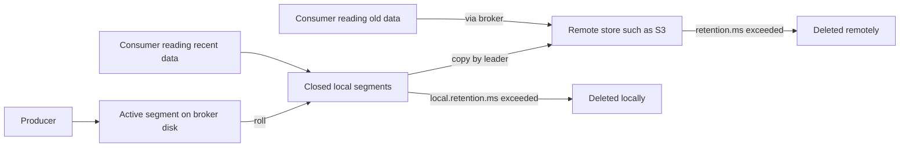

# Tiered Storage

## Introduction

Classic Kafka keeps every byte of every partition on broker disks, multiplied by the replication factor. That is fine for a week of data. It gets expensive and awkward for a year: brokers need huge, fast disks; adding a broker means copying terabytes; and a failed broker takes hours to rebuild because its replacement must re-fetch everything from the other replicas.

Tiered storage, designed in KIP-405 and production-ready since Kafka 3.9, splits a partition's log into two tiers. Recent segments stay on local broker disks, where producers write and most consumers read. Older, closed segments are copied to a remote store such as Amazon S3, Google Cloud Storage, Azure Blob Storage or HDFS, and deleted locally. Consumers still read old data through the normal Kafka API; the broker fetches it from the remote tier for them.

This page explains how tiered storage works, what it changes about cost and operations, how to configure it with a real plugin, how to turn it off again, and what it does not support. You will be able to decide whether a topic benefits from it and configure one that does.

## How It Works

A partition's log is a sequence of segments, as described in [Log Segments, Indexes and How Kafka Stores Data](./4-kafka-segments-and-indexes.mdx). With tiered storage enabled for a topic, the leader of each partition runs a background task in the broker's Remote Log Manager:

1. When a segment is closed (rolled) and all its records are below the high watermark, the leader copies the `.log` file, its indexes, the producer snapshot and the leader epoch data to the remote store.
2. It records the upload in the remote log metadata, by default stored in the internal compacted topic `__remote_log_metadata`.
3. Once a segment is safely remote and older than the **local** retention limit, it is deleted from local disk on the leader and the followers.
4. Once a segment is older than the **total** retention limit, it is deleted from the remote store too.



Only the leader uploads, so the remote store holds **one copy** of each segment rather than three. Durability of the remote copy comes from the object store itself (S3, for example, replicates across zones). Followers keep replicating recent data as usual.

Reading old data looks the same to a consumer. When it fetches an offset that is only in the remote tier, the broker reads the relevant part of the remote segment (through a pool of `remote.log.reader.threads`, default 10) and returns it. The first fetch from cold storage is slower, tens to hundreds of milliseconds instead of single milliseconds, but throughput during a long catch-up read is good because remote segments are large sequential objects. Many plugins add a local chunk cache to soften this.

Two pluggable interfaces make this work. The **RemoteStorageManager** (RSM) copies, fetches and deletes segment data in the remote store. Kafka does not ship a production RSM; you install one as a plugin. The **RemoteLogMetadataManager** (RLMM) tracks which segments are remote; Kafka's built-in topic-based implementation is the usual choice.

## Why Use It

The value comes from decoupling storage from compute.

| Concern | Without tiered storage | With tiered storage |
|---|---|---|
| Storage cost for long retention | Broker block storage times replication factor | Object storage, one copy, much cheaper per GB |
| Broker disk size | Sized for full retention | Sized for local retention (hours or days) |
| Adding or replacing a broker | Copies all retained data for its partitions | Copies only local data |
| Partition reassignment | Moves full history | Moves only local data |
| Retention you can afford | Days to weeks | Months to years |
| Latency reading old data | Same as recent | Higher on first read from remote |

The scaling benefit is easy to overlook. A cluster with 30 days of retention on local disks might need 12 hours to rebuild a failed broker. With one day of local retention and the rest remote, the same rebuild takes minutes, and adding brokers for a traffic peak becomes practical.

The alternative many teams used before tiered storage was to archive old data with a Kafka Connect sink to S3 and keep Kafka retention short. That is cheaper still, but the archive is no longer a Kafka topic: replaying it means a separate pipeline and different code. Tiered storage keeps the replay path identical, which is what makes it attractive for event sourcing, reprocessing after bugs, and training data for machine learning.

## Configuring It

Tiered storage has a broker part, enabled once for the cluster, and a topic part, enabled per topic.

### Broker Configuration

This example uses the open-source, Apache-licensed plugin from Aiven, which supports S3, Google Cloud Storage and Azure Blob Storage. Other vendors provide their own; the Kafka settings stay the same.

```properties
# Enable the tiered storage subsystem on this broker (read-only: requires restart).
remote.log.storage.system.enable=true

# Remote log metadata: the built-in topic-based implementation.
remote.log.metadata.manager.class.name=org.apache.kafka.server.log.remote.metadata.storage.TopicBasedRemoteLogMetadataManager
remote.log.metadata.manager.listener.name=PLAINTEXT
rlmm.config.remote.log.metadata.topic.replication.factor=3

# Remote storage manager: the plugin and where its jars live.
remote.log.storage.manager.class.name=io.aiven.kafka.tieredstorage.RemoteStorageManager
remote.log.storage.manager.class.path=/opt/kafka-tiered-storage/core/*:/opt/kafka-tiered-storage/s3/*

# Settings passed to the plugin use the rsm.config. prefix.
rsm.config.chunk.size=4194304
rsm.config.storage.backend.class=io.aiven.kafka.tieredstorage.storage.s3.S3Storage
rsm.config.storage.s3.bucket.name=acme-kafka-tiered
rsm.config.storage.s3.region=eu-west-1
rsm.config.fetch.chunk.cache.class=io.aiven.kafka.tieredstorage.fetch.cache.DiskChunkCache
rsm.config.fetch.chunk.cache.path=/var/cache/kafka-tiered
rsm.config.fetch.chunk.cache.size=17179869184
```

Credentials for the bucket normally come from the environment (an instance role on EC2, workload identity on Kubernetes) rather than from this file. The [secrets page](../11-kafka-security/5-kafka-secrets-and-credentials.mdx) covers the options.

### Topic Configuration

```bash
kafka-topics.sh --bootstrap-server localhost:9092 --create \
  --topic ledger-events \
  --partitions 24 \
  --replication-factor 3 \
  --config remote.storage.enable=true \
  --config local.retention.ms=86400000 \
  --config retention.ms=31536000000 \
  --config segment.bytes=536870912
```

| Topic setting | Meaning |
|---|---|
| `remote.storage.enable` | Turn tiering on for this topic (default `false`) |
| `local.retention.ms` / `local.retention.bytes` | How much to keep on broker disks; `-2` (the default) means "same as total retention", which keeps everything local |
| `retention.ms` / `retention.bytes` | Total retention across both tiers |
| `remote.log.copy.disable` | Stop uploading new segments while keeping remote data readable |
| `remote.log.delete.on.disable` | Must be set to `true` to turn tiering off and delete the remote data |

Here, records stay on brokers for one day and in S3 for a year. Remember that only closed segments are uploaded: with `segment.bytes` of 512 MiB on a slow partition, a segment may take a long time to close, and local disk usage will be larger than one day's data. The default `segment.ms` of seven days bounds it.

:::warning
Set `local.retention.ms` explicitly. With the default of `-2`, local retention equals total retention, so the topic uploads to the remote store but never frees local disk, giving you the cost of both tiers and the benefit of neither.
:::

### Turning It Off

You can stop tiering a topic in two ways. Setting `remote.log.copy.disable=true` makes the remote data read-only: nothing new is uploaded, existing remote segments stay readable until total retention expires them. In that state set `local.retention.ms` and `local.retention.bytes` back to `-2` (or to the total retention values), otherwise local data would keep being deleted with no remote copy. To remove tiering entirely, set `remote.storage.enable=false` together with `remote.log.delete.on.disable=true`, which deletes the remote copies. Disabling tiered storage at the broker level requires first removing it from every topic.

```bash
kafka-configs.sh --bootstrap-server localhost:9092 --alter \
  --entity-type topics --entity-name ledger-events \
  --add-config remote.log.copy.disable=true,local.retention.ms=-2,local.retention.bytes=-2
```

## Limitations

- **No compacted topics.** Tiered storage cannot be enabled on a topic with `cleanup.policy` including `compact`; the request fails with a configuration error. A proposal to add support (KIP-1272) was still under discussion at the time of writing. Changelog and state topics stay fully local.
- **You need a plugin.** Apache Kafka ships only a test implementation, `LocalTieredStorage`, that writes to a local directory. Production use requires a third-party RSM or a managed service.
- **Remote reads are slower.** Consumers that frequently jump to random old offsets will notice. Tiering suits topics where old data is read rarely and sequentially.
- **Topics created before Kafka 2.8** may lack producer snapshot files on old segments, which tiered storage requires.
- **Object store costs are not only storage.** Requests (PUT and GET) and cross-region traffic are billed too; large segments and chunk caches keep request counts down.

Managed services offer their own versions: Amazon MSK has a tiered storage option, Confluent Cloud tiers storage automatically, and Redpanda has its own implementation. The [managed Kafka page](../1-kafka-getting-started/5-kafka-managed-services.mdx) compares them.

## Worked Scenario: A Year of Ledger Events

A bank's regulators require that every ledger event be replayable for one year, and its fraud team occasionally reprocesses months of history when a new detection rule ships. Ingest is 30 MB/s, about 2.5 TB a day.

**Without tiering.** One year is roughly 950 TB, times a replication factor of 3: about 2.8 PB on broker disks. Brokers would need dozens of very large volumes each, and losing one would mean re-replicating hundreds of terabytes.

**With tiering.** Local retention of one day keeps about 7.5 TB across the cluster with replication. The remote tier holds one copy of about 950 TB in S3, with the object store's own durability. Brokers use modest fast disks, and replacing one copies a day of data. Fraud reprocessing reads months of history through the normal consumer API at a sustained rate, because each remote segment is a large sequential read.

**What they kept local.** The account balance changelog topic, which is compacted, stays fully local with seven days of retention; it cannot use tiered storage, and it is small anyway.

**The alternative not chosen.** The bank had previously used an S3 sink connector with seven days of Kafka retention. Reprocessing meant restoring from S3 into a temporary topic first, a fragile procedure that took a day to set up. Tiered storage costs a little more than the sink alone, because the remote segments include indexes and the plugin's metadata, but it removed the restore step entirely.

## Common Mistakes

- Enabling `remote.storage.enable` without lowering `local.retention.ms`, so nothing is ever freed locally.
- Trying to tier compacted topics such as Kafka Streams changelogs or `__consumer_offsets`.
- Expecting immediate offload: large `segment.bytes` or `segment.ms` delays the moment a segment closes and can be uploaded.
- Using `LocalTieredStorage` from the quick start in production; it is a test implementation.
- Ignoring object store request costs and choosing tiny segments that generate millions of PUT and GET requests.
- Turning tiering off by setting `remote.storage.enable=false` alone, which is rejected; use `remote.log.copy.disable` or add `remote.log.delete.on.disable=true`.
- Pointing several clusters at the same bucket and prefix, so their remote segments and metadata collide.

## Summary

- Tiered storage keeps recent segments on broker disks and moves closed, older segments to an object store, with one remote copy written by the partition leader.
- Consumers read remote data through the normal API; the broker fetches it, with higher latency on first access.
- It decouples storage from compute: cheaper long retention, smaller broker disks, and much faster broker replacement and reassignment.
- Enable it on brokers with `remote.log.storage.system.enable` and an RSM plugin, then per topic with `remote.storage.enable` and an explicit `local.retention.ms`.
- Compacted topics are not supported, and production use requires a third-party plugin or a managed service.

## Further Reading

- [Kafka documentation: Tiered Storage](https://kafka.apache.org/documentation/#tiered_storage) covers configuration, the quick start, disabling and limitations.
- [KIP-405: Kafka Tiered Storage](https://cwiki.apache.org/confluence/display/KAFKA/KIP-405%3A+Kafka+Tiered+Storage) is the original design, including the RSM and RLMM interfaces.
- [KIP-950: Tiered Storage Disablement](https://cwiki.apache.org/confluence/display/KAFKA/KIP-950%3A++Tiered+Storage+Disablement) explains `remote.log.copy.disable` and `remote.log.delete.on.disable`.
- [Aiven tiered storage for Apache Kafka](https://github.com/Aiven-Open/tiered-storage-for-apache-kafka) is an open-source RSM plugin for S3, GCS and Azure Blob Storage.
- [Kafka Tiered Storage GA release notes](https://cwiki.apache.org/confluence/display/KAFKA/Kafka+Tiered+Storage+GA+Release+Notes) list what became production-ready in 3.9 and the remaining limitations.
