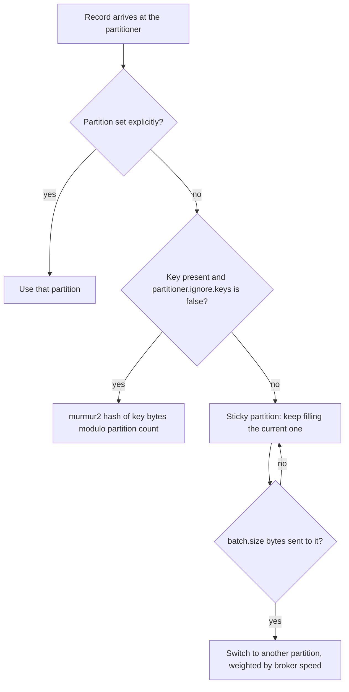

# Keys, Partitioners and Sticky Partitioning

## Introduction

A topic is split into partitions, and a partition is the unit of ordering, parallelism and placement. Every record has to land in exactly one of them, and the producer, not the broker, makes that choice. The decision has long-term consequences: it decides which records stay in order relative to each other, how evenly load spreads across brokers, and whether a single busy customer can slow down everybody else.

This page explains the three-step rule the default partitioner follows, what a key buys you and what it costs, how the sticky partitioner for keyless records evolved into the strictly uniform, adaptive version shipped since Kafka 3.3, and when it is worth writing a partitioner of your own. The scenario is a fleet of delivery vans sending GPS readings, contrasted with a web clickstream that needs no key at all.

## How the Default Partitioner Decides

When you build a `ProducerRecord` you may supply a partition, a key, both or neither. The producer applies the first rule that fits.



1. **Explicit partition.** `new ProducerRecord<>("topic", 3, key, value)` always goes to partition 3. Use this only when you have a reason the client library cannot know, such as routing a VIP tenant to a dedicated partition.
2. **Key present.** The serialized key bytes are hashed with murmur2 and taken modulo the number of partitions. The same key always maps to the same partition as long as the partition count does not change.
3. **No key.** The producer picks one partition and keeps appending to it until roughly `batch.size` bytes have accumulated, then moves to another. This is the sticky partitioner.

The hash in step 2 is deterministic and documented, which is what makes keyed partitioning useful. It is also the reason you should never change the partition count of a keyed topic casually: after the change, `hash(key) % n` points somewhere else and the history for a key is split across two partitions. [Topics and Partitions in Depth](../2-kafka-topics-and-storage/0-kafka-topics-and-partitions.mdx) covers that trap in detail.

## What a Key Buys You

A key is any value you choose to attach to the record; Kafka never interprets it. It is just bytes with two side effects.

**Ordering per key.** Kafka guarantees order within a partition only. Keying every record about one entity by that entity's id means all its records share a partition and therefore stay in order. An `OrderCancelled` event can never be read before the `OrderPlaced` it refers to if both carry the order id as key. [Ordering Guarantees and Message Keys](../2-kafka-topics-and-storage/1-kafka-ordering-and-keys.mdx) covers the guarantees formally.

**Locality.** A consumer processing a partition sees every record for its keys and none for other keys. That lets consumers hold per-key state in memory (the current position of van 42, the running balance of account 7) without coordination with other consumers. Kafka Streams depends on this entirely.

**Compaction.** A compacted topic keeps the last record per key. Without a key there is nothing to compact on. See [Retention and Log Compaction](../2-kafka-topics-and-storage/3-kafka-retention-and-compaction.mdx).

The cost is **skew**. Hashing spreads keys evenly only if the keys themselves are evenly busy. If one tenant produces 40 percent of your traffic, the partition its key hashes to carries 40 percent of the traffic, and so does the one broker leading that partition and the one consumer assigned to it. No amount of extra partitions helps, because the hot key still maps to exactly one of them. The fixes are a compound key (`tenantId-deviceId` instead of `tenantId`) when you do not actually need ordering across the whole tenant, or an explicit partition for the known heavy hitter. [Designing Partition Keys](../13-kafka-best-practices/1-kafka-partition-key-design.mdx) works through these choices.

```java
// Key by van id: all readings from one van stay in order and land on one consumer.
ProducerRecord<String, String> reading =
    new ProducerRecord<>("van-positions", "van-42", "{\"lat\":52.52,\"lon\":13.40,\"ts\":1760600000}");

// No key: a page view has no entity we need ordering for. Let the sticky partitioner spread load.
ProducerRecord<String, String> view =
    new ProducerRecord<>("page-views", "{\"path\":\"/checkout\",\"ts\":1760600000}");
```

Null keys are allowed and common. Do not invent a key such as a random UUID just to have one; you get the cost of hashing and none of the benefits, and you lose the sticky partitioner's batching advantage described next.

## From Round-Robin to Sticky to Strictly Uniform

Keyless partitioning has changed twice, and the history explains the current settings.

**Round-robin (before Kafka 2.4).** Each record went to the next partition in turn. Spread was perfect, but with 30 partitions a burst of 30 records produced 30 batches of one record each. Batches are what the sender puts on the wire, so round-robin meant tiny requests, poor compression and high latency.

**Sticky (Kafka 2.4, KIP-480).** The producer stuck to one partition until the batch for it was sent, then switched. Fewer, fuller batches cut latency noticeably. The flaw: a batch was "done" when it was sent, and batches to a slow broker took longer to drain, so the producer stuck to slow brokers longer. Slow brokers got more data, which made them slower.

**Strictly uniform sticky (Kafka 3.3, KIP-794).** The switch is now based on bytes produced, not batch lifetime: after `batch.size` bytes to a partition, move on. On top of that, adaptive partitioning weighs the choice of the next partition by how many batches are queued for each broker, so a slow broker receives less, not more. This is the behavior you get today with `partitioner.class` left unset.

| Setting | Default | Meaning |
|---|---|---|
| `partitioner.class` | unset | Leave unset to get the built-in strategy above. The old `DefaultPartitioner` and `UniformStickyPartitioner` classes are deprecated. |
| `partitioner.adaptive.partitioning.enable` | `true` | Prefer partitions on brokers with shorter queues. `false` picks the next sticky partition uniformly at random. |
| `partitioner.availability.timeout.ms` | `0` | If a broker has had a batch queued longer than this, stop sending it new keyless records until it catches up. `0` disables the check. |
| `partitioner.ignore.keys` | `false` | `true` makes keyed records use the sticky strategy too. Only for topics where you want keys stored but not used for placement. |

:::note
Adaptive partitioning only applies to records without a key. Keyed records are placed by hash regardless of broker speed, because moving them would break ordering. The constant `ProducerConfig.PARTITIONER_ADPATIVE_PARTITIONING_ENABLE_CONFIG` was misspelled in the Java client for years; Kafka 4.2 added the correctly spelled `PARTITIONER_ADAPTIVE_PARTITIONING_ENABLE_CONFIG` (KIP-1175) and deprecated the typo. The property name string was always correct.
:::

## Custom Partitioners

The `Partitioner` interface has one real method. Implement it when the built-in rules cannot express your routing, for example when one tenant is so large it deserves partitions of its own.

```java
import org.apache.kafka.clients.producer.Partitioner;
import org.apache.kafka.common.Cluster;
import org.apache.kafka.common.utils.Utils;

import java.util.Map;

/** Routes the biggest tenant to the last partition and hashes everybody else over the rest. */
public class BigTenantPartitioner implements Partitioner {
    private String bigTenant;

    @Override
    public void configure(Map<String, ?> configs) {
        // Read from producer config: props.put("big.tenant.id", "acme")
        bigTenant = String.valueOf(configs.get("big.tenant.id"));
    }

    @Override
    public int partition(String topic, Object key, byte[] keyBytes,
                         Object value, byte[] valueBytes, Cluster cluster) {
        int partitions = cluster.partitionCountForTopic(topic);
        if (bigTenant.equals(key)) {
            return partitions - 1;                       // dedicated partition for the heavy hitter
        }
        // Same murmur2 hash the default partitioner uses, spread over the remaining partitions.
        return Utils.toPositive(Utils.murmur2(keyBytes)) % (partitions - 1);
    }

    @Override
    public void close() {}
}
```

```java
props.put(ProducerConfig.PARTITIONER_CLASS_CONFIG, BigTenantPartitioner.class.getName());
props.put("big.tenant.id", "acme");
```

Keep custom partitioners pure and fast. They run on the caller's thread for every record and must return the same answer for the same key on every instance of the service, or the ordering guarantee silently disappears. Do not call out to a database or a config service inside `partition()`.

Two alternatives are often better than a custom class. Setting the partition explicitly on the `ProducerRecord` keeps the routing rule visible in application code. And a compound key removes most "one key is too hot" problems without any partitioner work.

## Hashing Across Languages

The murmur2 hash is a Java client convention, not a protocol rule. Other clients made different choices, which matters the moment a Python service and a Java service write the same keys to the same topic.

| Client | Default for keyed records | Compatible with Java's murmur2? |
|---|---|---|
| Java `kafka-clients` | murmur2 modulo partitions | yes |
| `confluent-kafka` (librdkafka), Python and Node | `consistent_random` (CRC32 based) | no, unless `partitioner=murmur2_random` is set |
| `franz-go` | `StickyKeyPartitioner` with murmur2 | yes |
| `sarama` | hash partitioner using FNV-1a by default | no, unless configured with a murmur2 hasher |

If two producers in different languages key the same topic, pick one hash and configure the others to match. Otherwise the key `van-42` lands in partition 3 from Java and partition 9 from Python, and the consumer that keeps van 42's state sees only half the readings.

```python
from confluent_kafka import Producer

producer = Producer({
    "bootstrap.servers": "localhost:9092",
    # Match the Java client so both services place the same key in the same partition.
    "partitioner": "murmur2_random",
})
producer.produce("van-positions", key="van-42", value=b'{"lat":52.52,"lon":13.40}')
producer.flush()
```

```go
client, err := kgo.NewClient(
	kgo.SeedBrokers("localhost:9092"),
	// Default already; shown for clarity. Keyed records hash with murmur2, keyless ones stick.
	kgo.RecordPartitioner(kgo.StickyKeyPartitioner(nil)),
)
```

## Worked Scenario: Van Telemetry and a Clickstream

A logistics company runs 3,000 vans, each reporting its position every two seconds, about 1,500 records per second. The same company's website produces a clickstream of roughly 20,000 page views per second. Both go through one cluster.

**Van positions, keyed by van id.** The dispatch service keeps every van's last known position and speed in memory and raises an alert if a van stops moving. It needs all readings for a van in order and on a single consumer. The key is `van-<id>` and the topic has 24 partitions, so each partition carries about 125 vans. Vans are roughly equally chatty, so skew is not a concern. If a few vans switched to high-frequency reporting during deliveries, the team would still prefer the key, accepting mild skew over losing ordering.

The alternative, no key with the sticky partitioner, would spread readings beautifully but a van's readings would be scattered over 24 partitions and the dispatch service would need a shared store to reassemble them. The key is cheaper.

**Page views, no key.** Analytics counts views per path per minute. Nothing needs per-entity ordering. With no key the sticky partitioner fills one partition's batch at a time, producing large, well-compressed batches, and adaptive partitioning quietly routes around a broker that is doing a log segment flush. If the team had keyed by session id "just in case", they would have had 20,000 hash computations per second producing many small batches, and the compression ratio of their JSON would have dropped.

```bash
# Confirm the spread for the keyless topic: offsets grow roughly evenly across partitions.
kafka-get-offsets.sh --bootstrap-server localhost:9092 --topic page-views
```

```text
page-views:0:184233
page-views:1:184107
page-views:2:184320
```

```bash
# For the keyed topic, check for skew: a partition far ahead of the others points to a hot key.
kafka-get-offsets.sh --bootstrap-server localhost:9092 --topic van-positions
```

## Common Mistakes

- **Keying with a random or unique value.** You pay for hashing, lose sticky batching and gain no ordering, since no two records share the key.
- **Changing the partition count of a keyed topic in production.** Keys remap and ordering for existing keys is broken across the boundary. Decide partition counts early or plan a new topic plus migration.
- **Mixing clients with different default hashes on one topic.** Java and librdkafka disagree unless librdkafka is told to use `murmur2_random`.
- **Expecting adaptive partitioning to fix hot keys.** It only redistributes keyless records. Skew from a hot key needs a different key design.
- **Writing a partitioner that depends on external state.** Two instances returning different partitions for the same key breaks ordering silently.
- **Using one key for an entire tenant when per-device ordering would do.** The compound key spreads load while preserving the ordering you actually rely on.

## Summary

- The producer picks a partition in three steps: explicit partition, then key hash, then sticky.
- Keys give per-key ordering, consumer locality and compaction, at the cost of possible skew from hot keys.
- Keyless records use the strictly uniform sticky partitioner (KIP-794) that switches after `batch.size` bytes and prefers faster brokers; it replaced round-robin and the original sticky partitioner.
- Leave `partitioner.class` unset; write a custom partitioner only for routing the default rules cannot express, and keep it deterministic.
- Different clients hash keys differently by default; align them when several languages write to the same keyed topic.

## Further Reading

- [KIP-480: Sticky Partitioner](https://cwiki.apache.org/confluence/display/KAFKA/KIP-480%3A+Sticky+Partitioner): the 2.4 change from round-robin to sticky, with latency measurements.
- [KIP-794: Strictly Uniform Sticky Partitioner](https://cwiki.apache.org/confluence/display/KAFKA/KIP-794%3A+Strictly+Uniform+Sticky+Partitioner): the 3.3 redesign and the adaptive partitioning settings.
- [Partitioner interface Javadoc](https://kafka.apache.org/43/javadoc/org/apache/kafka/clients/producer/Partitioner.html): the contract a custom partitioner must satisfy.
- [ProducerRecord Javadoc](https://kafka.apache.org/43/javadoc/org/apache/kafka/clients/producer/ProducerRecord.html): constructors for explicit partitions, keys, timestamps and headers.
- [librdkafka configuration: partitioner](https://github.com/confluentinc/librdkafka/blob/master/CONFIGURATION.md): the `partitioner` property and its `murmur2_random` option.
- [Ordering Guarantees and Message Keys](../2-kafka-topics-and-storage/1-kafka-ordering-and-keys.mdx): the formal ordering model this page relies on.
