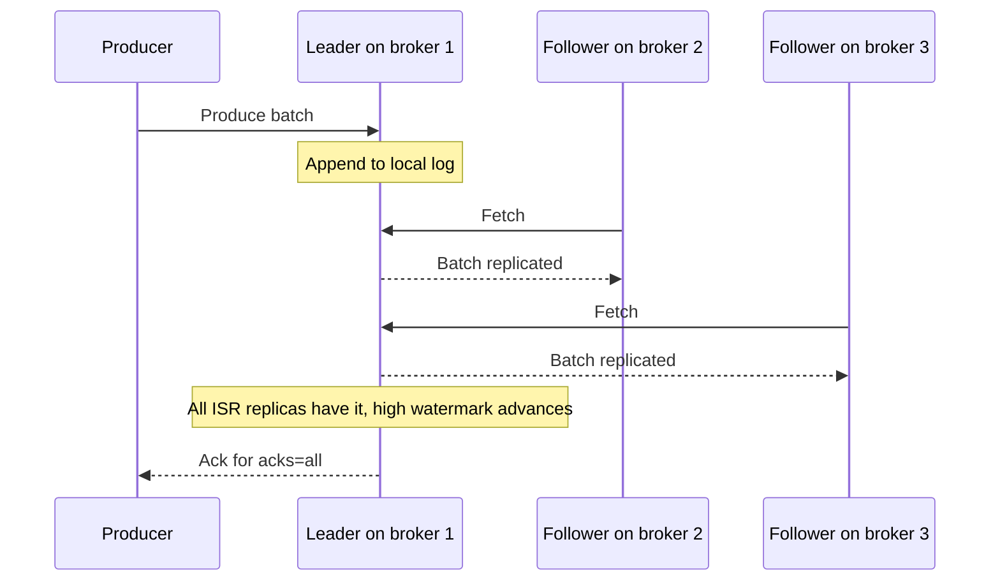

# acks, min.insync.replicas and Durability

## Introduction

"Kafka acknowledged my write" can mean three very different things depending on one producer setting and one topic setting. Get the pair right and a broker can lose its disk without you losing a record. Get it wrong and a routine broker restart quietly drops data that the producer swore was stored.

This page explains what happens on the broker between receiving a batch and answering the producer, what `acks=0`, `acks=1` and `acks=all` each wait for, and why `acks=all` is only half a guarantee until `min.insync.replicas` supplies the other half. We also look at the latency price and at unclean leader election. The scenario contrasts a bank ledger, where losing a record is unacceptable, with a clickstream where it is merely annoying.

## What Happens Inside the Broker

Each partition has one leader replica and, with a replication factor of three, two follower replicas on other brokers. Producers always write to the leader. Followers fetch from the leader continuously, the same way a consumer would.

The leader keeps a list of followers that are "in sync": those that have fetched up to the leader's end of log within the last `replica.lag.time.max.ms` (30 seconds by default). This list is the ISR, the in-sync replica set. A follower that falls behind, crashes or gets partitioned away is removed from the ISR; when it catches up it is added back. [Replication, Leaders, Followers and the ISR](../2-kafka-topics-and-storage/2-kafka-replication.mdx) explains the mechanism; here we care about one thing: a record is only truly safe once it is on every replica in the ISR, because any of them might become the next leader.



The leader also tracks the high watermark, the highest offset replicated to the whole ISR. Consumers can only read up to the high watermark, so a record that has been written to the leader but not yet replicated is invisible to consumers as well as unsafe.

## The Three Values of acks

`acks` tells the leader when to answer the producer.

| `acks` | Leader replies when | Survives | Typical latency | Use |
|---|---|---|---|---|
| `0` | Immediately, without even confirming the write | Nothing; a dropped TCP packet loses data | Lowest, network only | Metrics sampling, where speed beats completeness |
| `1` | The record is in the leader's log | Follower failures, not leader failures | One disk append | Legacy default; rarely the right choice today |
| `all` (or `-1`) | Every replica in the ISR has the record | Loss of any `ISR size - 1` brokers | One replication round trip | Default since Kafka 3.0; anything you cannot recreate |

With `acks=0` the producer does not wait for a response at all. The record may never reach the broker, and the producer cannot retry what it does not know failed. Offsets in the callback metadata are `-1` because nobody told the producer where the record landed.

With `acks=1` the leader answers as soon as it has appended the batch. If the leader then crashes before any follower fetched the batch, a follower becomes leader without it, and the record is gone although the producer saw success. This is the classic "Kafka lost my message" story and it is almost always `acks=1` behind it.

With `acks=all` the leader waits until every current ISR member has the batch. Note the word *current*. If followers have dropped out of the ISR, the ISR can shrink to just the leader, and `acks=all` then means "the leader has it", exactly the same as `acks=1`. That is why a second setting is required.

```java
props.put(ProducerConfig.ACKS_CONFIG, "all");   // the default; shown to make the intent visible
```

## min.insync.replicas: The Other Half of the Contract

`min.insync.replicas` is a topic (or broker-wide) setting that tells the leader: if the ISR has fewer members than this, refuse writes with `acks=all`. The broker-wide default is 1, which disables the protection. The standard production pairing is replication factor 3 with `min.insync.replicas=2`.

With that pairing:

- Normal operation: 3 replicas in the ISR, writes need all 3, the write survives the loss of any 2 brokers.
- One broker down: 2 replicas in the ISR, writes need both, the write survives the loss of 1 more broker.
- Two brokers down: 1 replica in the ISR, which is below 2. The leader rejects the write with `NotEnoughReplicasException`. The producer retries until a follower returns or `delivery.timeout.ms` expires.

The last row is the point. Kafka chooses to become unavailable for writes rather than accept a write it cannot make durable. That is a deliberate trade of availability for consistency, and for a ledger it is the right one. For a clickstream you might prefer `min.insync.replicas=1` and keep accepting page views on a single surviving replica.

Set it per topic when you create the topic or change it later:

```bash
kafka-topics.sh --bootstrap-server localhost:9092 --create \
  --topic ledger-entries --partitions 12 --replication-factor 3 \
  --config min.insync.replicas=2
```

```bash
kafka-configs.sh --bootstrap-server localhost:9092 --alter \
  --entity-type topics --entity-name ledger-entries \
  --add-config min.insync.replicas=2
```

Or make it the cluster default so nobody forgets:

```properties
# server.properties on every broker
default.replication.factor=3
min.insync.replicas=2
```

[Topic-Level Configuration](../2-kafka-topics-and-storage/5-kafka-topic-configuration.mdx) lists the other settings that can be overridden per topic.

:::warning
`min.insync.replicas` only matters when the producer uses `acks=all`. A producer with `acks=1` writes happily to a lone leader no matter what the topic says. Durability is a contract between the two settings, and either side can break it.
:::

## Unclean Leader Election

Suppose every replica in the ISR dies at once, and only a follower that was out of sync remains. Should it become leader? If yes, the partition is writable again but the records it never fetched are lost. If no, the partition stays offline until an ISR member returns.

`unclean.leader.election.enable` controls this and defaults to `false`: Kafka waits. For the ledger that is correct. For a topic of sensor readings with a short retention where availability matters more, a team might turn it on per topic and accept the gap. Treat enabling it as a conscious decision written down somewhere, not a knob to flip during an incident.

## The Latency Price

`acks=all` costs one replication round. The leader appends, followers must fetch (they poll continuously, so this is typically a millisecond or two on the same network), and only then does the ack go back. Within a data center the difference between `acks=1` and `acks=all` is usually single-digit milliseconds per batch. Because the producer pipelines up to five batches per broker and batches hold many records, throughput barely moves. What moves is tail latency: a slow follower disk delays the ack for everyone on that partition.

Across availability zones the extra round trip is larger, perhaps 2 to 10 ms, and you accept it because surviving a zone failure is the whole point of spreading replicas.

If latency genuinely matters more than durability, say so in the configuration of that one producer rather than weakening the topic for everyone:

```java
// A metrics sampler: we would rather drop a sample than wait.
props.put(ProducerConfig.ACKS_CONFIG, "1");
props.put(ProducerConfig.ENABLE_IDEMPOTENCE_CONFIG, "false");   // idempotence requires acks=all
```

Note the second line. The idempotent producer, on by default, requires `acks=all`. Setting `acks=1` while idempotence is explicitly enabled throws a `ConfigException` at startup; if idempotence is only implicitly enabled it is silently turned off. [The Idempotent Producer](./3-kafka-idempotent-producer.mdx) explains why the two depend on each other.

## Worked Scenario: A Bank Ledger and a Clickstream

A bank writes every posted transaction to a `ledger-entries` topic that downstream systems use for statements, fraud detection and the general ledger. Separately, the bank's public website writes page views to `web-clicks` for analytics.

**ledger-entries.** Losing an entry means a statement that does not add up and a regulator asking questions. The team sets replication factor 3, `min.insync.replicas=2`, `unclean.leader.election.enable=false` and leaves the producer at `acks=all` with idempotence on. During a rolling broker upgrade, each partition temporarily has 2 in-sync replicas, still enough. When a disk failed and took a second broker down during one such upgrade, writes to the affected partitions paused for 40 seconds until the upgraded broker rejoined. No entry was lost, and the producers' `record-retry-rate` metric was the only visible trace. The alternative, `min.insync.replicas=1`, would have kept writes flowing to a single copy during those 40 seconds; the team judged that an unacceptable window.

**web-clicks.** Losing a few thousand page views out of two billion a day changes no decision. The team keeps replication factor 3 so the topic survives broker failures for reads, but sets `min.insync.replicas=1` and leaves `acks=all`. In the same incident, `web-clicks` partitions on the failed brokers kept accepting writes to their lone surviving replica. Had that replica also failed, the analytics team would have lost 40 seconds of clicks and shrugged.

The producer code is the same for both; durability lives in the topic configuration plus the default `acks=all`. That is the recommended split: let the topic owner decide how durable the data must be, and keep producers at the default.

```java
Properties props = new Properties();
props.put(ProducerConfig.BOOTSTRAP_SERVERS_CONFIG, "broker-1:9092,broker-2:9092,broker-3:9092");
props.put(ProducerConfig.CLIENT_ID_CONFIG, "ledger-poster");
props.put(ProducerConfig.KEY_SERIALIZER_CLASS_CONFIG, StringSerializer.class.getName());
props.put(ProducerConfig.VALUE_SERIALIZER_CLASS_CONFIG, StringSerializer.class.getName());
// acks=all and enable.idempotence=true are the defaults. Nothing else to add.

try (KafkaProducer<String, String> producer = new KafkaProducer<>(props)) {
    ProducerRecord<String, String> entry = new ProducerRecord<>(
        "ledger-entries", "acct-7781", "{\"acct\":\"7781\",\"amount\":-120.00,\"txn\":\"t-99\"}");
    producer.send(entry, (meta, ex) -> {
        if (ex != null) {
            // After 120 s of retries the ISR was still too small, or a fatal error occurred.
            alerting.page("ledger publish failed for acct-7781", ex);
        }
    });
}
```

Verify a topic's settings and ISR state when in doubt:

```bash
kafka-topics.sh --bootstrap-server localhost:9092 --describe --topic ledger-entries
```

```text
Topic: ledger-entries  PartitionCount: 12  ReplicationFactor: 3  Configs: min.insync.replicas=2
  Topic: ledger-entries  Partition: 0  Leader: 1  Replicas: 1,2,3  Isr: 1,2,3
  Topic: ledger-entries  Partition: 1  Leader: 2  Replicas: 2,3,1  Isr: 2,3
```

Partition 1 above has an ISR of two: broker 1 is lagging or down. Writes still succeed because two is the minimum.

## Common Mistakes

- **Running `acks=all` with the broker default `min.insync.replicas=1`.** The ISR can shrink to the leader alone and `all` degrades to `1` without any warning.
- **Setting `min.insync.replicas` equal to the replication factor.** One broker restart makes the topic unwritable. Use replication factor 3 with a minimum of 2.
- **Using `acks=1` because "all" sounded slow.** Measure first; within a data center the difference is milliseconds and throughput is unaffected thanks to pipelining.
- **Enabling unclean leader election during an outage to "get things moving".** It trades data loss for availability permanently, not just for that incident.
- **Reading the `-1` offset from an `acks=0` callback as an error.** It is expected; the producer was never told where the record went.
- **Forgetting that replication factor 1 topics exist in dev.** A Docker Compose cluster with one broker needs `min.insync.replicas=1`, and configs copied from production will make every write fail.

## Summary

- The leader appends, followers fetch, and the high watermark marks what the whole ISR holds; only that is safe.
- `acks=0` waits for nothing, `acks=1` waits for the leader, `acks=all` waits for the current ISR and is the default since 3.0.
- `min.insync.replicas` makes `acks=all` meaningful by refusing writes when the ISR is too small; replication factor 3 with a minimum of 2 is the standard production pairing.
- Unclean leader election is off by default and should stay off for data you cannot regenerate.
- Put durability decisions in topic configuration so producers can stay at the defaults.

## Further Reading

- [Kafka design: replication](https://kafka.apache.org/documentation/#replication): ISR, high watermark and the durability guarantees in the project's own words.
- [Producer config: acks](https://kafka.apache.org/documentation/#producerconfigs_acks): the exact semantics of each value.
- [Topic config: min.insync.replicas](https://kafka.apache.org/documentation/#topicconfigs_min.insync.replicas): the setting and its interaction with `acks`.
- [Topic config: unclean.leader.election.enable](https://kafka.apache.org/documentation/#topicconfigs_unclean.leader.election.enable): the availability versus consistency switch.
- [Replication, Leaders, Followers and the ISR](../2-kafka-topics-and-storage/2-kafka-replication.mdx): the replication mechanism this page builds on.
- [Designing for Failure](../13-kafka-best-practices/3-kafka-failure-handling-practices.mdx): how these settings fit into a wider resilience plan.
