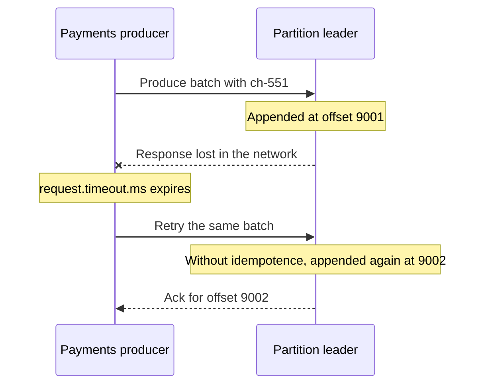

# The Idempotent Producer

## Introduction

Networks lose answers, not just requests. A producer sends a batch, the leader writes it, and the acknowledgement never comes back because a switch dropped the packet or the leader moved. From the producer's side the batch might be stored or might not; the only safe move is to send it again. Before idempotence, that retry wrote the batch a second time and every consumer saw the record twice.

The idempotent producer fixes exactly this case. The broker recognizes a retried batch and drops the copy, so retries become free of side effects. Since Kafka 3.0 it is on by default, which is why many teams use it without knowing it exists, and why some turn it off by accident.

This page explains how the mechanism works (producer IDs, epochs and per-partition sequence numbers), which settings it depends on, what it does not protect you from, and how to verify it is really active. The running scenario is a payments service where a duplicate record means a customer charged twice.

## The Duplicate Problem

Picture the payments service publishing a `PaymentCaptured` event for card charge `ch-551`. The batch reaches the leader, the leader appends it at offset 9001 and replicates it, and then the response is lost.



The producer is satisfied and so is the broker. The ledger consumer, however, reads two `PaymentCaptured` events for the same charge. If it is not itself deduplicating, it books the money twice.

The same thing happens on a leader change. The old leader wrote the batch and replicated it, then crashed before answering. The new leader already holds the batch; the producer, seeing an error, resends it.

Before Kafka 0.11 the only defenses were to disable retries (accept loss instead of duplicates) or to make every consumer idempotent. The idempotent producer moves that responsibility into the broker for the most common source of duplicates.

## How It Works: Producer ID, Epoch and Sequence Numbers

When an idempotent producer starts, it asks a broker for a **producer ID** (PID), a 64-bit number unique within the cluster, along with a short **epoch** number. It then tags every batch with three things: the PID, the epoch and a **sequence number**.

Sequence numbers are counted per partition. The first batch the producer sends to `payments-0` starts at sequence 0, and each batch's sequence advances by the number of records it holds. The batches to `payments-1` have their own counter.

The partition leader remembers, for every active PID, the sequence numbers of the last five batches it accepted. When a batch arrives it compares:

| Incoming sequence compared to what the leader has | Leader's decision |
|---|---|
| Exactly the next expected sequence | Append it, remember the sequence |
| Matches one of the last five batches already written | Duplicate: do not append, reply with success and the original offset |
| Higher than expected, leaving a gap | Reject with `OutOfOrderSequenceException`; an earlier batch is missing |
| Lower than the last five it remembers | Reject; too old to verify |

Think of the sequence number as the numbered pages of a fax. If page 7 arrives twice, the receiver throws the second copy away; if page 9 arrives right after page 7, it knows page 8 went missing and asks for it instead of stapling the pages out of order.

Back in the scenario, the retried batch carries the same PID and sequence as the first attempt. The leader sees a sequence it already wrote at offset 9001, discards the copy and answers "stored at 9001". The ledger sees one event.

Because the leader keeps state for the last five batches, idempotence also preserves ordering when several requests are in flight at once. If batch 2 fails and batch 3 succeeds, the leader rejects batch 3's successors until batch 2 is retried, so the log never shows 3 before 2. That is why idempotence requires `max.in.flight.requests.per.connection` to be 5 or lower: with more in flight, the leader could not check them all.

The state is replicated with the log. When leadership moves, the new leader rebuilds the PID and sequence table from its own copy of the log and snapshots, so deduplication keeps working through failover.

## The Settings It Depends On

Idempotence is a contract between three producer settings. All three already have compatible defaults.

| Setting | Required value | Default | Why |
|---|---|---|---|
| `enable.idempotence` | `true` | `true` | Turns the mechanism on |
| `acks` | `all` | `all` | A batch written only to the leader could vanish on failover, leaving the sequence counter ahead of the log |
| `retries` | greater than 0 | `2147483647` | Retries are the point; without them there is nothing to deduplicate |
| `max.in.flight.requests.per.connection` | 1 to 5 | `5` | The leader tracks the last five batches per producer and partition |

The defaults hide one trap. If you never mention `enable.idempotence` but set an incompatible value, for example `acks=1` copied from an old tuning guide, the client quietly disables idempotence and starts normally. If you set `enable.idempotence=true` explicitly together with `acks=1`, it refuses to start with a `ConfigException`. Being explicit therefore turns a silent downgrade into a loud failure:

```java
Properties props = new Properties();
props.put(ProducerConfig.BOOTSTRAP_SERVERS_CONFIG, "broker-1:9092,broker-2:9092");
props.put(ProducerConfig.CLIENT_ID_CONFIG, "payments-service");
props.put(ProducerConfig.KEY_SERIALIZER_CLASS_CONFIG, StringSerializer.class.getName());
props.put(ProducerConfig.VALUE_SERIALIZER_CLASS_CONFIG, StringSerializer.class.getName());
// Already the default, but stating it makes conflicting settings fail at startup
// instead of silently turning deduplication off.
props.put(ProducerConfig.ENABLE_IDEMPOTENCE_CONFIG, "true");
props.put(ProducerConfig.ACKS_CONFIG, "all");
```

Authorization is the other prerequisite. Since Kafka 2.8 (KIP-679), a principal with `WRITE` permission on the topic may use idempotence; older clusters required the cluster-level `IDEMPOTENT_WRITE` ACL. On a secured cluster where the producer lacks permission, initialization fails with an authorization error rather than falling back.

The non-Java clients follow the same model:

```python
from confluent_kafka import Producer

producer = Producer({
    "bootstrap.servers": "localhost:9092",
    "client.id": "payments-service",
    # librdkafka defaults this to false; turn it on explicitly.
    # It also forces acks=all, retries high and max.in.flight <= 5.
    "enable.idempotence": True,
})
```

```go
// franz-go enables idempotence by default; kgo.DisableIdempotentWrite() turns it off.
client, err := kgo.NewClient(
	kgo.SeedBrokers("localhost:9092"),
	kgo.ClientID("payments-service"),
	kgo.RequiredAcks(kgo.AllISRAcks()), // required for idempotence, and the default
)
```

:::note
librdkafka (and therefore `confluent-kafka` for Python and `@confluentinc/kafka-javascript`) still defaults `enable.idempotence` to `false`. A Java service and a Python service with "default settings" are not equally protected. Set it explicitly in every non-Java client.
:::

## What Idempotence Does Not Cover

The guarantee is narrow on purpose: **no duplicates caused by the producer's own internal retries, within one producer session, per partition.** Each limit matters.

**Application-level resends.** If your code catches an exception and calls `send()` again with a new `ProducerRecord`, that is a new record with a new sequence number. The broker cannot know it is the same payment. The same goes for an HTTP handler that publishes, times out, and is retried by the client calling your API. Idempotence protects the hop between producer and broker, not the hops before it.

**Producer restarts.** A new producer instance gets a new PID. If the payments service crashes after the broker stored a batch but before the service recorded success, the restarted instance sends it again under a fresh PID and the broker sees a brand new batch. Covering restarts needs a stable identity across sessions, which is what `transactional.id` provides; see [Transactions and Exactly-Once Producing](./7-kafka-transactions.mdx).

**Multiple partitions or topics as one unit.** Idempotence is per partition. Writing a debit to `ledger` and a notification to `emails` atomically, so both or neither appear, is again a transaction.

**Consumers.** A consumer that processes a record, crashes before committing its offset and reprocesses after restart creates duplicate side effects downstream. That is a consumer concern, handled by [Idempotent Consumers and Deduplication](../9-kafka-patterns/4-kafka-idempotent-consumers.mdx) or transactions.

**Long silences.** The broker forgets a PID after `producer.id.expiration.ms` (one day by default) without writes from it. A producer that wakes up after that receives an `UNKNOWN_PRODUCER_ID` error; modern clients handle it by bumping the epoch and resetting the sequence (KIP-360), so you normally never see it, but the deduplication window does not stretch back further than that.

| Source of duplicates | Prevented by idempotence? | What prevents it |
|---|---|---|
| Producer retry after a lost acknowledgement | Yes | Sequence numbers |
| Retry after leader failover | Yes | Replicated producer state |
| Application calls `send()` twice | No | A business key plus idempotent consumers |
| Producer process restarts and resends | No | Transactions with a stable `transactional.id`, or the outbox pattern |
| Consumer reprocesses after a crash | No | Transactions or consumer-side deduplication |

## Errors You May See

Most idempotence errors are handled inside the client. A few reach your callback.

- **`OutOfOrderSequenceException`**: the broker detected a gap, meaning an earlier batch was lost in a way the producer could not repair. For a non-transactional producer since Kafka 2.5, the client resets its sequence state and the failure is reported for the affected batches; for a transactional producer it is fatal and the producer must be closed. In practice it often points at data loss on the broker side, such as an unclean leader election or a topic with `min.insync.replicas=1`.
- **`ClusterAuthorizationException` or `TopicAuthorizationException`** during startup: missing permission, see above.
- **`InvalidProducerEpochException`** or **`ProducerFencedException`**: only relevant with a `transactional.id`, where another instance with the same id has taken over.

## Worked Scenario: Payments Without Double Charges

A payments service publishes `PaymentCaptured` events keyed by charge id to a 12-partition `payments` topic with replication factor 3 and `min.insync.replicas=2`. Three consumers read it: the ledger, the customer receipt mailer and fraud scoring.

During a broker upgrade, leadership for partitions moves every few minutes. The producer's metrics show bursts of `record-retry-rate` each time, because in-flight requests to the old leader fail with `NOT_LEADER_OR_FOLLOWER` and are resent to the new one. Some of those requests had already been written and replicated. With idempotence on, every resent batch was recognized and acknowledged with its original offset; the ledger's nightly reconciliation found zero duplicate charge ids.

The team's earlier service, written against Kafka 2.x with `acks=1` and idempotence never enabled, produced a handful of duplicates per upgrade and a support ticket each time. The fix was not a consumer-side dedup table (which they also added later for HTTP retries) but simply returning to the defaults:

```java
public final class PaymentsPublisher implements AutoCloseable {
    private final KafkaProducer<String, String> producer;

    public PaymentsPublisher(Properties base) {
        Properties props = new Properties();
        props.putAll(base);
        props.put(ProducerConfig.ENABLE_IDEMPOTENCE_CONFIG, "true");   // fail fast on conflicts
        props.put(ProducerConfig.ACKS_CONFIG, "all");
        props.put(ProducerConfig.DELIVERY_TIMEOUT_MS_CONFIG, "120000"); // total retry budget
        this.producer = new KafkaProducer<>(props);
    }

    public void captured(String chargeId, String json) {
        // The charge id is both the key (ordering per charge) and, inside the JSON,
        // the business id consumers use to deduplicate application-level resends.
        producer.send(new ProducerRecord<>("payments", chargeId, json), (meta, ex) -> {
            if (ex != null) {
                PaymentMetrics.publishFailures.increment();
                log.error("payment {} not published", chargeId, ex);
            }
        });
    }

    @Override
    public void close() {
        producer.close(Duration.ofSeconds(30));
    }
}
```

Note the comment about the business id. Idempotence removed duplicates caused by Kafka retries; the business id lets consumers handle duplicates the producer cannot see, such as the mobile app retrying a payment request. The two layers are complementary, not alternatives.

To confirm a running producer is idempotent, look at its startup log line, which prints the effective configuration, or at the broker's view of the PID:

```bash
kafka-producer-perf-test.sh --topic payments --num-records 1000 --record-size 200 \
  --throughput -1 --producer-props bootstrap.servers=localhost:9092 enable.idempotence=true

kafka-transactions.sh --bootstrap-server localhost:9092 describe-producers \
  --topic payments --partition 0
```

```text
ProducerId	ProducerEpoch	LatestCoordinatorEpoch	LastSequence	LastTimestamp	CurrentTransactionStartOffset
4001    	0            	-1                    	999         	1760600000000	None
```

A `LastSequence` that advances and a non-negative `ProducerId` show the broker is tracking sequences for that producer.

## Common Mistakes

- **Copying `acks=1` or `max.in.flight.requests.per.connection=10` from an old tuning guide.** Idempotence is silently disabled when it was only on by default. Set `enable.idempotence=true` explicitly so conflicts fail at startup.
- **Assuming librdkafka clients behave like Java.** Python and Node clients built on librdkafka default to `enable.idempotence=false`.
- **Believing idempotence means exactly-once end to end.** It covers producer retries within one session, nothing upstream or downstream.
- **Retrying in application code with a new record after a send failure.** Each new `send()` is a new record. Let the producer's own retries and `delivery.timeout.ms` do the work.
- **Setting `max.in.flight.requests.per.connection=1` "for ordering".** With idempotence, five in flight already preserves order and keeps throughput.
- **Ignoring `OutOfOrderSequenceException`.** It usually signals real data loss on the broker side; check `min.insync.replicas` and unclean leader election.

## Summary

- Retries after lost acknowledgements used to write duplicates; the idempotent producer lets the broker drop them.
- Each producer gets a producer ID and epoch, and tags batches with per-partition sequence numbers; the leader remembers the last five batches per producer and partition.
- It requires `acks=all`, retries enabled and at most five in-flight requests, all defaults in the Java client since Kafka 3.0. librdkafka clients must enable it explicitly.
- It does not cover application resends, producer restarts, multi-partition atomicity or consumer reprocessing; those need business ids, transactions or idempotent consumers.
- Set `enable.idempotence=true` explicitly so conflicting settings fail loudly.

## Further Reading

- [KIP-98: Exactly Once Delivery and Transactional Messaging](https://cwiki.apache.org/confluence/display/KAFKA/KIP-98+-+Exactly+Once+Delivery+and+Transactional+Messaging): the original design of producer IDs, sequence numbers and transactions.
- [KIP-360: Improve reliability of idempotent/transactional producer](https://cwiki.apache.org/confluence/display/KAFKA/KIP-360%3A+Improve+reliability+of+idempotent%2Ftransactional+producer): how producers recover from unknown producer IDs by bumping the epoch.
- [KIP-679: Producer will enable the strongest delivery guarantee by default](https://cwiki.apache.org/confluence/display/KAFKA/KIP-679%3A+Producer+will+enable+the+strongest+delivery+guarantee+by+default): why `acks=all` and idempotence became defaults in 3.0.
- [Producer config: enable.idempotence](https://kafka.apache.org/documentation/#producerconfigs_enable.idempotence): the exact requirements and conflict rules.
- [Broker config: producer.id.expiration.ms](https://kafka.apache.org/documentation/#brokerconfigs_producer.id.expiration.ms): how long the broker remembers an idle producer.
- [At-Most-Once, At-Least-Once and Exactly-Once](../4-kafka-consumers/4-kafka-delivery-semantics.mdx): where producer idempotence fits in the end-to-end picture.
