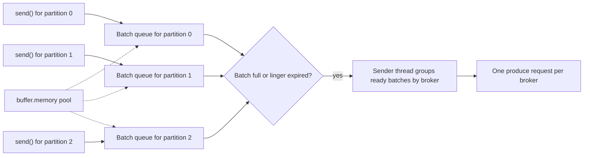

# Batching, Linger and Compression

## Introduction

A Kafka producer almost never sends a single record. It collects records into batches per partition, optionally compresses each batch, and sends many batches in one request. Batching is the reason a single producer can push hundreds of megabytes per second, and it is also the reason a record can sit in memory for a few milliseconds before it leaves your process.

Four settings control this machinery: `batch.size`, `linger.ms`, `buffer.memory` and `compression.type` (plus a compression level since Kafka 3.8). This page explains what each one does, how they interact, how to read the metrics that tell you whether batching is working, and how to choose a codec. The scenario is a clickstream pipeline that was spending more on network transfer than on brokers, contrasted with a trading service where every millisecond counts.

For systematic tuning with benchmarks, continue with [Tuning Producers](../12-kafka-performance/1-kafka-producer-tuning.mdx). This page builds the mental model.

## Why Batch at All

Every request to a broker has a fixed cost: a network round trip, a request header, a disk append on the leader, a replication fetch on each follower. If each record pays that cost alone, the fixed overhead dominates. Batching amortizes it across many records.

Think of a delivery van. Sending the van out for each parcel is fast for the first parcel and ruinous for the business. Waiting until the van is full is efficient but makes the first parcel wait. Real couriers leave when the van is full or when a deadline arrives, whichever comes first. That is precisely `batch.size` and `linger.ms`.

Batching also unlocks compression. Compressing one 300-byte JSON record achieves little; compressing a batch of 200 similar JSON records, with the same field names repeated, often shrinks it by a factor of five to ten. And compression happens once in the producer: the broker stores the compressed batch as is and consumers decompress it, so network, disk and replication traffic all shrink.

## How the Record Accumulator Works



The producer keeps a queue of batches for every partition it writes to. A new record is appended to the open batch at the tail of its partition's queue. A batch becomes **ready** to send when either:

- it has reached `batch.size` bytes, or
- it has existed for `linger.ms` milliseconds, or
- the producer is flushing or closing, or another batch to the same broker is going anyway and the sender can piggyback it.

The single sender thread wakes up, collects all ready batches, groups them by the broker that leads each partition, and sends one request per broker containing all of them (up to `max.request.size`). With five requests allowed in flight per connection, the next request can go out before the first one is acknowledged.

All batches live in one memory pool of `buffer.memory` bytes. When the pool is exhausted, because the brokers are slower than your application or unreachable, `send()` blocks for up to `max.block.ms` and then throws a `TimeoutException`. That blocking is back-pressure: the producer is telling your application to slow down.

## The Settings

| Setting | Default | What it does | Raise it when |
|---|---|---|---|
| `batch.size` | `16384` (16 KiB) | Upper size of one partition's batch in bytes | Records are large or throughput is high; 64 to 256 KiB is common |
| `linger.ms` | `5` | Maximum time a batch waits for more records | Throughput or compression matters more than a few ms |
| `buffer.memory` | `33554432` (32 MiB) | Total memory for all unsent batches | Many partitions, large batches, or brief broker slowdowns cause blocking |
| `max.request.size` | `1048576` (1 MiB) | Largest request, and largest single record | You must send larger records; brokers need matching `message.max.bytes` |
| `compression.type` | `none` | Codec applied to each batch | Almost always worth setting |
| `max.block.ms` | `60000` | How long `send()` may block on a full buffer or missing metadata | Lower it if callers prefer a fast failure |

Two points about defaults. First, `linger.ms` changed from 0 to 5 in Kafka 4.0 (KIP-1030). Measurements showed that waiting a few milliseconds produced larger batches, fewer requests and lower broker load, and often *reduced* end-to-end latency under load because brokers had less work queued. Second, `batch.size` is a ceiling, not a target: a batch is never padded, and with `linger.ms` expiring first, most batches in a quiet system are far smaller than 16 KiB.

A batch is per partition. A producer writing to 500 partitions with `batch.size=262144` could in theory hold 500 open batches of 256 KiB, which is 125 MiB, far above the default buffer. Size `buffer.memory` with your partition count in mind, or rely on the sticky partitioner for keyless records, which concentrates traffic into fewer, fuller batches (see [Keys, Partitioners and Sticky Partitioning](./1-kafka-producer-keys-and-partitioners.mdx)).

```properties
# A throughput-oriented producer for a high-volume event stream.
batch.size=131072
linger.ms=20
compression.type=zstd
buffer.memory=67108864
```

## Compression Codecs

Kafka supports four codecs. The producer compresses whole batches, so the ratio depends heavily on how similar the records in a batch are.

| Codec | Ratio on typical JSON | Producer CPU | Consumer CPU | Good fit |
|---|---|---|---|---|
| `none` | 1x | none | none | Already compressed payloads (images, encrypted data), tiny volumes |
| `gzip` | High | High | Medium | Legacy compatibility; rarely the best choice today |
| `snappy` | Medium | Low | Low | Latency-sensitive services that still want some savings |
| `lz4` | Medium | Very low | Very low | High throughput with minimal CPU; a safe default |
| `zstd` | Highest | Medium, tunable | Low | Network or storage costs dominate; cross-zone or cross-region traffic |

Since Kafka 3.8 (KIP-390) you can set a level for each codec: `compression.gzip.level` (1 to 9), `compression.lz4.level` (1 to 17, default 9) and `compression.zstd.level` (up to 22, default 3). Higher levels compress more and cost more producer CPU; decompression cost barely changes. zstd at its default level 3 is a strong general choice; levels above about 10 rarely pay off for streaming workloads.

The topic also has a `compression.type`, defaulting to `producer`, which means "store whatever the producer sent". If you set a topic to a specific codec and the producer uses a different one, the broker must decompress and recompress every batch, which costs broker CPU and is almost always a mistake. Leave the topic at `producer` and choose the codec in the client.

:::tip
Compression and batching multiply each other. A producer with `compression.type=zstd` but `linger.ms=0` on a low-traffic topic compresses batches of one or two records and gains almost nothing. If compression ratios look poor, check `batch-size-avg` before blaming the codec.
:::

## Reading the Metrics

You cannot tune what you cannot see. The Java producer exposes these metrics over JMX (group `producer-metrics`), and librdkafka clients report equivalents in their statistics callback:

| Metric | What it tells you |
|---|---|
| `batch-size-avg` | Average bytes per batch. Far below `batch.size` means `linger.ms` is expiring first. |
| `records-per-request-avg` | How many records each request carries |
| `compression-rate-avg` | Compressed size divided by uncompressed; 0.2 means 5x smaller |
| `record-queue-time-avg` | How long records wait in the accumulator; roughly your added latency |
| `bufferpool-wait-ratio` | Fraction of time `send()` waits for buffer memory. Non-zero means back-pressure. |
| `request-latency-avg` | Broker round trip per request |

A healthy throughput producer shows `batch-size-avg` close to `batch.size`, a `compression-rate-avg` well below 1, and `bufferpool-wait-ratio` at zero. A latency producer shows small `record-queue-time-avg` and does not care much about batch size.

You can read these in code too, which is handy in tests and for logging at shutdown:

```java
producer.metrics().forEach((name, metric) -> {
    if (name.group().equals("producer-metrics")
            && (name.name().equals("batch-size-avg") || name.name().equals("compression-rate-avg"))) {
        System.out.printf("%s = %s%n", name.name(), metric.metricValue());
    }
});
```

## Worked Scenario: A Clickstream That Cost Too Much

An e-commerce site sends page-view and click events, about 40,000 per second at peak, each a JSON document of around 600 bytes. Producers run in three availability zones and the cloud provider charges for cross-zone traffic. Because the producer writes to the leader (often in another zone) and followers replicate across zones too, every byte is paid for roughly three times.

The team started with the old defaults: `linger.ms=0`, no compression. The metrics showed `batch-size-avg` around 1.8 KiB (three records per batch) and 24 MB/s of raw producer traffic, about 70 MB/s after replication.

They changed three settings:

```java
Properties props = new Properties();
props.put(ProducerConfig.BOOTSTRAP_SERVERS_CONFIG, "broker-1:9092,broker-2:9092,broker-3:9092");
props.put(ProducerConfig.CLIENT_ID_CONFIG, "clickstream-collector");
props.put(ProducerConfig.KEY_SERIALIZER_CLASS_CONFIG, StringSerializer.class.getName());
props.put(ProducerConfig.VALUE_SERIALIZER_CLASS_CONFIG, StringSerializer.class.getName());
// Wait up to 25 ms so each batch collects a few hundred records.
props.put(ProducerConfig.LINGER_MS_CONFIG, "25");
// Allow batches up to 128 KiB so linger, not size, is usually the trigger.
props.put(ProducerConfig.BATCH_SIZE_CONFIG, String.valueOf(128 * 1024));
// zstd compresses repetitive JSON very well; level 3 is the library default.
props.put(ProducerConfig.COMPRESSION_TYPE_CONFIG, "zstd");
```

After the change, `batch-size-avg` rose to about 90 KiB before compression, `compression-rate-avg` settled at 0.14 (seven times smaller), and producer traffic fell from 24 MB/s to under 4 MB/s. The broker request rate dropped by more than 90 percent, which also lowered broker CPU. The cost: `record-queue-time-avg` went from under 1 ms to about 20 ms. For an analytics pipeline whose dashboards refresh every minute, that was irrelevant.

The same company runs an order-matching service for a marketplace auction, where bids must reach the matching engine fast. That producer keeps the default `linger.ms=5`, uses `lz4` for cheap compression, and has a `batch.size` of 32 KiB. The team considered `linger.ms=0` but measured no improvement: under load, the brief linger kept broker queues shorter, and p99 latency was actually slightly better at 5 ms.

The lesson is that there is no universally right value. The alternative to tuning, adding brokers to absorb tiny requests, would have cost far more than a 20 ms delay for the clickstream.

```bash
# Compare settings with the bundled benchmark before changing production.
kafka-producer-perf-test.sh --topic clicks-test --num-records 2000000 --record-size 600 \
  --throughput -1 \
  --producer-props bootstrap.servers=localhost:9092 linger.ms=25 batch.size=131072 compression.type=zstd
```

```text
2000000 records sent, 312500.0 records/sec (178.81 MB/sec), 21.37 ms avg latency, 160.00 ms max latency.
```

Note that the perf tool sends random bytes by default, which do not compress; pass `--payload-file` with real sample records to judge codecs. [Benchmarking with kafka-producer-perf-test and kafka-consumer-perf-test](../12-kafka-performance/5-kafka-benchmarking.mdx) covers this properly.

## Common Mistakes

- **Setting `linger.ms=0` in the belief that it minimizes latency.** Under load it often increases latency by flooding brokers with tiny requests. Measure before deciding.
- **Raising `batch.size` without raising `linger.ms`.** The batch still leaves after 5 ms; the larger ceiling is never reached on modest traffic.
- **Setting a topic-level `compression.type` that differs from the producer's.** The broker recompresses every batch. Keep the topic at `producer`.
- **Compressing data that is already compressed.** JPEGs, encrypted payloads and gzipped blobs only cost CPU.
- **Ignoring `bufferpool-wait-ratio`.** A non-zero value means `send()` is blocking your request threads; you need more buffer, faster brokers or less traffic.
- **Sending records larger than `max.request.size`.** They fail immediately with `RecordTooLargeException`; raising the limit also requires raising the broker's `message.max.bytes` and the consumer's fetch sizes.
- **Benchmarking compression with random payloads.** Random bytes are incompressible and make every codec look useless.

## Summary

- The producer groups records into per-partition batches and sends ready batches to each broker in one request; this amortizes fixed costs and enables compression.
- A batch leaves when it reaches `batch.size` or when `linger.ms` expires, whichever comes first. Kafka 4.0 changed the `linger.ms` default to 5.
- `buffer.memory` bounds unsent data; when full, `send()` blocks for up to `max.block.ms`, which is back-pressure.
- `lz4` is a cheap default, `zstd` gives the best ratio and is tunable with `compression.zstd.level` since 3.8; leave topic compression at `producer`.
- Watch `batch-size-avg`, `compression-rate-avg`, `record-queue-time-avg` and `bufferpool-wait-ratio` to tell whether your settings work.

## Further Reading

- [Producer configuration reference](https://kafka.apache.org/documentation/#producerconfigs): `batch.size`, `linger.ms`, `buffer.memory` and compression settings with defaults.
- [KIP-1030: Change constraints and default values for various configurations](https://cwiki.apache.org/confluence/display/KAFKA/KIP-1030%3A+Change+constraints+and+default+values+for+various+configurations): the 4.0 change of `linger.ms` to 5.
- [KIP-390: Support Compression Level](https://cwiki.apache.org/confluence/display/KAFKA/KIP-390%3A+Support+Compression+Level): per-codec compression levels added in 3.8.
- [Kafka design: efficiency](https://kafka.apache.org/documentation/#maximizingefficiency): why batching and end-to-end compression matter.
- [Producer monitoring metrics](https://kafka.apache.org/documentation/#producer_monitoring): the full list of producer metrics.
- [Throughput, Latency and the Trade-Offs Between Them](../12-kafka-performance/0-kafka-performance-fundamentals.mdx): the broader performance picture.
