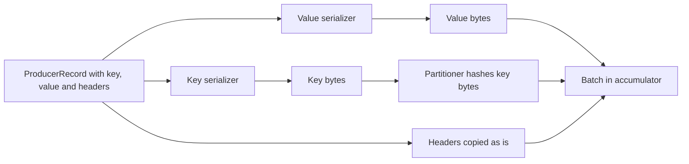

# Serializers and Record Headers

## Introduction

A Kafka broker stores bytes and nothing else. It does not know whether a value is JSON, Avro, a Protobuf message or a JPEG, and it never looks. Turning your `Order` object into bytes, and back again on the consumer side, is entirely the job of the client's serializers.

That makes the serializer the place where your data contract is decided. A careless choice, such as Java object serialization or a JSON layout nobody wrote down, becomes very expensive once five teams consume the topic.

This page covers the serializers that ship with the clients, how to write a custom one, how headers let you attach metadata without touching the payload, and how to carry trace IDs and event types across services. It stops short of schemas: the formats and Schema Registry get their own section, starting with [Choosing a Serialization Format: JSON, Avro, Protobuf](../6-kafka-schemas/0-kafka-serialization-formats.mdx). The running scenario is an order service publishing events that a warehouse, a billing service and a tracing system all read.

## Where Serialization Happens

Serialization runs on the caller's thread inside `send()`, before partitioning. That order matters: the default partitioner hashes the **serialized key bytes**, so two producers that serialize the same logical key differently (a string `"42"` versus a 4-byte integer 42) will route it to different partitions.



Because it runs in `send()`, a serialization failure is thrown synchronously as a `SerializationException`, not delivered to the callback. Wrap the call if your values can be malformed.

A record on the wire has four parts you control: key bytes (nullable), value bytes (nullable), headers, and a timestamp. Everything else (offset, partition) is assigned by Kafka.

## Built-in Serializers

The Java client ships a serializer for each common primitive in `org.apache.kafka.common.serialization`.

| Class | Bytes produced | Typical use |
|---|---|---|
| `StringSerializer` | UTF-8 text | Keys such as ids; JSON values you build yourself |
| `ByteArraySerializer` | The array unchanged | You serialize elsewhere, or you forward bytes |
| `ByteBufferSerializer` | Remaining bytes of the buffer | Zero-copy pipelines |
| `LongSerializer`, `IntegerSerializer`, `ShortSerializer` | Big-endian fixed width | Numeric keys, counters |
| `DoubleSerializer`, `FloatSerializer` | IEEE 754 big-endian | Numeric values |
| `UUIDSerializer` | UUID as UTF-8 string | UUID keys |
| `VoidSerializer` | Always null | Topics with no key or tombstone-only streams |

Pick the key serializer with care. Keys are hashed for partitioning and compared for compaction, so they must be stable and identical across every producer. Strings are the safest common denominator between languages; a Python producer and a Java producer both turn `"order-1001"` into the same UTF-8 bytes, whereas their native integer encodings may differ.

For values, the built-ins are a starting point. Real systems usually use a schema-aware serializer (`KafkaAvroSerializer`, `KafkaProtobufSerializer` or `KafkaJsonSchemaSerializer` from Confluent, or Apicurio equivalents) so that consumers can rely on the structure.

## Writing a Custom Serializer

A custom serializer implements `Serializer<T>`. The common case is JSON with Jackson, which is fine for a small team or a prototype, as long as you treat the JSON layout as a contract.

```java
import com.fasterxml.jackson.databind.ObjectMapper;
import com.fasterxml.jackson.databind.SerializationFeature;
import com.fasterxml.jackson.datatype.jsr310.JavaTimeModule;
import org.apache.kafka.common.errors.SerializationException;
import org.apache.kafka.common.header.Headers;
import org.apache.kafka.common.serialization.Serializer;

import java.nio.charset.StandardCharsets;

/** Serializes any Jackson-compatible object to UTF-8 JSON and records its type in a header. */
public class JsonSerializer<T> implements Serializer<T> {
    // ObjectMapper is thread-safe once configured; the producer may call us from many threads.
    private final ObjectMapper mapper = new ObjectMapper()
        .registerModule(new JavaTimeModule())
        .disable(SerializationFeature.WRITE_DATES_AS_TIMESTAMPS);

    @Override
    public byte[] serialize(String topic, T data) {
        if (data == null) {
            return null;                      // null stays null: a tombstone on compacted topics
        }
        try {
            return mapper.writeValueAsBytes(data);
        } catch (Exception e) {
            throw new SerializationException("cannot serialize " + data.getClass().getSimpleName(), e);
        }
    }

    @Override
    public byte[] serialize(String topic, Headers headers, T data) {
        if (data != null) {
            // The overload with headers lets a serializer describe what it wrote.
            headers.add("content-type", "application/json".getBytes(StandardCharsets.UTF_8));
        }
        return serialize(topic, data);
    }
}
```

```java
record OrderPlaced(String orderId, String customerId, java.math.BigDecimal total,
                   java.time.Instant placedAt) {}

Properties props = new Properties();
props.put(ProducerConfig.BOOTSTRAP_SERVERS_CONFIG, "localhost:9092");
props.put(ProducerConfig.KEY_SERIALIZER_CLASS_CONFIG, StringSerializer.class.getName());
props.put(ProducerConfig.VALUE_SERIALIZER_CLASS_CONFIG, JsonSerializer.class.getName());

try (KafkaProducer<String, OrderPlaced> producer = new KafkaProducer<>(props)) {
    OrderPlaced event = new OrderPlaced("1001", "c-77", new java.math.BigDecimal("42.50"),
        java.time.Instant.parse("2026-10-17T09:30:00Z"));
    producer.send(new ProducerRecord<>("orders", event.orderId(), event));
}
```

Rules for serializers:

- **Be thread-safe.** One producer instance is shared, so one serializer instance is called concurrently.
- **Map null to null.** A null value is a tombstone that deletes a key in a compacted topic; turning it into `"null"` breaks that.
- **Be deterministic for keys.** The same logical key must always produce the same bytes, or partitioning and compaction fall apart. Beware of JSON keys with unordered fields.
- **Never use Java's `ObjectOutputStream`.** The bytes are tied to Java class versions, unreadable from other languages, and deserializing them is a known security risk.

## Record Headers

Headers are an ordered list of key and value pairs attached to each record, added in Kafka 0.11 (KIP-82). Header keys are strings; header values are bytes. Keys may repeat, so a header is closer to an HTTP header list than to a map.

Headers solve a specific problem: metadata that infrastructure needs but the business payload should not contain. Without headers, teams either wrapped every payload in an envelope (`{"meta": ..., "data": ...}`) or squeezed metadata into the key. Both force every consumer to understand the wrapper, and both break when a schema-aware serializer owns the value bytes.

Good uses of headers:

| Header | Purpose |
|---|---|
| `traceparent` | W3C trace context, so a trace continues from the HTTP request into the consumer |
| `event-type` | `OrderPlaced`, `OrderCancelled`; lets consumers route or skip without decoding the value |
| `content-type` | `application/json`, `application/x-protobuf` for topics during a format migration |
| `source` or `producer-app` | Which service wrote the record, for debugging |
| `idempotency-key` | A business id consumers use for deduplication |
| `retry-count`, `original-topic` | Bookkeeping in retry and dead letter topics |

What does not belong in headers: anything a consumer needs to make a business decision that should be versioned with the schema, secrets (headers are not encrypted separately and are visible in every tool), or large blobs. Headers count against the record size limit and are not compressed separately from the batch.

```java
ProducerRecord<String, OrderPlaced> record = new ProducerRecord<>("orders", event.orderId(), event);
record.headers()
    .add("event-type", "OrderPlaced".getBytes(StandardCharsets.UTF_8))
    .add("producer-app", "order-service".getBytes(StandardCharsets.UTF_8))
    .add("traceparent", currentTraceParent().getBytes(StandardCharsets.UTF_8));
producer.send(record);
```

Consumers read them without decoding the value:

```java
for (ConsumerRecord<String, byte[]> r : records) {
    Header type = r.headers().lastHeader("event-type");
    if (type != null && !"OrderPlaced".equals(new String(type.value(), StandardCharsets.UTF_8))) {
        continue;   // the warehouse only cares about new orders
    }
    handle(r);
}
```

Headers are supported by every modern client:

```python
from confluent_kafka import Producer

producer = Producer({"bootstrap.servers": "localhost:9092"})
producer.produce(
    "orders",
    key="1001",
    value=b'{"orderId":"1001","total":42.5}',
    # A list of (str, bytes) tuples keeps order and allows repeated keys.
    headers=[("event-type", b"OrderPlaced"), ("producer-app", b"order-service")],
)
producer.flush()
```

```javascript
await producer.send({
  topic: 'orders',
  messages: [{
    key: '1001',
    value: JSON.stringify({ orderId: '1001', total: 42.5 }),
    headers: { 'event-type': 'OrderPlaced', 'producer-app': 'order-service' },
  }],
});
```

:::tip
Agree on header names and encodings across teams, the same way you agree on field names. A short list in a shared document ("header values are UTF-8 strings, names are lowercase with hyphens") prevents a consumer from finding `eventType`, `event_type` and `Event-Type` on the same topic.
:::

## Worked Scenario: One Order Topic, Three Consumers

The order service publishes `OrderPlaced`, `OrderPaid` and `OrderCancelled` to a single `orders` topic keyed by order id, so that all events for one order stay in sequence. Three consumers read it:

- The **warehouse** only needs `OrderPlaced` and `OrderCancelled`.
- **Billing** needs `OrderPlaced` and `OrderPaid`.
- The **tracing backend** (an OpenTelemetry collector fed by instrumented consumers) needs to stitch each order's journey from the checkout HTTP request through every consumer.

The first version wrapped everything in an envelope: `{"type": "OrderPlaced", "traceId": "...", "payload": {...}}`. When billing moved to Avro with Schema Registry, the envelope became a problem: the Avro serializer owns the whole value, so the type and trace id had to become part of every event schema.

The redesign moved the metadata into headers. The value is now only the event, serialized with the registry-aware serializer. Headers carry `event-type`, `traceparent` and `producer-app`. The warehouse filters on `event-type` and never deserializes `OrderPaid` events at all, saving CPU. The OpenTelemetry instrumentation for the Java client reads and writes `traceparent` automatically, so traces now continue across the topic with no application code.

The alternative of one topic per event type was considered and rejected: it would have broken ordering between `OrderPlaced` and `OrderCancelled` for the same order, because two topics cannot share a partition order.

```bash
# Inspect headers from the console consumer.
kafka-console-consumer.sh --bootstrap-server localhost:9092 --topic orders \
  --from-beginning --max-messages 2 \
  --property print.key=true --property print.headers=true
```

```text
event-type:OrderPlaced,producer-app:order-service	1001	{"orderId":"1001","customerId":"c-77","total":42.50}
event-type:OrderPaid,producer-app:order-service	1001	{"orderId":"1001","paymentId":"p-9"}
```

## Common Mistakes

- **Serializing keys differently in different producers.** The same order id as a string in one service and a long in another lands on different partitions and breaks ordering and compaction.
- **Using Java serialization.** Unreadable outside the JVM, fragile across class changes, and a deserialization security hole.
- **Turning null into a non-null value.** Tombstones stop working and compacted topics keep deleted keys forever.
- **Hiding business data in headers.** Headers are not covered by your schema; fields that matter belong in the value.
- **Putting secrets or personal data in headers.** Every console consumer and UI shows them.
- **Inventing envelope formats instead of headers.** Envelopes force every consumer to unwrap and fight with schema-aware serializers.
- **Catching errors only in the callback.** `SerializationException` is thrown from `send()` itself.

## Summary

- Brokers store bytes; serializers in the client decide the format, and their choice is your data contract.
- Serialization runs in `send()` before partitioning, so key bytes must be identical across all producers of a topic.
- Built-in serializers cover strings, bytes and numbers; custom serializers must be thread-safe, null-preserving and deterministic for keys.
- Headers carry metadata such as event type, trace context and content type without touching the payload, and every major client supports them.
- For anything shared between teams, move to a schema-aware format; see the Schemas section.

## Further Reading

- [Serializer Javadoc](https://kafka.apache.org/43/javadoc/org/apache/kafka/common/serialization/Serializer.html): the interface, including the overload that receives headers.
- [KIP-82: Add Record Headers](https://cwiki.apache.org/confluence/display/KAFKA/KIP-82+-+Add+Record+Headers): why headers were added and how they are encoded.
- [ProducerRecord Javadoc](https://kafka.apache.org/43/javadoc/org/apache/kafka/clients/producer/ProducerRecord.html): constructors that take headers and timestamps.
- [OpenTelemetry Kafka client instrumentation](https://github.com/open-telemetry/opentelemetry-java-instrumentation/tree/main/instrumentation/kafka): automatic trace propagation through headers.
- [Schema Registry: Why and How](../6-kafka-schemas/1-kafka-schema-registry.mdx): the next step once more than one team reads a topic.
