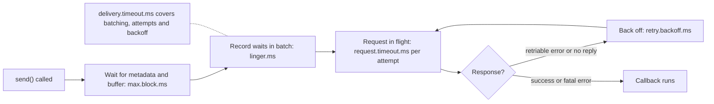

# Producer Errors, Retries and Timeouts

## Introduction

Things go wrong all the time in a Kafka cluster, and most of the time nobody notices. Leaders move during rolling restarts, a broker pauses for garbage collection, a follower falls out of the in-sync set for a few seconds. The producer is built to absorb these: it retries transient errors on its own, inside a time budget you control.

What reaches your code is the remainder: errors that will not go away by retrying, and transient errors that lasted longer than your budget. Handling those well is the difference between a service that degrades gracefully during an incident and one that silently drops data or hangs its request threads.

This page sorts producer errors into the ones the client retries and the ones it does not, explains the timeouts that bound each stage of a send, and shows what to do when a send finally fails. The scenario is a sensor-ingestion gateway that must decide what to do with readings during a broker outage.

## Two Places an Error Can Appear

A send can fail in two places, and code must watch both.

**Synchronously, thrown from `send()`.** These happen before the record enters the accumulator: a `SerializationException` from your serializer, a `TimeoutException` because metadata for the topic could not be fetched or the buffer stayed full for `max.block.ms`, a `RecordTooLargeException` when the serialized record is bigger than `max.request.size`, or an `IllegalStateException` on a closed producer.

**Asynchronously, in the callback or the `Future`.** Everything that happens after the record is buffered: broker rejections, authorization failures, and the final `TimeoutException` when `delivery.timeout.ms` expires.

```java
try {
    producer.send(record, (metadata, exception) -> {
        if (exception != null) {
            handleAsyncFailure(record, exception);    // broker said no, or the time budget ran out
        }
    });
} catch (SerializationException | RecordTooLargeException e) {
    handleBadRecord(record, e);                       // this record can never be sent; do not retry
} catch (org.apache.kafka.common.errors.TimeoutException e) {
    handleBackPressure(record, e);                    // metadata or buffer wait exceeded max.block.ms
}
```

A common bug is to wrap `send()` in a try block, see no exception, and assume success. Most failures arrive later.

## Retriable and Non-Retriable Errors

Every broker error has a class. Those extending `RetriableException` describe conditions expected to clear up: the producer retries them automatically and you only see them if they persist until the deadline. Everything else is reported to your callback at once.

| Error | Retriable | What it usually means |
|---|---|---|
| `NotLeaderOrFollowerException` | yes | Leadership moved; the producer refreshes metadata and resends |
| `NotEnoughReplicasException` | yes | ISR is below `min.insync.replicas`; writes resume when replicas return |
| `NotEnoughReplicasAfterAppendException` | yes | Written to the leader but ISR shrank before replication finished |
| `TimeoutException` (request level) | yes | No response within `request.timeout.ms` |
| `NetworkException`, `DisconnectException` | yes | Connection dropped |
| `UnknownTopicOrPartitionException` | yes | Topic not yet known to this broker, or genuinely missing |
| `CorruptRecordException` | yes | Checksum failure in transit |
| `RecordTooLargeException` | no | Record or batch exceeds broker or topic limits |
| `InvalidRecordException` | no | Broker refused the record, for example a compacted topic and a null key |
| `TopicAuthorizationException`, `ClusterAuthorizationException` | no | Missing ACL |
| `UnsupportedVersionException` | no | Broker too old for a feature the client uses |
| `SerializationException` | no | Your serializer failed |
| `OutOfOrderSequenceException`, `ProducerFencedException` | no | Idempotence or transaction state broken; see the idempotence and transactions pages |

The rule for application code follows from this table: **do not retry in your own code what the producer already retried.** By the time a retriable error reaches you, the producer has been trying for up to two minutes. Retrying again just delays the decision. And do not retry non-retriable errors at all: a record that is too large will be too large forever.

## The Timeouts and How They Nest

The producer has several timeouts, and they confuse people because they bound different stages.



| Setting | Default | Bounds |
|---|---|---|
| `max.block.ms` | `60000` | Time `send()` may block the caller for metadata or buffer space |
| `linger.ms` | `5` | Time a batch waits for more records |
| `request.timeout.ms` | `30000` | One request attempt, waiting for the broker's answer |
| `retry.backoff.ms` | `100` | Initial pause between attempts; grows exponentially |
| `retry.backoff.max.ms` | `1000` | Ceiling for the exponential backoff, with some random jitter |
| `retries` | `2147483647` | Number of attempts; effectively unlimited, so time is the real limit |
| `delivery.timeout.ms` | `120000` | **Everything** after `send()` returns: batching, all attempts, all backoffs |

`delivery.timeout.ms` is the one to reason about. It is the total promise: "within two minutes of `send()`, I will tell you whether this record made it." The client enforces `delivery.timeout.ms >= linger.ms + request.timeout.ms` and refuses to start otherwise.

Think of it like a parcel service's delivery guarantee. Individual attempts (`request.timeout.ms`) can fail and be repeated with pauses in between (`retry.backoff.ms`), but the overall promise is "delivered within two days, or we call you" (`delivery.timeout.ms`).

Why not just set `retries=3` like in older guides? Because a count is the wrong unit. Three retries against a leader election that takes 10 seconds might fail in under a second with fast errors; against a slow network they might take 90 seconds. A time budget matches what your business actually cares about. Since Kafka 2.1 (KIP-91) the recommended practice is to leave `retries` at its default and tune `delivery.timeout.ms`.

:::warning
Retries without idempotence can reorder and duplicate records. With idempotence on (the default), the broker drops duplicates and preserves order with up to five in-flight requests. If you have disabled idempotence, either re-enable it or set `max.in.flight.requests.per.connection=1` and accept lower throughput. See [The Idempotent Producer](./3-kafka-idempotent-producer.mdx).
:::

## What To Do When a Send Finally Fails

When the callback receives an exception, the producer has given up on that record. Your options depend on what the data is worth and whether order matters.

| Strategy | When to use | Trade-off |
|---|---|---|
| Log and count, then drop | Telemetry, clickstream, metrics | Simple; data is lost, so alert on the counter |
| Write to a local fallback (disk spool, outbox table) | Data that must not be lost, and you control a durable store | Needs a replay process; order across the gap may break |
| Fail the upstream request | Synchronous APIs where the caller can retry | Pushes the problem to the client; good for low volume |
| Stop the application | Ordering per key is critical and a gap is worse than downtime | Downtime instead of inconsistency |

One more subtle point: when a batch fails, later batches for the same partition that were already in flight may succeed. Without care you can end up with records 1, 2, 4, 5 on the partition and 3 in your fallback store. Idempotence prevents gaps caused by internal retries, but not gaps caused by a record that permanently failed. If per-key order across failures matters, stop producing to that key (or the whole service) until the failed record is resolved. The transactional outbox, in [The Transactional Outbox Pattern](../9-kafka-patterns/1-kafka-outbox-pattern.mdx), avoids the problem by publishing strictly in database order.

Callbacks run on the producer's I/O thread, so the fallback must be cheap. Hand the record to a queue or executor; do not write to a slow database inside the callback. Since Kafka 4.1 (KIP-1118), calling `flush()` from inside a callback throws instead of deadlocking.

## Worked Scenario: A Sensor Gateway During an Outage

A factory runs 8,000 vibration sensors. A gateway service receives readings over MQTT and publishes them to a `vibration-readings` topic, about 4,000 readings per second, keyed by sensor id. A predictive-maintenance model reads the topic. Losing a few seconds of data is acceptable; losing an hour hides the early signs of a failing bearing.

The team's first version used defaults and logged failures. During a planned maintenance window, two of three brokers were down for 25 minutes. With `min.insync.replicas=2`, every partition rejected writes with `NotEnoughReplicasException`. The producer retried happily for two minutes per record, the 32 MiB buffer filled within seconds, `send()` began blocking for 60 seconds per call, and the MQTT receiver threads stalled. The MQTT broker then disconnected the gateway for being unresponsive. When Kafka came back, 25 minutes of readings were simply gone.

The redesign made three decisions explicit:

1. **Bounded blocking.** `max.block.ms=2000`: the MQTT thread never waits longer than two seconds. A blocked `send()` is treated as "Kafka unavailable" rather than freezing the gateway.
2. **A shorter delivery budget.** `delivery.timeout.ms=30000`. After 30 seconds, a reading is better spooled locally than waiting in memory.
3. **A disk spool.** Failed readings go to an append-only local file, and a background task replays it when the producer is healthy again. The model tolerates late readings because each carries its own timestamp.

```java
Properties props = new Properties();
props.put(ProducerConfig.BOOTSTRAP_SERVERS_CONFIG, "broker-1:9092,broker-2:9092,broker-3:9092");
props.put(ProducerConfig.CLIENT_ID_CONFIG, "vibration-gateway");
props.put(ProducerConfig.KEY_SERIALIZER_CLASS_CONFIG, StringSerializer.class.getName());
props.put(ProducerConfig.VALUE_SERIALIZER_CLASS_CONFIG, ByteArraySerializer.class.getName());
props.put(ProducerConfig.MAX_BLOCK_MS_CONFIG, "2000");          // never stall MQTT threads for long
props.put(ProducerConfig.DELIVERY_TIMEOUT_MS_CONFIG, "30000");  // total budget per reading
props.put(ProducerConfig.REQUEST_TIMEOUT_MS_CONFIG, "10000");   // must satisfy delivery >= linger + request
props.put(ProducerConfig.LINGER_MS_CONFIG, "20");
props.put(ProducerConfig.COMPRESSION_TYPE_CONFIG, "lz4");

KafkaProducer<String, byte[]> producer = new KafkaProducer<>(props);
Spool spool = new Spool(Path.of("/var/lib/gateway/spool"));
ExecutorService spoolWriter = Executors.newSingleThreadExecutor();

void publish(String sensorId, byte[] reading) {
    ProducerRecord<String, byte[]> record = new ProducerRecord<>("vibration-readings", sensorId, reading);
    try {
        producer.send(record, (meta, ex) -> {
            if (ex == null) {
                return;
            }
            if (ex instanceof RetriableException) {
                // The cluster stayed unhealthy for the whole delivery budget. Keep the reading.
                spoolWriter.execute(() -> spool.append(record));
            } else {
                // Authorization, size or format problem: retrying will not help.
                Metrics.rejectedReadings.increment();
                log.error("reading from {} rejected permanently", sensorId, ex);
            }
        });
    } catch (org.apache.kafka.common.errors.TimeoutException e) {
        // Buffer full or metadata unavailable for 2 s: Kafka is effectively down.
        spool.append(record);
    }
}
```

In the next maintenance window the gateway kept accepting MQTT traffic, spooled about 6 million readings (roughly 1.2 GB on disk), and replayed them within eight minutes after the brokers returned. The model saw late data instead of missing data.

The alternatives were considered. Simply raising `buffer.memory` to hold 25 minutes of readings would have needed several gigabytes of heap and still lost everything on a gateway restart. Dropping readings would have been fine for 30 seconds but not for 25 minutes.

Watch these producer metrics to see trouble before the callbacks start failing:

```bash
# record-error-rate: records that failed permanently.  record-retry-rate: retries in progress.
# bufferpool-wait-ratio: send() blocked on memory.  requests-in-flight: backlog to brokers.
kafka-run-class.sh org.apache.kafka.tools.JmxTool \
  --object-name 'kafka.producer:type=producer-metrics,client-id=vibration-gateway' \
  --attributes record-error-rate,record-retry-rate,bufferpool-wait-ratio \
  --jmx-url service:jmx:rmi:///jndi/rmi://localhost:9999/jmxrmi
```

## Common Mistakes

- **Only catching exceptions around `send()`.** Most failures arrive in the callback or `Future`.
- **Retrying in application code after the producer already retried.** It doubles the wait and, with a new `send()`, creates duplicates idempotence cannot catch.
- **Setting `retries` to a small number.** Use `delivery.timeout.ms` to express how long you are willing to wait; leave `retries` at the default.
- **Leaving `max.block.ms` at 60 seconds in request-handling threads.** A broker outage freezes your web server. Lower it for latency-sensitive callers.
- **Retrying non-retriable errors.** A `RecordTooLargeException` or authorization failure needs a fix, not another attempt.
- **Doing slow work in callbacks.** They share one I/O thread with all deliveries.
- **Assuming a failed record leaves no gap.** Later records for the same partition may already be stored; design for that if order matters.

## Summary

- Errors surface either synchronously from `send()` (serialization, size, metadata or buffer timeouts) or asynchronously in the callback; handle both.
- Retriable errors such as leader changes and ISR shrinkage are retried by the producer; non-retriable ones are reported immediately.
- `delivery.timeout.ms` (two minutes by default) is the total budget after `send()`; `request.timeout.ms` bounds each attempt and `max.block.ms` bounds blocking inside `send()`.
- Leave `retries` at its default and keep idempotence on so retries neither duplicate nor reorder.
- Decide per topic what a final failure means: drop and count, spool and replay, fail upstream, or stop.

## Further Reading

- [Producer configuration reference](https://kafka.apache.org/documentation/#producerconfigs): timeouts, retries and backoff with defaults.
- [KIP-91: Provide Intuitive User Timeouts in The Producer](https://cwiki.apache.org/confluence/display/KAFKA/KIP-91+Provide+Intuitive+User+Timeouts+in+The+Producer): why `delivery.timeout.ms` replaced retry counting.
- [KIP-580: Exponential Backoff for Kafka Clients](https://cwiki.apache.org/confluence/display/KAFKA/KIP-580%3A+Exponential+Backoff+for+Kafka+Clients): the exponential backoff with `retry.backoff.max.ms`.
- [KIP-1118: Add Deadlock Protection on Producer Network Thread](https://cwiki.apache.org/confluence/display/KAFKA/KIP-1118%3A+Add+Deadlock+Protection+on+Producer+Network+Thread): why `flush()` inside a callback now throws.
- [Kafka protocol error codes](https://kafka.apache.org/protocol#protocol_error_codes): every broker error and whether it is retriable.
- [Dead Letter Topics and Retry Topics](../9-kafka-patterns/3-kafka-dead-letter-queues.mdx): patterns for records that cannot be processed.
