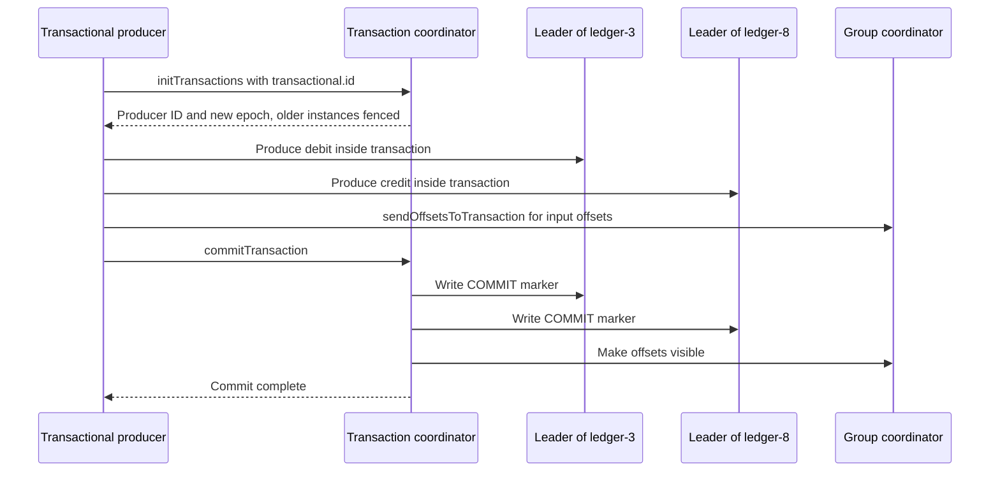

# Transactions and Exactly-Once Producing

## Introduction

The idempotent producer stops duplicates from retries, but only per partition and only within one producer session. Many real pipelines need more: read a record, compute something, write results to two topics and record that the input was handled, all as one unit. If the process crashes halfway, you want either everything to have happened or nothing.

Kafka transactions provide exactly that. A transactional producer can write to any number of partitions and topics and commit consumer offsets in the same atomic step. Consumers configured to read only committed data never see the results of an aborted attempt. Together, this is what Kafka means by "exactly-once semantics" (EOS).

This page explains the problem transactions solve, how the transaction coordinator and markers work, how to write a consume-transform-produce loop in Java, how to handle errors correctly, what changed in Kafka 4.0 with the hardened protocol (KIP-890), and what transactions do **not** cover. The scenario is a bank's transfer processor, where a debit without its matching credit is unacceptable.

## The Problem: Partial Writes and Reprocessing

The transfer processor reads `TransferRequested` events and, for each one, writes a debit to `ledger` for the source account and a credit for the destination account, then commits its input offset.

Without transactions, a crash can land between any two steps:

- After the debit, before the credit: money disappears from the ledger view.
- After both writes, before the offset commit: on restart the processor reads the same request again and writes a second debit and credit.

The idempotent producer helps with neither. The two writes go to different partitions, and the restart creates a new producer ID, so the broker sees the second debit as new.

The usual alternatives are to make every consumer of `ledger` deduplicate by transfer id, or to store the results and offsets in an external database in one local transaction. Both work, and both are what you would choose if your output leaves Kafka. When input and output are both Kafka topics, transactions do the job without a second system.

## How Transactions Work

A transactional producer is configured with a `transactional.id`, a stable name that survives restarts, such as `transfer-processor-0`. Each id maps to one **transaction coordinator**, a broker that keeps the transaction's state in the internal `__transaction_state` topic.



The steps in plain words:

1. **`initTransactions()`** registers the `transactional.id` with the coordinator. The coordinator returns the producer ID, bumps the epoch, and finishes or aborts any transaction a previous instance left open. Any older instance with the same id is now **fenced**: its next request fails with `ProducerFencedException`. This is how Kafka prevents a "zombie" (a paused instance that wakes up after its replacement started) from writing.
2. **`beginTransaction()`** starts a transaction locally.
3. **`send()`** writes records to their partitions as usual. They are appended to the logs immediately, but marked as part of an open transaction.
4. **`sendOffsetsToTransaction()`** adds the consumer's input offsets to the same transaction.
5. **`commitTransaction()`** flushes outstanding records and asks the coordinator to commit. The coordinator writes a decision to its log, then writes a small **commit marker** into every partition that took part. **`abortTransaction()`** writes abort markers instead.

Readers decide what they see through `isolation.level`. With `read_committed`, a consumer only reads up to the **last stable offset**: the first offset that belongs to a still-open transaction. Records from aborted transactions are filtered out. With the default `read_uncommitted`, consumers see everything, including records that are later aborted.

Think of it as writing a cheque in pencil. The records are physically on the page, but the bank teller (a `read_committed` consumer) ignores them until the ink signature (the commit marker) appears, and skips them entirely if the cheque is torn up (the abort marker).

## Consume-Transform-Produce in Java

This is the canonical exactly-once loop. The consumer must have auto-commit disabled and read committed data; the producer has a `transactional.id`.

```java
import org.apache.kafka.clients.consumer.*;
import org.apache.kafka.clients.producer.*;
import org.apache.kafka.common.KafkaException;
import org.apache.kafka.common.TopicPartition;
import org.apache.kafka.common.errors.*;
import org.apache.kafka.common.serialization.*;

import java.time.Duration;
import java.util.*;

public class TransferProcessor {
    public static void main(String[] args) {
        Properties c = new Properties();
        c.put(ConsumerConfig.BOOTSTRAP_SERVERS_CONFIG, "localhost:9092");
        c.put(ConsumerConfig.GROUP_ID_CONFIG, "transfer-processor");
        c.put(ConsumerConfig.ENABLE_AUTO_COMMIT_CONFIG, "false");          // offsets go in the transaction
        c.put(ConsumerConfig.ISOLATION_LEVEL_CONFIG, "read_committed");    // never read aborted input
        c.put(ConsumerConfig.KEY_DESERIALIZER_CLASS_CONFIG, StringDeserializer.class.getName());
        c.put(ConsumerConfig.VALUE_DESERIALIZER_CLASS_CONFIG, StringDeserializer.class.getName());

        Properties p = new Properties();
        p.put(ProducerConfig.BOOTSTRAP_SERVERS_CONFIG, "localhost:9092");
        // Stable across restarts of this instance; unique per instance.
        p.put(ProducerConfig.TRANSACTIONAL_ID_CONFIG, "transfer-processor-" + args[0]);
        p.put(ProducerConfig.KEY_SERIALIZER_CLASS_CONFIG, StringSerializer.class.getName());
        p.put(ProducerConfig.VALUE_SERIALIZER_CLASS_CONFIG, StringSerializer.class.getName());

        try (KafkaConsumer<String, String> consumer = new KafkaConsumer<>(c);
             KafkaProducer<String, String> producer = new KafkaProducer<>(p)) {

            producer.initTransactions();                     // fences older instances with this id
            consumer.subscribe(List.of("transfer-requests"));

            while (true) {
                ConsumerRecords<String, String> records = consumer.poll(Duration.ofMillis(500));
                if (records.isEmpty()) {
                    continue;
                }
                try {
                    producer.beginTransaction();
                    for (ConsumerRecord<String, String> r : records) {
                        Transfer t = Transfer.parse(r.value());
                        producer.send(new ProducerRecord<>("ledger", t.from(), t.debitJson()));
                        producer.send(new ProducerRecord<>("ledger", t.to(), t.creditJson()));
                    }
                    producer.sendOffsetsToTransaction(nextOffsets(records), consumer.groupMetadata());
                    producer.commitTransaction();
                } catch (ProducerFencedException | OutOfOrderSequenceException | AuthorizationException e) {
                    // Fatal: another instance took over, or state is broken. Stop this one.
                    throw e;
                } catch (KafkaException e) {
                    // Abortable: discard this attempt and reprocess from the last committed offsets.
                    producer.abortTransaction();
                    rewindToCommitted(consumer, records.partitions());
                }
            }
        }
    }

    static Map<TopicPartition, OffsetAndMetadata> nextOffsets(ConsumerRecords<String, String> records) {
        Map<TopicPartition, OffsetAndMetadata> out = new HashMap<>();
        for (TopicPartition tp : records.partitions()) {
            List<ConsumerRecord<String, String>> list = records.records(tp);
            long last = list.get(list.size() - 1).offset();
            out.put(tp, new OffsetAndMetadata(last + 1));    // the next offset to read, not the last one read
        }
        return out;
    }

    static void rewindToCommitted(KafkaConsumer<String, String> consumer, Set<TopicPartition> parts) {
        Map<TopicPartition, OffsetAndMetadata> committed = consumer.committed(parts);
        for (TopicPartition tp : parts) {
            OffsetAndMetadata om = committed.get(tp);
            if (om != null) {
                consumer.seek(tp, om.offset());
            } else {
                consumer.seekToBeginning(List.of(tp));
            }
        }
    }
}
```

Three details are easy to get wrong:

- **Offsets are the next position**, `last + 1`, the same as a normal commit.
- **`consumer.groupMetadata()`** is passed, not just the group id. It carries the member id and generation, so the coordinator can reject offsets from a consumer that has already lost its partitions in a rebalance. That is what makes one shared `transactional.id` per instance safe since Kafka 2.5 (KIP-447); older code had to create one producer per input partition.
- **After an abort, rewind.** The consumer's in-memory position has already moved past the records; seeking back to the committed offsets makes the next poll reprocess them.

Since Kafka 4.1 (KIP-1050), the Java client groups transactional errors into clearer categories, such as `TransactionAbortableException` for "abort and retry" and application-recoverable errors for "close and recreate the producer". The rule of thumb above still holds: fencing and sequence errors are fatal for this instance; everything else, abort and try again.

## The Settings

| Setting | Where | Default | Notes |
|---|---|---|---|
| `transactional.id` | producer | none | Enables transactions and implies idempotence. Stable per instance, unique across instances. |
| `transaction.timeout.ms` | producer | `60000` | The coordinator aborts a transaction open longer than this |
| `isolation.level` | consumer | `read_uncommitted` | Set `read_committed` on every consumer that must not see aborted data |
| `transaction.max.timeout.ms` | broker | `900000` | Upper limit a producer may request |
| `transaction.state.log.replication.factor` | broker | `3` | Replication of `__transaction_state`; needs at least three brokers |
| `transaction.state.log.min.isr` | broker | `2` | Durability of coordinator decisions |
| `transactional.id.expiration.ms` | broker | `604800000` | An idle `transactional.id` is forgotten after seven days |

:::note
A single-broker development cluster cannot create `__transaction_state` with the default replication factor of 3, and `initTransactions()` will hang until it times out. Set `transaction.state.log.replication.factor=1` and `transaction.state.log.min.isr=1` on local clusters only, as in [Running Kafka Locally with Docker Compose](../1-kafka-getting-started/0-kafka-docker-compose.mdx).
:::

## Kafka 4.0: The Hardened Transaction Protocol

Transactions had a rare but painful failure mode called a **hanging transaction**. A delayed produce request from an earlier attempt could arrive after that transaction was aborted and silently join the next one, or open a transaction the coordinator never knew about. The partition's last stable offset then stopped advancing, `read_committed` consumers stalled, and compaction could not clean the partition until an operator aborted the transaction by hand with `kafka-transactions.sh`.

KIP-890, enabled by default on the server since Kafka 4.0 through the `transaction.version=2` feature, closes this gap. With 4.0 or newer clients, the producer epoch is bumped at the end of **every** transaction, so a late request from an old transaction carries a stale epoch and is rejected. Partitions are also added to the transaction on the server side as part of the first produce request, which removes a client round trip and the window in which a partition could be written without being registered.

Nothing changes in your code. Producers switch to the new protocol on their next transaction after they detect that the cluster supports it. The practical effect is that hanging transactions, previously a known operational chore, should become very rare with current clients and brokers. Recent 4.x releases also add support for participating in external two-phase commit (KIP-939, `transaction.two.phase.commit.enable`) for systems that coordinate Kafka with a database, an advanced feature most applications do not need.

## What Transactions Do Not Cover

The exactly-once guarantee covers **Kafka in, Kafka out**. It stops at the boundary of the cluster.

- **External side effects.** If the transfer processor also calls a payment API or writes to PostgreSQL inside the loop, an abort cannot undo that call. Use the [transactional outbox](../9-kafka-patterns/1-kafka-outbox-pattern.mdx) or idempotent external writes keyed by a business id.
- **Producers that are not consumers.** A web service publishing events gains atomicity across partitions from transactions, but if the HTTP caller retries after a timeout, that is a new transaction with new records.
- **Consumers using `read_uncommitted`.** They see aborted records. Every downstream reader must opt into `read_committed`.
- **Latency for free.** Records become visible only after commit. A transaction that commits every 100 ms adds about that much end-to-end latency, and every commit costs coordinator round trips and markers.

| Approach | Guarantees | Cost | Choose it when |
|---|---|---|---|
| Idempotent producer only | No retry duplicates per partition | None, default | Plain event publishing |
| Transactions | Atomic multi-partition writes plus offsets | Commit latency, coordinator load | Kafka-to-Kafka processing where duplicates or partial writes are unacceptable |
| Idempotent consumers | Duplicates absorbed at the reader | A dedup store per consumer | Output leaves Kafka, or many producers you do not control |
| Kafka Streams with `exactly_once_v2` | Transactions managed for you | Same as transactions | You are writing a stream processor anyway |

If you write stream processing, Kafka Streams handles all of this with one setting; see [Exactly-Once Processing in Kafka Streams](../7-kafka-streams/6-kafka-streams-exactly-once.mdx).

## Worked Scenario: The Transfer Processor in Production

The bank runs four instances of the transfer processor, with `transactional.id` values `transfer-processor-0` to `-3`, each instance's id fixed by its Kubernetes StatefulSet ordinal. Input is `transfer-requests` with 24 partitions; output is `ledger`, keyed by account id. Statement generation and fraud detection read `ledger` with `isolation.level=read_committed`.

Each poll returns up to a few hundred requests, and one transaction covers the whole batch. Committing per batch rather than per record keeps the overhead low: a commit costs a few milliseconds, spread across hundreds of transfers.

During a node failure, instance 2's pod was frozen for 40 seconds by a stuck disk, and Kubernetes started a replacement with the same id on another node. The replacement's `initTransactions()` bumped the epoch and aborted the frozen instance's open transaction. When the old pod woke up and tried to commit, it received `ProducerFencedException` and exited. The ledger contained no partial transfers and no duplicates; the statement job, reading committed data only, never saw the aborted debits.

An operator can inspect transactions when something looks stuck:

```bash
kafka-transactions.sh --bootstrap-server localhost:9092 list

kafka-transactions.sh --bootstrap-server localhost:9092 describe \
  --transactional-id transfer-processor-2
```

```text
CoordinatorId	TransactionalId       	ProducerId	ProducerEpoch	TransactionState	TransactionTimeoutMs	CurrentTransactionStartTimeMs	TransactionDurationMs	TopicPartitions
1            	transfer-processor-2	3005      	17           	Ongoing         	60000               	1760690000000                	120                  	ledger-3,ledger-8
```

## Common Mistakes

- **Sharing one `transactional.id` across several running instances.** They fence each other continuously. Use one id per instance, stable across restarts.
- **Forgetting `isolation.level=read_committed` on downstream consumers.** They read aborted records and the whole effort is wasted.
- **Committing offsets with `consumer.commitSync()` instead of `sendOffsetsToTransaction()`.** The offsets are then outside the transaction and reprocessing returns.
- **Not rewinding the consumer after an abort.** The next poll continues past records that were never successfully processed.
- **Treating `ProducerFencedException` as retriable.** It means another instance owns the id; this one must shut down.
- **Calling external services inside the transaction and expecting rollback.** Only Kafka writes are undone.
- **Very long transactions.** `read_committed` consumers wait at the last stable offset; a transaction open for minutes stalls every reader of those partitions.
- **Running transactions on a single-broker dev cluster without lowering the transaction log replication settings.**

## Summary

- Transactions let one producer write to many partitions and commit consumer offsets atomically; with `read_committed` readers, this gives exactly-once processing from Kafka to Kafka.
- A stable `transactional.id` lets the coordinator fence zombie instances and clean up their open transactions.
- The loop is begin, send, `sendOffsetsToTransaction` with the consumer's group metadata, commit; on abortable errors abort and rewind, on fencing errors stop.
- Kafka 4.0 enables the hardened protocol of KIP-890 by default, bumping the epoch every transaction and largely eliminating hanging transactions.
- Guarantees end at the cluster boundary; use the outbox pattern or idempotent consumers for external systems.

## Further Reading

- [KIP-98: Exactly Once Delivery and Transactional Messaging](https://cwiki.apache.org/confluence/display/KAFKA/KIP-98+-+Exactly+Once+Delivery+and+Transactional+Messaging): the original transaction design.
- [KIP-447: Producer scalability for exactly once semantics](https://cwiki.apache.org/confluence/display/KAFKA/KIP-447%3A+Producer+scalability+for+exactly+once+semantics): why `groupMetadata()` lets one producer per instance suffice.
- [KIP-890: Transactions Server-Side Defense](https://cwiki.apache.org/confluence/display/KAFKA/KIP-890%3A+Transactions+Server-Side+Defense): the protocol hardening enabled in 4.0.
- [Transaction protocol operations guide](https://kafka.apache.org/43/operations/transaction-protocol/): enabling, upgrading and downgrading `transaction.version`.
- [KafkaProducer Javadoc](https://kafka.apache.org/43/javadoc/org/apache/kafka/clients/producer/KafkaProducer.html): the transactional API and its exceptions.
- [KIP-1050: Consistent error handling for Transactions](https://cwiki.apache.org/confluence/display/KAFKA/KIP-1050%3A+Consistent+error+handling+for+Transactions): the error categories introduced in 4.1.
