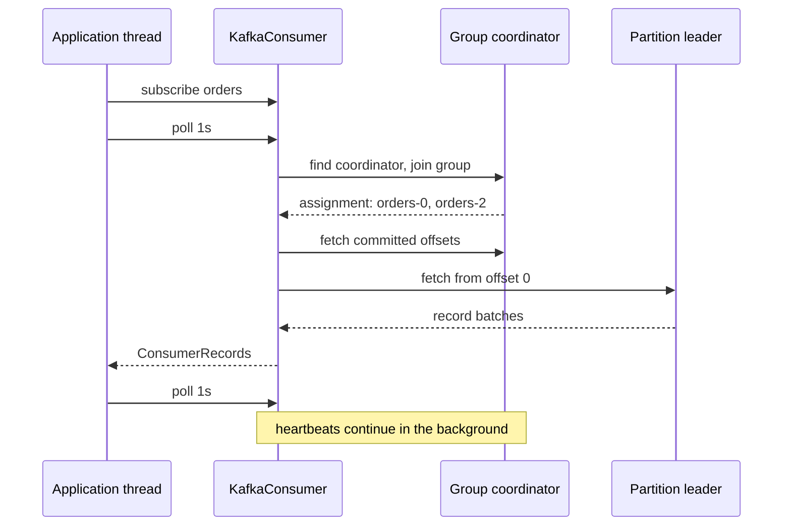

# Consumer Basics: The Poll Loop

## Introduction

A Kafka consumer is a program that asks brokers for records and processes them. That sounds trivial, but almost every consumer bug in production traces back to a misunderstanding of one thing: the poll loop. Unlike a message broker that pushes messages to you, Kafka waits for you to ask. Your call to `poll()` is not just "give me data"; it is also how the consumer proves it is alive, how it joins its group, how it commits offsets in the background and how it learns that partitions have been taken away from it.

By the end of this page you will be able to write a correct, shutdown-safe consumer in Java, understand what each configuration setting on the critical path does, and recognise the poll loop in the Python, Node and Go clients because the shape is the same everywhere.

The scenario running through this page is an **order service**. A checkout application produces one event per order to the `orders` topic, and the service you are writing reads those events and writes them into a fulfilment database. Later pages in this section add consumer groups, rebalances, offsets and delivery guarantees to the same scenario.

## Pull, Not Push

Kafka consumers pull. The consumer sends a fetch request to the partition leader saying "I am at offset 4,210 of partition 3, send me what you have from there". The broker answers with a batch of records (or waits a little, up to `fetch.max.wait.ms`, until at least `fetch.min.bytes` are available).

Why pull? Because it puts the consumer in charge of its own pace. A slow consumer simply polls less often and lag builds up on the broker's disk, where it is cheap and durable. A push system has to decide what to do when the receiver cannot keep up: buffer in memory, drop, or apply back-pressure. With Kafka, that decision never needs to be made in the broker. The trade-off is that a consumer that stops polling is indistinguishable, for a while, from one that is merely busy, which is exactly what the liveness settings on [Heartbeats, max.poll.interval.ms and Liveness](./5-kafka-consumer-liveness.mdx) are for.

The alternative the order service team considered was RabbitMQ, where the broker pushes to a consumer with a prefetch window. That model is excellent for work queues with many small, independent tasks. The order service wanted something different: the ability to re-read yesterday's orders when a bug corrupted the fulfilment database. A pull-based log with retention gives that replay for free; a queue that deletes on acknowledgement does not.

## The Minimal Consumer

Here is the smallest useful consumer for the order service, using `org.apache.kafka:kafka-clients` 4.x.

```java
import org.apache.kafka.clients.consumer.ConsumerConfig;
import org.apache.kafka.clients.consumer.ConsumerRecord;
import org.apache.kafka.clients.consumer.ConsumerRecords;
import org.apache.kafka.clients.consumer.KafkaConsumer;
import org.apache.kafka.common.serialization.StringDeserializer;

import java.time.Duration;
import java.util.List;
import java.util.Properties;

public class OrderConsumer {
    public static void main(String[] args) {
        Properties props = new Properties();
        props.put(ConsumerConfig.BOOTSTRAP_SERVERS_CONFIG, "localhost:9092");
        props.put(ConsumerConfig.GROUP_ID_CONFIG, "fulfilment-service");
        props.put(ConsumerConfig.KEY_DESERIALIZER_CLASS_CONFIG, StringDeserializer.class.getName());
        props.put(ConsumerConfig.VALUE_DESERIALIZER_CLASS_CONFIG, StringDeserializer.class.getName());
        // Start from the oldest retained record the first time this group runs.
        props.put(ConsumerConfig.AUTO_OFFSET_RESET_CONFIG, "earliest");

        try (KafkaConsumer<String, String> consumer = new KafkaConsumer<>(props)) {
            consumer.subscribe(List.of("orders"));
            while (true) {
                // Block for up to one second waiting for records.
                ConsumerRecords<String, String> records = consumer.poll(Duration.ofSeconds(1));
                for (ConsumerRecord<String, String> record : records) {
                    System.out.printf("partition=%d offset=%d key=%s value=%s%n",
                        record.partition(), record.offset(), record.key(), record.value());
                }
            }
        }
    }
}
```

Three settings are mandatory: `bootstrap.servers`, `key.deserializer` and `value.deserializer`. `group.id` is required as soon as you call `subscribe()`. Everything else has a default.

Run it against a local broker (see [Running Kafka Locally with Docker Compose](../1-kafka-getting-started/0-kafka-docker-compose.mdx)) and produce a few records with the console producer:

```bash
kafka-console-producer.sh --bootstrap-server localhost:9092 \
  --topic orders --property parse.key=true --property key.separator=:
>order-1001:{"customer":"c-42","total":59.90}
>order-1002:{"customer":"c-17","total":12.00}
```

The consumer prints:

```text
partition=2 offset=0 key=order-1001 value={"customer":"c-42","total":59.90}
partition=0 offset=0 key=order-1002 value={"customer":"c-17","total":12.00}
```

## What Happens Inside poll()

`poll()` looks like a simple blocking read, but a lot happens behind it. Understanding the sequence explains most of the consumer's behaviour.



The first `poll()` does the expensive work: it discovers the group coordinator, joins the group, waits for a partition assignment, looks up the last committed offsets and only then starts fetching. Subsequent polls mostly return already-buffered records: the consumer prefetches the next batch while your code is processing the current one, so a healthy consumer rarely waits on the network inside `poll()`.

Two facts about `poll()` matter for correctness:

1. **The timeout is a maximum wait for records, not a guarantee of data.** `poll(Duration.ofSeconds(1))` returns as soon as records are available, or an empty `ConsumerRecords` after one second. An empty result is normal; do not treat it as an error.
2. **Rebalance callbacks and background commits run inside `poll()`, on your thread.** If you stop calling `poll()`, offsets stop being auto-committed, your `ConsumerRebalanceListener` is never invoked and, after `max.poll.interval.ms` (5 minutes by default), the consumer leaves the group.

Since Kafka 4.0 the old `poll(long)` overload is gone; only `poll(Duration)` exists. The difference is more than a type: `poll(Duration)` honours its timeout even while waiting for an assignment, so a consumer that cannot reach its coordinator returns empty instead of hanging forever.

## Deserialization and Record Anatomy

A record arrives as bytes. The deserializers you configure turn the key bytes and the value bytes into objects; the rest of the record is metadata the broker set.

| Field | Where it comes from | Typical use |
| --- | --- | --- |
| `topic()`, `partition()`, `offset()` | Broker | Logging, manual commits, deduplication keys |
| `timestamp()` and `timestampType()` | Producer (`CreateTime`) or broker (`LogAppendTime`) | Windowing, lag in time, replay by time |
| `key()` | Producer | Routing to a partition, grouping related events |
| `value()` | Producer | The payload |
| `headers()` | Producer | Trace IDs, schema IDs, retry counts |
| `leaderEpoch()` | Broker | Fencing stale fetches after leader changes |

For the order service, the key is the order ID and the value is JSON. In a real system you would use a JSON, Avro or Protobuf deserializer backed by a schema registry (see [Schema Registry: Why and How](../6-kafka-schemas/1-kafka-schema-registry.mdx)) rather than parsing strings by hand.

A deserialization failure is one of the few errors `poll()` itself throws. If a producer puts a malformed record on the topic, every poll that reaches that offset throws `RecordDeserializationException` and the consumer is stuck. The exception carries the topic-partition and offset, so the standard fix is to log it, optionally write the raw bytes to a dead letter topic and seek past it:

```java
try {
    records = consumer.poll(Duration.ofSeconds(1));
} catch (RecordDeserializationException e) {
    log.error("Poison record at {} offset {}", e.topicPartition(), e.offset(), e);
    consumer.seek(e.topicPartition(), e.offset() + 1); // skip it
    continue;
}
```

The alternative, a deserializer that returns `null` on bad input, hides the problem and silently drops orders. Failing loudly and skipping deliberately is almost always the better trade.

## Configuration on the Critical Path

You do not need to memorise the consumer configuration reference, but a handful of settings decide how your consumer behaves day to day. Defaults are from the Kafka 4.3 client.

| Setting | Default | What it controls |
| --- | --- | --- |
| `group.id` | none | Which group this consumer joins; required for `subscribe()` |
| `auto.offset.reset` | `latest` | Where to start when the group has no committed offset: `earliest`, `latest`, `none`, or `by_duration:PT24H` style ISO-8601 |
| `enable.auto.commit` | `true` | Whether `poll()` commits offsets in the background |
| `auto.commit.interval.ms` | `5000` | How often auto-commit happens |
| `max.poll.records` | `500` | Upper bound on records returned by one `poll()` |
| `max.poll.interval.ms` | `300000` | How long you may go between polls before the consumer is considered dead |
| `fetch.min.bytes` / `fetch.max.wait.ms` | `1` / `500` | How long the broker may hold a fetch waiting for data |
| `max.partition.fetch.bytes` | `1048576` | Maximum bytes fetched per partition per request |
| `fetch.max.bytes` | `52428800` | Maximum bytes per fetch response across partitions |
| `isolation.level` | `read_uncommitted` | Whether to hide records from open or aborted transactions |
| `client.id` | empty | A name that shows up in broker logs, metrics and quotas |

The `auto.offset.reset` default surprises people. With `latest`, a brand-new consumer group ignores everything already in the topic and only sees records produced after it joins. For the order service that would silently skip every order placed before the first deployment, so it sets `earliest`. The `by_duration` form, added in Kafka 4.0, is useful for a new analytics consumer that wants "the last 7 days" rather than the whole retention window.

`max.poll.records` is not a fetch size; it is a cap on what each `poll()` hands you. Lowering it does not reduce network traffic, but it does reduce the time between polls, which is the cheapest way to stop a slow consumer from being kicked out of its group.

:::tip
Always set `client.id` to something meaningful, such as `fulfilment-service-host-07`. Broker-side request logs, quota violations and the `kafka-consumer-groups.sh --describe` output all show it, and "consumer-fulfilment-service-1" tells nobody which machine to look at.
:::

## Shutting Down Cleanly

The infinite `while (true)` loop above has no way to stop. If the process is killed, the consumer does not leave the group, and the remaining members wait for its session timeout (45 seconds by default) before its partitions are reassigned. During that window nobody processes those partitions.

The consumer is not thread-safe, and the only method you may call from another thread is `wakeup()`. It makes the blocked `poll()` throw `WakeupException`, which gives you a clean exit path:

```java
public class OrderConsumer implements Runnable {
    private final KafkaConsumer<String, String> consumer;
    private final OrderRepository repository;

    @Override
    public void run() {
        try {
            consumer.subscribe(List.of("orders"));
            while (true) {
                ConsumerRecords<String, String> records = consumer.poll(Duration.ofSeconds(1));
                for (ConsumerRecord<String, String> record : records) {
                    repository.save(Order.fromJson(record.value()));
                }
                consumer.commitSync(); // explicit commit after the batch is persisted
            }
        } catch (WakeupException e) {
            // Expected on shutdown; fall through to close().
        } finally {
            consumer.close(); // leaves the group immediately and commits if auto-commit is on
        }
    }

    public void shutdown() {
        consumer.wakeup(); // safe to call from the JVM shutdown hook thread
    }
}
```

Wire `shutdown()` to `Runtime.getRuntime().addShutdownHook(...)`. On close, the consumer sends a leave-group request so partitions move to other members within seconds rather than after a timeout. In Kafka 4.x, `close(Duration)` is deprecated in favour of `close(CloseOptions)`, which also lets you choose whether to leave the group or stay as a static member (see [Consumer Groups and Partition Assignment](./1-kafka-consumer-groups.mdx)).

## The Same Loop in Other Languages

The poll loop has the same shape in every mature client because the protocol imposes it. Python with `confluent-kafka` (built on librdkafka):

```python
from confluent_kafka import Consumer, KafkaError

consumer = Consumer({
    "bootstrap.servers": "localhost:9092",
    "group.id": "fulfilment-service",
    "auto.offset.reset": "earliest",
    "enable.auto.commit": False,
})
consumer.subscribe(["orders"])

try:
    while True:
        msg = consumer.poll(1.0)          # returns one message or None after 1 second
        if msg is None:
            continue
        if msg.error():
            if msg.error().code() == KafkaError._PARTITION_EOF:
                continue                   # reached the end of a partition; not an error
            raise RuntimeError(msg.error())
        save_order(msg.key(), msg.value())
        consumer.commit(msg, asynchronous=False)   # commit this message's offset + 1
except KeyboardInterrupt:
    pass
finally:
    consumer.close()
```

Two differences: `poll()` returns one message rather than a batch (use `consume(num_messages, timeout)` for batches), and errors arrive as messages with `msg.error()` set rather than as exceptions. The threading model is also different: librdkafka runs its own background threads for fetching and heartbeating, so a slow Python loop still heartbeats but still trips `max.poll.interval.ms`.

Go with `franz-go` and Node with `kafkajs` or `@confluentinc/kafka-javascript` follow the same pattern; the client pages, such as [Kafka with Python](../5-kafka-clients/2-kafka-python-client.mdx), [Kafka with Node.js](../5-kafka-clients/3-kafka-node-client.mdx) and [Kafka with Go](../5-kafka-clients/4-kafka-go-client.mdx), show full examples.

## Worked Scenario: From Prototype to Reliable Order Consumer

The team's first version of the fulfilment service was the minimal consumer at the top of this page. It worked in staging and then produced three incidents in its first month.

**Incident one: missed orders.** The group was created with the default `auto.offset.reset=latest` on a topic that already had a week of orders. The first deployment skipped them all. Fix: `earliest`, plus an explicit offset reset for the group, covered on [Seeking, Resetting Offsets and Replaying](./6-kafka-consumer-seek-and-reset.mdx).

**Incident two: duplicates after a crash.** With auto-commit on, offsets were committed every five seconds regardless of whether the database write had happened. A crash mid-batch meant some orders were written twice after restart, and because the first version had no idempotency key, two shipments went out. Fix: `enable.auto.commit=false`, `commitSync()` after the batch is saved, and an upsert on order ID in the database. The reasoning is on [Offsets, Commits and Where to Resume](./3-kafka-offsets-and-commits.mdx).

**Incident three: a stuck partition.** A test producer wrote a record with an invalid body. Every poll threw, the consumer restarted in a crash loop and the partition never advanced. Fix: catch `RecordDeserializationException`, publish the raw bytes to `orders.dlq` and seek past the offset.

The resulting consumer looks like the shutdown-safe version above, with the deserialization guard added. It is about forty lines of code, and every line exists because of a specific failure.

## Common Mistakes

- Treating an empty `poll()` result as a failure and backing off or restarting; empty polls are normal.
- Leaving `auto.offset.reset=latest` on a new group that must process existing data.
- Doing slow work (network calls, batch inserts) between polls without lowering `max.poll.records` or raising `max.poll.interval.ms`, so the consumer is evicted from its group.
- Sharing one `KafkaConsumer` across threads; only `wakeup()` is thread-safe.
- Killing the process without `close()`, so partitions sit idle until the session timeout expires.
- Catching all exceptions inside the loop and continuing, which hides a poison record until the consumer has silently stopped making progress.
- Creating a new `KafkaConsumer` per request or per message; a consumer is a long-lived object with its own connections and buffers.

## Summary

- Kafka consumers pull; `poll()` is where fetching, group membership, heartbeating (for the classic protocol) and offset commits all happen.
- The three required settings are `bootstrap.servers` and the two deserializers; `group.id` is needed for `subscribe()`.
- `auto.offset.reset` only applies when the group has no committed offset; its default `latest` skips existing data.
- `max.poll.records` caps records per poll and is the first knob to turn when processing is slow.
- A deserialization error is thrown from `poll()` with the offending offset; skip it deliberately rather than hiding it.
- Shut down with `wakeup()` from another thread and `close()` in `finally`, so partitions move immediately.
- The same loop shape appears in Python, Node and Go because the protocol dictates it.

## Further Reading

- [KafkaConsumer Javadoc (4.3)](https://kafka.apache.org/43/javadoc/org/apache/kafka/clients/consumer/KafkaConsumer.html): the class documentation with the official examples of each commit style.
- [Consumer configuration reference (4.3)](https://kafka.apache.org/43/configuration/consumer-configs/): every setting with its default and importance.
- [Kafka 4.3 upgrade notes](https://kafka.apache.org/43/getting-started/upgrade/): removed and deprecated consumer APIs since 4.0, including `poll(long)`.
- [confluent-kafka-python Consumer API](https://docs.confluent.io/platform/current/clients/confluent-kafka-python/html/index.html#consumer): the Python equivalent of the poll loop.
