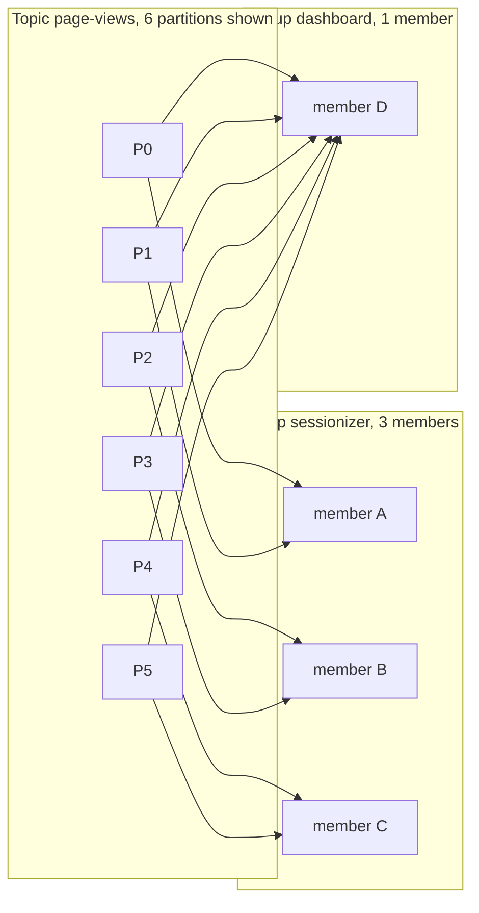

# Consumer Groups and Partition Assignment

## Introduction

A single consumer can read a topic, but a single process has a ceiling: one CPU-bound loop, one network pipe, one point of failure. Consumer groups are how Kafka turns one logical reader into many processes without duplicating work. Members of a group split the topic's partitions between them; each partition is read by exactly one member at a time; and when a member dies, its partitions move to the survivors.

This page explains the mechanics behind that promise: who decides which member gets which partition, where that decision is stored, how a group scales, and the two assignment models (client-side assignors in the classic protocol, server-side assignors in the KIP-848 protocol). You will learn how to pick a group size, when to use static membership, and how to read the output of `kafka-consumer-groups.sh`.

The scenario is a **clickstream**: a web front end produces one event per page view to a `page-views` topic with 24 partitions, keyed by session ID. Several teams want to read it: a sessionisation service, a real-time dashboard and a nightly archiver.

## One Topic, Many Groups, One Reader per Partition

The rules of a consumer group are short:

1. A consumer group is identified by its `group.id`. All consumers with the same `group.id` and the same subscription form one group.
2. Within a group, every partition of every subscribed topic is assigned to exactly one member at a time.
3. Different groups are independent. Each has its own committed offsets, so the dashboard group and the archiver group both read all of `page-views` without affecting each other.



Rule 2 is the one with consequences. Because a partition has one reader, the records within it are processed in order by a single thread, which is what makes "all events for session X are handled in sequence" true. It also caps parallelism: a group can never have more active members than partitions. With 24 partitions, the 25th sessionizer instance will join the group, be assigned nothing and sit idle.

This is the fundamental difference from a queue such as RabbitMQ, where any number of consumers can compete for messages from the same queue. Kafka trades that flexibility for ordering and cheap, broker-side position tracking. If you genuinely need many more consumers than partitions, with no ordering requirement, the answer is a share group, covered on [Queues for Kafka: Share Groups](./7-kafka-share-groups.mdx).

## The Group Coordinator

Every group is managed by one broker acting as its **group coordinator**. Which broker is decided by hashing the `group.id` onto a partition of the internal `__consumer_offsets` topic (50 partitions by default); the leader of that partition is the coordinator. The same topic stores the group's committed offsets and membership metadata, replicated like any other topic (`offsets.topic.replication.factor`, default 3).

The coordinator's job:

- Accept members joining and leaving.
- Track liveness through heartbeats.
- Trigger a rebalance when membership or the partition count changes.
- Persist committed offsets.

Since Kafka 4.0 the coordinator is a rewritten component (the "new group coordinator") with its own thread pool and `group.coordinator.*` settings, and it understands three kinds of groups: classic consumer groups, KIP-848 consumer groups and share groups. The broker setting `group.coordinator.rebalance.protocols` that used to switch protocols on and off is deprecated in 4.3 and scheduled for removal in 5.0; protocols are now controlled by the `group.version`, `share.version` and `streams.version` feature flags.

A consumer finds its coordinator with a `FindCoordinator` request to any bootstrap broker. You never configure it; if the coordinator broker goes down, the leadership of its `__consumer_offsets` partition moves and members rediscover it on their next request.

## Subscribe Versus Assign

There are two ways to tell a consumer what to read.

**`subscribe(topics)` or `subscribe(pattern)`** joins the group and lets the coordinator assign partitions. This is what you want 95 percent of the time: scaling, failover and rebalancing come for free.

**`assign(partitions)`** bypasses group management entirely. The consumer reads exactly the partitions you list, nobody else in any group is affected, and no rebalance ever happens. You still get offset commits if you set a `group.id`, but nobody will take over if the process dies.

| | `subscribe()` | `assign()` |
| --- | --- | --- |
| Partition ownership | Decided by the coordinator | Decided by you |
| Failover | Automatic | None |
| Scaling | Add a member | Change your own deployment |
| Rebalances | Yes | Never |
| Typical use | Services, pipelines | Tooling, replay jobs, Kafka Streams internals, one partition per pod with an external scheduler |

The nightly archiver in the clickstream scenario is a batch job that reads every partition from a start offset to an end offset and exits. It uses `assign()` with all 24 partitions: there is no group to coordinate, and the job does not want to be interrupted by a rebalance halfway through a multi-gigabyte read.

Pattern subscriptions deserve a note. The classic `subscribe(Pattern)` evaluates the regex on the client, which means every consumer fetches all topic metadata and large clusters pay for it. Kafka 4.x adds `subscribe(SubscriptionPattern)`, available only under the KIP-848 protocol, where the broker evaluates the regex (RE2J syntax) and only matching topics are sent to the client.

## Assignors: Who Gets What

When a group forms or changes, someone has to turn "24 partitions, 3 members" into a concrete mapping. That someone is the **assignor**.

### Classic protocol: client-side assignors

In the classic protocol the coordinator picks one member as the **group leader**, sends it the full member list and subscriptions, and the leader runs the assignor locally. The strategy is a client setting, `partition.assignment.strategy`, and the whole group must agree on at least one strategy in common.

| Assignor | Behaviour | Good for | Drawback |
| --- | --- | --- | --- |
| `RangeAssignor` (default, first in list) | Per topic, sorts partitions and members and hands out contiguous ranges | Co-partitioned joins where partition N of two topics should land on the same member | Uneven when partitions do not divide by members; the first members get the extras on every topic |
| `RoundRobinAssignor` | Deals partitions across all topics one by one | Even load with identical subscriptions | Every rebalance can move every partition |
| `StickyAssignor` | Even like round robin, but keeps existing assignments when possible | Reducing churn in state-heavy consumers | Still eager: all partitions are revoked during the rebalance, even those that stay put |
| `CooperativeStickyAssignor` (default, second in list) | Sticky plus the cooperative protocol: only partitions that actually move are revoked | Most services since Kafka 2.4 | Needs two rebalance rounds to settle |

The 4.3 client default is `RangeAssignor,CooperativeStickyAssignor`. Listing both lets a group migrate from range to cooperative sticky with a rolling restart: first deploy with both, then remove `RangeAssignor`. The rebalance mechanics behind "eager" and "cooperative" are on [Rebalancing: Eager, Cooperative and the KIP-848 Protocol](./2-kafka-rebalancing.mdx).

### KIP-848 protocol: server-side assignors

Under the new protocol (`group.protocol=consumer`), the coordinator computes assignments itself. Clients no longer set `partition.assignment.strategy`; instead the broker exposes a list in `group.consumer.assignors` (default `uniform,range`) and a client may pick one with `group.remote.assignor`, or leave it unset to get the broker's first entry.

- **`uniform`** spreads partitions as evenly as possible across members while being sticky. It is what the classic `CooperativeStickyAssignor`, `StickyAssignor` and `RoundRobinAssignor` map to when a group migrates. Rack-aware assignment is not fully supported yet under the new protocol (tracked in KAFKA-19387), so check the release notes before relying on `client.rack` for placement.
- **`range`** keeps the co-partitioning property of the classic range assignor for applications that join topics by partition number.

Custom assignors are possible (implement `ConsumerGroupPartitionAssignor` on the broker), but client-side custom assignors are not supported under the new protocol, so an application relying on a bespoke `ConsumerPartitionAssignor` must stay on classic or move its logic to the broker.

## Sizing a Group

Three numbers decide the shape of a group: partitions, members and the per-member throughput you can sustain.

For the sessionizer, measurements showed one instance handles about 8,000 events per second before it falls behind. Peak traffic is 60,000 events per second. That calls for at least 8 instances, and the team runs 12 to leave headroom for a failed pod and a traffic spike. With 24 partitions, each instance owns two, and the group can grow to 24 before adding partitions becomes necessary.

Rules of thumb:

- Make the partition count a multiple of your expected member count so the assignment is even. 24 partitions work for 2, 3, 4, 6, 8 or 12 members; 10 partitions over 4 members leaves two members doing 50 percent more work.
- Leave room to grow. Adding partitions later is possible but breaks key-to-partition mapping for existing keys (see [Ordering Guarantees and Message Keys](../2-kafka-topics-and-storage/1-kafka-ordering-and-keys.mdx)), so over-provision partitions a little at creation time.
- Watch lag per partition, not just per group. One hot partition (a bot hammering one session ID) shows up as lag on a single member no matter how many you add. [Consumer Lag: Measuring and Fixing It](../10-kafka-operations/2-kafka-consumer-lag.mdx) covers the diagnosis.

## Static Membership

By default each consumer gets a fresh member ID when it starts. A restart therefore looks to the coordinator like one member leaving and a new one joining: two rebalances for what was really a deployment.

Static membership (`group.instance.id`) gives a consumer a stable identity. If a static member disconnects and reconnects with the same `group.instance.id` within `session.timeout.ms`, the coordinator hands back the same partitions with no rebalance at all.

```properties
group.id=sessionizer
group.instance.id=sessionizer-pod-3
# Classic protocol: give the pod time to restart before its partitions move.
session.timeout.ms=120000
```

The trade-off is in that last line. A static member that has genuinely died keeps its partitions for the full session timeout, during which they are not processed. You are trading faster recovery from real failures for no churn on routine restarts. Static membership earns its keep when:

- Members hold large local state that is expensive to rebuild (RocksDB stores in Kafka Streams, in-memory caches warmed from the partition).
- Pods have stable names, as in a Kubernetes StatefulSet, so the instance ID can be derived from the hostname.
- Restarts are frequent and planned (rolling deployments several times a day).

Under the KIP-848 protocol the client cannot set `session.timeout.ms`; the broker's `group.consumer.session.timeout.ms` (default 45 seconds, bounded by `group.consumer.min.session.timeout.ms` and `group.consumer.max.session.timeout.ms`) applies to everyone. The new protocol makes rebalances cheap enough that many teams drop static membership when they migrate, but it is still supported.

:::warning
Two running consumers must never share a `group.instance.id`. The second to join is fenced with a `FencedInstanceIdException` and must be shut down. A deployment system that starts the new pod before the old one has exited will hit this unless the old pod is told to leave the group without releasing its instance ID.
:::

## Inspecting a Group

The `kafka-consumer-groups.sh` tool shows you exactly what the coordinator sees.

```bash
kafka-consumer-groups.sh --bootstrap-server localhost:9092 --describe --group sessionizer
```

```text
GROUP        TOPIC       PARTITION  CURRENT-OFFSET  LOG-END-OFFSET  LAG   CONSUMER-ID                                HOST          CLIENT-ID
sessionizer  page-views  0          1048221         1048230         9     sessionizer-pod-0-3fc8d6f1-...             /10.0.4.12    sessionizer-pod-0
sessionizer  page-views  1          1047990         1048102         112   sessionizer-pod-0-3fc8d6f1-...             /10.0.4.12    sessionizer-pod-0
sessionizer  page-views  2          1049003         1049003         0     sessionizer-pod-1-e76ea8c3-...             /10.0.4.13    sessionizer-pod-1
...
```

Each row is a partition: the committed offset, the end of the log, the difference (lag) and which member owns it. A `-` in the consumer column means the partition is unassigned, usually because the group is mid-rebalance or has fewer members than partitions in an uneven way.

To see members and their counts:

```bash
kafka-consumer-groups.sh --bootstrap-server localhost:9092 --describe --group sessionizer --members --verbose
```

```text
GROUP        CONSUMER-ID                    HOST        CLIENT-ID          #PARTITIONS  ASSIGNMENT
sessionizer  sessionizer-pod-0-3fc8d6f1-... /10.0.4.12  sessionizer-pod-0  2            page-views(0,1)
sessionizer  sessionizer-pod-1-e76ea8c3-... /10.0.4.13  sessionizer-pod-1  2            page-views(2,3)
```

And the group's overall state:

```bash
kafka-consumer-groups.sh --bootstrap-server localhost:9092 --describe --group sessionizer --state
```

```text
GROUP        COORDINATOR (ID)   ASSIGNMENT-STRATEGY   STATE    #MEMBERS
sessionizer  kafka-2:9092 (2)   uniform               Stable   12
```

`Stable` means everyone has an assignment. `PreparingRebalance` and `CompletingRebalance` are the transitional states of the classic protocol; `Reconciling` and `Assigning` appear for KIP-848 groups. A group that is never `Stable` is rebalancing continuously, and the cause is almost always a member that cannot keep up with `max.poll.interval.ms`.

Kafka 4.x also ships `kafka-groups.sh --list` (KIP-1043), which lists every group in the cluster with its type and protocol. It is handy when a cluster runs a mix of classic, consumer and share groups.

## Worked Scenario: Three Teams, One Topic

The clickstream topic has 24 partitions and three readers with very different needs.

**Sessionizer** (stateful, latency-sensitive): a 12-member group on the KIP-848 protocol with the `uniform` assignor. It keeps per-session state in memory, so rebalances hurt; the new protocol's incremental reassignment limits each rebalance to the partitions that actually move. It uses `group.instance.id` derived from the StatefulSet pod name so that rolling deployments do not move partitions at all.

**Dashboard** (stateless, read-everything): a 2-member group that aggregates counts per URL in a time window and pushes them to a web socket. It is on the classic protocol with `CooperativeStickyAssignor` because the dashboard library has not been upgraded yet, and it can afford a few seconds of rebalance.

**Archiver** (batch): no group at all. A nightly job uses `assign()` on all 24 partitions, reads from the offsets it saved in its own metadata store after the previous run to the current end offsets, writes Parquet files and exits.

Three readers, three membership strategies, zero interference: each group's offsets live in its own rows of `__consumer_offsets`, and the archiver's live in its own database.

## Common Mistakes

- Running more consumers than partitions and wondering why the extra ones are idle.
- Giving two unrelated applications the same `group.id`; they will split the partitions between them and each see half the data.
- Choosing a partition count that does not divide evenly by the planned member count.
- Using `assign()` for a long-running service and then being surprised that nothing takes over when a pod dies.
- Reusing a `group.instance.id` across two live pods during a deployment, which fences one of them.
- Setting `partition.assignment.strategy` to a single new assignor on a rolling deploy without first listing the old one alongside it, so old and new members have no common strategy and the group fails to form.
- Forgetting that under `group.protocol=consumer` the client-side `partition.assignment.strategy`, `session.timeout.ms` and `heartbeat.interval.ms` settings are rejected; the broker owns them.

## Summary

- A consumer group shares a `group.id`; each partition is read by exactly one member, so parallelism is capped by partition count.
- Groups are independent: many groups can read the same topic with separate offsets.
- A broker acting as group coordinator tracks membership and stores offsets in `__consumer_offsets`.
- `subscribe()` gets automatic assignment and failover; `assign()` gives full control and none of either.
- Classic groups run client-side assignors (`RangeAssignor`, `CooperativeStickyAssignor`); KIP-848 groups use broker-side assignors (`uniform`, `range`) selected via `group.remote.assignor`.
- Static membership (`group.instance.id`) avoids rebalances on restarts at the cost of slower recovery from real failures.
- `kafka-consumer-groups.sh --describe` shows assignments, lag and group state; a group that is never `Stable` has a liveness problem.

## Further Reading

- [Consumer rebalance protocol operations guide (4.3)](https://kafka.apache.org/43/operations/consumer-rebalance-protocol/): server-side assignors, migration and limitations of the KIP-848 protocol.
- [KIP-848: The Next Generation of the Consumer Rebalance Protocol](https://cwiki.apache.org/confluence/display/KAFKA/KIP-848%3A+The+Next+Generation+of+the+Consumer+Rebalance+Protocol): the design behind server-side assignment.
- [KIP-345: Static membership](https://cwiki.apache.org/confluence/display/KAFKA/KIP-345%3A+Introduce+static+membership+protocol+to+reduce+consumer+rebalances): the motivation and semantics of `group.instance.id`.
- [Managing consumer groups (4.3 operations)](https://kafka.apache.org/43/operations/basic-kafka-operations/): the `kafka-consumer-groups.sh` reference with sample output.
