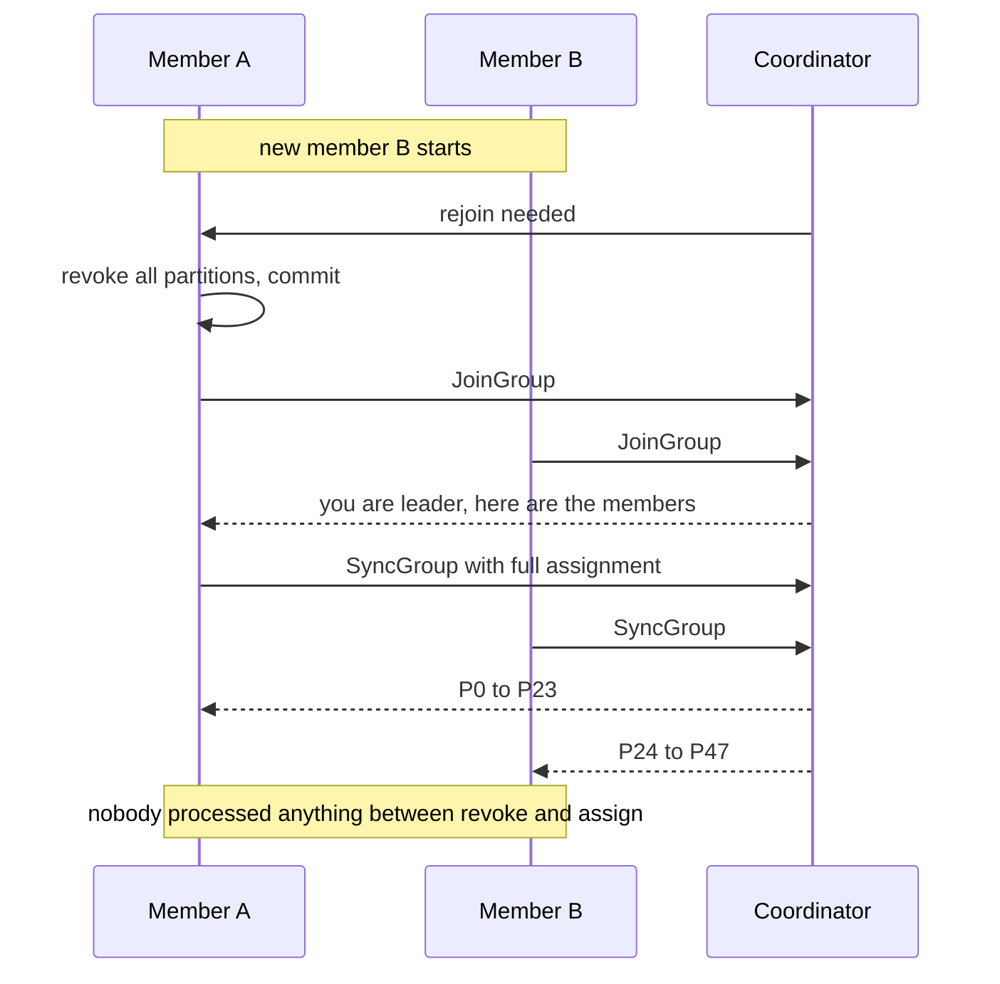
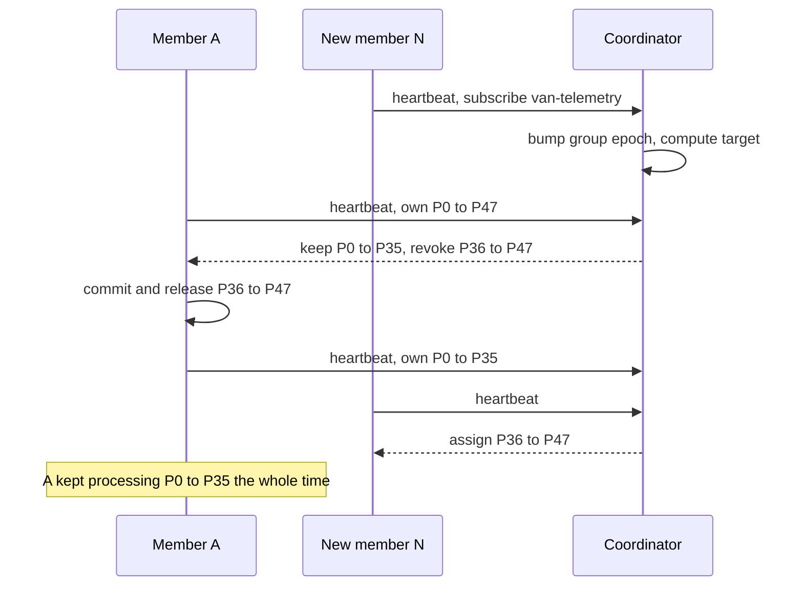

# Rebalancing: Eager, Cooperative and the KIP-848 Protocol

## Introduction

A consumer group is only useful because its membership can change. Pods crash, autoscalers add instances, deployments replace every member one by one. Each time, the partitions have to be dealt out again so that every partition still has exactly one owner. That redistribution is a **rebalance**.

Rebalances are where most of the operational pain of Kafka consumers lives. A badly behaved rebalance stops the whole group for seconds or minutes, throws away in-memory state and produces a burst of duplicate processing. Kafka has gone through three generations of rebalance design to make that pain smaller: the original **eager** protocol, the **cooperative** (incremental) protocol added in Kafka 2.4, and the broker-driven **KIP-848** protocol, which became generally available in Kafka 4.0.

After this page you will be able to name what triggers a rebalance, explain what each protocol does while it runs, write a `ConsumerRebalanceListener` that does not lose work, and decide when and how to move a group to `group.protocol=consumer`.

The scenario is **vehicle telemetry**. A fleet of 40,000 delivery vans sends a GPS and engine reading every five seconds to a `van-telemetry` topic with 48 partitions, keyed by van ID. A `trip-tracker` service keeps the last few minutes of readings per van in memory to detect harsh braking and idle engines. It runs on Kubernetes with a horizontal autoscaler that adds pods during the morning rush.

## What Triggers a Rebalance

A rebalance happens whenever the answer to "who owns which partition" might have changed. The common triggers are:

- **A member joins.** A new pod starts, or an old one restarts with a fresh member ID.
- **A member leaves cleanly.** `close()` sends a leave request.
- **A member is declared dead.** It stopped heartbeating for longer than the session timeout.
- **A member is too slow.** It did not call `poll()` within `max.poll.interval.ms`, so it left the group on its own (see [Heartbeats, max.poll.interval.ms and Liveness](./5-kafka-consumer-liveness.mdx)).
- **The subscription changes.** A member subscribes to a different topic list, or a regex subscription starts matching a newly created topic.
- **Partitions are added** to a subscribed topic.

For the trip tracker, the autoscaler alone can cause a dozen membership changes every morning, and a rolling deployment of 12 pods causes at least 12 more. How much each of those costs depends on the protocol.

## The Eager Protocol: Stop the World

In the original design, the coordinator broker knows the members but does not compute assignments. A rebalance runs as a two-step barrier:

1. Every member is told to rejoin. Before rejoining, **each member revokes all of its partitions**, commits offsets and stops processing.
2. Members send `JoinGroup`. When all have arrived (or the deadline passes), the coordinator picks one member as the leader and sends it the full membership.
3. The leader runs the assignor locally and sends the result in `SyncGroup`. The coordinator hands each member its new partitions.



The weakness is in step 1. Even if the outcome leaves 47 of 48 partitions exactly where they were, every member stops, drops its state and starts again. In a large group the barrier waits for the slowest member, so a single pod stuck in a long processing batch delays everyone. Engineers call this the "stop-the-world" rebalance.

`RangeAssignor`, `RoundRobinAssignor` and `StickyAssignor` all use the eager protocol. Sticky assignment helps a little because partitions usually come back to the same member, but they are still revoked in the meantime.

## The Cooperative Protocol: Only Move What Moves

KIP-429 kept the same `JoinGroup`/`SyncGroup` machinery but changed what members do with it. In a cooperative rebalance:

1. Members rejoin **without revoking anything**. They keep processing the partitions they own while the rebalance runs.
2. The leader computes the target assignment. Any partition that has to move is left out of its old owner's assignment and not yet given to the new owner.
3. The old owner sees that a partition disappeared, revokes just that one and rejoins, which triggers a second, short rebalance.
4. In the second round, the now-free partition goes to its new owner.

Two rounds sound slower, but nothing else stops. When the 13th trip-tracker pod joins a group of 12, about four partitions move and the other 44 never pause. The client gets cooperative behaviour from `CooperativeStickyAssignor`, which is the second entry in the default `partition.assignment.strategy` list (`RangeAssignor,CooperativeStickyAssignor`).

Migrating a live group from an eager assignor to cooperative needs two rolling restarts: first deploy with both assignors listed so that old and new members share a common strategy, then deploy again with only `CooperativeStickyAssignor`. Removing the eager one in a single step leaves old and new members unable to agree.

The cooperative protocol still has limits. Every membership change still runs a group-wide `JoinGroup` round, the leader still needs the full membership, and one slow member still holds the barrier. It reduces the damage of a rebalance but not the coordination.

## The KIP-848 Protocol: The Broker Takes Over

KIP-848, "The Next Generation of the Consumer Rebalance Protocol", throws away the barrier. It was early access in Kafka 3.7, became generally available in Kafka 4.0 and is the recommended protocol for new applications on the current 4.3 release. The client opts in with:

```properties
group.protocol=consumer
```

The default is still `classic`. The Kafka project's published plan is to make `consumer` the default in 5.0 and to drop classic support from the Java consumer in 6.0.

Under KIP-848:

- **There is no group leader and no `JoinGroup`/`SyncGroup`.** Each member sends a periodic `ConsumerGroupHeartbeat` to the coordinator carrying its subscription and the partitions it currently owns.
- **The coordinator computes the target assignment** with a server-side assignor (`uniform` by default, or `range`), described on [Consumer Groups and Partition Assignment](./1-kafka-consumer-groups.mdx).
- **Each member reconciles independently.** The heartbeat response tells a member which partitions to give up and which to take. A member only receives a partition after its previous owner has confirmed releasing it. A group epoch and per-member epochs keep everyone's view consistent.
- **Members never wait for each other.** A slow member delays only the partitions it is releasing, not the whole group.



Liveness settings move to the broker as well. The client settings `session.timeout.ms`, `heartbeat.interval.ms` and `partition.assignment.strategy` are rejected when `group.protocol=consumer`; the broker's `group.consumer.session.timeout.ms` (default 45 seconds) and `group.consumer.heartbeat.interval.ms` (default 5 seconds) apply, and both can be overridden per group as group-level configs. `enforceRebalance()` is not supported either: the broker decides when assignments change.

### Comparing the Three

| | Eager | Cooperative | KIP-848 |
| --- | --- | --- | --- |
| Who computes assignment | Leader member | Leader member | Coordinator broker |
| Partitions paused during rebalance | All | Only those that move | Only those that move |
| Group-wide barrier | Yes | Yes, possibly two rounds | No |
| Slow member blocks others | Yes | Yes | No |
| Client config | `partition.assignment.strategy` | `CooperativeStickyAssignor` | `group.protocol=consumer` |
| Custom client-side assignor | Yes | Yes | No, broker-side only |
| Available since | Always | Kafka 2.4 | GA in Kafka 4.0 |

## Rebalance Listeners: Doing the Right Thing at the Edges

Whatever the protocol, your code finds out about ownership changes through a `ConsumerRebalanceListener`. Its callbacks run inside `poll()` on your thread, which is what makes them safe places to commit and to flush state.

- `onPartitionsRevoked(partitions)`: you are about to lose these partitions in an orderly way. Finish or abandon in-flight work for them and commit their offsets now, while you still own them.
- `onPartitionsAssigned(partitions)`: you now own these. Load any state, or `seek()` to a position you stored yourself.
- `onPartitionsLost(partitions)`: you lost these without an orderly handover, for example after your session expired. Another member may already own them, so **do not commit**; just discard local state.

```java
public class TripTrackerListener implements ConsumerRebalanceListener {
    private final KafkaConsumer<String, Telemetry> consumer;
    private final TripState state;                       // in-memory windows per van
    private final Map<TopicPartition, OffsetAndMetadata> pending;

    public TripTrackerListener(KafkaConsumer<String, Telemetry> consumer,
                               TripState state,
                               Map<TopicPartition, OffsetAndMetadata> pending) {
        this.consumer = consumer;
        this.state = state;
        this.pending = pending;
    }

    @Override
    public void onPartitionsRevoked(Collection<TopicPartition> partitions) {
        // Commit progress for partitions we are handing over, then drop their state.
        Map<TopicPartition, OffsetAndMetadata> toCommit = new HashMap<>();
        for (TopicPartition tp : partitions) {
            OffsetAndMetadata om = pending.remove(tp);
            if (om != null) toCommit.put(tp, om);
            state.evict(tp);
        }
        if (!toCommit.isEmpty()) consumer.commitSync(toCommit);
    }

    @Override
    public void onPartitionsAssigned(Collection<TopicPartition> partitions) {
        // Rebuild windows lazily from incoming data; nothing to load eagerly.
        partitions.forEach(state::init);
    }

    @Override
    public void onPartitionsLost(Collection<TopicPartition> partitions) {
        // Someone else may own these already: never commit here.
        partitions.forEach(tp -> { pending.remove(tp); state.evict(tp); });
    }
}
```

Register it with `consumer.subscribe(List.of("van-telemetry"), listener)`.

With the cooperative and KIP-848 protocols, `onPartitionsRevoked` is called only for the partitions that actually move, and may not be called at all during a rebalance in which you lose nothing. Code written for the eager protocol that assumed "revoked means everything" (for example, clearing all state in one go) needs a second look.

:::warning
Keep listener callbacks short. Under the classic protocol, a callback that takes longer than `max.poll.interval.ms` gets the member kicked out mid-rebalance. Under KIP-848 a slow revocation only delays the handover of those partitions, but it still holds them unprocessed.
:::

## Migrating a Group to KIP-848

The broker side needs nothing on Kafka 4.x: the new protocol is enabled once the cluster's `group.version` feature is at its 4.0 level, which happens when you finalize an upgrade to 4.0 or later. The client side has two options.

**Online migration** is a rolling restart that changes only `group.protocol=consumer`. When the first upgraded member joins, the coordinator converts the classic group into a consumer group and keeps the remaining classic members working through a compatibility path until they are restarted too. This works as long as the classic group uses a standard assignor without custom metadata. Downgrade is the same process in reverse: when the last new-protocol member leaves, the group converts back. The broker setting `group.consumer.migration.policy` (default `bidirectional`; also `upgrade`, `downgrade` and `disabled`) controls which direction is allowed.

**Offline migration** stops every member, so the group is empty, and starts them all with the new setting. It is simpler to reason about but costs a few minutes of no processing.

Before migrating, check three things:

1. **Client support.** The Java client supports `group.protocol=consumer` from 4.0. librdkafka-based clients (confluent-kafka for Python, Go, .NET and JavaScript) support it in their recent releases; check the release notes of the version you run.
2. **Removed settings.** Delete `session.timeout.ms`, `heartbeat.interval.ms` and `partition.assignment.strategy` from the client config, or the consumer fails at start-up. Map any assignor choice to `group.remote.assignor` (`range` or `uniform`).
3. **Custom assignors and `enforceRebalance()` calls.** Neither is supported. Stay on classic until you can replace them.

## Worked Scenario: Morning Rush for the Telemetry Fleet

The trip tracker started on the default configuration: classic protocol, `CooperativeStickyAssignor` (the eager `RangeAssignor` had been removed from the list a year earlier). Every weekday at 07:30 the autoscaler grows the group from 6 to 16 pods over ten minutes.

On the cooperative protocol, each scale-up step triggered two rebalance rounds. Ten new pods meant twenty rounds, and because every round was a group-wide barrier, a pod busy flushing a large batch to the alerting service held up all the others. Dashboards showed lag spikes of 30 to 40 seconds on all 48 partitions, even those that never moved. Harsh-braking alerts arrived late exactly when traffic was heaviest.

The team weighed three options:

- **Static membership** would have helped deployments but not autoscaling, since new pods are genuinely new members.
- **Pre-scaling** before 07:30 would hide the problem but waste capacity the rest of the day.
- **KIP-848** removes the barrier, so only moving partitions pause.

They chose KIP-848 with an online migration: one deployment that removed `partition.assignment.strategy` and `session.timeout.ms` and added `group.protocol=consumer`. During the rollout the group was mixed for about ten minutes and kept working. The next morning's scale-up showed lag spikes only on the partitions being handed over, each lasting about a second, and the untouched partitions showed no spike at all.

The one code change was in the rebalance listener: an old `onPartitionsRevoked` cleared all in-memory windows on every call, which under incremental rebalancing threw away state for partitions the pod was keeping. It now evicts only the revoked partitions, as in the listener above.

## Common Mistakes

- Removing the eager assignor and adding `CooperativeStickyAssignor` in a single rolling deploy, leaving the group with no common strategy.
- Committing offsets in `onPartitionsLost`; those partitions may already belong to another member, and the commit fails or overwrites newer progress.
- Assuming `onPartitionsRevoked` always receives every owned partition; under cooperative and KIP-848 rebalances it receives only the ones moving.
- Leaving `session.timeout.ms` or `partition.assignment.strategy` in the client config after switching to `group.protocol=consumer`, so the consumer refuses to start.
- Treating frequent rebalances as normal. A group that rebalances every few minutes usually has a member exceeding `max.poll.interval.ms` or a crash loop.
- Using an autoscaler that reacts to CPU on consumer pods, which scales up during rebalances and makes them worse. Scale on lag instead.

## Summary

- A rebalance redistributes partitions when members join, leave, die, stall, change subscriptions or when partitions are added.
- The eager protocol revokes every partition from every member and blocks the group behind a barrier.
- The cooperative protocol (`CooperativeStickyAssignor`) revokes only moving partitions but still uses group-wide join rounds.
- KIP-848 (`group.protocol=consumer`, GA since Kafka 4.0) moves assignment to the broker and removes the barrier; members reconcile independently through heartbeats.
- Under KIP-848, session timeout, heartbeat interval and assignor are broker or group settings, not client settings.
- Commit in `onPartitionsRevoked`, never in `onPartitionsLost`, and keep callbacks short.
- Groups can migrate online with a rolling restart, provided they use standard assignors.

## Further Reading

- [Consumer rebalance protocol guide (4.3)](https://kafka.apache.org/43/operations/consumer-rebalance-protocol/): enabling, migrating and the current limitations of KIP-848.
- [KIP-848: The Next Generation of the Consumer Rebalance Protocol](https://cwiki.apache.org/confluence/display/KAFKA/KIP-848%3A+The+Next+Generation+of+the+Consumer+Rebalance+Protocol): the full design, including epochs and reconciliation.
- [KIP-429: Kafka Consumer Incremental Rebalance Protocol](https://cwiki.apache.org/confluence/display/KAFKA/KIP-429%3A+Kafka+Consumer+Incremental+Rebalance+Protocol): how cooperative rebalancing works on top of the classic protocol.
- [ConsumerRebalanceListener Javadoc (4.3)](https://kafka.apache.org/43/javadoc/org/apache/kafka/clients/consumer/ConsumerRebalanceListener.html): exact semantics of the revoked, assigned and lost callbacks.
- [Kafka 4.3 upgrade notes](https://kafka.apache.org/43/getting-started/upgrade/): feature versions such as `group.version` and protocol-related deprecations.
