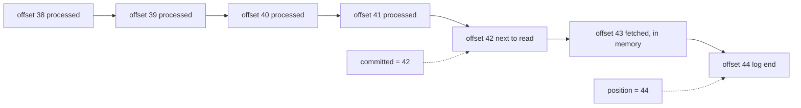

# Offsets, Commits and Where to Resume

## Introduction

A Kafka topic does not forget a record once you have read it. The broker keeps every record until retention removes it, and it is your consumer's job to remember how far it got. That bookmark is the **committed offset**. When a consumer restarts, or a partition moves to another member in a rebalance, the committed offset is the only thing that says where to resume.

Get commits wrong and you either reprocess work (commit too late) or lose it (commit too early). Most "Kafka lost my message" and "Kafka sent it twice" reports are commit problems in the consumer, not broker problems.

By the end of this page you will understand the difference between position and committed offset, know exactly what auto-commit does and does not promise, write manual commits with `commitSync()` and `commitAsync()`, commit per partition, and decide what happens when there is no committed offset at all.

The scenario is a **bank ledger**. A core banking system publishes every posted transaction to a `ledger-postings` topic with 12 partitions, keyed by account number. A `balance-projector` service reads the topic and maintains a balance table in PostgreSQL that the mobile app queries. A posting applied twice shows the customer the wrong balance; a posting skipped is worse.

## Offsets, Positions and Committed Offsets

Every record in a partition has an offset, a 64-bit number that increases by one per record (with gaps after compaction or transaction markers). Offsets are per partition: offset 500 in partition 3 has nothing to do with offset 500 in partition 4.

A consumer tracks two numbers per assigned partition:

| Number | Where it lives | Meaning |
| --- | --- | --- |
| **Position** | Consumer memory | The offset of the next record `poll()` will return |
| **Committed offset** | `__consumer_offsets` on the coordinator | The offset the group will resume from after a restart or rebalance |

The committed offset is, by convention, **the offset of the next record to read**, not the last record processed. If you processed offset 41, you commit 42. Off-by-one mistakes here cause one duplicate (commit 41) or one skipped record (commit 43) per restart.



In this picture the consumer has fetched up to 43, so its position is 44, but it has only finished 41 and committed 42. If it crashes now, the next owner starts at 42 and reprocesses 42 and 43, which were fetched but never committed. That gap between position and committed offset is the window of possible duplicates.

Commits are stored as records in the internal `__consumer_offsets` topic (50 partitions, replication factor 3 by default). The coordinator keeps the latest commit per group, topic and partition in memory and compacts the topic in the background. Committed offsets survive broker restarts, but not forever: once a group has no members, its offsets are deleted after `offsets.retention.minutes`, which defaults to 10,080 minutes (7 days). A consumer that has been switched off for longer than that comes back to no committed offset at all.

## Auto-Commit: Convenient, With Fine Print

With the default `enable.auto.commit=true`, the consumer commits for you every `auto.commit.interval.ms` (5 seconds). The detail that matters is **when**: the commit happens inside a later `poll()` call (and in `close()`), and it commits the position as of the records returned by the *previous* poll.

That gives a precise guarantee. If your code fully processes each batch before calling `poll()` again, auto-commit never commits a record you have not processed, and you get at-least-once delivery. If your code hands records to another thread and returns to `poll()` immediately, auto-commit may commit records that the other thread has not finished, and a crash loses them.

Auto-commit also commits on a timer, not on your schedule. A crash four seconds after the last commit means up to four seconds of records are processed again. For a clickstream counter that is acceptable. For the bank ledger it is not, because applying a posting twice changes a balance.

## Manual Commits: commitSync and commitAsync

Set `enable.auto.commit=false` and commit yourself. The Java client offers two styles.

**`commitSync()`** blocks until the coordinator confirms the commit, retrying transient errors until `default.api.timeout.ms` (60 seconds) runs out. It is simple and safe, at the cost of one round trip per commit.

**`commitAsync(callback)`** sends the commit and returns immediately. The callback reports success or failure later. It does not retry, on purpose: a retried old commit could land after a newer one and move the group backwards.

The standard pattern combines them: asynchronous commits while running for throughput, and one synchronous commit on shutdown so the last progress is not lost.

```java
Properties props = new Properties();
props.put(ConsumerConfig.BOOTSTRAP_SERVERS_CONFIG, "localhost:9092");
props.put(ConsumerConfig.GROUP_ID_CONFIG, "balance-projector");
props.put(ConsumerConfig.ENABLE_AUTO_COMMIT_CONFIG, "false");
props.put(ConsumerConfig.AUTO_OFFSET_RESET_CONFIG, "earliest");
props.put(ConsumerConfig.KEY_DESERIALIZER_CLASS_CONFIG, StringDeserializer.class.getName());
props.put(ConsumerConfig.VALUE_DESERIALIZER_CLASS_CONFIG, PostingDeserializer.class.getName());

KafkaConsumer<String, Posting> consumer = new KafkaConsumer<>(props);
try {
    consumer.subscribe(List.of("ledger-postings"));
    while (running.get()) {
        ConsumerRecords<String, Posting> records = consumer.poll(Duration.ofMillis(500));
        for (ConsumerRecord<String, Posting> record : records) {
            balances.apply(record.value());          // idempotent upsert keyed by posting ID
        }
        consumer.commitAsync((offsets, exception) -> {
            if (exception != null) {
                log.warn("Commit failed for {}; a later commit will cover it", offsets, exception);
            }
        });
    }
} catch (WakeupException e) {
    // shutting down
} finally {
    try {
        consumer.commitSync();                        // make the final position durable
    } finally {
        consumer.close();
    }
}
```

`commitSync()` and `commitAsync()` with no arguments commit the current position of every assigned partition, which is the offset after the last record returned by `poll()`. That is correct only if you processed everything `poll()` returned before committing.

## Committing Specific Offsets

When you want finer control, for instance committing mid-batch, or committing only partitions that finished, pass the offsets explicitly. Remember the plus one.

```java
Map<TopicPartition, OffsetAndMetadata> toCommit = new HashMap<>();
for (TopicPartition tp : records.partitions()) {
    List<ConsumerRecord<String, Posting>> batch = records.records(tp);
    for (ConsumerRecord<String, Posting> record : batch) {
        balances.apply(record.value());
    }
    long lastOffset = batch.get(batch.size() - 1).offset();
    // Commit the NEXT offset to read, with optional metadata for debugging.
    toCommit.put(tp, new OffsetAndMetadata(lastOffset + 1, "host=projector-3"));
}
consumer.commitSync(toCommit);
```

The metadata string is stored alongside the offset and shows up when you read committed offsets back with `consumer.committed(Set.of(tp))` or the Admin API. A host name or batch ID there has saved more than one late-night investigation.

How often to commit is a trade-off between the cost of a commit and the amount of work redone after a crash:

| Strategy | Commits per second | Work redone after a crash | When to use |
| --- | --- | --- | --- |
| Every record | Very high | At most one record | Low volume, very expensive processing |
| Every batch (after each `poll()`) | One per poll | One batch | The usual default for manual commits |
| Every N records or T seconds | Low | Up to N records or T seconds | High volume, cheap and idempotent processing |
| Auto-commit | Every 5 seconds | Up to 5 seconds | Processing is synchronous and duplicates are harmless |

Committing every record from many consumers puts real load on the coordinator and on `__consumer_offsets`; batch-level commits are almost always enough when processing is idempotent.

## Commits and Rebalances

A commit is only accepted from the current owner of a partition. If your consumer lost its partitions, because it was too slow and was removed from the group, a commit for them fails with `CommitFailedException` from `commitSync()` (or an error in the `commitAsync()` callback). This is the group protecting itself: another member may already be processing those records, and an old commit would overwrite its progress.

Treat `CommitFailedException` as a signal, not as something to retry. The records since the last successful commit will be processed again by the new owner. The fix is upstream: make processing faster or the batches smaller, as explained on [Heartbeats, max.poll.interval.ms and Liveness](./5-kafka-consumer-liveness.mdx).

To avoid redoing work at every planned rebalance, commit in `onPartitionsRevoked`, as shown on [Rebalancing: Eager, Cooperative and the KIP-848 Protocol](./2-kafka-rebalancing.mdx). That callback runs while you still own the partitions, so the commit succeeds and the next owner starts exactly where you stopped.

## When There Is No Committed Offset

A consumer falls back to `auto.offset.reset` in two situations: the group has never committed for that partition (a new group, or a partition added recently), or the committed offset is out of range because retention already deleted those records.

| Value | Behaviour | Typical use |
| --- | --- | --- |
| `latest` (default) | Start at the end; only new records are read | Live dashboards, alerting on fresh data |
| `earliest` | Start at the oldest retained record | Projections and pipelines that must see everything |
| `by_duration:P1D` | Start at the first record newer than the duration (ISO-8601) | New consumers that need recent history only (Kafka 4.0 and later) |
| `none` | Throw `NoOffsetForPartitionException` | Critical consumers where silently picking a start is worse than failing |

For the balance projector the team chose `none` in production. If the group ever loses its offsets, for instance after more than 7 days switched off, they want an alert and a deliberate decision, not a silent restart from the end of the topic that skips postings or a restart from the beginning that re-applies months of them.

## Storing Offsets Outside Kafka

Committing to Kafka and writing to a database are two separate actions, so there is always a moment where one has happened and the other has not. One way to close that gap is to store the offset in the same database transaction as the result:

```sql
BEGIN;
UPDATE balances SET amount = amount + 250.00 WHERE account_id = 'ACC-1029';
INSERT INTO consumer_progress (consumer_group, topic, kafka_partition, next_offset)
VALUES ('balance-projector', 'ledger-postings', 7, 918244)
ON CONFLICT (consumer_group, topic, kafka_partition)
DO UPDATE SET next_offset = EXCLUDED.next_offset;
COMMIT;
```

On start-up, or in `onPartitionsAssigned`, the consumer reads `next_offset` for each assigned partition and calls `consumer.seek(tp, nextOffset)`. Kafka's committed offsets then serve only for monitoring. This gives effectively-once results in the database, and it is covered in more depth on [At-Most-Once, At-Least-Once and Exactly-Once](./4-kafka-delivery-semantics.mdx).

## Worked Scenario: The Projector Restart

The first version of the balance projector used auto-commit. During a routine deployment, a pod received `SIGKILL` before its graceful shutdown finished. On restart, about three seconds of postings, a few hundred records, were applied a second time. Forty customers saw inflated balances until a reconciliation job caught it the next morning.

The team considered two fixes. One was to keep auto-commit and make every posting application idempotent by recording processed posting IDs. The other was to move the offset into the database transaction. They did both, for defence in depth:

1. `enable.auto.commit=false`.
2. Each batch is applied in one PostgreSQL transaction that also updates `consumer_progress`.
3. The balances table has a `processed_postings` side table with the posting ID as primary key, so a replayed posting is a no-op.
4. The consumer still calls `commitAsync()` after each batch so that `kafka-consumer-groups.sh --describe` and lag alerts keep working.
5. `auto.offset.reset=none`, with an alert on the resulting exception.

Inspecting the group afterwards shows the committed offsets moving in step with the database:

```bash
kafka-consumer-groups.sh --bootstrap-server localhost:9092 --describe --group balance-projector
```

```text
GROUP              TOPIC            PARTITION  CURRENT-OFFSET  LOG-END-OFFSET  LAG  CONSUMER-ID           HOST         CLIENT-ID
balance-projector  ledger-postings  6          903311          903315          4    projector-1-a8c2...   /10.0.7.21   projector-1
balance-projector  ledger-postings  7          918244          918244          0    projector-1-a8c2...   /10.0.7.21   projector-1
```

## Common Mistakes

- Committing the offset of the last processed record instead of that offset plus one, so one record is reprocessed after every restart.
- Using auto-commit while processing on a separate thread pool, which commits records before they are processed.
- Retrying a failed `commitAsync()` inside its callback, which can move the committed offset backwards.
- Calling `commitSync()` after every single record on a high-volume topic and overloading the coordinator.
- Ignoring `CommitFailedException` and assuming the records were committed.
- Leaving a group idle for more than `offsets.retention.minutes` and being surprised when it restarts from `auto.offset.reset`.
- Using `latest` for a consumer that must not miss anything, so the first deployment skips existing data.

## Summary

- The committed offset is the next offset to read, stored per group and partition in `__consumer_offsets`.
- Position (in memory) runs ahead of the committed offset; the gap is what gets reprocessed after a crash.
- Auto-commit commits the previous poll's position on a timer and gives at-least-once only if processing finishes before the next poll.
- Use `commitAsync()` in the loop and `commitSync()` on shutdown; commit explicit maps for per-partition control.
- `CommitFailedException` means you no longer own the partition; fix processing speed rather than retrying.
- `auto.offset.reset` applies only without a valid committed offset; choose `earliest`, `latest`, `by_duration` or `none` deliberately.
- Storing offsets in the same database transaction as results closes the gap between processing and committing.

## Further Reading

- [KafkaConsumer Javadoc (4.3)](https://kafka.apache.org/43/javadoc/org/apache/kafka/clients/consumer/KafkaConsumer.html): offset management, manual commits and storing offsets outside Kafka.
- [Consumer configuration reference (4.3)](https://kafka.apache.org/43/configuration/consumer-configs/): `enable.auto.commit`, `auto.commit.interval.ms` and `auto.offset.reset`.
- [Broker configuration reference (4.3)](https://kafka.apache.org/43/configuration/broker-configs/): `offsets.retention.minutes` and the `__consumer_offsets` topic settings.
- [KIP-1106: Add duration based offset reset option](https://cwiki.apache.org/confluence/display/KAFKA/KIP-1106%3A+Add+duration+based+offset+reset+option+for+consumer+clients): the design of `by_duration`.
