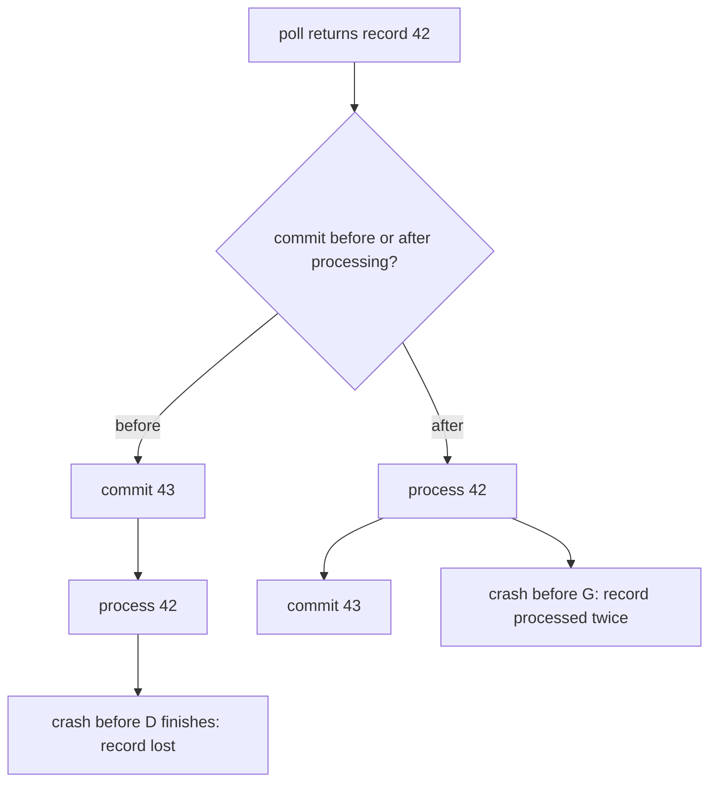

# At-Most-Once, At-Least-Once and Exactly-Once

## Introduction

"Does Kafka guarantee exactly-once delivery?" is one of the most common questions about Kafka, and the honest answer is "it depends on where the data ends up". Kafka gives you building blocks, and the guarantee your application actually provides depends on how you combine them: where you commit offsets relative to processing, whether your writes are idempotent, and whether you use transactions.

This page defines the three guarantees in terms of what a consumer does, shows the code pattern for each, and explains the limits of Kafka's exactly-once support. You will be able to look at a consumer and say which guarantee it gives, and choose the cheapest one your use case can live with.

The scenario is a **payments platform**. A `payment-requests` topic receives card payment instructions. A `payment-processor` service reads them, calls the card network, writes a result to a `payment-results` topic and sends a confirmation email. Duplicates mean a customer is charged twice; losses mean a payment silently never happens.

## Where Duplicates and Losses Come From

A consumer does two things for each record: it **processes** the record (a side effect: a database write, an API call, a produced record) and it **commits** the offset. These are two separate operations against two separate systems, and a crash can fall between them.

- **Commit first, then process.** A crash after the commit but before processing finishes means the record is never processed. The group resumes after it.
- **Process first, then commit.** A crash after processing but before the commit means the record is processed again by whoever takes over.

There is no ordering of two independent operations that avoids both. That single observation explains all three guarantees.



## At-Most-Once

Each record is processed zero or one times. You get it by committing before processing.

```java
ConsumerRecords<String, String> records = consumer.poll(Duration.ofMillis(500));
consumer.commitSync();                 // progress is saved before any work happens
for (ConsumerRecord<String, String> record : records) {
    metrics.increment(record.value()); // if we crash here, these records are skipped
}
```

At-most-once is the right choice when a lost record is cheap and a duplicate is harmful or confusing, and when the data is quickly superseded anyway. Examples: high-frequency sensor readings where the next value arrives in a second, or "user is typing" indicators. It is wrong for anything involving money, orders or state that is not replaced by the next record.

Auto-commit combined with asynchronous processing on another thread accidentally behaves like at-most-once: offsets are committed by the poll loop while the worker thread may still be holding unprocessed records.

## At-Least-Once

Each record is processed one or more times. You get it by processing first and committing after, which is what the manual-commit examples on [Offsets, Commits and Where to Resume](./3-kafka-offsets-and-commits.mdx) do. It is also what auto-commit gives you when processing finishes inside the poll loop.

At-least-once is the practical default for most Kafka consumers, and it becomes as good as exactly-once **if processing is idempotent**: doing it twice has the same effect as doing it once. Common ways to get there:

- **Upserts keyed by a business ID.** `INSERT ... ON CONFLICT (payment_id) DO NOTHING` makes a replayed payment result a no-op.
- **A processed-IDs table** written in the same transaction as the side effect.
- **Idempotency keys on external APIs.** Most card networks and payment providers accept an idempotency key; sending the same request twice with the same key charges once.
- **Natural idempotence.** Setting a value ("van 17 is at position X") is idempotent; adding to a value ("balance plus 50") is not.

The pattern is developed fully on [Idempotent Consumers and Deduplication](../9-kafka-patterns/4-kafka-idempotent-consumers.mdx).

## Exactly-Once Within Kafka: Transactions

When a consumer reads from Kafka and its only side effect is writing back to Kafka, Kafka can make the whole read-process-write step atomic. The trick is to commit the consumer's offsets **as part of the producer's transaction**. Either the output records and the offset commit both become visible, or neither does.

The ingredients:

- A transactional producer with a stable `transactional.id`.
- A consumer with `enable.auto.commit=false`.
- `producer.sendOffsetsToTransaction(offsets, consumer.groupMetadata())` to put the offsets inside the transaction.
- Downstream consumers with `isolation.level=read_committed`, so they never see records from aborted transactions.

```java
producer.initTransactions();   // fences any older producer with the same transactional.id
consumer.subscribe(List.of("payment-requests"));

while (running.get()) {
    ConsumerRecords<String, PaymentRequest> records = consumer.poll(Duration.ofMillis(500));
    if (records.isEmpty()) continue;

    producer.beginTransaction();
    try {
        Map<TopicPartition, OffsetAndMetadata> offsets = new HashMap<>();
        for (ConsumerRecord<String, PaymentRequest> record : records) {
            PaymentResult result = authorizer.decide(record.value()); // pure function, no external call
            producer.send(new ProducerRecord<>("payment-results", record.key(), result));
            offsets.put(new TopicPartition(record.topic(), record.partition()),
                        new OffsetAndMetadata(record.offset() + 1));
        }
        // The offsets commit only if the whole transaction commits.
        producer.sendOffsetsToTransaction(offsets, consumer.groupMetadata());
        producer.commitTransaction();
    } catch (ProducerFencedException | InvalidProducerEpochException e) {
        // Another instance took over this transactional.id; stop this one.
        throw e;
    } catch (KafkaException e) {
        producer.abortTransaction();
        // Rewind to the last committed offsets so the batch is retried.
        for (TopicPartition tp : records.partitions()) {
            OffsetAndMetadata committed = consumer.committed(Set.of(tp)).get(tp);
            consumer.seek(tp, committed == null ? 0L : committed.offset());
        }
    }
}
```

Passing `consumer.groupMetadata()` matters. It carries the group generation, so if this consumer was kicked out of the group and its partitions given to another member, the coordinator rejects the stale transaction instead of letting two members both commit the same input. Producer-side details, such as `transactional.id` naming and timeouts, are on [Transactions and Exactly-Once Producing](../3-kafka-producers/7-kafka-transactions.mdx). Kafka Streams wraps this whole pattern behind one setting, `processing.guarantee=exactly_once_v2`, covered on [Exactly-Once Processing in Kafka Streams](../7-kafka-streams/6-kafka-streams-exactly-once.mdx).

:::warning
Transactions only cover Kafka. The `authorizer.decide()` call above is deliberately a pure function. If it called the card network, an aborted and retried transaction would call it again. Any side effect outside Kafka needs its own idempotency.
:::

## Exactly-Once to External Systems

Most real consumers write somewhere other than Kafka: a database, a search index, an email service. Kafka transactions cannot include those systems. You have three options, in rough order of preference:

1. **At-least-once plus idempotent writes.** Simple, scales well, and correct for most databases with a unique key. This is what most teams should start with.
2. **Store offsets with the data.** Write the result and the next offset in one database transaction and `seek()` to the stored offset on assignment. The database becomes the source of truth for progress.
3. **Transactional outbox in reverse.** Write results to Kafka transactionally, and let a sink connector with idempotent writes deliver them to the database.

Some side effects can never be made exactly-once. An email, once sent, cannot be unsent. For those, the best you can do is at-least-once with a deduplication check right before the side effect, accepting that a crash between "sent" and "recorded as sent" can still cause a rare duplicate.

## Choosing a Guarantee

| Guarantee | How | Cost | Good for |
| --- | --- | --- | --- |
| At-most-once | Commit, then process | Cheapest; data loss on crash | Metrics sampling, ephemeral signals |
| At-least-once | Process, then commit | Duplicates on crash and rebalance | Most consumers, combined with idempotent processing |
| Exactly-once, Kafka to Kafka | Transactions with `sendOffsetsToTransaction` and `read_committed` | Extra latency per transaction, more complex error handling | Stream processing, financial pipelines inside Kafka |
| Effectively-once, Kafka to database | Offsets stored in the same DB transaction, or idempotent upserts | Schema and code discipline | Projections, ledgers, read models |

The alternative to all of this is a system that promises exactly-once delivery end to end. Message brokers that claim it usually mean "exactly-once inside the broker"; the moment a consumer calls an external system, the same commit-versus-side-effect problem returns. Kafka is explicit about where its guarantee ends, which is more honest and easier to reason about.

## Worked Scenario: The Payment Processor

The payments team split the processor into two consumers, each with the guarantee its job needed.

**Authorization step** (Kafka to Kafka). It reads `payment-requests`, calls the card network, and writes to `payment-results`. Unlike the simplified code above, the real decision needs the card network, and that call is external, so transactions alone cannot make it exactly-once. The team sends each request with the payment ID as the network's idempotency key, so a retried call returns the original authorization rather than charging again. The write to `payment-results` and the offset commit happen in one Kafka transaction, so a crash never produces a result without moving the offset or vice versa.

**Notification step** (Kafka to email). It reads `payment-results` with `isolation.level=read_committed`, so it never sees results from aborted transactions. It is at-least-once: before sending, it inserts the payment ID into a `notifications_sent` table with a unique constraint; if the insert fails, the email was already sent and the record is skipped. A crash between sending and inserting can still send one duplicate email. The team accepted that: a duplicate "payment received" email is a minor annoyance, and avoiding it entirely would require a mail provider with idempotency keys.

They rejected at-most-once for both steps (a skipped payment is unacceptable) and rejected a distributed transaction across Kafka and the mail service (no such protocol exists, and two-phase commit with the database would have added latency and failure modes for little gain).

## Common Mistakes

- Believing Kafka transactions make database writes or HTTP calls exactly-once; they cover Kafka reads and writes only.
- Forgetting `isolation.level=read_committed` downstream of a transactional producer, so consumers see records from aborted transactions.
- Committing offsets with `consumer.commitSync()` in a transactional loop instead of `sendOffsetsToTransaction()`, which breaks atomicity.
- Using non-idempotent operations such as "add 50 to balance" in an at-least-once consumer without a deduplication key.
- Copying old examples that pass only the group ID string to `sendOffsetsToTransaction`. That overload was removed in Kafka 4.0; the current one takes `consumer.groupMetadata()`, which carries the generation used for fencing.
- Assuming at-least-once means "rarely duplicates". Every rebalance without a commit in `onPartitionsRevoked` reprocesses the last batch.

## Summary

- A consumer processes and commits in two separate steps; the order you choose decides the guarantee.
- Commit first for at-most-once; process first for at-least-once.
- At-least-once plus idempotent processing is the default choice for most consumers.
- Exactly-once from Kafka to Kafka uses a transactional producer, `sendOffsetsToTransaction(offsets, consumer.groupMetadata())` and `read_committed` readers.
- Writes to external systems need idempotency keys, upserts or offsets stored in the same transaction.
- Some side effects, like emails, can only be made "very rarely duplicated", not exactly-once.

## Further Reading

- [Kafka design: message delivery semantics](https://kafka.apache.org/43/design/design/): the official explanation of the three guarantees and how Kafka provides them.
- [KafkaProducer Javadoc (4.3)](https://kafka.apache.org/43/javadoc/org/apache/kafka/clients/producer/KafkaProducer.html): the transactional API, including `sendOffsetsToTransaction`.
- [KIP-98: Exactly Once Delivery and Transactional Messaging](https://cwiki.apache.org/confluence/display/KAFKA/KIP-98+-+Exactly+Once+Delivery+and+Transactional+Messaging): the original transaction design.
- [KIP-447: Producer scalability for exactly once semantics](https://cwiki.apache.org/confluence/display/KAFKA/KIP-447%3A+Producer+scalability+for+exactly+once+semantics): why consumer group metadata is passed to the transaction.
- [KIP-890: Transactions Server-Side Defense](https://cwiki.apache.org/confluence/display/KAFKA/KIP-890%3A+Transactions+Server-Side+Defense): the transaction protocol improvements shipped in Kafka 4.x.
