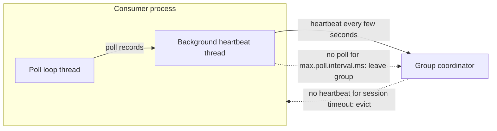

# Heartbeats, max.poll.interval.ms and Liveness

## Introduction

A consumer group can only reassign a dead member's partitions if it notices the member is dead. Notice too slowly and partitions sit unprocessed while lag piles up. Notice too eagerly and healthy-but-busy consumers are thrown out, their work is redone by someone else, and the group spends its time rebalancing instead of processing.

Kafka separates two kinds of failure and watches each with its own timer. A **crashed** consumer (process gone, machine down, network partition) is detected by missing heartbeats. A **stuck** consumer (process alive, but the poll loop is blocked on a slow call or an infinite loop) is detected by the time between `poll()` calls. Mixing the two up is behind most "my consumer keeps rebalancing" problems.

By the end of this page you will know which settings control each timer under the classic and the KIP-848 protocols, what happens step by step when a timer fires, and four ways to handle processing that is slower than the defaults allow.

The scenario is **fraud scoring**. A `card-transactions` topic with 24 partitions carries every card swipe. A `fraud-scorer` service enriches each transaction with customer history and calls a machine-learning model over HTTP. Most calls take 20 milliseconds; under load, the model service sometimes takes 3 seconds per call.

## Two Failure Modes, Two Timers

| Failure | Example | Detected by | Default |
| --- | --- | --- | --- |
| Crash | `kill -9`, node failure, network cut | Heartbeats stop arriving at the coordinator | 45-second session timeout |
| Livelock | Poll loop blocked on a slow HTTP call | No `poll()` call within `max.poll.interval.ms` | 5 minutes |

The Java consumer sends heartbeats from a **background thread**, independent of your poll loop. That is deliberate: it lets the coordinator detect a crash within seconds even when processing a batch legitimately takes minutes. The price is that heartbeats alone cannot detect a stuck poll loop, because the background thread keeps heartbeating cheerfully while your code is frozen. That is the job of the second timer.



## The Classic Protocol Settings

Under `group.protocol=classic` (the default), the client chooses its own timers:

| Client setting | Default | Meaning |
| --- | --- | --- |
| `session.timeout.ms` | 45000 | No heartbeat for this long and the coordinator removes the member |
| `heartbeat.interval.ms` | 3000 | How often the background thread heartbeats; keep it at most a third of the session timeout |
| `max.poll.interval.ms` | 300000 | Maximum time between two `poll()` calls before the member leaves the group |
| `max.poll.records` | 500 | Maximum records per `poll()`, which bounds the work between polls |

The broker bounds the session timeout with `group.min.session.timeout.ms` and `group.max.session.timeout.ms`; a client asking for a value outside that range is rejected when it joins.

A lower session timeout means faster failover after a crash, but more false alarms from garbage collection pauses or brief network blips. The 45-second default (raised from 10 seconds in Kafka 3.0) reflects real-world experience that cloud networks hiccup more often than processes crash.

## The KIP-848 Protocol Settings

Under `group.protocol=consumer`, crash detection moves to the broker. The client may not set `session.timeout.ms` or `heartbeat.interval.ms`; the consumer refuses to start if they are present. Instead:

| Broker or group setting | Default | Meaning |
| --- | --- | --- |
| `group.consumer.session.timeout.ms` | 45000 | Session timeout for all members of KIP-848 groups |
| `group.consumer.heartbeat.interval.ms` | 5000 | Heartbeat interval the coordinator tells members to use |
| `group.consumer.min.session.timeout.ms` / `group.consumer.max.session.timeout.ms` | 45000 / 60000 | Allowed range for per-group overrides |
| `consumer.session.timeout.ms` (group config) | 45000 | Per-group override, set with `kafka-configs.sh --entity-type groups` |

`max.poll.interval.ms` and `max.poll.records` **stay on the client** in both protocols, because only the client knows when your code last called `poll()`.

To give one group a longer session timeout under KIP-848:

```bash
kafka-configs.sh --bootstrap-server localhost:9092 \
  --alter --entity-type groups --entity-name fraud-scorer \
  --add-config consumer.session.timeout.ms=60000
```

```text
Completed updating config for group fraud-scorer.
```

Moving the timers to the broker is a governance improvement: platform teams can enforce sane values instead of discovering that one application set a 10-minute session timeout and holds partitions hostage when it dies.

## What Happens When max.poll.interval.ms Expires

Suppose the fraud scorer polls 500 records and the model service slows to 3 seconds per call. Processing the batch takes 25 minutes, far beyond the 5-minute limit. Here is the sequence:

1. Five minutes after the last `poll()`, the background thread notices the deadline has passed.
2. A dynamic member proactively **leaves the group**. The coordinator rebalances and hands its partitions to other members.
3. The other members start from the last committed offset, so they reprocess everything this member had not yet committed.
4. Twenty minutes later, the stuck member finishes its batch and tries to commit. The commit fails with `CommitFailedException`, because it no longer owns those partitions.
5. Its next `poll()` rejoins the group, triggering another rebalance, and it receives a new, likely different, assignment.

If the slowness persists, this repeats: the group is permanently rebalancing, every batch is processed at least twice, and lag grows without bound. A static member (one with `group.instance.id`) behaves slightly differently: it does not send a leave request when the poll timer expires, so its partitions only move once its session timeout passes as well.

The consumer exposes metrics that show the problem before it bites:

- `time-between-poll-avg` and `time-between-poll-max`: how long your loop spends between polls. Alert when the max approaches `max.poll.interval.ms`.
- `last-poll-seconds-ago`: how long since the last poll right now.
- `poll-idle-ratio-avg`: fraction of time spent waiting inside `poll()`. Close to zero means the consumer is saturated.

## Four Ways to Handle Slow Processing

### 1. Poll Smaller Batches

The cheapest fix. If the worst case per record is 3 seconds and you want to stay under a 5-minute window with margin, poll at most about 60 records:

```properties
max.poll.records=50
```

Throughput barely changes, because the consumer still prefetches in the background; you only shorten the gap between polls.

### 2. Raise max.poll.interval.ms

Setting `max.poll.interval.ms=900000` (15 minutes) buys time, but it also means a genuinely stuck consumer, deadlocked or in an infinite loop, holds its partitions for 15 minutes before anyone notices. Raise it to cover a known worst case, not as a reflex.

### 3. Pause, Process Elsewhere, Resume

For processing that is unpredictable, hand records to a worker pool, **pause** the partitions so `poll()` returns nothing for them, and keep calling `poll()` to stay alive. When the work finishes, commit and **resume**.

```java
ExecutorService workers = Executors.newFixedThreadPool(8);
Future<?> inFlight = null;
Map<TopicPartition, OffsetAndMetadata> toCommit = new HashMap<>();

while (running.get()) {
    ConsumerRecords<String, CardTxn> records = consumer.poll(Duration.ofMillis(200));

    if (!records.isEmpty()) {
        consumer.pause(records.partitions());          // stop fetching while we work
        for (TopicPartition tp : records.partitions()) {
            List<ConsumerRecord<String, CardTxn>> batch = records.records(tp);
            toCommit.put(tp, new OffsetAndMetadata(batch.get(batch.size() - 1).offset() + 1));
        }
        inFlight = workers.submit(() -> scorer.scoreAll(records));
    }

    if (inFlight != null && inFlight.isDone()) {
        inFlight.get();                                // surfaces processing exceptions
        consumer.commitSync(toCommit);
        consumer.resume(consumer.paused());            // fetch again
        toCommit.clear();
        inFlight = null;
    }
}
```

The poll loop now spins every 200 milliseconds, so `max.poll.interval.ms` is never at risk, while the slow work happens on other threads. A real implementation also needs a rebalance listener that waits for (or cancels) in-flight work for revoked partitions before committing, as described on [Rebalancing: Eager, Cooperative and the KIP-848 Protocol](./2-kafka-rebalancing.mdx).

### 4. Use a Share Group

If records are independent and order does not matter, a share group lets you run more consumers than partitions and gives each record its own processing deadline (an acquisition lock). See [Queues for Kafka: Share Groups](./7-kafka-share-groups.mdx).

| Approach | Effort | Keeps ordering | Detects a stuck consumer quickly |
| --- | --- | --- | --- |
| Lower `max.poll.records` | Config only | Yes | Yes |
| Raise `max.poll.interval.ms` | Config only | Yes | No, slower detection |
| Pause and resume with a worker pool | Moderate code | Per partition, if one task per partition | Yes |
| Share group | New consumer type | No | Yes, per record |

## Liveness in Other Clients

librdkafka-based clients (confluent-kafka for Python, Go, .NET and JavaScript) use the same settings and the same model: a background thread heartbeats, and `max.poll.interval.ms` is enforced against your calls to `poll()` or `consume()`. When it expires, the next poll returns an error (`MAX_POLL_EXCEEDED` in librdkafka terms) and the consumer rejoins. In Python this is easy to trigger accidentally with a long synchronous call inside the loop, because the background heartbeat keeps the session alive and hides the problem until the poll deadline passes.

:::tip
Long garbage collection pauses look like crashes to the coordinator. If you see members evicted with no application error, check GC logs before raising timeouts. A pause longer than the session timeout means the heap or collector needs attention.
:::

## Worked Scenario: The Slow Model Service

The fraud scorer ran with defaults: 500 records per poll, a 5-minute poll interval. One Friday the model service degraded to 2 to 3 seconds per call. Within ten minutes the group was in a rebalance loop. Lag on `card-transactions` climbed past 2 million records, and card authorizations were being approved without a fraud score because the scorer could not keep up.

The incident review traced it in the metrics: `time-between-poll-max` had jumped from 10 seconds to over 20 minutes, and the coordinator log showed members leaving every five minutes.

The team made three changes:

1. **`max.poll.records=50`**, so even at 3 seconds per call a batch takes under three minutes.
2. **Parallel calls per batch.** The scorer now calls the model service for the 50 records concurrently with a bounded thread pool, while preserving per-card order by grouping records by key before dispatch.
3. **A timeout and fallback on the model call.** After 500 milliseconds the scorer uses a cheaper rules-based score and marks the result as degraded. A slow dependency now reduces quality instead of stopping the pipeline.

They considered raising `max.poll.interval.ms` to 30 minutes and rejected it: it would have hidden the problem while making real crashes of the poll loop take half an hour to detect. They also added an alert on `time-between-poll-max` above 60 seconds.

## Common Mistakes

- Raising `session.timeout.ms` to fix "consumer kicked out during long processing"; the cause is `max.poll.interval.ms`, which is a separate timer.
- Setting `heartbeat.interval.ms` close to `session.timeout.ms`, so a single delayed heartbeat evicts the member.
- Leaving `session.timeout.ms` and `heartbeat.interval.ms` in the config after switching to `group.protocol=consumer`.
- Doing blocking network calls with no timeout inside the poll loop.
- Using pause and resume without a rebalance listener, so in-flight work for revoked partitions commits offsets the member no longer owns.
- Treating `CommitFailedException` as a transient error to retry rather than a sign the member was removed.

## Summary

- Kafka detects crashes with heartbeats (session timeout, 45 seconds by default) and stalls with `max.poll.interval.ms` (5 minutes by default).
- Heartbeats come from a background thread, so they prove the process is alive, not that your loop is making progress.
- Under the classic protocol the client sets session and heartbeat timers; under KIP-848 the broker or group config owns them.
- `max.poll.interval.ms` and `max.poll.records` are always client settings.
- When the poll timer expires, the member leaves, its partitions move, and its next commit fails with `CommitFailedException`.
- Fix slow processing with smaller batches first, then pause and resume with a worker pool, or a share group for independent records.
- Watch `time-between-poll-max` to catch the problem before it causes a rebalance loop.

## Further Reading

- [KafkaConsumer Javadoc (4.3)](https://kafka.apache.org/43/javadoc/org/apache/kafka/clients/consumer/KafkaConsumer.html): the "Detecting Consumer Failures" and multi-threaded processing sections.
- [Consumer configuration reference (4.3)](https://kafka.apache.org/43/configuration/consumer-configs/): `session.timeout.ms`, `heartbeat.interval.ms`, `max.poll.interval.ms` and `max.poll.records`.
- [Group configuration reference (4.3)](https://kafka.apache.org/43/configuration/group-configs/): per-group session and heartbeat overrides for KIP-848 and share groups.
- [KIP-62: Allow consumer to send heartbeats from a background thread](https://cwiki.apache.org/confluence/display/KAFKA/KIP-62%3A+Allow+consumer+to+send+heartbeats+from+a+background+thread): why there are two timers.
- [KIP-735: Increase default consumer session timeout](https://cwiki.apache.org/confluence/display/KAFKA/KIP-735%3A+Increase+default+consumer+session+timeout): the reasoning behind the 45-second default.
