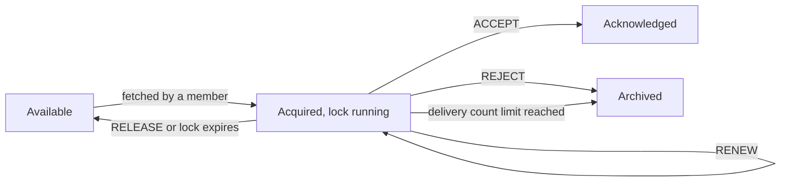

# Queues for Kafka: Share Groups

## Introduction

Consumer groups give each partition to exactly one member. That is what makes Kafka's ordering guarantee work, and it is also a hard ceiling: a topic with 6 partitions can never be processed by more than 6 consumers in one group. For work where order does not matter, such as rendering documents, sending notifications or resizing images, that ceiling is just an obstacle. Teams have worked around it for years by over-partitioning topics, or by moving the work to a separate queueing system such as RabbitMQ or SQS.

**Share groups**, introduced by KIP-932 and nicknamed "Queues for Kafka", remove the ceiling. Members of a share group cooperatively consume the same partitions, any number of members can read a partition at once, and each record is acknowledged individually, with automatic redelivery if a consumer fails to finish it.

Share groups arrived in stages: early access in Kafka 4.0, a preview in 4.1, and **production-ready status in Kafka 4.2** (released in early 2026). The current 4.3 release adds per-group configuration for delivery limits and record locks. Many articles written in 2025 still call the feature a preview; for the Java client on a 4.2 or later cluster that is no longer true. Some other clients, such as confluent-kafka for Python, only ship a preview share consumer so far.

After this page you will understand how share groups track records, what each acknowledgement type does, how to write a share consumer in Java, which settings matter, and how to decide between a share group, a consumer group and a dedicated queue.

The scenario is **invoice rendering**. A billing system publishes one job per invoice to an `invoice-render-jobs` topic with 6 partitions. A worker turns each job into a PDF, which takes between 2 and 20 seconds. Most of the month 6 workers are enough, but on the first business day of each month 400,000 invoices arrive in a few hours and the team wants 60 workers.

## How Share Groups Differ From Consumer Groups

| | Consumer group | Share group |
| --- | --- | --- |
| Readers per partition | Exactly one member | Many members at once |
| Maximum useful members | Number of partitions | Not tied to partitions (default cap 200 per group) |
| Ordering | Per partition, guaranteed | Not guaranteed across members |
| Progress tracking | One committed offset per partition | State per record (acquired, acknowledged, archived) |
| Failure of one record | Blocks the partition until handled | Released and redelivered, others continue |
| Redelivery limit | None built in | Delivery count limit, then the record is archived |
| Delivery guarantee | At-least-once, exactly-once with transactions | At-least-once |
| Java client class | `KafkaConsumer` | `KafkaShareConsumer` |

Share groups and consumer groups can read the same topic at the same time without affecting each other. A billing-analytics consumer group can read `invoice-render-jobs` in order while a share group of renderers processes the same records as a work queue.

## Acquisition Locks and Record States

A share group tracks every partition it reads as a **share-partition**. Instead of a single committed offset, the broker keeps a window of **in-flight** records, between the share-partition start offset (everything before it is done) and the end offset (nothing after it has been handed out yet).

When a consumer fetches, the broker **acquires** a batch of available records for it and starts an **acquisition lock** timer, 30 seconds by default. Each record then moves through four states:



- **Available**: ready to be handed to any member.
- **Acquired**: locked to one member until it acknowledges or the lock expires.
- **Acknowledged**: processed successfully; never delivered again.
- **Archived**: given up on, either rejected or delivered too many times.

Each acquisition increments the record's **delivery count**. When it reaches the limit, 5 by default, the record is archived instead of being made available again. That is what stops a poison record from being retried forever. The number of records in flight per share-partition is also capped (2,000 by default), which limits how far ahead of the slowest unfinished record the group can run.

The analogy is a ticket queue in a support team. Anyone can take the next ticket; once taken, it is theirs for a while. If they finish, it is closed. If they hand it back or go home without finishing, it returns to the queue. A ticket that has bounced between five people gets parked for a human to look at.

## Acknowledgement Types and Modes

A share consumer tells the broker what happened to each record with an `AcknowledgeType`:

| Type | Meaning | Next state |
| --- | --- | --- |
| `ACCEPT` | Processed successfully | Acknowledged |
| `RELEASE` | Could not process now; try again, possibly on another member | Available (delivery count already incremented) |
| `REJECT` | Will never succeed, do not retry | Archived |
| `RENEW` | Still working; extend the lock (added in 4.2) | Acquired, with a fresh lock |

How acknowledgements are produced depends on `share.acknowledgement.mode`:

- **`implicit`** (default): every record from a `poll()` is treated as accepted when you call `poll()` again or call `commitSync()` or `commitAsync()`. Records still unacknowledged at `close()` are released. This is the simplest mode and behaves like "process the batch, then ask for more".
- **`explicit`**: you must call `acknowledge(record, type)` for every record before the next `poll()`, or `poll()` throws `IllegalStateException`. This is the mode to use when individual records can fail.

Acknowledgements are buffered locally and sent to the broker on the next `poll()`, `commitSync()`, `commitAsync()` or `close()`. `commitSync()` returns a per-partition map of results, and `setAcknowledgementCommitCallback()` reports the outcome of asynchronous commits.

## A Share Consumer in Java

The share consumer lives in the same `org.apache.kafka:kafka-clients` artifact as the regular consumer.

```java
import org.apache.kafka.clients.consumer.AcknowledgeType;
import org.apache.kafka.clients.consumer.ConsumerRecord;
import org.apache.kafka.clients.consumer.ConsumerRecords;
import org.apache.kafka.clients.consumer.KafkaShareConsumer;
import org.apache.kafka.common.serialization.StringDeserializer;

import java.time.Duration;
import java.util.List;
import java.util.Properties;

public class InvoiceRenderer {
    public static void main(String[] args) {
        Properties props = new Properties();
        props.put("bootstrap.servers", "localhost:9092");
        props.put("group.id", "invoice-renderers");           // a share group, not a consumer group
        props.put("key.deserializer", StringDeserializer.class.getName());
        props.put("value.deserializer", StringDeserializer.class.getName());
        props.put("share.acknowledgement.mode", "explicit");
        props.put("max.poll.records", "10");                  // small batches: each job is slow

        try (KafkaShareConsumer<String, String> consumer = new KafkaShareConsumer<>(props)) {
            consumer.subscribe(List.of("invoice-render-jobs"));
            while (true) {
                ConsumerRecords<String, String> records = consumer.poll(Duration.ofSeconds(1));
                for (ConsumerRecord<String, String> record : records) {
                    try {
                        PdfRenderer.render(record.value());
                        consumer.acknowledge(record, AcknowledgeType.ACCEPT);
                    } catch (InvalidInvoiceException e) {
                        // Bad data: retrying will not help.
                        consumer.acknowledge(record, AcknowledgeType.REJECT);
                    } catch (TemplateServiceUnavailableException e) {
                        // Temporary problem: let another attempt pick it up.
                        consumer.acknowledge(record, AcknowledgeType.RELEASE);
                    }
                }
                consumer.commitSync();   // send this batch's acknowledgements now
            }
        }
    }
}
```

Run the same program 60 times and all 60 instances share the 6 partitions. The broker spreads acquisitions among them, so a member that is busy rendering a 20-second invoice simply fetches less.

For jobs that can outlast the 30-second lock, keep explicit mode, set `share.acquire.mode=record_limit` with a small `max.poll.records` so the consumer does not prefetch records it cannot start yet, and acknowledge long-running records with `RENEW` on each loop iteration until they finish. Renewal keeps a record locked, which also holds back the share-partition's start offset, so use it for genuinely long jobs rather than as a default.

## Enabling and Configuring Share Groups

Share groups are controlled by the `share.version` cluster feature. Check it and, on a cluster upgraded from an older release, enable it:

```bash
kafka-features.sh --bootstrap-server localhost:9092 describe
kafka-features.sh --bootstrap-server localhost:9092 upgrade --feature share.version=1
```

Share-group state is stored in the internal `__share_group_state` topic, which by default needs 3 replicas and a minimum ISR of 2. On a single-broker development cluster, set `share.coordinator.state.topic.replication.factor=1` and `share.coordinator.state.topic.min.isr=1` on the broker before creating share groups.

Most behaviour is tuned with **group-level configs**, set per group with `kafka-configs.sh`. The broker-level `group.share.*` settings supply defaults and allowed ranges.

| Group config | Default | What it controls |
| --- | --- | --- |
| `share.auto.offset.reset` | `latest` | Where a new share group starts: `latest`, `earliest` or `by_duration:...` |
| `share.record.lock.duration.ms` | 30000 | How long an acquired record stays locked (broker bounds 15 to 60 seconds) |
| `share.delivery.count.limit` | 5 | Delivery attempts before a record is archived (broker bounds 2 to 10) |
| `share.partition.max.record.locks` | 2000 | In-flight records per share-partition |
| `share.isolation.level` | `read_uncommitted` | Whether records from aborted transactions are delivered |
| `share.session.timeout.ms` | 45000 | How long a silent member keeps its membership |
| `share.renew.acknowledge.enable` | `true` | Whether members may use `RENEW` |

The default `latest` catches people out: a new share group ignores every record already in the topic. For the renderers, which must process the backlog left from before they were deployed:

```bash
kafka-configs.sh --bootstrap-server localhost:9092 \
  --alter --entity-type groups --entity-name invoice-renderers \
  --add-config share.auto.offset.reset=earliest,share.record.lock.duration.ms=60000
```

Client-side, the settings that matter are `share.acknowledgement.mode` (`implicit` or `explicit`), `share.acquire.mode` (`batch_optimized` by default, or `record_limit` for strict batch sizes) and `max.poll.records`.

## Inspecting Share Groups

`kafka-share-groups.sh` is the share-group counterpart of `kafka-consumer-groups.sh`:

```bash
kafka-share-groups.sh --bootstrap-server localhost:9092 --list
kafka-share-groups.sh --bootstrap-server localhost:9092 --describe --group invoice-renderers
kafka-share-groups.sh --bootstrap-server localhost:9092 --describe --group invoice-renderers --members
```

The default `--describe` shows, per share-partition, the start offset and the lag of records not yet acknowledged. With the group stopped, `--reset-offsets` supports `--to-earliest`, `--to-latest` and `--to-datetime`, with `--dry-run` or `--execute`. For quick experiments, `kafka-console-share-consumer.sh --bootstrap-server localhost:9092 --topic invoice-render-jobs --group demo-share` joins a share group from the terminal.

:::note
Kafka 4.3 has no built-in dead letter topic for share groups: archived records are simply skipped. A DLQ feature for share groups (KIP-1191) has been accepted for a future release. Until then, publish failing records to your own dead letter topic before acknowledging them with `REJECT`, as described on [Dead Letter Topics and Retry Topics](../9-kafka-patterns/3-kafka-dead-letter-queues.mdx).
:::

## Worked Scenario: Month-End Invoice Rendering

Before share groups, the billing team had three options for the month-end spike and liked none of them.

- **Repartition to 60 partitions.** It allows 60 consumers, but 54 of them sit idle for the rest of the month, partitions are hard to remove later, and one slow 20-second invoice still blocks every invoice behind it in the same partition.
- **Move rendering to RabbitMQ.** RabbitMQ is an excellent work queue (see the [RabbitMQ tutorial](/docs/middleware/rabbitmq)), but it meant a second messaging system to run, a bridge from Kafka, and no replay of past jobs when a template bug corrupted a month's PDFs.
- **Parallelise inside each consumer.** A thread pool per consumer worked, but offset commits with out-of-order completion needed fiddly bookkeeping, and a crash still redelivered whole batches.

With the cluster on Kafka 4.3, they switched the renderers to a share group named `invoice-renderers`, kept the topic at 6 partitions and set the group config to `earliest` with a 60-second lock. The Kubernetes autoscaler scales the renderer deployment from 6 to 60 pods based on share-group lag.

Failures map cleanly onto acknowledgement types. Malformed invoices are `REJECT`ed after being written to an `invoice-render-jobs.dlq` topic for the billing team. Outages of the template service produce `RELEASE`, and the record is retried by another pod; if the outage outlasts five attempts, the record is archived and a lag-based alert fires. A pod killed mid-render simply stops acknowledging; its records become available again when their locks expire.

The first month-end run on share groups rendered 400,000 invoices in 2 hours 10 minutes, against 9 hours on the old 6-consumer setup, with no topic changes. The billing-analytics consumer group continued to read the same topic in order the whole time.

## Common Mistakes

- Using a share group for data that needs per-key ordering, such as account balance updates; records for the same key can be processed concurrently and out of order.
- Forgetting that `share.auto.offset.reset` defaults to `latest`, so a new share group skips the existing backlog.
- Processing longer than the acquisition lock without `RENEW`, so the record is redelivered to another member while the first is still working on it.
- Treating archived records as handled. Without your own dead letter topic, a record that hits the delivery limit is silently skipped.
- Leaving `share.coordinator.state.topic.replication.factor` at 3 on a one-broker development cluster, so share groups cannot store their state.
- Reusing a consumer group's `group.id` for a share group. Pick a distinct name for each.
- Expecting exactly-once processing; share groups are at-least-once, so handlers must still be idempotent.

## Summary

- Share groups (KIP-932) let many members read the same partitions, with per-record acquisition, acknowledgement and redelivery.
- They were early access in 4.0, preview in 4.1 and are production-ready from Kafka 4.2; 4.3 adds per-group delivery and lock settings.
- Records move between Available, Acquired, Acknowledged and Archived; a delivery count limit (default 5) stops endless retries.
- Acknowledge with `ACCEPT`, `RELEASE`, `REJECT` or `RENEW`, in implicit (default) or explicit mode.
- Configure behaviour per group with `kafka-configs.sh --entity-type groups`, and inspect it with `kafka-share-groups.sh`.
- Choose share groups for independent, order-insensitive work that needs more workers than partitions; keep consumer groups for ordered streams.

## Further Reading

- [KIP-932: Queues for Kafka](https://cwiki.apache.org/confluence/display/KAFKA/KIP-932%3A+Queues+for+Kafka): the design, record states and protocol of share groups.
- [KafkaShareConsumer Javadoc (4.3)](https://kafka.apache.org/43/javadoc/org/apache/kafka/clients/consumer/KafkaShareConsumer.html): acknowledgement modes, renewal and the full API with examples.
- [Group configuration reference (4.3)](https://kafka.apache.org/43/configuration/group-configs/): every `share.*` group config with defaults and ranges.
- [Basic Kafka operations (4.3)](https://kafka.apache.org/43/operations/basic-kafka-operations/): listing, describing, resetting and deleting share groups.
- [Kafka 4.3 upgrade notes](https://kafka.apache.org/43/getting-started/upgrade/): the production-ready announcement in 4.2 and small-cluster settings for share groups.
- [KIP-1191: Dead-letter queues for share groups](https://cwiki.apache.org/confluence/display/KAFKA/KIP-1191%3A+Dead-letter+queues+for+share+groups): the planned DLQ support.
