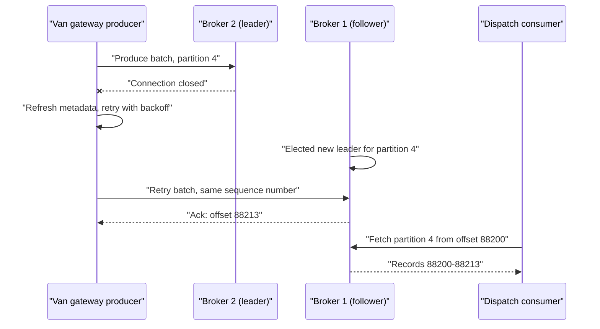

# Kafka with Java (kafka-clients)

## Introduction

Kafka itself is written in Java and Scala, and the Java client lives in the same repository as the broker. Every new protocol feature lands there first: the KIP-848 consumer rebalance protocol, share groups, client metrics push and transaction improvements all shipped in the Java client before any other language had them. Other clients are measured against it. When a librdkafka changelog says "Java-compatible", this is what it means.

That makes `org.apache.kafka:kafka-clients` the reference point for the rest of this section. Spring Kafka wraps it, Kafka Streams and Kafka Connect are built on it, and most documentation examples use it.

By the end of this page you will be able to add the client to a Maven or Gradle project, write a producer that does not lose records, write a consumer poll loop with manual commits and clean shutdown, and decide whether plain `kafka-clients` is the right layer for your service or whether Spring Kafka or Kafka Streams would serve you better.

The running example is a delivery company. Each van sends a GPS position every few seconds to a `van-positions` topic, keyed by van ID. A dispatch service consumes those positions to keep a live map and to detect vans that have stopped for too long.

## Adding the Dependency

The client is a single jar plus a few small transitive dependencies (compression codecs and SLF4J). It needs Java 11 or newer; only the brokers, Connect and the CLI tools require Java 17.

```xml
<!-- pom.xml -->
<dependency>
  <groupId>org.apache.kafka</groupId>
  <artifactId>kafka-clients</artifactId>
  <version>4.4.0</version>
</dependency>
<!-- The client logs through SLF4J; add a binding or you will see no client logs at all. -->
<dependency>
  <groupId>ch.qos.logback</groupId>
  <artifactId>logback-classic</artifactId>
  <version>1.5.29</version>
</dependency>
```

```bash
# Gradle (Kotlin DSL) equivalent
# implementation("org.apache.kafka:kafka-clients:4.4.0")
```

You do not need to match the client version to the broker version. Kafka keeps the wire protocol backwards and forwards compatible, and the client negotiates API versions with each broker on connect. There is one floor: since 4.0, Java clients only talk to brokers at version 2.1 or newer (KIP-896 removed the older protocol versions). In practice, use the newest client and upgrade it regularly; it is the cheapest way to pick up bug fixes.

:::note
The `kafka-clients` jar contains the producer, the consumer, the share consumer and the Admin client. Kafka Streams is a separate artifact (`kafka-streams`), and so is the Connect API. Do not add the full `kafka_2.13` broker jar to an application.
:::

## Writing a Producer

`KafkaProducer` is thread-safe and expensive to create: it opens connections, starts a background I/O thread and reserves up to 32 MB of buffer memory. Create one per application (or per distinct configuration) and share it across threads. Creating a producer per request is the single most common Java performance bug with Kafka.

```java
import org.apache.kafka.clients.producer.KafkaProducer;
import org.apache.kafka.clients.producer.ProducerConfig;
import org.apache.kafka.clients.producer.ProducerRecord;
import org.apache.kafka.common.serialization.StringSerializer;

import java.util.Properties;

public class PositionPublisher implements AutoCloseable {

    private final KafkaProducer<String, String> producer;

    public PositionPublisher(String bootstrapServers) {
        Properties props = new Properties();
        props.put(ProducerConfig.BOOTSTRAP_SERVERS_CONFIG, bootstrapServers);
        props.put(ProducerConfig.CLIENT_ID_CONFIG, "van-gateway");
        props.put(ProducerConfig.KEY_SERIALIZER_CLASS_CONFIG, StringSerializer.class.getName());
        props.put(ProducerConfig.VALUE_SERIALIZER_CLASS_CONFIG, StringSerializer.class.getName());
        // acks=all and enable.idempotence=true are already the defaults; stating them
        // documents intent and protects against someone "tuning" them away later.
        props.put(ProducerConfig.ACKS_CONFIG, "all");
        props.put(ProducerConfig.ENABLE_IDEMPOTENCE_CONFIG, true);
        // Positions are small and frequent: compress batches to save network and disk.
        props.put(ProducerConfig.COMPRESSION_TYPE_CONFIG, "lz4");
        this.producer = new KafkaProducer<>(props);
    }

    public void publish(String vanId, String positionJson) {
        ProducerRecord<String, String> record =
                new ProducerRecord<>("van-positions", vanId, positionJson);
        // send() is asynchronous: it appends to an in-memory batch and returns.
        producer.send(record, (metadata, exception) -> {
            if (exception != null) {
                // Runs on the producer's I/O thread: log or hand off, never block here.
                System.err.printf("Failed to send position for %s: %s%n", vanId, exception);
            }
        });
    }

    @Override
    public void close() {
        // close() flushes buffered records and waits for their acknowledgements.
        producer.close();
    }
}
```

A few points that the code does not show on its own.

**Keys decide ordering.** Using the van ID as the key sends every position for one van to the same partition, so the dispatch service sees them in order. Without a key, positions for one van would be spread across partitions and could arrive out of order.

**The callback is the only place you learn about failure.** By the time the callback reports an exception, the producer has already retried for up to `delivery.timeout.ms` (two minutes by default). The error is final. Decide up front what happens: log and drop (fine for a GPS ping that will be replaced in five seconds), write to a local fallback file, or fail the request that caused it.

**Synchronous sends are a choice, not a default.** Calling `producer.send(record).get()` blocks until the broker acknowledges. It is useful in a command-line tool or a test, but in a service it caps throughput at one round trip per record. For the van gateway, asynchronous sends with a callback are right. For a bank transfer API that must not return 200 until the event is durable, waiting on the future is right, ideally for a batch of records at once.

## Writing a Consumer

`KafkaConsumer` is the opposite of the producer in one important way: it is **not** thread-safe. One consumer belongs to one thread. To process faster, run more consumer instances in the same group (more threads or more processes), up to the number of partitions.

```java
import org.apache.kafka.clients.consumer.ConsumerConfig;
import org.apache.kafka.clients.consumer.ConsumerRecord;
import org.apache.kafka.clients.consumer.ConsumerRecords;
import org.apache.kafka.clients.consumer.KafkaConsumer;
import org.apache.kafka.common.errors.WakeupException;
import org.apache.kafka.common.serialization.StringDeserializer;

import java.time.Duration;
import java.util.List;
import java.util.Properties;

public class DispatchConsumer implements Runnable {

    private final KafkaConsumer<String, String> consumer;

    public DispatchConsumer(String bootstrapServers) {
        Properties props = new Properties();
        props.put(ConsumerConfig.BOOTSTRAP_SERVERS_CONFIG, bootstrapServers);
        props.put(ConsumerConfig.GROUP_ID_CONFIG, "dispatch-map");
        props.put(ConsumerConfig.KEY_DESERIALIZER_CLASS_CONFIG, StringDeserializer.class.getName());
        props.put(ConsumerConfig.VALUE_DESERIALIZER_CLASS_CONFIG, StringDeserializer.class.getName());
        // Opt in to the KIP-848 rebalance protocol (brokers must be 4.0+).
        props.put(ConsumerConfig.GROUP_PROTOCOL_CONFIG, "consumer");
        // A brand-new group starts from the oldest retained position, not "now".
        props.put(ConsumerConfig.AUTO_OFFSET_RESET_CONFIG, "earliest");
        // Commit only after processing, so a crash replays instead of skipping.
        props.put(ConsumerConfig.ENABLE_AUTO_COMMIT_CONFIG, false);
        this.consumer = new KafkaConsumer<>(props);
    }

    @Override
    public void run() {
        try {
            consumer.subscribe(List.of("van-positions"));
            while (true) {
                ConsumerRecords<String, String> records = consumer.poll(Duration.ofMillis(500));
                for (ConsumerRecord<String, String> r : records) {
                    updateMap(r.key(), r.value());
                }
                if (!records.isEmpty()) {
                    // Commits the offsets returned by the last poll() for every partition.
                    consumer.commitSync();
                }
            }
        } catch (WakeupException e) {
            // Expected during shutdown: wakeup() makes poll() throw this.
        } finally {
            // Leaves the group promptly so partitions move to other instances now,
            // not after a session timeout.
            consumer.close();
        }
    }

    public void shutdown() {
        // The only KafkaConsumer method that is safe to call from another thread.
        consumer.wakeup();
    }

    private void updateMap(String vanId, String positionJson) {
        System.out.printf("van=%s position=%s%n", vanId, positionJson);
    }
}
```

And the `main` method that wires shutdown to the JVM:

```java
public class DispatchApp {
    public static void main(String[] args) throws InterruptedException {
        DispatchConsumer consumer = new DispatchConsumer("localhost:9092");
        Thread worker = new Thread(consumer, "dispatch-consumer");
        Runtime.getRuntime().addShutdownHook(new Thread(() -> {
            consumer.shutdown();
            try {
                worker.join(); // wait for close() to finish before the JVM exits
            } catch (InterruptedException ignored) {
                Thread.currentThread().interrupt();
            }
        }));
        worker.start();
    }
}
```

Running it against a topic with a few records prints something like:

```bash
$ java -cp app.jar DispatchApp
van=VAN-017 position={"lat":52.5201,"lon":13.4049,"ts":1760700000}
van=VAN-017 position={"lat":52.5207,"lon":13.4061,"ts":1760700005}
van=VAN-042 position={"lat":48.1371,"lon":11.5754,"ts":1760700003}
```

### The Rules of the Poll Loop

The poll loop looks simple, but three rules keep it healthy.

1. **Call `poll()` often.** If the gap between two `poll()` calls exceeds `max.poll.interval.ms` (five minutes by default), the consumer is considered stuck and its partitions are given to someone else. Slow processing per batch is the usual cause. Lower `max.poll.records` or move slow work elsewhere.
2. **Commit after processing, not before.** `commitSync()` after the loop gives at-least-once delivery: a crash between processing and committing replays a few records. Your processing must tolerate that, which is why the map update is idempotent (setting a van's position twice is harmless).
3. **Shut down with `wakeup()` and `close()`.** Killing the process without `close()` leaves the group waiting for a timeout before reassigning partitions, which shows up as a gap in your live map.

The [Consumer Basics](../4-kafka-consumers/0-kafka-consumer-basics.mdx) page goes deeper into each step, and [Offsets, Commits and Where to Resume](../4-kafka-consumers/3-kafka-offsets-and-commits.mdx) covers asynchronous and per-partition commits.

## The Admin Client

Applications sometimes need to create topics, inspect consumer groups or read configuration. `Admin` does that over the same protocol:

```java
import org.apache.kafka.clients.admin.Admin;
import org.apache.kafka.clients.admin.AdminClientConfig;
import org.apache.kafka.clients.admin.NewTopic;

import java.util.List;
import java.util.Map;

public class CreateTopics {
    public static void main(String[] args) throws Exception {
        try (Admin admin = Admin.create(Map.of(
                AdminClientConfig.BOOTSTRAP_SERVERS_CONFIG, "localhost:9092"))) {
            NewTopic positions = new NewTopic("van-positions", 12, (short) 3)
                    .configs(Map.of("retention.ms", "86400000")); // keep one day
            // all().get() waits for the controller to confirm the creation.
            admin.createTopics(List.of(positions)).all().get();
        }
    }
}
```

In production, topics are usually created by infrastructure code (Terraform, Strimzi resources, a CI job) rather than by the application at startup. See [Managing Topics with the Admin API](../2-kafka-topics-and-storage/6-kafka-admin-api.mdx).

## Plain Client, Spring Kafka or Kafka Streams?

The same JVM gives you three layers to choose from. They are not competitors; each one is built on the one before it.

| Layer | What you write | Choose it when | Trade-off |
| --- | --- | --- | --- |
| `kafka-clients` | Poll loops, callbacks, commit calls | Libraries, small services, full control over threading and commits | You write error handling, retries and lifecycle yourself |
| Spring Kafka | `@KafkaListener` methods, `KafkaTemplate` | You already use Spring Boot; you want retries, dead letters and metrics wired in | Another abstraction to learn; behaviour hidden behind container settings |
| Kafka Streams | A topology of `map`, `filter`, `join`, `aggregate` | The output is another topic or a queryable state store; you need windows or joins | Opinionated runtime; internal topics; harder to reason about at first |

For the van example: the gateway that turns HTTP pings into records is a plain producer. The dispatch map could be any of the three. Detecting "a van has not moved for 15 minutes" is a windowed aggregation, which is exactly what Kafka Streams is for (see [Kafka Streams Introduction](../7-kafka-streams/0-kafka-streams-introduction.mdx)).

## Worked Scenario: Surviving a Broker Restart

The dispatch team runs three brokers. During a rolling upgrade, broker 2, which leads four of the twelve `van-positions` partitions, restarts. What does each client do?



The producer sees a disconnect, marks the batch for retry, refreshes metadata to learn the new leader and resends. Because idempotence is on, the batch carries a producer ID and sequence number, so if broker 2 had actually written it before dying, the new leader recognises the duplicate. The application callback never sees an error unless the outage lasts longer than `delivery.timeout.ms`.

The consumer's fetches to broker 2 fail; it refreshes metadata and fetches from broker 1, continuing from its current position. No rebalance happens, because the consumer group membership did not change.

The only setting that turns this from a non-event into data loss is `acks`. With `acks=1`, a batch acknowledged by broker 2 just before it crashed, and not yet replicated, is gone. That is why the defaults are `acks=all` with idempotence, and why the code above repeats them.

## Common Mistakes

- **Creating a `KafkaProducer` per message or per HTTP request.** Each one opens connections and a buffer; share one instance.
- **Sharing a `KafkaConsumer` between threads.** It throws `ConcurrentModificationException`. Use one consumer per thread.
- **Blocking inside the producer callback.** It runs on the I/O thread and stalls every other send.
- **Calling `send().get()` in a loop for throughput-sensitive paths.** It serialises the producer to one round trip per record.
- **Forgetting an SLF4J binding.** The client then logs nothing, and connection problems become invisible.
- **Leaving `auto.offset.reset` at `latest` for a new group that should process history.** The group silently skips everything already in the topic.
- **Exiting without `close()`.** Buffered producer records are lost and consumer partitions stay assigned until a timeout.

## Summary

- `org.apache.kafka:kafka-clients` is the reference Kafka client; new protocol features ship there first. It needs Java 11+.
- Use the newest client version; it talks to any broker from 2.1 onwards.
- `KafkaProducer` is thread-safe and should be shared; `send()` is asynchronous and reports failure through its callback or future.
- `KafkaConsumer` is single-threaded; scale with more instances in the same group, keep `poll()` frequent, commit after processing and shut down with `wakeup()` plus `close()`.
- Set `group.protocol=consumer` to use the KIP-848 rebalance protocol on 4.0+ brokers; the default is still `classic`.
- Pick Spring Kafka for Spring Boot services and Kafka Streams for topic-to-topic processing with state.

## Further Reading

- [Apache Kafka documentation: APIs](https://kafka.apache.org/documentation/#api) - overview of the producer, consumer, share consumer, Admin, Streams and Connect APIs.
- [Producer API](https://kafka.apache.org/documentation/#producerapi) - where to find the producer Javadoc, including its threading notes.
- [Consumer API](https://kafka.apache.org/documentation/#consumerapi) - links to the consumer Javadoc: poll loop, commits, rebalance listeners and multi-threading guidance.
- [KIP-848: The Next Generation of the Consumer Rebalance Protocol](https://cwiki.apache.org/confluence/display/KAFKA/KIP-848%3A+The+Next+Generation+of+the+Consumer+Rebalance+Protocol) - the design behind `group.protocol=consumer`.
- [KIP-896: Remove old client protocol API versions](https://cwiki.apache.org/confluence/display/KAFKA/KIP-896%3A+Remove+old+client+protocol+API+versions+in+Kafka+4.0) - why 4.x clients need brokers at 2.1 or newer.
- [Java tutorial](/docs/language/java) - a refresher on the language if you are coming from elsewhere.
