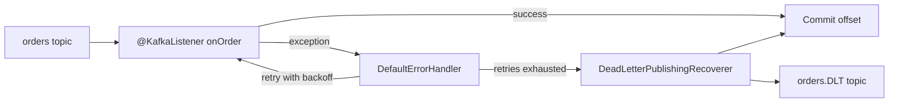

# Kafka with Spring Boot and Spring Kafka

## Introduction

If your services already run on Spring Boot, writing a raw `KafkaConsumer` poll loop feels like going back to hand-written JDBC. Spring for Apache Kafka (usually called Spring Kafka) gives you the same programming model you know from Spring MVC and Spring Data: declare a method, annotate it, and let a container handle threads, polling, commits, retries and shutdown.

Underneath, nothing magic happens. Spring Kafka uses the official `kafka-clients` library described in [Kafka with Java](./0-kafka-java-client.mdx). Every Kafka setting still applies; Spring adds a layer of lifecycle management, error handling and integration with Spring's configuration, metrics and transactions.

By the end of this page you will be able to set up a Spring Boot 4 project with Kafka, publish events with `KafkaTemplate`, consume them with `@KafkaListener`, handle failures with retries and dead-letter topics, and write an integration test against a real broker.

The running example is an online shop. The checkout service publishes an `OrderPlaced` event to an `orders` topic. A fulfilment service listens for it and reserves stock in the warehouse system, which sometimes times out.

## Versions and Dependencies

Spring Kafka versions track Spring Boot and the Kafka client:

| Spring Boot | Spring Kafka | kafka-clients | Java |
| --- | --- | --- | --- |
| 4.1.x | 4.1.x | 4.2.x | 17+ |
| 4.0.x | 4.0.x | 4.1.x | 17+ |
| 3.5.x | 3.3.x | 3.9.x | 17+ |

Let Spring Boot's dependency management pick the versions; do not pin `spring-kafka` yourself unless you have a reason.

One thing changed in Spring Boot 4: auto-configuration was split into modules, so you now add the **Kafka starter** explicitly. Adding only `spring-kafka`, as many Spring Boot 3 tutorials show, gives you the library without the auto-configured `KafkaTemplate` and listener container factory.

```xml
<parent>
  <groupId>org.springframework.boot</groupId>
  <artifactId>spring-boot-starter-parent</artifactId>
  <version>4.1.1</version>
</parent>

<dependencies>
  <dependency>
    <groupId>org.springframework.boot</groupId>
    <artifactId>spring-boot-starter-kafka</artifactId>
  </dependency>
  <!-- Brings spring-kafka-test (EmbeddedKafka) and the usual test libraries. -->
  <dependency>
    <groupId>org.springframework.boot</groupId>
    <artifactId>spring-boot-starter-kafka-test</artifactId>
    <scope>test</scope>
  </dependency>
</dependencies>
```

## Configuration Through application.yaml

Spring Boot maps the most common client settings to `spring.kafka.*` properties. Anything without a dedicated property goes under a `properties` map and is passed straight to the Kafka client.

```yaml
spring:
  application:
    name: fulfilment-service
  kafka:
    bootstrap-servers: localhost:9092
    producer:
      acks: all
      key-serializer: org.apache.kafka.common.serialization.StringSerializer
      # Jackson 3 based serializer, new in Spring Kafka 4.0
      value-serializer: org.springframework.kafka.support.serializer.JacksonJsonSerializer
      properties:
        compression.type: lz4
    consumer:
      group-id: fulfilment
      auto-offset-reset: earliest
      key-deserializer: org.apache.kafka.common.serialization.StringDeserializer
      value-deserializer: org.springframework.kafka.support.serializer.JacksonJsonDeserializer
      properties:
        # Opt in to the KIP-848 rebalance protocol (Kafka 4.0+ brokers).
        group.protocol: consumer
        # Only these packages may be instantiated from type headers.
        spring.json.trusted.packages: "com.example.shop.events"
    listener:
      # Three consumer threads in this instance; never more than the partition count.
      concurrency: 3
```

Two defaults differ from the plain client, and both are good:

- Spring sets `enable.auto.commit=false` on the consumer and commits offsets itself after your listener returns (the default `AckMode.BATCH` commits once per poll batch).
- Listener exceptions go to an error handler instead of crashing the consumer thread.

:::note
Spring Kafka 4.0 moved to Jackson 3. The old `JsonSerializer`, `JsonDeserializer` and `JsonSerde` still work with Jackson 2 but are deprecated in favour of `JacksonJsonSerializer`, `JacksonJsonDeserializer` and `JacksonJsonSerde`. Check this when you upgrade from Spring Boot 3.
:::

## Producing with KafkaTemplate

Spring Boot auto-configures a `KafkaTemplate` that wraps one shared `KafkaProducer`. Inject it like any other bean.

```java
package com.example.shop.checkout;

import com.example.shop.events.OrderPlaced;
import org.springframework.kafka.core.KafkaTemplate;
import org.springframework.kafka.support.SendResult;
import org.springframework.stereotype.Service;

import java.util.concurrent.CompletableFuture;

@Service
public class OrderEvents {

    private final KafkaTemplate<String, OrderPlaced> kafka;

    public OrderEvents(KafkaTemplate<String, OrderPlaced> kafka) {
        this.kafka = kafka;
    }

    public CompletableFuture<SendResult<String, OrderPlaced>> orderPlaced(OrderPlaced event) {
        // Key by order ID so every event for one order lands on one partition, in order.
        return kafka.send("orders", event.orderId(), event)
                .whenComplete((result, ex) -> {
                    if (ex != null) {
                        // Final failure after the client's own retries.
                        System.err.println("Could not publish " + event.orderId() + ": " + ex);
                    }
                });
    }
}
```

```java
package com.example.shop.events;

import java.math.BigDecimal;
import java.util.List;

// A Java record serializes cleanly with Jackson.
public record OrderPlaced(String orderId, String customerId, List<String> skus, BigDecimal total) {}
```

`send()` returns a `CompletableFuture` (the older `ListenableFuture` was removed in Spring Kafka 3.0). Return it from a reactive or async controller, or call `join()` when the HTTP response must wait for the broker. The same trade-off as in the plain client applies: waiting gives you certainty, not waiting gives you throughput.

## Consuming with @KafkaListener

A listener is a method on a bean. Spring creates a listener container per annotated method, which runs the poll loop on its own threads and calls your method once per record.

```java
package com.example.shop.fulfilment;

import com.example.shop.events.OrderPlaced;
import org.apache.kafka.clients.consumer.ConsumerRecord;
import org.springframework.kafka.annotation.KafkaListener;
import org.springframework.stereotype.Component;

@Component
public class OrderListener {

    private final WarehouseClient warehouse;

    public OrderListener(WarehouseClient warehouse) {
        this.warehouse = warehouse;
    }

    @KafkaListener(topics = "orders")
    public void onOrder(ConsumerRecord<String, OrderPlaced> record) {
        OrderPlaced order = record.value();
        // Throwing here hands the record to the error handler; returning normally
        // marks it as processed and its offset will be committed.
        warehouse.reserve(order.orderId(), order.skus());
    }
}
```

`WarehouseClient` stands for whatever HTTP client your team uses to call the warehouse API. You can also declare the parameter as just `OrderPlaced` and add `@Header(KafkaHeaders.RECEIVED_PARTITION) int partition` style arguments when you need metadata.

Topics can be created at startup by declaring `NewTopic` beans. Spring's `KafkaAdmin` creates them if they do not exist and leaves existing ones alone. This is convenient for local development; in production, many teams prefer to create topics through infrastructure code and disable this.

```java
@Bean
NewTopic ordersTopic() {
    return TopicBuilder.name("orders").partitions(6).replicas(3).build();
}
```

## Handling Failures

The warehouse API times out a few times a day. What should happen to an order whose reservation fails?



Out of the box, Spring Kafka's `DefaultErrorHandler` retries a failed record nine more times with no delay, then logs it and moves on. That is rarely what you want in production: ten rapid retries against a struggling warehouse make things worse, and "log and skip" loses the order.

### Blocking Retries Then a Dead-Letter Topic

Define your own error handler bean. Spring Boot wires it into the auto-configured container factory.

```java
package com.example.shop.fulfilment;

import org.springframework.context.annotation.Bean;
import org.springframework.context.annotation.Configuration;
import org.springframework.kafka.core.KafkaTemplate;
import org.springframework.kafka.listener.DeadLetterPublishingRecoverer;
import org.springframework.kafka.listener.DefaultErrorHandler;
import org.springframework.util.backoff.ExponentialBackOff;

@Configuration
public class KafkaErrorConfig {

    @Bean
    DefaultErrorHandler errorHandler(KafkaTemplate<Object, Object> template) {
        // Publishes the failed record to "<topic>.DLT", same partition, with
        // exception details in headers.
        var recoverer = new DeadLetterPublishingRecoverer(template);

        var backOff = new ExponentialBackOff(1_000, 2.0); // 1s, 2s, 4s...
        backOff.setMaxElapsedTime(30_000);                 // give up after ~30s

        var handler = new DefaultErrorHandler(recoverer, backOff);
        // Bad data will never succeed: send it straight to the DLT.
        handler.addNotRetryableExceptions(IllegalArgumentException.class);
        return handler;
    }
}
```

Blocking retries are simple and keep ordering: nothing else on that partition is processed until the record succeeds or is dead-lettered. The cost is that one slow record stalls the partition, and the total retry time must stay well below `max.poll.interval.ms` or the consumer is kicked out of the group.

### Non-Blocking Retry Topics

When stalling a partition is unacceptable, `@RetryableTopic` moves the failed record to a retry topic and carries on. A separate listener consumes the retry topic after a delay.

```java
import org.springframework.kafka.annotation.BackOff;
import org.springframework.kafka.annotation.DltHandler;
import org.springframework.kafka.annotation.KafkaListener;
import org.springframework.kafka.annotation.RetryableTopic;

@RetryableTopic(attempts = "4", backOff = @BackOff(delayString = "2s", multiplier = 3))
@KafkaListener(topics = "orders")
public void onOrder(OrderPlaced order) {
    warehouse.reserve(order.orderId(), order.skus());
}

@DltHandler
public void onDeadLetter(OrderPlaced order) {
    // Alert a human, open a ticket, or park the order for manual review.
    System.err.println("Order needs manual attention: " + order.orderId());
}
```

In Spring Kafka 4.0 the `@Backoff` annotation from Spring Retry was replaced by Spring Kafka's own `@BackOff`, built on the core retry support in Spring Framework 7. Older examples using `backoff = @Backoff(delay = 2000)` need updating.

| Approach | Ordering per key | Partition stalls? | Extra topics | Good for |
| --- | --- | --- | --- | --- |
| `DefaultErrorHandler` with backoff | Kept | Yes, during retries | One DLT | Short, rare outages; strict ordering |
| `@RetryableTopic` | Lost for retried records | No | Retry topics plus DLT | Slow downstreams; independent records |

The [Dead Letter Topics and Retry Topics](../9-kafka-patterns/3-kafka-dead-letter-queues.mdx) page discusses the design trade-offs in more depth.

## Worked Scenario: Testing the Fulfilment Flow

The fulfilment team wants a test that proves an `OrderPlaced` event leads to a warehouse reservation. Mocking `KafkaTemplate` would test nothing about serialization, topic names or consumer configuration. A real broker in the test catches all of those.

Spring Kafka ships an in-process KRaft broker. `@EmbeddedKafka` starts it and, with `bootstrapServersProperty`, points Spring Boot at it.

```java
package com.example.shop.fulfilment;

import com.example.shop.events.OrderPlaced;
import org.junit.jupiter.api.Test;
import org.springframework.beans.factory.annotation.Autowired;
import org.springframework.boot.test.context.SpringBootTest;
import org.springframework.kafka.core.KafkaTemplate;
import org.springframework.kafka.test.context.EmbeddedKafka;
import org.springframework.test.context.bean.override.mockito.MockitoBean;

import java.math.BigDecimal;
import java.util.List;

import static org.mockito.Mockito.timeout;
import static org.mockito.Mockito.verify;

@SpringBootTest
@EmbeddedKafka(topics = "orders", partitions = 1,
        bootstrapServersProperty = "spring.kafka.bootstrap-servers")
class OrderListenerTest {

    @Autowired
    KafkaTemplate<String, OrderPlaced> template;

    @MockitoBean
    WarehouseClient warehouse;

    @Test
    void reservesStockForNewOrder() {
        var order = new OrderPlaced("o-1001", "c-7", List.of("SKU-1", "SKU-2"), new BigDecimal("59.90"));
        template.send("orders", order.orderId(), order);

        // The listener runs on another thread; wait up to 10 seconds for the call.
        verify(warehouse, timeout(10_000)).reserve("o-1001", List.of("SKU-1", "SKU-2"));
    }
}
```

The embedded broker is fast and needs no Docker. When you want the exact broker version you run in production, use Testcontainers instead: the `org.testcontainers.kafka.KafkaContainer` class runs the official `apache/kafka` image, and Spring Boot's `@ServiceConnection` sets the bootstrap servers for you. [Testing Kafka Applications](../13-kafka-best-practices/4-kafka-testing-strategies.mdx) compares both.

## Common Mistakes

- **Adding only `spring-kafka` on Spring Boot 4.** Without `spring-boot-starter-kafka` there is no auto-configured `KafkaTemplate` or listener factory.
- **Setting `concurrency` higher than the partition count.** The extra threads sit idle with no partitions assigned.
- **Keeping the default error handler in production.** Ten instant retries and then a log line is neither resilient nor safe.
- **Long blocking retries that exceed `max.poll.interval.ms`.** The consumer is removed from the group mid-retry and the record is processed again elsewhere.
- **Trusting all packages for JSON type headers (`spring.json.trusted.packages: "*"`).** It lets producers choose which classes your consumer instantiates; list your event packages instead.
- **Mixing Jackson 2 and Jackson 3 classes after an upgrade.** Producer and consumer must agree on the serializer family and type header format.
- **Mocking `KafkaTemplate` in integration tests.** You end up testing Mockito, not your Kafka wiring.

## Summary

- Spring Kafka wraps `kafka-clients` with containers that run the poll loop, commit offsets and route errors for you.
- On Spring Boot 4, add `spring-boot-starter-kafka`; configure clients with `spring.kafka.*` and pass anything else through `properties`.
- `KafkaTemplate.send()` returns a `CompletableFuture`; one shared producer backs it.
- `@KafkaListener` methods are called per record; `concurrency` sets threads per instance.
- Replace the default error handler: use `DefaultErrorHandler` with backoff and a `DeadLetterPublishingRecoverer`, or `@RetryableTopic` for non-blocking retries.
- Spring Kafka 4.x uses Jackson 3 serializer classes and Spring Framework 7 retry (`@BackOff`), and supports KIP-848 and early-access share consumers.

## Further Reading

- [Spring for Apache Kafka reference](https://docs.spring.io/spring-kafka/reference/) - the full guide to templates, listeners, error handling and testing.
- [Spring Boot Kafka support](https://docs.spring.io/spring-boot/reference/messaging/kafka.html) - which `spring.kafka.*` properties exist and what Boot auto-configures.
- [Spring Kafka change history](https://docs.spring.io/spring-kafka/reference/appendix/change-history.html) - the Jackson 3 class renames and the Spring Retry removal in 4.0.
- [Non-blocking retries](https://docs.spring.io/spring-kafka/reference/retrytopic.html) - how `@RetryableTopic` names and consumes its retry topics.
- [Spring for Apache Kafka 4.1.0 release notes](https://spring.io/blog/2026/06/09/spring-kafka-4/) - the current release line and its Spring Boot pairing.
