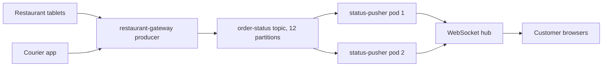

# Kafka with Node.js

## Introduction

Node.js services sit at the edges of many Kafka systems. They are the API gateways that turn HTTP requests into events, the backends-for-frontends that push updates to browsers over WebSockets, and the serverless functions that react to a record and call an external API. Node's event loop is a good match for this kind of I/O-heavy glue work.

The Node.js Kafka landscape has changed in the last few years, and many tutorials online are out of date. For a long time **KafkaJS** was the default choice: a pure JavaScript client with a pleasant promise-based API. Its last release, 2.2.4, was in February 2023, and it has not kept up with Kafka 4.x features such as the KIP-848 rebalance protocol. Confluent responded with **`@confluentinc/kafka-javascript`**, a client built on librdkafka that offers a KafkaJS-compatible API, so existing code can move over with small changes.

By the end of this page you will know which client to choose for a new project, how to produce and consume with `@confluentinc/kafka-javascript`, how to migrate KafkaJS code, and which behaviours differ between the two.

The running example is a food delivery app. Restaurant and courier systems publish status changes (`ORDER_ACCEPTED`, `PICKED_UP`, `DELIVERED`) to an `order-status` topic, keyed by order ID. A Node.js service consumes them and pushes each update to the customer's browser over a WebSocket.

## Choosing a Client

| Client | Install | Implementation | Status in 2026 | Choose it when |
| --- | --- | --- | --- | --- |
| `@confluentinc/kafka-javascript` | `npm install @confluentinc/kafka-javascript` | librdkafka (C++ addon, prebuilt binaries) | Actively developed, Confluent-supported, KIP-848, transactions | New projects; migrating off KafkaJS; you want the same behaviour as the Python, Go and .NET librdkafka clients |
| `kafkajs` | `npm install kafkajs` | Pure JavaScript | No release since 2.2.4 (February 2023) | Existing code that works and is scheduled for migration |
| `@platformatic/kafka` | `npm install @platformatic/kafka` | Pure TypeScript | Actively developed, younger project | You cannot ship native addons (some serverless or edge runtimes) |
| `node-rdkafka` | `npm install node-rdkafka` | librdkafka, callback and stream API | Maintained, but superseded by the Confluent package | Legacy code already written against it |

The rest of this page uses `@confluentinc/kafka-javascript`. It needs Node.js 18 or newer, and prebuilt binaries are published for Linux (glibc and musl, x64 and arm64), macOS on Apple silicon and Windows x64, so `npm install` does not compile anything on common platforms.

The package exposes two APIs:

- **The KafkaJS-style promisified API**, available under `require('@confluentinc/kafka-javascript').KafkaJS`. This is the recommended API and the one shown below.
- **The node-rdkafka-style callback API** (`Producer`, `KafkaConsumer`), for code ported from node-rdkafka.

## Producing Records

```javascript
// producer.js
const { Kafka } = require('@confluentinc/kafka-javascript').KafkaJS;

const kafka = new Kafka({
  kafkaJS: {
    clientId: 'restaurant-gateway',
    brokers: ['localhost:9092'],
  },
});

// KafkaJS-style settings go inside the kafkaJS block; any librdkafka property
// (like linger.ms or compression.type) can sit next to it.
const producer = kafka.producer({
  'compression.type': 'lz4',
  kafkaJS: {
    acks: -1,          // wait for all in-sync replicas (the default)
    idempotent: true,  // default is false in this client; turn it on
  },
});

async function publishStatus(orderId, status) {
  const event = { orderId, status, at: new Date().toISOString() };
  // send() resolves once the broker has acknowledged the record, with one
  // RecordMetadata entry (topicName, partition, baseOffset) per partition written.
  const [meta] = await producer.send({
    topic: 'order-status',
    messages: [{ key: orderId, value: JSON.stringify(event) }],
  });
  console.log(`order ${orderId} ${status} -> partition ${meta.partition} offset ${meta.baseOffset}`);
}

async function main() {
  await producer.connect();
  await publishStatus('ord-5521', 'ORDER_ACCEPTED');
  await publishStatus('ord-5521', 'PICKED_UP');
  await producer.disconnect(); // flushes anything still buffered
}

main().catch((err) => {
  console.error(err);
  process.exit(1);
});
```

Running it prints:

```bash
$ node producer.js
order ord-5521 ORDER_ACCEPTED -> partition 3 offset 0
order ord-5521 PICKED_UP -> partition 3 offset 1
```

Both events share a key, so they land on the same partition in order. That is what lets the browser show "Accepted" before "Picked up".

`await producer.send()` waits for one broker round trip. In an HTTP handler that is usually what you want: the restaurant tablet gets an error if the event was not stored. In a tight loop it is slow. Either pass many messages to one `send()` call, or start several sends and `await Promise.all(...)` on them; librdkafka batches them underneath either way.

## Consuming Records

```javascript
// status-pusher.js
const { Kafka } = require('@confluentinc/kafka-javascript').KafkaJS;

const kafka = new Kafka({ kafkaJS: { brokers: ['localhost:9092'] } });

const consumer = kafka.consumer({
  // librdkafka property: opt in to the KIP-848 protocol (Kafka 4.0+ brokers).
  'group.protocol': 'consumer',
  kafkaJS: {
    groupId: 'status-pusher',
    fromBeginning: false, // a new group starts from the latest records
  },
});

// Placeholder for your WebSocket layer.
function pushToCustomer(orderId, event) {
  console.log(`push ${orderId}: ${event.status}`);
}

async function main() {
  await consumer.connect();
  await consumer.subscribe({ topics: ['order-status'] });

  await consumer.run({
    // Process up to 4 partitions at the same time; order is kept within each.
    partitionsConsumedConcurrently: 4,
    eachMessage: async ({ topic, partition, message }) => {
      const event = JSON.parse(message.value.toString());
      pushToCustomer(event.orderId, event);
      // Returning normally marks the offset as processed; it is committed
      // periodically in the background (autoCommit is on by default).
    },
  });
}

const shutdown = async () => {
  await consumer.disconnect(); // commits processed offsets and leaves the group
  process.exit(0);
};
process.on('SIGTERM', shutdown);
process.on('SIGINT', shutdown);

main().catch((err) => {
  console.error(err);
  process.exit(1);
});
```

`eachMessage` is called for one record at a time per partition. If the handler throws, the client does not commit that offset and seeks back so the record is retried, which gives at-least-once delivery. A handler that always throws on a bad record blocks that partition forever, so catch errors you cannot fix and send the record to a dead-letter topic instead (see [Dead Letter Topics and Retry Topics](../9-kafka-patterns/3-kafka-dead-letter-queues.mdx)).

`eachBatch` is also available. Batches are built on the client and capped by the librdkafka-specific `js.consumer.max.batch.size` property (32 by default), which plays the same role as `max.poll.records` in Java.

:::tip
The package is published as CommonJS. In an ES module project, import the default export and read `KafkaJS` from it: `import pkg from '@confluentinc/kafka-javascript'` followed by `const { Kafka } = pkg.KafkaJS`. TypeScript definitions ship with the package.
:::

## Migrating from KafkaJS

Most KafkaJS code ports in an afternoon. The changes follow one pattern: settings that KafkaJS let you pass per call move to the client, producer or consumer configuration, and KafkaJS options go inside a `kafkaJS` block.

```javascript
// Before: kafkajs
const { Kafka } = require('kafkajs');
const kafka = new Kafka({ clientId: 'app', brokers: ['kafka:9092'] });
const producer = kafka.producer();
await producer.send({ topic: 'order-status', acks: 1, messages: [{ value: 'x' }] });
const consumer = kafka.consumer({ groupId: 'g' });
await consumer.subscribe({ topic: 'order-status', fromBeginning: true });

// After: @confluentinc/kafka-javascript
const { Kafka } = require('@confluentinc/kafka-javascript').KafkaJS;
const kafka = new Kafka({ kafkaJS: { clientId: 'app', brokers: ['kafka:9092'] } });
const producer = kafka.producer({ kafkaJS: { acks: 1 } });          // acks per producer
await producer.send({ topic: 'order-status', messages: [{ value: 'x' }] });
const consumer = kafka.consumer({ kafkaJS: { groupId: 'g', fromBeginning: true } }); // per consumer
await consumer.subscribe({ topics: ['order-status'] });
```

The differences worth knowing before you start:

| Area | KafkaJS | `@confluentinc/kafka-javascript` |
| --- | --- | --- |
| `acks`, `compression`, `timeout` | Per `send()` | Per producer |
| `fromBeginning` | Per `subscribe()` | Per consumer |
| `autoCommit`, `autoCommitInterval` | On `run()` | Consumer config |
| Custom partitioners and assignors | Supported | Not supported; built-in partitioners via the `partitioner` property |
| Default partitioner | Java-compatible murmur2 | `murmur2_random`, also Java-compatible, so keys map to the same partitions |
| `consumer.stop()` | Supported | Not supported; call `disconnect()` |
| `heartbeat()` in handlers | Needed for long work | Not needed; librdkafka heartbeats in the background |
| Error checks | `error.name`, `error.type` | `error.code` |
| SASL | Plain, SCRAM, OAUTHBEARER, AWS IAM | Plain, SCRAM, OAUTHBEARER |

Because the default partitioner stays murmur2-compatible, you can migrate producers one at a time without moving keys to different partitions. That is the property that makes a gradual migration safe.

## Worked Scenario: A Slow WebSocket Push

On a rainy Friday evening, delivery volume doubles. Customers complain that status updates arrive minutes late. The team looks at the consumer group lag and the service's event loop.



Findings and fixes:

1. **Handlers were serial.** Without `partitionsConsumedConcurrently`, each pod processed one partition's message at a time, waiting on the WebSocket hub's HTTP API for each. Setting it to 4 let each pod work on four partitions in parallel while keeping per-order ordering, because one order always lives in one partition.
2. **Too few pods for the partition count.** Twelve partitions and two pods meant six partitions per pod. Scaling to six pods, with the KIP-848 protocol enabled, moved partitions without a stop-the-world rebalance.
3. **JSON parsing was not the problem.** A CPU profile showed the event loop mostly idle, waiting on I/O. More concurrency, not more CPU, was the fix.

Lag dropped below one second. The team kept `partitionsConsumedConcurrently` below the number of partitions per pod, since higher values give no benefit.

## Common Mistakes

- **Starting a new project on KafkaJS.** It has had no release since February 2023 and lacks Kafka 4.x features.
- **Leaving `idempotent` off.** It defaults to false in both libraries; turn it on for producers that must not duplicate.
- **Passing `fromBeginning` to `subscribe()` after migrating.** It is ignored there; set it on the consumer.
- **Throwing forever on a poison message.** The partition stops; catch, dead-letter and move on.
- **Awaiting each `send()` in a loop.** Batch messages into one call or await a group of sends together.
- **Not calling `disconnect()` on shutdown.** Processed offsets may not be committed and the group waits for a timeout.

## Summary

- For new Node.js projects, use `@confluentinc/kafka-javascript` and its KafkaJS-compatible API under `.KafkaJS`; it needs Node 18+ and ships prebuilt librdkafka binaries.
- KafkaJS still works but has had no release since 2.2.4 in February 2023; plan a migration.
- KafkaJS options go inside a `kafkaJS` block; librdkafka properties such as `group.protocol` or `compression.type` sit beside it.
- `acks`, `compression` and `fromBeginning` move from per-call to per-client configuration.
- The default partitioner is Java-compatible murmur2, so producers can be migrated one by one.
- Use `partitionsConsumedConcurrently` to process partitions in parallel without breaking per-key order.

## Further Reading

- [confluent-kafka-javascript documentation](https://docs.confluent.io/kafka-clients/javascript/current/overview.html) - installation, both APIs and configuration.
- [KafkaJS migration guide](https://github.com/confluentinc/confluent-kafka-javascript/blob/master/MIGRATION.md) - every configuration and API difference, property by property.
- [confluent-kafka-javascript changelog](https://docs.confluent.io/kafka-clients/javascript/current/changelog.html) - which librdkafka version each release bundles.
- [Introducing confluent-kafka-javascript](https://www.confluent.io/blog/introducing-confluent-kafka-javascript/) - why Confluent built the client and how it relates to KafkaJS.
- [KafkaJS documentation](https://kafka.js.org/) - reference for existing KafkaJS code you are migrating.
