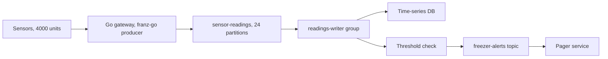

# Kafka with Go (franz-go)

## Introduction

Go is a natural fit for the infrastructure side of Kafka: ingestion gateways that accept millions of small messages, proxies, log shippers, operators and command-line tools. Its goroutines and small memory footprint suit long-running network services, and a single static binary is easy to ship into a container.

Go has several Kafka libraries, and the choice has real consequences for performance, features and how you build your binary. This page focuses on **franz-go** (`github.com/twmb/franz-go`), a pure Go client that covers the full Kafka protocol, including transactions, the KIP-848 consumer protocol and share groups, and is consistently among the fastest Go clients. It needs no C library, so `CGO_ENABLED=0` builds and cross-compilation just work.

By the end of this page you will be able to create a franz-go client, produce records synchronously and asynchronously, write a consumer that commits only processed records and survives rebalances, use the admin package, and choose between franz-go, sarama and confluent-kafka-go.

The running example is a fleet of environmental sensors in a chain of cold-storage warehouses. Each sensor reports temperature and humidity every ten seconds. A Go gateway accepts these readings over HTTP and produces them to a `sensor-readings` topic, keyed by sensor ID. A Go consumer writes them to a time-series database and raises an alert if a freezer warms above minus 15 degrees.

## Choosing a Go Client

| Library | Module | Implementation | Strengths | Trade-offs |
| --- | --- | --- | --- | --- |
| franz-go | `github.com/twmb/franz-go` | Pure Go | Full protocol coverage, fast, transactions, KIP-848, share groups, admin package (`kadm`), fake in-memory cluster (`kfake`) for tests | Single main maintainer; API is large because it exposes many options |
| sarama | `github.com/IBM/sarama` | Pure Go | The oldest and most widely deployed Go client; huge amount of existing code | Older API design; consumer group handling is more manual; some defaults need tuning |
| confluent-kafka-go | `github.com/confluentinc/confluent-kafka-go/v2` | librdkafka via cgo | Same behaviour and config keys as Python, .NET and Node librdkafka clients; Confluent support | Requires cgo, which complicates cross-compiling and minimal images |
| kafka-go | `github.com/segmentio/kafka-go` | Pure Go | Simple, idiomatic reader and writer types | Slower development; fewer advanced features |

For the sensor gateway, franz-go is the default choice: pure Go keeps the container image small, and the throughput headroom matters when a few thousand sensors report at once. A team that already standardised on librdkafka configuration across languages might reasonably choose confluent-kafka-go instead.

## Installing franz-go

```bash
go get github.com/twmb/franz-go@latest            # the client, package pkg/kgo
go get github.com/twmb/franz-go/pkg/kadm@latest   # optional: admin helpers
```

The core client lives in the `kgo` package. At the time of writing, franz-go is at v1.22, supports brokers from Kafka 0.8 through 4.4, and declares a recent Go toolchain (Go 1.26) in its `go.mod`.

## Creating a Client

franz-go has a single `kgo.Client` type that can produce, consume and send admin requests. You configure it with functional options rather than a properties map.

```go
package main

import (
	"github.com/twmb/franz-go/pkg/kgo"
)

func newClient(groupID string) (*kgo.Client, error) {
	return kgo.NewClient(
		kgo.SeedBrokers("localhost:9092"),
		kgo.ClientID("sensor-gateway"),
		// Producer defaults are already safe: acks from all in-sync replicas,
		// idempotent writes, snappy compression, 10ms linger.
		kgo.ProducerBatchCompression(kgo.Lz4Compression()),

		// Consumer options; harmless for a client that only produces.
		kgo.ConsumerGroup(groupID),
		kgo.ConsumeTopics("sensor-readings"),
	)
}
```

The producer defaults deserve a closer look because they differ from both Java and librdkafka:

| Setting | franz-go default | Java client default |
| --- | --- | --- |
| Acks | All in-sync replicas | `all` |
| Idempotent writes | On | On |
| Linger | 10 ms (since v1.20) | 5 ms |
| Compression | Snappy, falling back to none | None |
| Key hashing | murmur2, Java-compatible | murmur2 |
| Start offset for a new group | Earliest | `latest` |

The last row is the one that surprises people. A new franz-go consumer group reads the whole topic from the beginning; a new Java group starts at the end. Use `kgo.ConsumeStartOffset(kgo.NewOffset().AtEnd())` if you want Java's behaviour.

## Producing Records

`Produce` is asynchronous and takes a callback. `ProduceSync` waits for the result and is convenient in request handlers.

```go
package main

import (
	"context"
	"encoding/json"
	"log"
	"net/http"

	"github.com/twmb/franz-go/pkg/kgo"
)

type Reading struct {
	SensorID    string  `json:"sensor_id"`
	Celsius     float64 `json:"celsius"`
	HumidityPct float64 `json:"humidity_pct"`
	TS          int64   `json:"ts"`
}

func readingsHandler(cl *kgo.Client) http.HandlerFunc {
	return func(w http.ResponseWriter, r *http.Request) {
		var rd Reading
		if err := json.NewDecoder(r.Body).Decode(&rd); err != nil {
			http.Error(w, "bad reading", http.StatusBadRequest)
			return
		}
		value, _ := json.Marshal(rd)
		rec := &kgo.Record{Topic: "sensor-readings", Key: []byte(rd.SensorID), Value: value}

		// Async: return 202 immediately; the callback reports the final outcome.
		// The request context is not used, because it is cancelled when the
		// handler returns and would abort the produce.
		cl.Produce(context.Background(), rec, func(r *kgo.Record, err error) {
			if err != nil {
				log.Printf("produce failed for sensor %s: %v", r.Key, err)
			}
		})
		w.WriteHeader(http.StatusAccepted)
	}
}

func produceAlert(ctx context.Context, cl *kgo.Client, sensorID string, msg string) error {
	rec := &kgo.Record{Topic: "freezer-alerts", Key: []byte(sensorID), Value: []byte(msg)}
	// Sync: an alert must be stored before we report success.
	return cl.ProduceSync(ctx, rec).FirstErr()
}
```

Two things to keep in mind:

- **The context passed to `Produce` can cancel the record.** If it is cancelled before the record is sent, the record fails with the context error. That is useful for timeouts, but a request context that ends when the handler returns would cancel every async produce, as the comment explains.
- **Call `cl.Flush(ctx)` before `cl.Close()`** on shutdown so buffered records are delivered. `Close` alone does not wait for them.

## Consuming Records with Safe Commits

By default, franz-go auto-commits offsets every five seconds for records that previous polls returned. That gives at-least-once delivery in most cases, but a rebalance can still move a partition while you are halfway through a batch. The pattern below makes commits explicit and blocks rebalances while a batch is being processed.

```go
package main

import (
	"context"
	"encoding/json"
	"log"
	"os/signal"
	"syscall"

	"github.com/twmb/franz-go/pkg/kgo"
)

func main() {
	ctx, stop := signal.NotifyContext(context.Background(), syscall.SIGINT, syscall.SIGTERM)
	defer stop()

	cl, err := kgo.NewClient(
		kgo.SeedBrokers("localhost:9092"),
		kgo.ConsumerGroup("readings-writer"),
		kgo.ConsumeTopics("sensor-readings"),
		kgo.DisableAutoCommit(),
		// No rebalance can take partitions away between PollFetches and AllowRebalance.
		kgo.BlockRebalanceOnPoll(),
		// Opt in to the KIP-848 protocol (Kafka 4.0+; 4.3+ recommended by franz-go).
		kgo.ServerSideBalancer(),
	)
	if err != nil {
		log.Fatal(err)
	}
	defer cl.Close() // leaves the group

	for {
		// Return at most 1000 records so one batch stays well under max poll interval.
		fetches := cl.PollRecords(ctx, 1000)
		if fetches.IsClientClosed() || ctx.Err() != nil {
			return
		}
		fetches.EachError(func(topic string, partition int32, err error) {
			log.Printf("fetch error %s[%d]: %v", topic, partition, err)
		})

		var batch []Reading
		fetches.EachRecord(func(r *kgo.Record) {
			var rd Reading
			if err := json.Unmarshal(r.Value, &rd); err != nil {
				log.Printf("skipping bad record at %s[%d]@%d", r.Topic, r.Partition, r.Offset)
				return
			}
			batch = append(batch, rd)
		})

		if err := writeToTimeSeriesDB(ctx, batch); err != nil {
			// Do not commit: these records will be redelivered after a restart.
			log.Printf("write failed: %v", err)
			cl.AllowRebalance()
			continue
		}
		// Commit everything returned by the polls so far, then let rebalances run.
		if err := cl.CommitUncommittedOffsets(ctx); err != nil {
			log.Printf("commit failed: %v", err)
		}
		cl.AllowRebalance()
	}
}

func writeToTimeSeriesDB(ctx context.Context, batch []Reading) error {
	// Insert rows; use the sensor ID and timestamp as a unique key so replays are harmless.
	return nil
}
```

`Reading` is the struct from the producer example. The write uses a unique key on sensor ID and timestamp, so a replay after a crash or a failed commit only rewrites rows that already exist. That idempotent write is what makes at-least-once delivery safe here.

:::warning
With `BlockRebalanceOnPoll`, you must call `AllowRebalance()` after every poll, including error paths. Forgetting it on one branch freezes the group's rebalances and, eventually, gets the consumer kicked out for exceeding the rebalance timeout.
:::

## Admin Operations with kadm

The `kadm` package wraps admin requests in a friendlier API. It is built on top of a `kgo.Client`.

```go
package main

import (
	"context"
	"fmt"
	"log"

	"github.com/twmb/franz-go/pkg/kadm"
	"github.com/twmb/franz-go/pkg/kgo"
)

func main() {
	cl, err := kgo.NewClient(kgo.SeedBrokers("localhost:9092"))
	if err != nil {
		log.Fatal(err)
	}
	defer cl.Close()
	adm := kadm.NewClient(cl)

	ctx := context.Background()
	// 24 partitions, replication factor 3, default topic configs.
	resp, err := adm.CreateTopic(ctx, 24, 3, nil, "sensor-readings")
	if err != nil {
		log.Fatal(err)
	}
	fmt.Println("created:", resp.Topic, resp.Err)

	// Lag per partition for the writer group.
	lags, err := adm.Lag(ctx, "readings-writer")
	if err != nil {
		log.Fatal(err)
	}
	lags.Each(func(l kadm.DescribedGroupLag) {
		fmt.Printf("group %s total lag %d\n", l.Group, l.Lag.Total())
	})
}
```

## Worked Scenario: A Freezer Alert That Arrived Late

One night a freezer door is left open. The alert fires 40 minutes after the temperature crosses the threshold. The post-incident review traces the delay through the pipeline.



1. **The gateway was fine.** Produce latency stayed under 20 ms; records reached the topic on time.
2. **The writer group was not.** A database slowdown made each batch take minutes. Because the writer only checked thresholds after a successful database write, alerts waited behind storage.
3. **The fix separated concerns.** The team created a second consumer group, `freezer-watch`, that reads the same topic and only checks thresholds. Consumer groups are independent, so a slow database no longer delays alerts. This is the main reason to pick a log like Kafka over a queue here: two groups read the same records at their own pace.

They also lowered the batch size for the writer from 1000 to 250 records, keeping each batch short enough that a rebalance is never blocked for long.

## Common Mistakes

- **Passing the HTTP request context to an async `Produce`.** The record fails with "context canceled" as soon as the handler returns.
- **Closing the client without `Flush`.** Buffered records are dropped.
- **Assuming Java's `latest` start offset.** franz-go starts new groups at the earliest offset.
- **Forgetting `AllowRebalance()` on an error path** when using `BlockRebalanceOnPoll`.
- **Committing before the batch is stored.** A crash then loses the batch.
- **Running several goroutines over one partition's records without care.** You lose per-key ordering; process each partition in its own goroutine if you parallelise (`fetches.EachPartition`).
- **Choosing confluent-kafka-go and then building with `CGO_ENABLED=0`.** It needs cgo; pick a pure Go client if you need static, cgo-free builds.

## Summary

- franz-go (`github.com/twmb/franz-go/pkg/kgo`) is a pure Go, full-featured Kafka client; `kadm` adds admin helpers.
- One `kgo.Client` produces, consumes and administers; it is configured with functional options.
- Defaults are safe for producing (all ISR acks, idempotence) but start new consumer groups at the earliest offset.
- `Produce` is async with a callback; `ProduceSync` waits; always `Flush` before `Close`.
- For explicit at-least-once consumption, combine `DisableAutoCommit`, `BlockRebalanceOnPoll`, `CommitUncommittedOffsets` and `AllowRebalance`.
- `ServerSideBalancer()` opts in to KIP-848; sarama and confluent-kafka-go remain valid alternatives for existing code or librdkafka consistency.

## Further Reading

- [franz-go on GitHub](https://github.com/twmb/franz-go) - README, examples directory and the detailed changelog.
- [kgo package documentation](https://pkg.go.dev/github.com/twmb/franz-go/pkg/kgo) - every client option with its default.
- [kadm package documentation](https://pkg.go.dev/github.com/twmb/franz-go/pkg/kadm) - topic, group, ACL and offset administration.
- [IBM sarama](https://github.com/IBM/sarama) - the long-standing alternative pure Go client.
- [confluent-kafka-go](https://github.com/confluentinc/confluent-kafka-go) - the librdkafka-based Go client from Confluent.
- [KIP-848: The Next Generation of the Consumer Rebalance Protocol](https://cwiki.apache.org/confluence/display/KAFKA/KIP-848%3A+The+Next+Generation+of+the+Consumer+Rebalance+Protocol) - the server-side assignment protocol behind `ServerSideBalancer`.
