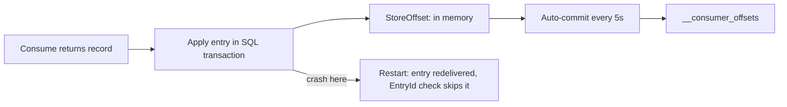

# Kafka with .NET

## Introduction

Many banks, insurers, retailers and logistics companies run their core systems on .NET, and those systems increasingly publish and react to events through Kafka. A C# service might post every ledger entry to a topic, consume price changes from a pricing team written in Java, or feed a reporting database from a stream of orders.

The standard .NET client is **Confluent.Kafka**, published by Confluent and built on librdkafka, the same C library behind the Python, Go and Node.js clients from Confluent. The NuGet package ships native librdkafka binaries for Windows, Linux and macOS, so you install one package and write plain C#.

By the end of this page you will be able to add Confluent.Kafka to a project, produce records with `ProduceAsync` and `Produce`, run a consumer inside an ASP.NET Core or Worker Service host, control offset commits precisely, and decide whether a higher-level framework such as MassTransit or KafkaFlow is worth adding.

The running example is a small bank. A payments API posts each transfer as a `LedgerEntry` event to a `ledger-entries` topic, keyed by account number. A balance service consumes the entries and maintains each account's current balance in SQL Server. Losing an entry is unacceptable; processing one twice must not double a balance.

## Installing Confluent.Kafka

```bash
dotnet add package Confluent.Kafka
```

The current release line is 2.16, targeting .NET 10, .NET 8, .NET Framework 4.6.2 and .NET Standard 2.0. Its version number matches the bundled librdkafka version, which helps when reading the librdkafka changelog.

Optional packages add Schema Registry support:

| Package | Purpose |
| --- | --- |
| `Confluent.SchemaRegistry` | Schema Registry REST client |
| `Confluent.SchemaRegistry.Serdes.Avro` | Avro serializer and deserializer |
| `Confluent.SchemaRegistry.Serdes.Protobuf` | Protobuf serializer and deserializer |
| `Confluent.SchemaRegistry.Serdes.Json` | JSON Schema serializer and deserializer |

The examples below use plain JSON with `System.Text.Json` to stay focused on the client. For a ledger shared across teams, a schema is the better long-term choice (see [Schema Registry: Why and How](../6-kafka-schemas/1-kafka-schema-registry.mdx)).

## Producing Records

Configuration is a typed `ProducerConfig` object whose properties map one-to-one to librdkafka settings.

```csharp
using System.Text.Json;
using Confluent.Kafka;

public record LedgerEntry(string EntryId, string Account, decimal Amount, string Currency, DateTimeOffset At);

public sealed class LedgerPublisher : IDisposable
{
    private readonly IProducer<string, string> _producer;

    public LedgerPublisher(string bootstrapServers)
    {
        var config = new ProducerConfig
        {
            BootstrapServers = bootstrapServers,
            ClientId = "payments-api",
            Acks = Acks.All,
            // librdkafka defaults this to false; a ledger needs it on.
            EnableIdempotence = true,
            // Hash keys the way the Java client does, so a Java producer and this
            // one put the same account on the same partition.
            Partitioner = Partitioner.Murmur2Random,
            CompressionType = CompressionType.Lz4,
        };
        // Build once, share everywhere: the producer is thread-safe.
        _producer = new ProducerBuilder<string, string>(config).Build();
    }

    public async Task PublishAsync(LedgerEntry entry, CancellationToken ct)
    {
        var message = new Message<string, string>
        {
            Key = entry.Account,
            Value = JsonSerializer.Serialize(entry),
        };
        // Completes when the broker acknowledges; throws ProduceException on failure.
        DeliveryResult<string, string> result = await _producer.ProduceAsync("ledger-entries", message, ct);
        Console.WriteLine($"Stored {entry.EntryId} at {result.TopicPartitionOffset}");
    }

    public void Dispose()
    {
        // Deliver anything still buffered before tearing down.
        _producer.Flush(TimeSpan.FromSeconds(10));
        _producer.Dispose();
    }
}
```

There are two ways to produce, and the choice is the same trade-off as everywhere in Kafka:

- **`ProduceAsync`** returns a `Task` that completes on acknowledgement. Awaiting it inside an HTTP request means the API only answers "transfer accepted" once the entry is durable. That is right for the bank. Many concurrent requests still get batched together underneath, so throughput stays good.
- **`Produce`** takes a delivery handler callback and returns immediately. It is faster in tight loops, such as replaying a file of historical entries, because nothing waits per record. Call `Flush` at the end.

In ASP.NET Core, register the publisher as a singleton (`builder.Services.AddSingleton<LedgerPublisher>(...)`). A scoped or transient producer would create a new connection pool and buffer for every request.

## Consuming Inside a Hosted Service

A consumer is a long-running loop, which fits the `BackgroundService` base class in ASP.NET Core and the Worker Service template. One wrinkle: `Consume` is a blocking call, so the loop must run on its own thread rather than block host startup.

```csharp
using System.Text.Json;
using Confluent.Kafka;
using Microsoft.Extensions.Hosting;
using Microsoft.Extensions.Logging;

public sealed class BalanceConsumer : BackgroundService
{
    private readonly ILogger<BalanceConsumer> _log;
    private readonly BalanceStore _store;

    public BalanceConsumer(ILogger<BalanceConsumer> log, BalanceStore store)
    {
        _log = log;
        _store = store;
    }

    protected override Task ExecuteAsync(CancellationToken stoppingToken) =>
        // Consume() blocks; run the loop on a dedicated thread.
        Task.Factory.StartNew(() => Run(stoppingToken), stoppingToken,
            TaskCreationOptions.LongRunning, TaskScheduler.Default);

    private void Run(CancellationToken stoppingToken)
    {
        var config = new ConsumerConfig
        {
            BootstrapServers = "localhost:9092",
            GroupId = "balance-service",
            // KIP-848 rebalance protocol (Kafka 4.0+ brokers).
            GroupProtocol = GroupProtocol.Consumer,
            AutoOffsetReset = AutoOffsetReset.Earliest,
            // Keep background commits, but only of offsets we explicitly store.
            EnableAutoCommit = true,
            EnableAutoOffsetStore = false,
            // Only see entries from committed transactions (librdkafka default).
            IsolationLevel = IsolationLevel.ReadCommitted,
        };

        using var consumer = new ConsumerBuilder<string, string>(config)
            .SetErrorHandler((_, e) => _log.LogWarning("Kafka error: {Reason}", e.Reason))
            .Build();
        consumer.Subscribe("ledger-entries");

        try
        {
            while (!stoppingToken.IsCancellationRequested)
            {
                ConsumeResult<string, string> result;
                try
                {
                    result = consumer.Consume(stoppingToken);
                }
                catch (ConsumeException e)
                {
                    _log.LogError("Consume failed: {Reason}", e.Error.Reason);
                    continue;
                }

                var entry = JsonSerializer.Deserialize<LedgerEntry>(result.Message.Value)!;
                // Applies the entry and records EntryId in the same SQL transaction,
                // so a redelivered entry is detected and skipped.
                _store.Apply(entry);

                // Mark this record as processed; the next auto-commit includes it.
                consumer.StoreOffset(result);
            }
        }
        catch (OperationCanceledException)
        {
            // Host is shutting down.
        }
        finally
        {
            // Commits stored offsets and leaves the group cleanly.
            consumer.Close();
        }
    }
}
```

Register it with `builder.Services.AddHostedService<BalanceConsumer>()`.

### Why EnableAutoOffsetStore = false

This is the most important line in .NET consumer code, and it is specific to librdkafka. librdkafka separates two steps:

1. **Storing** an offset: noting in memory that a record is done.
2. **Committing**: sending the stored offsets to Kafka, which auto-commit does every five seconds.

With the defaults, librdkafka stores the offset of each record as soon as `Consume` returns it, before your code has processed it. If the process crashes after the next auto-commit but before `_store.Apply` finished, that entry is skipped forever. Turning off the automatic store and calling `StoreOffset` after processing gives at-least-once delivery while keeping cheap background commits. The alternative, calling `consumer.Commit(result)` after every record, is also correct but adds a broker round trip per record.



## Plain Client or a Framework?

Confluent.Kafka is deliberately low-level. Several .NET libraries build on it:

| Option | What it adds | Choose it when | Cost |
| --- | --- | --- | --- |
| Confluent.Kafka alone | Nothing beyond the client | You want full control and few dependencies | You write hosting, retries and dead-lettering yourself |
| KafkaFlow | Middleware pipeline, typed handlers, worker pools that keep per-key order, admin dashboard | Kafka-first services with many consumers | Another abstraction; its own configuration model |
| MassTransit (Kafka rider) | Sagas, consistent messaging API across RabbitMQ, Azure Service Bus and Kafka | You already use MassTransit with another broker | Kafka is a "rider", not the core transport; some Kafka concepts are hidden |
| .NET Aspire `Aspire.Confluent.Kafka` | Registers producers and consumers in DI with health checks and telemetry | You build with .NET Aspire | Configuration conventions you need to learn |

For the bank, the team starts with the plain client: one producer, one consumer, and a hard requirement to understand exactly when offsets move. If the number of consumers grows to dozens, KafkaFlow becomes attractive.

## Worked Scenario: The Double-Credited Account

During a deployment, a customer's balance briefly shows a deposit twice. The investigation finds that an early version of the balance service used the defaults: auto-store and auto-commit, and an `UPDATE accounts SET balance = balance + @amount` statement with no deduplication.

What happened: pod A processed entry 9001 and updated the balance, then was stopped by the deployment before the next auto-commit. Its partitions moved to pod B, which resumed from the last committed offset and applied entry 9001 again.

The fix had two parts, both visible in the code above:

1. **Idempotent processing.** The SQL transaction inserts `EntryId` into a `processed_entries` table with a unique constraint and updates the balance. A duplicate insert fails, the transaction rolls back and the consumer moves on. Duplicates become harmless no matter how they arise.
2. **Explicit offset storing.** `EnableAutoOffsetStore = false` with `StoreOffset` after processing stops the opposite failure, a skipped entry, which would have been far worse.

Kafka transactions were considered and rejected: they give exactly-once only for Kafka-to-Kafka flows, and the balance lives in SQL Server. The [delivery semantics](../4-kafka-consumers/4-kafka-delivery-semantics.mdx) page explains why idempotent consumers are the usual answer when the output is a database.

## Common Mistakes

- **Registering the producer as scoped or transient.** Each instance opens connections and buffers; make it a singleton.
- **Calling the blocking `Consume` directly in `ExecuteAsync`.** It can block application startup; run the loop on its own thread.
- **Leaving `EnableAutoOffsetStore` at its default with auto-commit on.** Offsets can be committed for records you have not processed.
- **Forgetting `EnableIdempotence = true`.** librdkafka defaults it to false, unlike the Java client.
- **Mixing .NET and Java producers on keyed topics without `Partitioner.Murmur2Random`.** The default CRC32-based partitioner sends the same key to a different partition.
- **Skipping `Close()` on shutdown.** Stored offsets are not committed and the group waits for a timeout before reassigning partitions.
- **Ignoring fatal errors.** If the error handler reports `IsFatal`, the client cannot recover; restart it.

## Summary

- Confluent.Kafka (`dotnet add package Confluent.Kafka`) is the standard .NET client, built on librdkafka and shipping native binaries.
- Configure with typed `ProducerConfig` and `ConsumerConfig`; set `EnableIdempotence = true` and, if Java producers share the topic, `Partitioner = Partitioner.Murmur2Random`.
- `ProduceAsync` waits for the acknowledgement; `Produce` with a delivery handler is faster for bulk work. Share one producer.
- Run consumers in a `BackgroundService` on a dedicated thread, set `EnableAutoOffsetStore = false` and call `StoreOffset` after processing.
- Make processing idempotent so that redelivery is harmless; use `GroupProtocol.Consumer` for the KIP-848 protocol.
- Add KafkaFlow, MassTransit or Aspire integration only when their extra features earn their place.

## Further Reading

- [confluent-kafka-dotnet on GitHub](https://github.com/confluentinc/confluent-kafka-dotnet) - README, examples (including a web app and exactly-once word count) and changelog.
- [Confluent .NET client documentation](https://docs.confluent.io/kafka-clients/dotnet/current/overview.html) - API reference and configuration guide.
- [librdkafka CONFIGURATION.md](https://github.com/confluentinc/librdkafka/blob/master/CONFIGURATION.md) - every setting behind the typed config properties, with defaults.
- [Getting Started with Apache Kafka and .NET](https://developer.confluent.io/get-started/dotnet/) - a step-by-step introductory guide.
- [KafkaFlow](https://github.com/Farfetch/kafkaflow) - a framework on top of Confluent.Kafka for middleware-style consumers.
