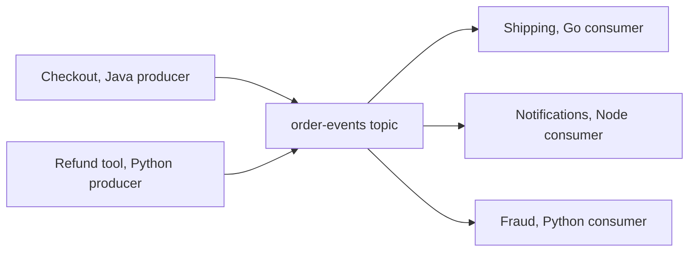

# Client Configuration Reference: The Settings That Matter

## Introduction

A Kafka producer has more than 60 configuration keys and a consumer more than 70. Almost all of them have sensible defaults, and you will never touch most of them. A dozen or so decide whether your application loses data, duplicates it, falls behind or gets stuck in rebalances.

This page is a field guide to those dozen. For each setting it explains what it controls, when to change it and what the default is in the two client families you are most likely to use: the **Java client** (`kafka-clients`, also used by Spring Kafka, Kafka Streams and Connect) and **librdkafka** (behind confluent-kafka for Python, Confluent.Kafka for .NET, confluent-kafka-go and `@confluentinc/kafka-javascript`). franz-go has its own option names; its defaults are noted where they matter.

The defaults are not the same across families, and that is the real reason this page exists. A team that tunes its Java services and then writes a Python consumer with "the same config" can end up with duplicates, ordering bugs or a consumer that cannot see some records.

Defaults below are from Apache Kafka 4.3/4.4 for the Java client and librdkafka 2.16. Check the official configuration pages for the version you run.

## Settings Every Client Needs

| Setting | Java default | librdkafka default | What it does and when to change it |
| --- | --- | --- | --- |
| `bootstrap.servers` | none | none | A few brokers used only to discover the cluster. List two or three so startup survives one being down. |
| `client.id` | empty | `rdkafka` | Appears in broker logs, metrics and quotas. Always set it to the service name. |
| `security.protocol` | `PLAINTEXT` | `plaintext` | Use `SASL_SSL` (or `SSL` for mTLS) for anything outside a laptop. See [Kafka Security Overview](../11-kafka-security/0-kafka-security-overview.mdx). |
| `client.rack` | empty | empty | The availability zone of this client. Lets consumers fetch from a same-zone follower when brokers enable rack-aware replica selection, which cuts cross-zone traffic costs. |
| `request.timeout.ms` | 30000 | 30000 (`socket.timeout.ms` 60000) | How long to wait for one broker response. Rarely worth changing. |
| `metadata.recovery.strategy` | `rebootstrap` | `rebootstrap` | What to do when every known broker is unreachable. With `rebootstrap`, the client goes back to `bootstrap.servers`, which helps when brokers are replaced with new addresses. |

Authentication is configured differently in the two families. The Java client uses a JAAS string; librdkafka uses plain keys:

```properties
# Java client: SCRAM over TLS
security.protocol=SASL_SSL
sasl.mechanism=SCRAM-SHA-512
sasl.jaas.config=org.apache.kafka.common.security.scram.ScramLoginModule required username="orders-svc" password="${file:/etc/kafka/secrets.properties:password}";
```

```properties
# librdkafka (Python, .NET, Go, Node): the same connection
security.protocol=SASL_SSL
sasl.mechanism=SCRAM-SHA-512
sasl.username=orders-svc
sasl.password=read-this-from-a-secret-store
```

Never commit passwords to a repository; [Managing Secrets and Client Credentials](../11-kafka-security/5-kafka-secrets-and-credentials.mdx) covers the options.

## Producer Settings

### Durability and Duplicates

| Setting | Java default | librdkafka default | Notes |
| --- | --- | --- | --- |
| `acks` | `all` | `all` (`-1`) | `all` waits for every in-sync replica. Pair it with topic `min.insync.replicas=2` on a replication factor of 3. `1` is faster but loses acknowledged records when a leader dies. See [acks and Durability](../3-kafka-producers/2-kafka-producer-acks-and-durability.mdx). |
| `enable.idempotence` | `true` | **`false`** | Prevents duplicates and reordering caused by retries. Turn it on explicitly in every librdkafka producer. |
| `max.in.flight.requests.per.connection` | 5 | 1000000 | Must be 5 or less for idempotence; librdkafka adjusts it automatically when idempotence is on. |
| `transactional.id` | none | none | Set it only for exactly-once Kafka-to-Kafka pipelines. Implies idempotence. See [Transactions](../3-kafka-producers/7-kafka-transactions.mdx). |

### Timeouts and Retries

| Setting | Java default | librdkafka default | Notes |
| --- | --- | --- | --- |
| `delivery.timeout.ms` | 120000 | **300000** (alias of `message.timeout.ms`) | The total time a record may spend being retried before the client gives up and reports an error. This is the one retry setting to tune. |
| `retries` | 2147483647 | 2147483647 | Leave it alone; bound retries with `delivery.timeout.ms` instead. |
| `retry.backoff.ms` / `retry.backoff.max.ms` | 100 / 1000 | 100 / 1000 | Exponential backoff between retries. |
| `max.block.ms` | 60000 | n/a | Java only: how long `send()` may block waiting for metadata or buffer space. In librdkafka a full queue raises an error immediately. |

### Throughput

| Setting | Java default | librdkafka default | Notes |
| --- | --- | --- | --- |
| `linger.ms` | 5 (was 0 before Kafka 4.0) | 5 | How long to wait for more records before sending a batch. 10-50 ms raises throughput for busy producers at a small latency cost. franz-go defaults to 10 ms. |
| `batch.size` | 16384 bytes, per partition | **1000000 bytes** | Maximum batch size. Java's is small; 64-256 KB is common for high-volume topics. |
| `compression.type` | `none` | `none` | `lz4` or `zstd` usually pay for themselves on JSON. franz-go defaults to snappy. |
| `buffer.memory` | 33554432 (32 MB) | `queue.buffering.max.kbytes` 1048576 (1 GB) | Memory for records waiting to be sent. |

### Partitioning

| Setting | Java default | librdkafka default | Notes |
| --- | --- | --- | --- |
| Key hashing | murmur2 | **`consistent_random` (CRC32)** | The same key goes to **different partitions** in Java and librdkafka unless you set `partitioner=murmur2_random` on librdkafka producers. The KafkaJS-compatible API of `@confluentinc/kafka-javascript` and franz-go already use murmur2. |
| Records without a key | Sticky, switches partition per batch | Sticky (`sticky.partitioning.linger.ms` 10) | Spreads unkeyed records evenly while keeping batches large. |

## Consumer Settings

### Group Membership

| Setting | Java default | librdkafka default | Notes |
| --- | --- | --- | --- |
| `group.id` | none | none | Consumers with the same ID share partitions. A new ID means a new, independent reader. |
| `group.protocol` | `classic` | `classic` | Set `consumer` to use the KIP-848 protocol on Kafka 4.0+ brokers: incremental, broker-driven rebalances without stop-the-world pauses. See [Rebalancing](../4-kafka-consumers/2-kafka-rebalancing.mdx). |
| `group.remote.assignor` | none (broker chooses) | none | With `group.protocol=consumer`, picks the server-side assignor (`uniform` or `range`; the broker default is `uniform`). |
| `session.timeout.ms` | 45000 | 45000 | Classic protocol only. With `consumer`, the broker setting `group.consumer.session.timeout.ms` applies; the Java client rejects this key and librdkafka ignores it. |
| `heartbeat.interval.ms` | 3000 | 3000 | Classic protocol only; the broker setting `group.consumer.heartbeat.interval.ms` replaces it (Java rejects the key, librdkafka ignores it). |
| `partition.assignment.strategy` | `RangeAssignor, CooperativeStickyAssignor` | `range,roundrobin` | Classic protocol only; `group.remote.assignor` replaces it, and the Java client rejects this key under `consumer`. Prefer cooperative sticky if you stay on classic. |
| `group.instance.id` | none | none | Static membership: a restarted instance gets its partitions back without a rebalance if it returns within the session timeout. Useful for stateful consumers and rolling deploys. |
| `max.poll.interval.ms` | 300000 | 300000 | The maximum gap between polls before the consumer is considered stuck. Applies to both protocols. See [Liveness](../4-kafka-consumers/5-kafka-consumer-liveness.mdx). |

### Where to Start and How to Commit

| Setting | Java default | librdkafka default | Notes |
| --- | --- | --- | --- |
| `auto.offset.reset` | `latest` | `latest` (`largest`) | Used when a group has no committed offset. Choose `earliest` when a new group must process history. Kafka 4.x also accepts `by_duration:` followed by an ISO-8601 duration. franz-go starts at the earliest offset by default. |
| `enable.auto.commit` | `true` | `true` | Commits in the background every `auto.commit.interval.ms` (5000). |
| `enable.auto.offset.store` | n/a | `true` | librdkafka only: stores each offset as soon as the record is returned. Set it to `false` and call `store_offsets` / `StoreOffset` after processing for safe at-least-once with auto-commit. |
| `isolation.level` | `read_uncommitted` | **`read_committed`** | Whether to show records from aborted or open transactions. Use `read_committed` whenever transactional producers write the topic. |

### Fetching and Batch Size

| Setting | Java default | librdkafka default | Notes |
| --- | --- | --- | --- |
| `max.poll.records` | 500 | n/a | Java only: records returned per `poll()`. Lower it if processing a batch takes long. librdkafka returns one message per `poll()`, or a batch from `consume(num_messages=...)`. |
| `fetch.min.bytes` | 1 | 1 | Raise it (e.g. 64 KB) to make brokers wait for fuller responses: fewer requests, slightly more latency. |
| `fetch.max.wait.ms` | 500 | 500 (`fetch.wait.max.ms`) | Upper bound on that wait. |
| `max.partition.fetch.bytes` | 1048576 | 1048576 | Per-partition limit per fetch. |
| `fetch.max.bytes` | 52428800 | 52428800 | Per-request limit across partitions. |

## Starting Configurations for Common Workloads

These are reasonable starting points, not final answers; measure before and after any change.

```properties
# Payments or orders: never lose, never duplicate (Java names; same keys in librdkafka)
acks=all
enable.idempotence=true
delivery.timeout.ms=120000
linger.ms=5
compression.type=lz4
# librdkafka only: match Java key hashing
# partitioner=murmur2_random

# Consumer side
group.protocol=consumer
enable.auto.commit=false
auto.offset.reset=earliest
isolation.level=read_committed
```

```properties
# Clickstream or logs: high volume, small loss tolerable on rare failures
acks=all
enable.idempotence=true
linger.ms=50
batch.size=262144
compression.type=zstd

# Consumer side
group.protocol=consumer
fetch.min.bytes=65536
max.poll.records=2000
```

Even for logs, keep `acks=all` unless you have measured that it is your bottleneck; the latency cost is usually a few milliseconds.

## Worked Scenario: One Topic, Three Languages

A retailer's checkout system publishes `OrderEvent` records keyed by order ID to `order-events`. Three teams consume or produce it:



Three bugs appear over a month, each caused by a default that differs between clients:

1. **Refund events arrive before the order.** The refund tool (confluent-kafka, Python) used the default CRC32 partitioner. The same order ID hashed to a different partition than the checkout service's murmur2, so the shipping consumer sometimes saw `REFUNDED` before `PLACED`. Fix: `partitioner=murmur2_random` in the Python producer.
2. **Occasional duplicate refunds.** The Python producer also had `enable.idempotence` at its librdkafka default of false. A network timeout followed by a retry wrote the same refund twice. Fix: turn on idempotence.
3. **The fraud team saw orders that were never placed.** Checkout later moved to transactions for an outbox flow, and aborted transactions left records in the log. Java consumers with the default `read_uncommitted` saw them; the Python consumers did not, because librdkafka defaults to `read_committed`. The Java-based fraud prototype flagged phantom orders. Fix: `isolation.level=read_committed` on every consumer of a transactional topic.

The lasting fix was organisational: the platform team published a shared, versioned client configuration for each language, with the differences in this page written down, and code review checks new services against it. [Schemas as Contracts Between Teams](../13-kafka-best-practices/2-kafka-schema-and-contract-practices.mdx) applies the same idea to message formats.

## Common Mistakes

- **Copying a Java config into a librdkafka client and assuming the same behaviour.** Idempotence, partitioning, isolation level, batch size and delivery timeout all differ.
- **Tuning `retries` instead of `delivery.timeout.ms`.** Retries are effectively unlimited; time is the real bound.
- **Setting `acks=1` for speed without measuring.** It risks losing acknowledged records for a few milliseconds of latency.
- **Keeping `session.timeout.ms` and `heartbeat.interval.ms` after switching to `group.protocol=consumer`.** The Java client fails to start and librdkafka silently ignores them; the broker controls those now.
- **Raising `max.poll.interval.ms` to hide slow processing.** A stuck consumer then takes longer to detect; reduce batch size or speed up the work instead.
- **Forgetting `client.id`.** Broker logs and quotas become impossible to attribute.
- **Using `auto.offset.reset=latest` for a new group that must see existing data.** The group silently starts at the end.

## Summary

- A dozen settings matter: `bootstrap.servers`, `client.id`, security, `acks`, `enable.idempotence`, `delivery.timeout.ms`, `linger.ms`, `batch.size`, `compression.type`, `group.protocol`, `auto.offset.reset`, commit settings, `isolation.level` and `max.poll.interval.ms`.
- Java and librdkafka disagree on several defaults: idempotence (on vs off), key hashing (murmur2 vs CRC32), isolation level (uncommitted vs committed), `batch.size` and `delivery.timeout.ms`.
- Since Kafka 4.0 the Java `linger.ms` default is 5 ms; franz-go uses 10 ms and starts new groups at the earliest offset.
- `group.protocol=consumer` enables KIP-848 and moves session and heartbeat timeouts to the broker.
- Publish one reviewed configuration per language for shared topics.

## Further Reading

- [Producer configs](https://kafka.apache.org/documentation/#producerconfigs) - every Java producer setting with its default and valid values.
- [Consumer configs](https://kafka.apache.org/documentation/#consumerconfigs) - every Java consumer setting, including which ones the `consumer` group protocol does not support.
- [librdkafka CONFIGURATION.md](https://github.com/confluentinc/librdkafka/blob/master/CONFIGURATION.md) - all librdkafka settings with defaults, shared by the Python, .NET, Go and Node clients.
- [KIP-1030: Change constraints and default values for various configurations](https://cwiki.apache.org/confluence/display/KAFKA/KIP-1030%3A+Change+constraints+and+default+values+for+various+configurations) - the 4.0 change of `linger.ms` from 0 to 5.
- [kgo options](https://pkg.go.dev/github.com/twmb/franz-go/pkg/kgo) - franz-go's equivalents and defaults.
