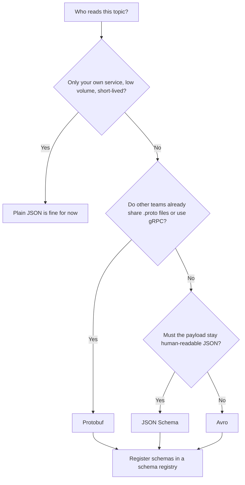

# Choosing a Serialization Format: JSON, Avro, Protobuf

## Introduction

A Kafka broker never looks inside a record. The key and the value are byte arrays, and the broker stores, replicates and serves them without caring whether they hold a JSON document, an Avro record or a photo of a cat. That freedom is useful, but it moves a decision onto you: every producer and every consumer of a topic must agree on how to turn objects into bytes and back. That agreement is the serialization format.

The choice is harder to undo than most Kafka settings. Partitions can be added and retention can be changed on a live topic, but once a few hundred million records are written in one format, switching means either rewriting them or teaching every consumer to read two formats forever. This page gives you enough to make the call deliberately. You will learn what plain JSON, Avro, Protobuf and JSON Schema each look like on the wire, how they differ in size, speed and evolvability, and which one fits which kind of system.

## Why the Format Matters More Than It Seems

Three things depend on the format you pick.

**Cost.** Kafka clusters are usually bound by network and disk, not CPU. A record format that is half the size halves the bytes replicated between brokers, stored on disk for the retention window, and pulled by every consumer group. For a clickstream topic that moves 50,000 events per second, the difference between a 600-byte JSON event and a 180-byte Avro event is roughly 20 MB/s of traffic before replication, multiplied by the replication factor and by the number of consumer groups reading it.

**The contract.** A topic is an interface between teams, exactly like an HTTP API. A format with an explicit schema gives that interface a written definition that tools can check. A format without one makes the definition whatever the producer's code happens to emit this week.

**Change.** Schemas change. A new field gets added, a field gets renamed, a type gets widened from integer to long when the first order over 2 billion cents arrives. Some formats make these changes safe by design; others leave it to discipline and luck.

## Plain JSON

JSON is the format most developers reach for first, and it is a reasonable place to start. Every language parses it, you can read it with `kafka-console-consumer.sh`, and there is nothing to install.

```json
{
  "orderId": "ord-7781",
  "customerId": "cust-204",
  "amountCents": 4599,
  "currency": "EUR",
  "placedAt": "2026-10-16T09:14:33Z",
  "items": [
    { "sku": "KB-104", "quantity": 1, "priceCents": 4599 }
  ]
}
```

The weaknesses show up after a few months in production.

- **Size.** Field names repeat in every record. The example above spends more bytes on keys like `"amountCents"` than on the values. Compression on the producer helps, but a binary format with an external schema is still usually two to four times smaller.
- **No types on the wire.** `4599` might be an integer or a float; `"2026-10-16T09:14:33Z"` is just a string. Each consumer re-derives the meaning.
- **No contract.** Nothing stops a producer from sending `amount_cents` tomorrow instead of `amountCents`. Consumers find out at 3 a.m.
- **Parsing speed.** Text parsing is slower than reading fixed binary fields. This rarely matters for a service handling hundreds of events per second; it matters a lot for a stream processor handling hundreds of thousands.

Plain JSON is a fine choice for low-volume internal topics, prototypes, and cases where humans will read the topic directly. It becomes a liability once several teams depend on the data.

## Avro

Apache Avro was designed for exactly this situation: lots of records, written by one system and read by many, where the schema changes over time. An Avro schema is itself a JSON document.

```json
{
  "type": "record",
  "name": "OrderPlaced",
  "namespace": "com.shop.orders",
  "fields": [
    { "name": "orderId", "type": "string" },
    { "name": "customerId", "type": "string" },
    { "name": "amountCents", "type": "long" },
    { "name": "currency", "type": "string", "default": "EUR" },
    { "name": "placedAt", "type": { "type": "long", "logicalType": "timestamp-millis" } },
    { "name": "items", "type": { "type": "array", "items": {
      "type": "record", "name": "OrderItem", "fields": [
        { "name": "sku", "type": "string" },
        { "name": "quantity", "type": "int" },
        { "name": "priceCents", "type": "long" }
      ] } } }
  ]
}
```

The encoded record contains only the values, in schema order, with no field names and no type tags. Strings and integers use variable-length encodings, so small numbers take one byte. The `OrderPlaced` record above encodes to roughly 60 bytes against about 200 for the JSON version.

The catch is the reader needs the exact schema the writer used, otherwise it cannot tell where one field ends and the next begins. Avro solves this with **schema resolution**: given the writer's schema and the reader's schema, the library maps one to the other, filling in defaults for missing fields and skipping fields the reader does not know. This is what makes Avro's schema evolution strong, and it is why Avro and a schema registry almost always travel together (see [Schema Registry: Why and How](./1-kafka-schema-registry.mdx)).

Other things to know about Avro:

- Nullable fields are written as a union, `["null", "string"]`, with `"default": null`. There is no separate "optional" keyword.
- Code generation is optional. You can work with `GenericRecord` objects at runtime or generate typed classes with the Avro Maven or Gradle plugin.
- Logical types (`timestamp-millis`, `decimal`, `uuid`, `date`) add meaning to primitive encodings, which matters for a bank ledger where `decimal` is not the same as `double`.
- Avro is the historical default of the Kafka ecosystem. Kafka Connect, ksqlDB, Flink, Spark and most data-lake tools read it natively.

## Protobuf

Protocol Buffers come from Google and from the RPC world. A `.proto` file defines messages, and a compiler (`protoc`) generates classes for Java, Go, Python, C#, JavaScript and many more.

```protobuf
syntax = "proto3";
package com.shop.orders;

import "google/protobuf/timestamp.proto";

message OrderPlaced {
  string order_id = 1;
  string customer_id = 2;
  int64 amount_cents = 3;
  string currency = 4;
  google.protobuf.Timestamp placed_at = 5;
  repeated OrderItem items = 6;
}

message OrderItem {
  string sku = 1;
  int32 quantity = 2;
  int64 price_cents = 3;
}
```

The numbers after each field are the important part. On the wire, Protobuf writes `field number, type tag, value`. The reader does not need the writer's schema to parse the bytes; it needs it only to know what the numbers mean. Unknown field numbers are skipped, and missing fields take their zero value (`0`, `""`, `false`, empty list).

This self-describing-by-number design has consequences:

- Encoded size is close to Avro, slightly larger because of the tags, but still a fraction of JSON.
- A field can be renamed freely; only the number matters. A field number can never be reused, which is why `reserved` exists.
- Code generation is the normal workflow, not an option. Dynamic access without generated classes exists (`DynamicMessage`) but is awkward.
- The ecosystem is strongest in service-to-service communication (gRPC) and in polyglot organizations where Go, C++ and Java teams already share `.proto` files.

Protobuf support in schema registries arrived later than Avro's (Confluent added it in 5.5, in 2020), but it is now first-class in Confluent Schema Registry, Apicurio, Karapace and Redpanda.

## JSON Schema

JSON Schema is not a new encoding. The payload is still JSON text. What it adds is a formal description of the allowed shape, which a serializer can validate on the way out and a schema registry can store and check for compatibility.

```json
{
  "$schema": "https://json-schema.org/draft-07/schema#",
  "title": "OrderPlaced",
  "type": "object",
  "additionalProperties": false,
  "required": ["orderId", "customerId", "amountCents"],
  "properties": {
    "orderId": { "type": "string" },
    "customerId": { "type": "string" },
    "amountCents": { "type": "integer" },
    "currency": { "type": "string", "default": "EUR" },
    "placedAt": { "type": "string", "format": "date-time" }
  }
}
```

JSON Schema fits when you want a contract but cannot give up human readability or already speak JSON everywhere, for example when the same event is also delivered to partners over a webhook. The price is that you keep JSON's size and parsing cost, and schema evolution rules are more subtle than Avro's or Protobuf's because of the `additionalProperties` setting (covered in [Schema Evolution and Compatibility Rules](./4-kafka-schema-evolution.mdx)).

## Side by Side

| | Plain JSON | Avro | Protobuf | JSON Schema |
|---|---|---|---|---|
| Encoding | Text | Binary, no tags | Binary, numbered tags | Text |
| Relative size | 1x | 0.25x to 0.5x | 0.3x to 0.5x | 1x |
| Schema required to read | No | Yes (writer's schema) | No for parsing, yes for meaning | No |
| Schema language | None | JSON | `.proto` IDL | JSON |
| Code generation | None | Optional | Expected | Optional |
| Human readable on the wire | Yes | No | No | Yes |
| Schema evolution | Manual discipline | Strong, via defaults and resolution | Strong, via field numbers | Depends on content model |
| Best-known home | Web APIs | Kafka, data lakes, Hadoop | gRPC, mobile, microservices | REST APIs, OpenAPI |
| Registry support | n/a | Mature | Mature | Mature |

Size ratios are indicative. Compression (`compression.type=zstd` or `lz4` on the producer) narrows the gap for JSON, but binary formats compress well too, so the ratio rarely drops below 2x.

## A Decision Guide



A few rules of thumb:

- **Default to Avro for data pipelines.** If the topic feeds Kafka Connect sinks, Flink or Spark jobs, a data warehouse or a lakehouse, Avro has the smoothest path and the most forgiving evolution rules.
- **Default to Protobuf for service events in a polyglot shop.** If the same organization uses gRPC, or if Go and Java services both produce and consume, the shared `.proto` toolchain wins. Protobuf also has the better story for very small messages (a fleet of sensors sending a dozen numbers each).
- **Pick JSON Schema when JSON is a requirement, not a habit.** Partner integrations, browser clients consuming through a REST proxy, or teams that need to debug by eye.
- **Do not mix formats inside one topic.** A topic is one contract. If you need two shapes of event, use two topics or one schema with a union (Avro) or `oneof` (Protobuf).
- **Whatever you pick, use a schema registry** once more than one team touches the topic. Plain JSON without a registry is the only option that leaves the contract undocumented.

## Worked Scenario: An Order System Picks a Format

A retailer is building an order pipeline. The `orders.placed` topic will be written by the checkout service (Java, Spring Boot) and read by four consumers: a fulfilment service (Java), a fraud model (Python), a Kafka Connect sink into Snowflake, and an analytics job in Flink. Expected volume is 2,000 orders per minute at peak, with seven days of retention.

The team starts with plain JSON because it is already what the checkout service logs. Within two weeks the fraud team's parser breaks when a developer renames `amountCents` to `amount` and forgets to tell anyone. The Snowflake sink also needs a schema to create columns, and with JSON it has to infer one.

They consider Protobuf. The Java and Python sides would be comfortable, but nobody in the company uses gRPC, and the Flink and Snowflake connectors both prefer Avro. They pick **Avro with a schema registry**:

- Compatibility set to `BACKWARD` on the subject stops the rename from being registered without a default.
- The Snowflake sink reads column types straight from the registered schema.
- Python's `confluent-kafka` library deserializes Avro with a dozen lines of configuration.
- Volume is modest, so the size win (about 3x) is nice rather than decisive. The real win is the contract.

Had the company been a gRPC shop with Go services, the same reasoning would have landed on Protobuf, and nothing else in the pipeline would need to change. The format is the vehicle; the registry is the seatbelt.

## Common Mistakes

- Choosing a format for its benchmark numbers when the actual bottleneck is an unversioned contract between teams. Size matters at scale; correctness matters at any scale.
- Starting with plain JSON "for now" on a topic that is already shared by three teams. "For now" lasts years.
- Putting a type tag inside the payload (`"type": "OrderPlaced"`) and switching on it, instead of using an Avro union, a Protobuf `oneof`, or a subject naming strategy that the registry understands.
- Using `double` for money in Avro or Protobuf. Use `long` cents or Avro's `decimal` logical type.
- Mixing formats in one topic, or changing a topic's format in place. Create a new topic and migrate consumers.
- Assuming Protobuf needs no registry because it parses without the schema. It parses into field numbers; without the schema, nobody knows that field 3 is the amount in cents.

## Summary

- Kafka stores bytes. The serialization format is your decision and it is expensive to change later.
- Plain JSON is readable and universal but large, untyped and uncontracted. It suits low-volume, single-team topics.
- Avro is compact, has the strongest schema evolution story, and is the native tongue of the Kafka data ecosystem.
- Protobuf is compact, uses numbered fields that make renames free and evolution predictable, and is the natural choice where gRPC or shared `.proto` files already exist.
- JSON Schema keeps the JSON payload and adds a validated contract. Choose it when readability or partner compatibility is a hard requirement.
- Any format other than plain JSON should be paired with a schema registry; the next page explains why and how.

## Further Reading

- [Apache Avro specification](https://avro.apache.org/docs/current/specification/) - the schema language, binary encoding and the schema resolution rules that make evolution work.
- [Protocol Buffers language guide (proto3)](https://protobuf.dev/programming-guides/proto3/) - field numbers, `reserved`, `oneof` and the update rules.
- [JSON Schema specification](https://json-schema.org/specification) - the drafts and keywords, including `additionalProperties`.
- [Confluent: Formats, Serializers and Deserializers](https://docs.confluent.io/platform/current/schema-registry/fundamentals/serdes-develop/index.html) - how each format is handled by the Confluent serializers and the wire format they share.
- [Apache Kafka documentation: Producer configs](https://kafka.apache.org/documentation/#producerconfigs) - `compression.type` and the other settings that interact with payload size.
