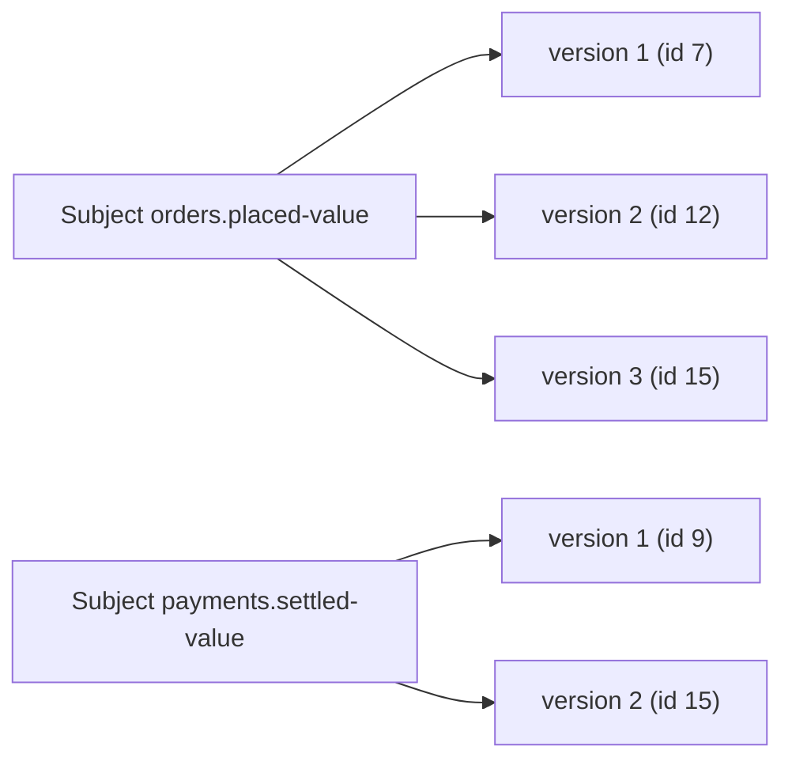
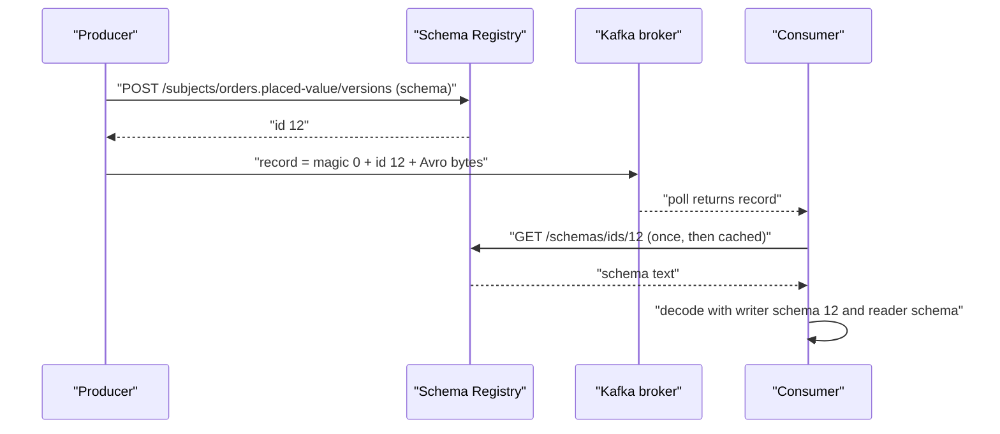

# Schema Registry: Why and How

## Introduction

The previous page ended with a recommendation: whatever format you choose, pair it with a schema registry. This page explains what that means in practice. A schema registry is a small HTTP service that sits next to your Kafka cluster, stores every version of every schema, hands out a short numeric ID for each one, and refuses to accept a new version that would break existing readers.

By the end of this page you will be able to explain why Avro records on a Kafka topic start with five extra bytes, run Confluent Schema Registry next to a KRaft broker with Docker Compose, register and inspect schemas with `curl`, and configure a Java producer and consumer to use it. You will also know what the main alternatives, Apicurio Registry and Karapace, do differently, so you can pick one with open eyes.

## The Problem a Registry Solves

Avro needs the writer's schema to decode a record. Where does the consumer get it?

Option one is to put the whole schema in every message. An Avro schema for a modest order event is about a kilobyte of JSON, which would dwarf the 60-byte payload. Avro's container files do this once per file; for individual Kafka records it destroys the size advantage.

Option two is to compile the schema into both producer and consumer and hope they stay in sync. This works until the first change. A producer deployed with a new field starts writing records the older consumer cannot decode, and the failure surfaces as a deserialization exception in a service that did not change.

Option three is a shared lookup service. The producer registers its schema once, receives an integer ID, and writes that ID in front of each record. The consumer reads the ID, fetches the schema (once, then caches it) and decodes. Because the registry sees every schema before it is used, it can also check that the new one is compatible with the old ones and reject it if not. That is a schema registry.

Think of it like the library catalog number stamped inside a book. The book does not carry the whole catalog; it carries a short number that lets you look up everything about it.

## How It Works

### Subjects, Versions and IDs

A registry organizes schemas under **subjects**. A subject is a named, ordered list of schema versions. With the default naming strategy, a topic called `orders.placed` has a subject `orders.placed-value` for its values and, if the key is also schema-managed, `orders.placed-key`.

Each registered schema gets two numbers:

- A **version** within the subject, starting at 1 and incrementing. Versions are about the history of one topic.
- A global **schema ID**, unique across the registry. The same schema text registered under two subjects gets the same ID. The ID is what goes on the wire.



Version 3 of the orders subject and version 2 of the payments subject share ID 15 because the schema text is identical, which can happen when two topics reuse one record type.

### The Wire Format

The Confluent serializers, and every registry that is compatible with them, write records as:

| Bytes | Content |
|---|---|
| 0 | Magic byte, value `0` |
| 1 to 4 | Schema ID as a big-endian 32-bit integer |
| 5 onward | The encoded payload (Avro binary, Protobuf binary, or JSON text) |

For Protobuf there is one more piece between the ID and the payload: a list of **message indexes** that says which message inside the `.proto` file was used, since a single Protobuf schema can define several messages. For the first message in the file this is a single `0` byte.

Recent Confluent serializers (Platform 8.x) can optionally put the schema identifier in a record header instead, but the five-byte prefix remains the default you will meet everywhere.

This is why reading a registry-managed topic with the plain `kafka-console-consumer.sh` shows garbage at the start of each line, and why a consumer configured with `StringDeserializer` against an Avro topic fails: there is a schema ID where it expects text. The companion tool `kafka-avro-console-consumer` (shipped with Confluent Platform) resolves the ID for you.

### The Registration Flow



Both producer and consumer cache aggressively. In steady state a producer talks to the registry once per schema for the life of the process, and a consumer once per distinct schema ID it encounters. The registry is not on the hot path, which is why a single small instance can serve a very large cluster. It is on the startup path, so it still needs to be highly available.

### Where the Registry Stores Its Data

Confluent Schema Registry keeps no database of its own. It writes every schema to a compacted, single-partition Kafka topic named `_schemas` and replays it on startup. Several registry instances can run at once; they elect a primary that handles writes, while any instance serves reads. This makes the registry stateless from an operator's point of view: lose every instance, start new ones, and they rebuild from the topic. Protect `_schemas` the way you protect your most important topic, because losing it means every record on every schema-managed topic becomes undecodable.

## Running It Locally

The following Compose file starts a single KRaft broker from the Apache image and a Schema Registry from Confluent's image. The registry only needs to reach the broker; it does not need the broker to be Confluent's.

```yaml
# docker-compose.yml
services:
  kafka:
    image: apache/kafka:4.3.1
    container_name: kafka
    ports:
      - "9092:9092"
    environment:
      KAFKA_NODE_ID: 1
      KAFKA_PROCESS_ROLES: broker,controller
      KAFKA_CONTROLLER_QUORUM_VOTERS: 1@kafka:9093
      KAFKA_LISTENERS: PLAINTEXT://0.0.0.0:9092,CONTROLLER://0.0.0.0:9093,INTERNAL://0.0.0.0:29092
      # Clients on the host use localhost:9092; containers use kafka:29092
      KAFKA_ADVERTISED_LISTENERS: PLAINTEXT://localhost:9092,INTERNAL://kafka:29092
      KAFKA_LISTENER_SECURITY_PROTOCOL_MAP: PLAINTEXT:PLAINTEXT,CONTROLLER:PLAINTEXT,INTERNAL:PLAINTEXT
      KAFKA_CONTROLLER_LISTENER_NAMES: CONTROLLER
      KAFKA_INTER_BROKER_LISTENER_NAME: INTERNAL
      KAFKA_OFFSETS_TOPIC_REPLICATION_FACTOR: 1
      KAFKA_TRANSACTION_STATE_LOG_REPLICATION_FACTOR: 1
      KAFKA_TRANSACTION_STATE_LOG_MIN_ISR: 1

  schema-registry:
    image: confluentinc/cp-schema-registry:8.3.2
    container_name: schema-registry
    depends_on:
      - kafka
    ports:
      - "8081:8081"
    environment:
      SCHEMA_REGISTRY_HOST_NAME: schema-registry
      SCHEMA_REGISTRY_LISTENERS: http://0.0.0.0:8081
      # Where the registry stores schemas: the _schemas topic on this broker
      SCHEMA_REGISTRY_KAFKASTORE_BOOTSTRAP_SERVERS: kafka:29092
      # One broker locally; use 3 in production
      SCHEMA_REGISTRY_KAFKASTORE_TOPIC_REPLICATION_FACTOR: 1
```

```bash
docker compose up -d
curl -s http://localhost:8081/subjects
# []
docker exec kafka /opt/kafka/bin/kafka-topics.sh --bootstrap-server localhost:9092 --list
# _schemas
```

The empty list and the `_schemas` topic confirm the registry is up and has created its storage. The Compose file for the full tutorial, including the broker settings explained line by line, is in [Running Kafka Locally with Docker Compose (KRaft)](../1-kafka-getting-started/0-kafka-docker-compose.mdx).

Server-side settings worth knowing (as properties, or as `SCHEMA_REGISTRY_` environment variables with dots replaced by underscores):

| Property | Default | Meaning |
|---|---|---|
| `listeners` | `http://0.0.0.0:8081` | Where the REST API listens |
| `kafkastore.bootstrap.servers` | none | The Kafka cluster used for storage and leader election |
| `kafkastore.topic` | `_schemas` | The compacted storage topic |
| `kafkastore.topic.replication.factor` | `3` | Replication for `_schemas`; capped by the number of brokers |
| `schema.compatibility.level` | `backward` | The global default compatibility (see [Schema Evolution and Compatibility Rules](./4-kafka-schema-evolution.mdx)) |
| `schema.registry.group.id` | `schema-registry` | Identifies one registry cluster; instances with the same ID form a cluster |

## A Tour of the REST API

Everything a serializer does, you can do with `curl`. The content type is `application/vnd.schemaregistry.v1+json`; plain `application/json` is also accepted.

Register a schema. The `schema` field is the schema as an escaped string; `schemaType` is `AVRO` (the default), `PROTOBUF` or `JSON`.

```bash
curl -s -X POST http://localhost:8081/subjects/orders.placed-value/versions \
  -H "Content-Type: application/vnd.schemaregistry.v1+json" \
  -d '{
    "schemaType": "AVRO",
    "schema": "{\"type\":\"record\",\"name\":\"OrderPlaced\",\"namespace\":\"com.shop.orders\",\"fields\":[{\"name\":\"orderId\",\"type\":\"string\"},{\"name\":\"amountCents\",\"type\":\"long\"}]}"
  }'
# {"id":1}
```

Inspect what is there:

```bash
curl -s http://localhost:8081/subjects
# ["orders.placed-value"]

curl -s http://localhost:8081/subjects/orders.placed-value/versions
# [1]

curl -s http://localhost:8081/subjects/orders.placed-value/versions/latest
# {"subject":"orders.placed-value","version":1,"id":1,"schema":"{\"type\":\"record\",...}"}

# Look up by the global ID found in a record's first bytes
curl -s http://localhost:8081/schemas/ids/1
# {"schema":"{\"type\":\"record\",...}"}
```

Check compatibility without registering. Add `verbose=true` to see why a candidate fails. This call is the heart of any CI pipeline for schemas.

```bash
# Add a field WITHOUT a default: not backward compatible
curl -s -X POST "http://localhost:8081/compatibility/subjects/orders.placed-value/versions/latest?verbose=true" \
  -H "Content-Type: application/vnd.schemaregistry.v1+json" \
  -d '{"schema": "{\"type\":\"record\",\"name\":\"OrderPlaced\",\"namespace\":\"com.shop.orders\",\"fields\":[{\"name\":\"orderId\",\"type\":\"string\"},{\"name\":\"amountCents\",\"type\":\"long\"},{\"name\":\"currency\",\"type\":\"string\"}]}"}'
# {"is_compatible":false,"messages":["{errorType:'READER_FIELD_MISSING_DEFAULT_VALUE', description:'The field 'currency' at path '/fields/2' in the new schema has no default value and is missing in the old schema', ...}"]}
```

Read and change compatibility, globally or per subject:

```bash
curl -s http://localhost:8081/config
# {"compatibilityLevel":"BACKWARD"}

curl -s -X PUT http://localhost:8081/config/orders.placed-value \
  -H "Content-Type: application/vnd.schemaregistry.v1+json" \
  -d '{"compatibility": "FULL_TRANSITIVE"}'
# {"compatibility":"FULL_TRANSITIVE"}
```

Delete. A soft delete hides the subject but keeps the IDs resolvable, so existing records can still be read. A permanent delete requires a prior soft delete and really removes it.

```bash
curl -s -X DELETE http://localhost:8081/subjects/orders.placed-value
# [1]
curl -s -X DELETE "http://localhost:8081/subjects/orders.placed-value?permanent=true"
# [1]
```

Error codes worth recognizing in serializer exceptions: HTTP 409 for an incompatible schema, 422 (`42201`) for a malformed one, and 404 (`40401`) for an unknown subject.

## Clients: Producer and Consumer

The Confluent serializers live in the `io.confluent` group, published to Confluent's own Maven repository rather than Maven Central.

```xml
<repositories>
  <repository>
    <id>confluent</id>
    <url>https://packages.confluent.io/maven/</url>
  </repository>
</repositories>

<dependencies>
  <dependency>
    <groupId>org.apache.kafka</groupId>
    <artifactId>kafka-clients</artifactId>
    <version>4.3.1</version>
  </dependency>
  <dependency>
    <groupId>io.confluent</groupId>
    <artifactId>kafka-avro-serializer</artifactId>
    <version>8.3.2</version>
  </dependency>
</dependencies>
```

A producer needs the serializer class and the registry URL. Everything else is optional.

```java
Properties props = new Properties();
props.put(ProducerConfig.BOOTSTRAP_SERVERS_CONFIG, "localhost:9092");
props.put(ProducerConfig.KEY_SERIALIZER_CLASS_CONFIG, StringSerializer.class.getName());
props.put(ProducerConfig.VALUE_SERIALIZER_CLASS_CONFIG,
        io.confluent.kafka.serializers.KafkaAvroSerializer.class.getName());
props.put("schema.registry.url", "http://localhost:8081");
// Register schemas automatically on first use. Convenient in development;
// most teams set this to false in production (see the governance page).
props.put("auto.register.schemas", "true");

try (KafkaProducer<String, GenericRecord> producer = new KafkaProducer<>(props)) {
    Schema schema = new Schema.Parser().parse(new File("src/main/avro/OrderPlaced.avsc"));
    GenericRecord order = new GenericData.Record(schema);
    order.put("orderId", "ord-7781");
    order.put("amountCents", 4599L);
    producer.send(new ProducerRecord<>("orders.placed", "ord-7781", order)).get();
}
```

A consumer mirrors it:

```java
Properties props = new Properties();
props.put(ConsumerConfig.BOOTSTRAP_SERVERS_CONFIG, "localhost:9092");
props.put(ConsumerConfig.GROUP_ID_CONFIG, "fulfilment");
props.put(ConsumerConfig.KEY_DESERIALIZER_CLASS_CONFIG, StringDeserializer.class.getName());
props.put(ConsumerConfig.VALUE_DESERIALIZER_CLASS_CONFIG,
        io.confluent.kafka.serializers.KafkaAvroDeserializer.class.getName());
props.put("schema.registry.url", "http://localhost:8081");
// false (default) returns GenericRecord; true returns generated classes
props.put("specific.avro.reader", "false");

try (KafkaConsumer<String, GenericRecord> consumer = new KafkaConsumer<>(props)) {
    consumer.subscribe(List.of("orders.placed"));
    while (true) {
        for (ConsumerRecord<String, GenericRecord> rec : consumer.poll(Duration.ofMillis(500))) {
            System.out.printf("%s -> %d cents%n", rec.key(), rec.value().get("amountCents"));
        }
    }
}
```

The serializer settings that matter most:

| Setting | Default | What it does |
|---|---|---|
| `schema.registry.url` | none | One or more registry URLs, comma separated |
| `auto.register.schemas` | `true` | Register an unknown schema on first send. Turn off in production |
| `use.latest.version` | `false` | Serialize with the subject's latest registered schema instead of the object's own. Requires `auto.register.schemas=false` |
| `latest.compatibility.strict` | `true` | With `use.latest.version`, verify the object's schema is compatible with the latest |
| `normalize.schemas` | `false` | Normalize whitespace and field order before lookup, so cosmetic differences do not create new versions |
| `key.subject.name.strategy`, `value.subject.name.strategy` | `TopicNameStrategy` | How the subject is derived (next section) |
| `basic.auth.credentials.source`, `basic.auth.user.info` | none | `USER_INFO` plus `user:password` for registries behind HTTP basic auth |

## Subject Naming Strategies

The default strategy ties one schema (and its evolution) to one topic. That is right for most topics but not for all.

| Strategy | Subject for topic `orders` and record `com.shop.OrderPlaced` | Use when |
|---|---|---|
| `TopicNameStrategy` (default) | `orders-value` | One event type per topic. Compatibility is enforced per topic |
| `RecordNameStrategy` | `com.shop.OrderPlaced` | The same record type appears in many topics and must evolve together, or one topic carries several types |
| `TopicRecordNameStrategy` | `orders-com.shop.OrderPlaced` | One topic carries several types, each evolving independently per topic |

Set it with `value.subject.name.strategy=io.confluent.kafka.serializers.subject.RecordNameStrategy`. Consumers do not need to know which strategy was used because they look up by ID, but anything that enforces compatibility (the registry, CI checks, broker-side validation in Confluent Server) depends on it. Pick once per topic and document it.

## Alternatives to Confluent Schema Registry

Confluent Schema Registry is the original and the de facto standard: its REST API and wire format are what every other product emulates. It is source-available under the Confluent Community License, which forbids offering it as a competing hosted service but otherwise allows free use. Some advanced features, such as data contract rules and the RBAC security plugin, are part of the paid Enterprise tier.

| | Confluent Schema Registry | Apicurio Registry | Karapace | Built into the broker |
|---|---|---|---|---|
| Maintainer | Confluent | Red Hat community | Aiven | Redpanda; also AWS Glue for MSK |
| License | Confluent Community License | Apache 2.0 | Apache 2.0 | Vendor specific |
| Confluent-compatible API | Native | Yes, at `/apis/ccompat/v7`, with gaps | Yes, the primary API | Redpanda: yes. Glue: no, different wire format |
| Storage | Kafka topic | Kafka, PostgreSQL or SQL Server | Kafka topic | Broker internal |
| Formats | Avro, Protobuf, JSON Schema | Those plus OpenAPI, AsyncAPI, GraphQL, XSD, WSDL | Avro, Protobuf, JSON Schema | Avro, Protobuf, JSON Schema |
| Also includes | Schema linking, contexts, data contracts (Enterprise) | Web console, groups, artifact rules, own serdes | Kafka REST proxy | Redpanda console |

**Apicurio Registry** (3.x, Apache 2.0) is the broadest: many artifact types, a web console, and optional relational storage. It has its own v3 API and serializers (`io.apicurio.registry.serde.avro.AvroKafkaSerializer`, configured with `apicurio.registry.url`), plus a compatibility layer: point unmodified Confluent serializers at `http://registry:8080/apis/ccompat/v7`. That layer covers the common cases, but test your exact serializers, especially with schema references.

**Karapace** (Aiven, Apache 2.0, Python) aims to be a drop-in replacement. It implements the Confluent REST API plus a Kafka REST proxy, stores schemas in `_schemas`, ships as `ghcr.io/aiven-open/karapace`, and supports basic auth and OIDC bearer tokens. It has no data contract rules, and some newer JSON Schema keywords register only under `NONE`. For Confluent client compatibility under a permissive license, without Apicurio's extra scope, Karapace is the usual pick.

**Redpanda** builds a Confluent-compatible registry into the broker. **AWS Glue Schema Registry** pairs with MSK but uses its own wire format, so Confluent tooling cannot read its records.

:::tip
Whichever you run, keep the Confluent wire format. The five-byte prefix is understood by Kafka Connect converters, ksqlDB, Flink, console tools and every third-party UI. Using Apicurio's own ID scheme or Glue's format locks you into that vendor's serializers.
:::

## Worked Scenario: A Clickstream Team Adopts a Registry

A media company has a `web.pageviews` topic written by a JavaScript edge service and consumed by a Flink sessionization job and a nightly Spark export. Events are plain JSON. Volume is 40,000 events per second.

Two incidents push them to a registry. First, the edge team changes `userId` from a number to a string (to support anonymous IDs) and the Spark export silently produces nulls for a day. Second, the storage bill: seven days of 700-byte JSON events at that rate is about 24 TB before replication.

They adopt Avro with Confluent Schema Registry, running three registry instances behind a load balancer, with `_schemas` at replication factor 3. The subject `web.pageviews-value` is set to `BACKWARD` compatibility. The edge service, in Node, uses the Confluent JavaScript client's schema registry module and the same wire format, so Flink and Spark read the records with the standard Avro deserializers.

Results: the average event falls from 700 to about 180 bytes, cutting storage to roughly 6 TB. The next attempt to change a field's type is rejected at registration time, and the edge team adds a new field with a default instead. They considered Karapace, but the company already runs Confluent Platform, so one vendor's tooling was simpler. A team on plain Apache Kafka would likely have chosen Karapace or Apicurio.

## Common Mistakes

- Running one registry instance in production. It is off the hot path, but a producer that restarts while the registry is down cannot serialize. Run at least two and put `_schemas` at replication factor 3.
- Reading a registry-managed topic with `StringDeserializer` and concluding the data is corrupt. The leading bytes are the magic byte and schema ID.
- Leaving `auto.register.schemas=true` in production. Any producer with network access can then create a new schema version. Register through CI and let producers only look up.
- Using different subject naming strategies on producers for the same topic. The registry will happily hold both and enforce neither relationship.
- Deleting a subject permanently while old records are still in the topic. Consumers hit unknown IDs and stop. Soft delete first, and only hard delete after retention has expired the data.
- Giving registry instances different `schema.registry.group.id` values, which creates two registries fighting over one topic.

## Summary

- A schema registry stores schema versions under subjects, assigns each schema a global ID, and checks compatibility before accepting a new version.
- Records carry a magic byte and a four-byte schema ID in front of the payload, so consumers can fetch and cache the exact writer schema.
- Confluent Schema Registry stores everything in the compacted `_schemas` topic and can run as a stateless, multi-instance service next to any Kafka cluster, including Apache Kafka 4.x in KRaft mode.
- The REST API registers, inspects, tests, configures and deletes schemas; serializers call it behind the scenes.
- `TopicNameStrategy` is the default and right for most topics; the other strategies exist for shared record types and multi-type topics.
- Apicurio Registry (Apache 2.0, broad scope, database storage option), Karapace (Apache 2.0, drop-in, with REST proxy) and Redpanda's built-in registry all speak the Confluent API and wire format.

## Further Reading

- [Confluent Schema Registry overview](https://docs.confluent.io/platform/current/schema-registry/index.html) - concepts, architecture and the `_schemas` topic.
- [Schema Registry API reference](https://docs.confluent.io/platform/current/schema-registry/develop/api.html) - every endpoint, request body and error code.
- [Schema Registry configuration reference](https://docs.confluent.io/platform/current/schema-registry/installation/config.html) - the server properties and their defaults.
- [Apicurio Registry documentation](https://www.apicur.io/registry/docs/) - installation, the Confluent compatibility API and Apicurio's own serdes.
- [Karapace on GitHub](https://github.com/Aiven-Open/karapace) - the Aiven implementation of the Schema Registry and REST proxy APIs.
- [Redpanda Schema Registry](https://docs.redpanda.com/current/manage/schema-reg/) - the registry built into the Redpanda broker.
