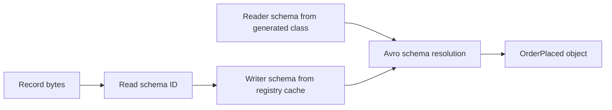

# Avro with Kafka

## Introduction

Avro is the format the Kafka ecosystem grew up with. Kafka Connect converters, ksqlDB, Flink, Spark and nearly every data-lake tool read it out of the box, and Confluent Schema Registry was built around it before it learned Protobuf and JSON Schema. If your topics feed analytics, a warehouse or other teams you do not talk to every day, Avro is usually the safest default.

This page takes you from an empty project to a working Avro pipeline. You will write a schema for an order event, generate Java classes from it, produce and consume those classes through Schema Registry, read the same topic from Python, and learn the handful of Avro details (unions, logical types, generic versus specific records) that trip up newcomers. It assumes you have the local broker and registry from [Schema Registry: Why and How](./1-kafka-schema-registry.mdx) running.

## Writing a Schema

An Avro schema is a JSON document, conventionally stored in a file ending in `.avsc`. The top-level type for a Kafka value is almost always a `record`.

```json
{
  "type": "record",
  "name": "OrderPlaced",
  "namespace": "com.shop.orders.avro",
  "doc": "Emitted once when a customer completes checkout.",
  "fields": [
    { "name": "orderId", "type": "string" },
    { "name": "customerId", "type": "string" },
    { "name": "amount", "type": { "type": "bytes", "logicalType": "decimal", "precision": 12, "scale": 2 } },
    { "name": "currency", "type": "string", "default": "EUR" },
    { "name": "placedAt", "type": { "type": "long", "logicalType": "timestamp-millis" } },
    { "name": "couponCode", "type": ["null", "string"], "default": null },
    { "name": "channel", "type": { "type": "enum", "name": "Channel", "symbols": ["WEB", "MOBILE", "STORE", "UNKNOWN"], "default": "UNKNOWN" } },
    { "name": "items", "type": { "type": "array", "items": {
        "type": "record", "name": "OrderItem", "fields": [
          { "name": "sku", "type": "string" },
          { "name": "quantity", "type": "int" }
        ] } } }
  ]
}
```

The pieces worth understanding before you write your own:

- **Namespace plus name** form the full name, `com.shop.orders.avro.OrderPlaced`. Generated Java classes use it as their package and class name, and `RecordNameStrategy` uses it as the subject name.
- **Primitive types** are `null`, `boolean`, `int` (32-bit), `long` (64-bit), `float`, `double`, `bytes` and `string`.
- **Complex types** are `record`, `enum`, `array`, `map` (always string keys), `union` and `fixed`.
- **Defaults** are not just convenience values. They are what a reader fills in when the writer's schema lacks the field, which is the mechanism behind safe evolution. A field without a default is a field you can never safely add later.
- **`doc`** strings travel with the schema into the registry and into generated code. They are the cheapest documentation you will ever write.

### Optional Fields Are Unions

Avro has no `optional` keyword. A field that may be absent is a union with `null`, and the convention is to put `null` first so that `null` can be the default.

```json
{ "name": "couponCode", "type": ["null", "string"], "default": null }
```

The default must match the first branch of the union. Writing `["string", "null"]` with `"default": null` is an error that the parser reports immediately, which is a common first stumble.

### Logical Types

A logical type annotates a primitive with meaning. The bytes on the wire stay the same; the library converts them to a richer type in your language.

| Logical type | Underlying type | Java type in generated code | Typical use |
|---|---|---|---|
| `decimal` | `bytes` or `fixed` | `BigDecimal` | Money, quantities that must not round |
| `uuid` | `string` | `String` or `UUID` | Identifiers |
| `date` | `int` (days since epoch) | `LocalDate` | Birthdays, business dates |
| `time-millis` | `int` | `LocalTime` | Opening hours |
| `timestamp-millis` | `long` | `Instant` | Event time |
| `timestamp-micros` | `long` | `Instant` | High-resolution event time |
| `local-timestamp-millis` | `long` | `LocalDateTime` | Wall-clock time without a zone |

For a bank ledger or an order system, `decimal` with explicit `precision` and `scale` is the right type for money. A `double` cannot represent 0.10 exactly, and summing a million of them drifts.

### Enums and Their Default

Enums are compact (an `int` on the wire) and self-documenting, but adding a symbol is a classic way to break old readers: a consumer that does not know `KIOSK` cannot decode it. Since Avro 1.9 an enum can declare a `default` symbol that old readers fall back to, which is why the schema above includes `UNKNOWN`. Add it on day one; you cannot retrofit it for records already written.

## Generic Versus Specific Records

Avro offers two ways to work with data in Java.

**Generic records** (`GenericRecord`) are maps keyed by field name, built at runtime from a parsed schema. They need no build step and suit tools that handle any schema: a topic inspector, a sink connector, a data-quality job.

**Specific records** are classes generated from the `.avsc` file. They give you typed getters, builders and compile-time checks. Application code that knows exactly which event it handles should use them.

| | GenericRecord | Specific record |
|---|---|---|
| Build step | None | Code generation |
| Field access | `record.get("orderId")` | `order.getOrderId()` |
| Typos caught | At runtime | At compile time |
| Best for | Generic tools, dynamic pipelines | Application services |
| Consumer setting | `specific.avro.reader=false` (default) | `specific.avro.reader=true` |

### Generating Classes with Maven

Put schemas in `src/main/avro` and let the Avro Maven plugin generate sources during the build.

```xml
<dependencies>
  <dependency>
    <groupId>org.apache.avro</groupId>
    <artifactId>avro</artifactId>
    <version>1.12.2</version>
  </dependency>
  <dependency>
    <groupId>io.confluent</groupId>
    <artifactId>kafka-avro-serializer</artifactId>
    <version>8.3.2</version>
  </dependency>
  <dependency>
    <groupId>org.apache.kafka</groupId>
    <artifactId>kafka-clients</artifactId>
    <version>4.3.1</version>
  </dependency>
</dependencies>

<build>
  <plugins>
    <plugin>
      <groupId>org.apache.avro</groupId>
      <artifactId>avro-maven-plugin</artifactId>
      <version>1.12.2</version>
      <executions>
        <execution>
          <phase>generate-sources</phase>
          <goals><goal>schema</goal></goals>
          <configuration>
            <sourceDirectory>${project.basedir}/src/main/avro</sourceDirectory>
            <outputDirectory>${project.build.directory}/generated-sources/avro</outputDirectory>
            <!-- Generate java.lang.String instead of Avro's Utf8 for string fields -->
            <stringType>String</stringType>
            <!-- Map decimal fields to BigDecimal instead of ByteBuffer -->
            <enableDecimalLogicalType>true</enableDecimalLogicalType>
          </configuration>
        </execution>
      </executions>
    </plugin>
  </plugins>
</build>
```

Remember the Confluent Maven repository (`https://packages.confluent.io/maven/`) for the serializer artifact. After `mvn generate-sources` you have `OrderPlaced`, `OrderItem` and `Channel` classes under `com.shop.orders.avro`.

The `stringType` setting matters more than it looks. Without it, string fields come back as `org.apache.avro.util.Utf8`, and `order.getOrderId().equals("ord-1")` is silently `false`. Likewise, without `enableDecimalLogicalType` a `decimal` field is generated as a raw `ByteBuffer` rather than a `BigDecimal`.

## Producing Avro Records

```java
import com.shop.orders.avro.Channel;
import com.shop.orders.avro.OrderItem;
import com.shop.orders.avro.OrderPlaced;
import io.confluent.kafka.serializers.KafkaAvroSerializer;
import org.apache.kafka.clients.producer.*;
import org.apache.kafka.common.serialization.StringSerializer;

import java.math.BigDecimal;
import java.time.Instant;
import java.util.List;
import java.util.Properties;

public class OrderProducer {
    public static void main(String[] args) throws Exception {
        Properties props = new Properties();
        props.put(ProducerConfig.BOOTSTRAP_SERVERS_CONFIG, "localhost:9092");
        props.put(ProducerConfig.KEY_SERIALIZER_CLASS_CONFIG, StringSerializer.class);
        props.put(ProducerConfig.VALUE_SERIALIZER_CLASS_CONFIG, KafkaAvroSerializer.class);
        props.put(ProducerConfig.ACKS_CONFIG, "all");
        props.put("schema.registry.url", "http://localhost:8081");

        OrderPlaced order = OrderPlaced.newBuilder()
                .setOrderId("ord-7781")
                .setCustomerId("cust-204")
                .setAmount(new BigDecimal("45.99"))   // scale must match the schema (2)
                .setPlacedAt(Instant.now())
                .setChannel(Channel.WEB)
                .setItems(List.of(new OrderItem("KB-104", 1)))
                .build();                              // currency and couponCode take their defaults

        try (KafkaProducer<String, OrderPlaced> producer = new KafkaProducer<>(props)) {
            RecordMetadata md = producer
                    .send(new ProducerRecord<>("orders.placed", order.getOrderId(), order))
                    .get();
            System.out.printf("wrote to %s-%d@%d%n", md.topic(), md.partition(), md.offset());
        }
    }
}
```

```bash
$ mvn -q compile exec:java -Dexec.mainClass=OrderProducer
wrote to orders.placed-0@0

$ curl -s http://localhost:8081/subjects
["orders.placed-value"]
```

The builder enforces required fields: leave out `customerId` and `build()` throws before anything reaches Kafka. The serializer looked up the schema embedded in the generated class, registered it under `orders.placed-value` (because `auto.register.schemas` defaults to `true`), and prefixed the record with the returned ID.

## Consuming Avro Records

```java
import com.shop.orders.avro.OrderPlaced;
import io.confluent.kafka.serializers.KafkaAvroDeserializer;
import org.apache.kafka.clients.consumer.*;
import org.apache.kafka.common.serialization.StringDeserializer;

import java.time.Duration;
import java.util.List;
import java.util.Properties;

public class FulfilmentConsumer {
    public static void main(String[] args) {
        Properties props = new Properties();
        props.put(ConsumerConfig.BOOTSTRAP_SERVERS_CONFIG, "localhost:9092");
        props.put(ConsumerConfig.GROUP_ID_CONFIG, "fulfilment");
        props.put(ConsumerConfig.AUTO_OFFSET_RESET_CONFIG, "earliest");
        props.put(ConsumerConfig.KEY_DESERIALIZER_CLASS_CONFIG, StringDeserializer.class);
        props.put(ConsumerConfig.VALUE_DESERIALIZER_CLASS_CONFIG, KafkaAvroDeserializer.class);
        props.put("schema.registry.url", "http://localhost:8081");
        // Return generated OrderPlaced objects instead of GenericRecord
        props.put("specific.avro.reader", "true");

        try (KafkaConsumer<String, OrderPlaced> consumer = new KafkaConsumer<>(props)) {
            consumer.subscribe(List.of("orders.placed"));
            while (true) {
                for (ConsumerRecord<String, OrderPlaced> rec : consumer.poll(Duration.ofMillis(500))) {
                    OrderPlaced o = rec.value();
                    System.out.printf("%s %s %s %s%n",
                            o.getOrderId(), o.getAmount(), o.getCurrency(), o.getChannel());
                }
            }
        }
    }
}
```

```text
ord-7781 45.99 EUR WEB
```

Here is what happens inside the deserializer for each record. It reads the schema ID from bytes 1 to 4, fetches the **writer schema** from the registry (cached after the first time), and uses the generated class's schema as the **reader schema**. Avro's resolution rules then map one onto the other: fields the reader does not know are skipped, fields the writer did not have are filled from the reader's defaults. This is why a consumer compiled against version 1 of the schema keeps working when the producer moves to version 2, provided the change was compatible.



## Reading the Same Topic from Python

The fraud team writes Python. They do not need generated classes; `confluent-kafka` decodes Avro into dictionaries.

```bash
pip install "confluent-kafka[avro,schemaregistry]"
```

```python
from confluent_kafka import Consumer
from confluent_kafka.schema_registry import SchemaRegistryClient
from confluent_kafka.schema_registry.avro import AvroDeserializer
from confluent_kafka.serialization import SerializationContext, MessageField

registry = SchemaRegistryClient({"url": "http://localhost:8081"})
# No reader schema given: decode with the writer schema found in each record
avro_deserializer = AvroDeserializer(registry)

consumer = Consumer({
    "bootstrap.servers": "localhost:9092",
    "group.id": "fraud-scoring",
    "auto.offset.reset": "earliest",
})
consumer.subscribe(["orders.placed"])

try:
    while True:
        msg = consumer.poll(1.0)
        if msg is None:
            continue
        if msg.error():
            print("consumer error:", msg.error())
            continue
        order = avro_deserializer(msg.value(), SerializationContext(msg.topic(), MessageField.VALUE))
        # decimal arrives as decimal.Decimal, timestamp-millis as datetime
        print(order["orderId"], order["amount"], order["placedAt"].isoformat())
finally:
    consumer.close()
```

```text
ord-7781 45.99 2026-10-17T08:41:12.512000+00:00
```

Producing from Python is symmetrical: construct `AvroSerializer(registry, schema_str, to_dict)` with the `.avsc` text and a function that turns your object into a dictionary, then call it with a `SerializationContext` before `producer.produce`. More on the Python client is in [Kafka with Python (confluent-kafka)](../5-kafka-clients/2-kafka-python-client.mdx).

## Inspecting Avro Topics

Because each value starts with a schema ID, `kafka-console-consumer.sh` prints unreadable bytes. Two tools decode properly:

```bash
# Confluent Platform ships an Avro-aware console consumer
kafka-avro-console-consumer --bootstrap-server localhost:9092 \
  --topic orders.placed --from-beginning \
  --property schema.registry.url=http://localhost:8081

# kcat (formerly kafkacat) decodes Avro values through the registry as well
kcat -b localhost:9092 -t orders.placed -C -s value=avro -r http://localhost:8081
```

Both print the record as JSON, with decimals rendered as their byte representation in some versions, so do not be alarmed by odd-looking `amount` values in the console.

## Worked Scenario: A Sensor Fleet Switches to Avro

A logistics company has 30,000 refrigerated trucks, each sending a temperature reading every ten seconds to a `fleet.telemetry` topic. The original JSON payload carried `truckId`, `ts`, `tempC`, `doorOpen`, `lat`, `lon` and a firmware version, about 230 bytes per event, 3,000 events per second.

The team moves to Avro for three reasons. First, size: the Avro encoding is about 45 bytes, so a 14-day retention window shrinks from roughly 830 GB to 160 GB before replication. Second, a firmware rollout once sent `tempC` as a string on half the fleet, which broke the alerting job for an afternoon; with a registered schema and a typed serializer at the ingestion gateway, that payload would have been rejected at the edge. Third, the data science team loads telemetry into a lakehouse, whose Kafka Connect sink reads Avro columns directly.

Choices they make along the way:

- `ts` becomes `timestamp-millis` rather than an ISO string, so stream processors get an `Instant` without parsing.
- `firmware` becomes `["null", "string"]` with a `null` default, because older trucks do not report it.
- A `status` enum gets an `UNKNOWN` default from the first version, since new truck states are certain to appear.
- The gateway (Java) uses generated classes; the alerting service (Python) uses `AvroDeserializer` without a reader schema because it only reads three fields.

They considered Protobuf, which would have produced similar sizes and is common on embedded devices. They chose Avro because the trucks talk to a Java gateway rather than directly to Kafka, so device-side code generation did not matter, and the lakehouse path was smoother.

## Common Mistakes

- Writing `["string", "null"]` with a `null` default. The default must match the first union branch, so put `null` first.
- Adding a field without a default. Old records have no value for it, so new readers cannot decode them under `BACKWARD` compatibility.
- Forgetting `stringType` in code generation and comparing `Utf8` objects to `String` values.
- Using `double` for money instead of the `decimal` logical type, or setting a `BigDecimal` whose scale differs from the schema's `scale` (the serializer rejects it).
- Expecting `specific.avro.reader=true` to work without the generated class on the consumer's classpath. The deserializer falls back to an error, not to `GenericRecord`.
- Adding enum symbols without an enum `default`, which breaks every consumer still running the old schema.
- Reading Avro topics with `StringDeserializer` and filing a bug about corrupt data.

## Summary

- Avro schemas are JSON documents; the full name (namespace plus name) identifies the record and drives code generation.
- Optional fields are unions with `null` first and a `null` default. Every field you might ever want to add later needs a default.
- Logical types such as `decimal`, `timestamp-millis` and `uuid` give primitive encodings real meaning; use `decimal` for money.
- Use generated specific records in application code and `GenericRecord` in generic tools. Set `specific.avro.reader=true` on consumers that want generated classes.
- The Confluent serializer registers or looks up the schema and writes its ID; the deserializer resolves the writer schema against the reader schema, which is what lets producers and consumers upgrade independently.
- Python, Go, .NET and JavaScript clients read the same records through the same registry and wire format.

## Further Reading

- [Apache Avro specification](https://avro.apache.org/docs/current/specification/) - types, logical types, defaults and schema resolution rules.
- [Avro Getting Started (Java)](https://avro.apache.org/docs/current/getting-started-java/) - code generation, the Maven plugin and generic versus specific APIs.
- [Confluent: Avro Schema Serializer and Deserializer](https://docs.confluent.io/platform/current/schema-registry/fundamentals/serdes-develop/serdes-avro.html) - every serializer setting, including `specific.avro.reader` and logical type handling.
- [confluent-kafka Python API reference](https://docs.confluent.io/platform/current/clients/confluent-kafka-python/html/index.html) - `AvroSerializer`, `AvroDeserializer` and `SchemaRegistryClient`.
- [Apache Kafka documentation: Consumer configs](https://kafka.apache.org/documentation/#consumerconfigs) - the client settings used alongside the deserializer.
