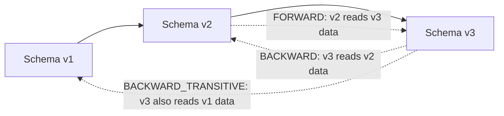
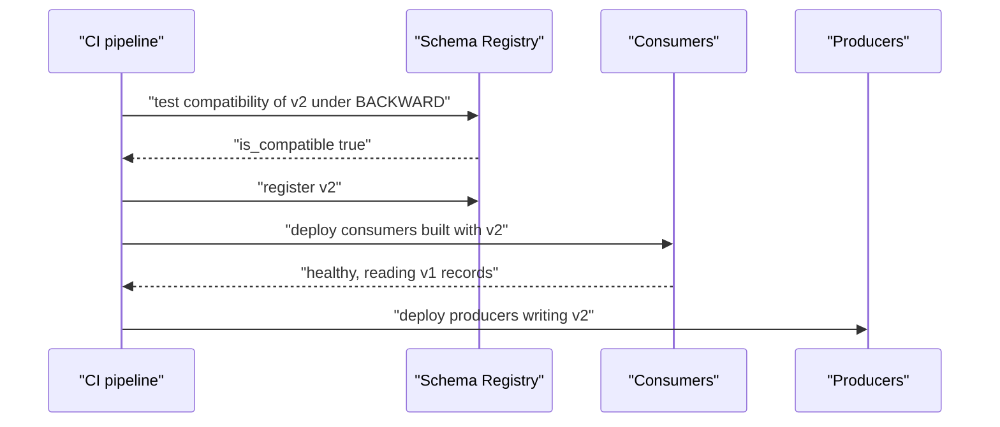

# Schema Evolution and Compatibility Rules

## Introduction

The first version of a schema is easy. The tenth is where teams get hurt. Requirements change: the order event needs a delivery window, the sensor reading needs a battery level, the ledger entry needs a second currency. Meanwhile the topic still holds last week's records, some consumers are three releases behind, and a Kafka Streams job has a state store full of the old shape.

Schema evolution is the discipline of changing a schema without breaking any of those readers. A schema registry turns that discipline into an automatic check: every new version is compared against the old ones under a **compatibility type**, and rejected if it would break someone. This page explains what each compatibility type promises, which concrete changes are safe in Avro, Protobuf and JSON Schema, which order to deploy producers and consumers in, and what to do when you genuinely need a breaking change.

## Readers, Writers and Time

Every evolution question reduces to one pair: a record written with schema A, read by code that expects schema B.

On a Kafka topic that pairing happens in both directions. A consumer upgraded to version 2 still reads version 1 records that are waiting in the log, or that it replays after an offset reset. A consumer still on version 1 reads version 2 records from a producer that upgraded first. A good mental model is a library that keeps every edition of a book on the same shelf: new readers must cope with old editions, and old readers may be handed a new one.

The compatibility types name which of those directions you guarantee.

## The Compatibility Types

| Type | Guarantee | Checked against | Who upgrades first |
|---|---|---|---|
| `BACKWARD` (default) | New schema can read data written with the previous schema | Latest version | Consumers |
| `BACKWARD_TRANSITIVE` | New schema can read data written with every earlier schema | All versions | Consumers |
| `FORWARD` | Previous schema can read data written with the new schema | Latest version | Producers |
| `FORWARD_TRANSITIVE` | Every earlier schema can read data written with the new schema | All versions | Producers |
| `FULL` | Both backward and forward with the previous schema | Latest version | Either, independently |
| `FULL_TRANSITIVE` | Both directions with every earlier schema | All versions | Either, independently |
| `NONE` | No checks | Nothing | Coordinate by hand |



### Why Transitive Matters

Non-transitive checks compare only with the latest version. That sounds sufficient until you chain changes. Suppose version 1 has a field `discount` with no default, version 2 removes it, and version 3 adds `discount` back as a string. Each step can pass a non-transitive check, yet a version 3 reader meeting a version 1 record finds `discount` as a number where it expects a string.

If your topic keeps data longer than one schema generation (compacted topics, long retention, replays from the beginning, Kafka Streams changelogs), use a transitive type. The cost is only that the registry checks more versions on registration. Many teams set `BACKWARD_TRANSITIVE` or `FULL_TRANSITIVE` as their organization default and never look back.

### Choosing a Type

- **`BACKWARD`** fits the common Kafka case: consumers are upgraded first (or tolerate new fields), and they must read what is already in the topic. It is the default for a reason.
- **`FORWARD`** fits when producers move faster than consumers you do not control, such as a public data feed where downstream teams upgrade at their own pace.
- **`FULL`** fits shared, long-lived topics where nobody can promise an upgrade order. It is the most restrictive and the most relaxing to operate.
- **`NONE`** is for development subjects, or briefly during a deliberate breaking change on a new topic. Never leave a production subject on it.

Kafka Streams applications are a special case: their changelog and repartition topics are read back by the application itself, so the Streams app should be upgraded before the producers of its input topics, and only backward or full compatibility makes sense for those inputs.

## Safe and Unsafe Changes in Avro

Avro's rules follow directly from schema resolution: the reader uses defaults for fields the writer lacked and ignores fields the reader lacks.

| Change | BACKWARD | FORWARD | FULL |
|---|---|---|---|
| Add a field with a default | Yes | Yes | Yes |
| Add a field without a default | No | Yes | No |
| Remove a field that had a default | Yes | Yes | Yes |
| Remove a field without a default | Yes | No | No |
| Rename a field, keeping the old name in `aliases` | Yes | No | No |
| Promote `int` to `long`, `float` or `double` | Yes | No | No |
| Promote `long` to `float` or `double`, or `float` to `double` | Yes | No | No |
| Change `string` to `bytes` or back | Yes | Yes | Yes |
| Add a branch to a union | Yes | No | No |
| Add an enum symbol, when the enum has a `default` | Yes | Yes | Yes |
| Add an enum symbol, no enum `default` | Yes | No | No |
| Change a field's type incompatibly (`string` to `int`) | No | No | No |

The pattern behind the table: **give every field a default** and almost every change becomes fully compatible. Adding and removing fields with defaults is the bread and butter of Avro evolution.

Renames are the exception that surprises people. Avro matches fields by name, so a rename is really a removal plus an addition. Reader-side `aliases` let a new reader find the old name, but an old reader has no idea the new name exists. Under `FULL`, the honest way to rename is to add the new field with a default, migrate producers to fill both, migrate consumers to the new one, and remove the old field later.

```json
{ "name": "customerRef", "type": "string", "default": "", "aliases": ["customerId"] }
```

## Safe and Unsafe Changes in Protobuf

Protobuf matches fields by number, not name, and every proto3 field is effectively optional. That makes its rules simpler.

| Change | Safe? | Why |
|---|---|---|
| Add a field with a new number | Yes | Old readers skip unknown numbers; new readers see a zero value in old records |
| Remove a field and mark its number `reserved` | Yes | Readers see the zero value; `reserved` stops reuse |
| Rename a field, keeping its number | Yes on the wire | Generated code changes, and JSON mappings that use field names break |
| Reuse a removed field number for something else | No | Old records decode into the new field with the wrong meaning |
| Change a field's type between `int32`, `int64`, `uint32`, `uint64`, `bool` | Wire compatible, values may truncate | Avoid unless you have checked every value range |
| Change between `string` and `bytes` | Compatible if the bytes are valid UTF-8 | Usually not worth it |
| Move an existing field into a new `oneof` | No | Changes presence semantics |
| Add a new message type to the file | Backward yes, forward no | Old readers cannot resolve the new message index |

That last row is why Confluent recommends `BACKWARD_TRANSITIVE` for Protobuf subjects rather than a forward or full type: adding message types to a schema file is common, and it is not forward compatible.

Remember the zero-value trap when adding fields: an old record decoded by a new reader has `0`, `""` or `false` in the new field. If that is indistinguishable from a real value, declare the field `optional` so code can test `hasField()`.

## Safe and Unsafe Changes in JSON Schema

JSON Schema compatibility depends on the **content model**, set by `additionalProperties`.

- In a **closed** schema (`additionalProperties: false`), the writer could never have sent an undeclared property, so the reader can safely add a new optional property. Removing a property is the risky direction, because old writers may still send it and a closed reader rejects it.
- In an **open** schema (the default), an old writer might already have sent any property name with any type. Adding a declared property is therefore not backward compatible, because the registry cannot rule out a conflicting value in old data. Removing a property is fine, since the open reader accepts it as an extra.
- **Partially open** schemas (a typed `additionalProperties` or `patternProperties`) sit in between: extras must match a declared type or name pattern, so you can reason about them.

The practical rule: decide the content model in version 1, and prefer closed for events whose producers you control. If you inherited an open schema and need to add properties, the cleanest path is often a new subject with a closed schema. Confluent Schema Registry also offers a `LENIENT` compatibility policy for JSON Schema that relaxes these checks, at the price of trusting producers.

## Deployment Order

The compatibility type tells you which side may go first. Getting the order wrong is how a compatible schema still causes an outage.



Under `BACKWARD`, consumers built against v2 go first; they can read the v1 records already on the topic. Only then do producers start writing v2. Under `FORWARD` the order flips. Under `FULL` it does not matter, which is precisely why shared topics often use it.

## Making a Breaking Change

Sometimes a change cannot be made compatible: the key changes meaning, a field changes from a single value to a list, or a misguided early design must go. The registry blocks it, and it should. The safe pattern is a new topic.

1. Create `orders.placed.v2` with the new schema under its own subject.
2. Make producers write both topics (or write v2 and run a small Kafka Streams or Connect job that converts v2 to v1 for laggards).
3. Move consumers to v2 one at a time, checking lag and output.
4. When the v1 topic has no readers left, stop writing it and let retention clean it up.

Avoid the tempting shortcut of setting the subject to `NONE`, registering the breaking schema, and switching back. Every consumer that replays the topic will meet both shapes forever.

Confluent's Enterprise tier also offers **migration rules** in data contracts, which transform records between major versions at read time using JSONata expressions. They help when you cannot create a new topic, but they move complexity into the serializer, so use them deliberately.

## Worked Scenario: A Bank Ledger Adds a Second Currency

A bank's `ledger.entries` topic is compacted, holds every account's latest balance-affecting entries, and is read by a reporting service, a fraud model and a Kafka Streams job that maintains balances. The Avro schema has `accountId`, `amountMinor` (a `long` in minor units) and `bookedAt`. The subject uses `FULL_TRANSITIVE` because data lives indefinitely and three teams deploy on their own schedules.

The product team wants multi-currency accounts. The first proposal, changing `amountMinor` into a record of amount and currency, is rejected by the registry's compatibility test in CI, as it should be: no old reader can decode it.

The accepted design adds `currency` as `"type": "string", "default": "EUR"`. Every old entry implicitly becomes EUR, which matches reality, and old readers simply ignore the new field. Because it is fully compatible, teams deploy in any order. The Streams job is upgraded first anyway, since its changelog is read back by itself, and the fraud model last because it needs a retraining cycle to use the field.

A later request to rename `amountMinor` to `amount` is declined. Under `FULL_TRANSITIVE` a rename would mean a parallel field and two release cycles, for a purely cosmetic gain. The team adds a `doc` string instead.

## Common Mistakes

- Leaving long-retention or compacted topics on non-transitive compatibility, then breaking replays with a chain of individually valid changes.
- Adding an Avro field without a default and wondering why `BACKWARD` rejects it.
- Reusing a Protobuf field number, or removing a field without `reserved`.
- Deploying producers first under `BACKWARD`. The registry allowed the schema; consumers still crash on fields they cannot map, or on unknown enum symbols.
- Treating a rename as a small change. In Avro it is a remove plus add; in Protobuf it breaks JSON mappings.
- Starting JSON Schema subjects with the default open content model and finding later that no property can be added.
- Using `NONE` to sneak a breaking change through instead of creating a new topic.

## Summary

- Compatibility types describe which readers can read which writers: `BACKWARD` (new reads old), `FORWARD` (old reads new), `FULL` (both), each with a transitive variant that checks all history.
- Use transitive types for any topic that keeps data longer than one schema generation; `BACKWARD` is the default and `BACKWARD_TRANSITIVE` is recommended for Protobuf.
- In Avro, defaults are what make changes safe; in Protobuf, field numbers and `reserved` are; in JSON Schema, the content model is.
- Deploy consumers first under backward types, producers first under forward types, in any order under full types.
- Breaking changes belong on a new topic with a migration period, not on a subject temporarily set to `NONE`.

## Further Reading

- [Confluent: Schema Evolution and Compatibility](https://docs.confluent.io/platform/current/schema-registry/fundamentals/schema-evolution.html) - the compatibility types, upgrade order and per-format rules.
- [Apache Avro specification: Schema Resolution](https://avro.apache.org/docs/current/specification/#schema-resolution) - the exact rules readers use to map writer schemas, including promotions and aliases.
- [Protocol Buffers: Updating a Message Type](https://protobuf.dev/programming-guides/proto3/#updating) - which field changes are wire compatible.
- [Confluent: JSON Schema compatibility rules](https://docs.confluent.io/platform/current/schema-registry/fundamentals/serdes-develop/serdes-json.html) - open, closed and partially open content models explained with examples.
- [Confluent: Data Contracts](https://docs.confluent.io/platform/current/schema-registry/fundamentals/data-contracts.html) - migration rules for transforming records across major versions.
