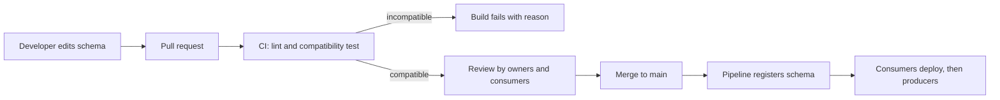

# Schema Governance in a Team

## Introduction

A schema registry checks compatibility, but it does not decide who may change a schema, where schemas are reviewed, or what happens when the registry itself goes down. With one team and three topics that is fine. With fifteen teams, two hundred subjects and auditors asking where personal data flows, it is not. Governance is the set of habits and guardrails that keep schemas trustworthy as the organization grows.

This page describes a governance setup that works for most teams without heavy process: schemas live in a repository with owners, CI checks compatibility before merge, registration happens from the pipeline rather than from producers, access to the registry is controlled, and schemas carry metadata about ownership and sensitive data. You will also see how the main registries (Confluent Schema Registry, Apicurio and Karapace) support each piece, and how to operate the registry itself. The cross-team view of topics as contracts continues in [Schemas as Contracts Between Teams](../13-kafka-best-practices/2-kafka-schema-and-contract-practices.mdx).

## The Problem with Auto-Registration

Out of the box, Confluent serializers have `auto.register.schemas=true`. The first time a producer sends an object whose schema the registry has never seen, the serializer registers it. In development this is pleasant. In production it means:

- Any service with network access to the registry can create a new schema version on any subject it writes to, as a side effect of a deploy.
- The first time anyone sees an incompatible change is when a producer fails at runtime, possibly during a release at night.
- There is no review: nobody asked the consumers whether the new field makes sense.
- Schema changes are not tied to a commit, so "who changed this and why" has no answer.

The fix is to move registration to the build pipeline and make producers read-only.

```properties
# Producer settings in production
schema.registry.url=https://schema-registry.internal:8081
auto.register.schemas=false
# Serialize against the latest registered schema for the subject
use.latest.version=true
# ...and verify the object's schema is compatible with it
latest.compatibility.strict=true
basic.auth.credentials.source=USER_INFO
# Read-only registry credentials, injected from your secret store at deploy time
basic.auth.user.info=orders-producer:REPLACE_ME
```

With these settings a producer whose schema was never registered fails fast at startup with a "subject not found" error, which is exactly what you want: the problem surfaces in deployment, not in data.

## Schemas in a Repository

Treat schemas like API definitions: version them in Git, review them in pull requests, and give each one an owner.

```text
schemas/
  CODEOWNERS
  orders/
    order-placed.avsc          # subject orders.placed-value
    order-cancelled.avsc       # subject orders.cancelled-value
  payments/
    payment-authorized.proto   # subject payments.authorized-value
    common/money.proto         # referenced subject common/money.proto
  partners/
    notification.schema.json   # subject partner.notifications-value
  subjects.yaml                # subject name, format, compatibility, owner
```

```text
# CODEOWNERS
/schemas/orders/     @shop/checkout-team
/schemas/payments/   @shop/payments-platform
/schemas/partners/   @shop/integrations
```

Two layouts are common. A **central repository** like the one above makes cross-team review easy and gives one place to run checks. **Schemas next to the producing service** keep changes atomic with the code that emits them. Either works; what matters is that each subject has exactly one source of truth and a named owning team. Consumers can depend on published artifacts (a Maven or npm package of generated classes, or the registry itself) rather than copying files.

## Compatibility Checks in CI

The registry's compatibility endpoint is the gate. Run it on every pull request that touches a schema, against the production registry (read-only credentials are enough).

With Maven, the Confluent plugin wraps the API:

```xml
<plugin>
  <groupId>io.confluent</groupId>
  <artifactId>kafka-schema-registry-maven-plugin</artifactId>
  <version>8.3.2</version>
  <configuration>
    <schemaRegistryUrls>
      <param>${env.SCHEMA_REGISTRY_URL}</param>
    </schemaRegistryUrls>
    <userInfoConfig>${env.SCHEMA_REGISTRY_USER_INFO}</userInfoConfig>
    <subjects>
      <orders.placed-value>schemas/orders/order-placed.avsc</orders.placed-value>
      <orders.cancelled-value>schemas/orders/order-cancelled.avsc</orders.cancelled-value>
    </subjects>
    <schemaTypes>
      <orders.placed-value>AVRO</orders.placed-value>
      <orders.cancelled-value>AVRO</orders.cancelled-value>
    </schemaTypes>
  </configuration>
</plugin>
```

```bash
# On every pull request: fail the build if any schema would be rejected
mvn io.confluent:kafka-schema-registry-maven-plugin:test-compatibility

# On merge to main, from the pipeline's write credentials only
mvn io.confluent:kafka-schema-registry-maven-plugin:register
```

Without Maven, a short script against the REST API does the same job and works with any registry that speaks the Confluent API, including Karapace and Apicurio's compatibility layer:

```bash
#!/usr/bin/env bash
# check-schema.sh SUBJECT FILE TYPE  -> exits non-zero if incompatible
set -euo pipefail
subject="$1"; file="$2"; type="${3:-AVRO}"
body=$(jq -n --arg s "$(cat "$file")" --arg t "$type" '{schema: $s, schemaType: $t}')

result=$(curl -sf -u "$SCHEMA_REGISTRY_USER_INFO" \
  -H "Content-Type: application/vnd.schemaregistry.v1+json" \
  -X POST "$SCHEMA_REGISTRY_URL/compatibility/subjects/$subject/versions/latest?verbose=true" \
  -d "$body")

echo "$result" | jq .
echo "$result" | jq -e '.is_compatible' > /dev/null
```

```text
$ ./check-schema.sh orders.placed-value schemas/orders/order-placed.avsc
{
  "is_compatible": false,
  "messages": [ "... READER_FIELD_MISSING_DEFAULT_VALUE ... 'deliveryWindow' ..." ]
}
$ echo $?
1
```

For Protobuf, `buf breaking` adds a fast local check before the registry call, and Apicurio offers its own Maven plugin for teams on its native API.



## Access Control

Once producers no longer register schemas, lock the door so they cannot.

| Principal | Needs | Typical grant |
|---|---|---|
| CI pipeline | Register schemas, set compatibility | Write on owned subjects |
| Producers | Look up schemas by subject | Read |
| Consumers | Fetch schemas by ID | Read |
| Platform team | Change global config, modes, deletes | Admin |
| Humans exploring | Browse subjects | Read, through a UI |

How you express this depends on the registry:

- **Confluent Schema Registry** supports HTTPS and HTTP basic authentication in the community edition. Per-subject authorization (role-based access or ACLs on subjects) comes with the Enterprise security plugin, or with Confluent Cloud's built-in RBAC.
- **Karapace** supports basic auth with per-user read and write rules matched against subject patterns, and OAuth2/OIDC bearer tokens, all under Apache 2.0.
- **Apicurio Registry** integrates with OIDC providers such as Keycloak and offers role-based access (read-only, developer, admin) plus owner-only authorization on artifacts.

Network placement matters too. The registry is an internal service: put it behind TLS on a private network, never on the public internet.

## Metadata, Tags and Data Contracts

A schema says what the fields are. Governance also needs to know who owns the data, how to reach them, and which fields are sensitive.

**Documentation in the schema.** Use Avro `doc`, Protobuf comments and JSON Schema `description` on every field. They travel into the registry and into generated code, so they are the documentation consumers actually see.

**Metadata and tags.** Confluent Schema Registry (since 7.4) lets you attach metadata properties (owner, contact, team) and tags such as `PII` to a schema or to individual fields when registering:

```json
{
  "schemaType": "AVRO",
  "schema": "{\"type\":\"record\",\"name\":\"Customer\",\"fields\":[{\"name\":\"customerId\",\"type\":\"string\"},{\"name\":\"email\",\"type\":\"string\"}]}",
  "metadata": {
    "properties": { "owner": "crm-team", "slack": "#crm-oncall" },
    "tags": { "Customer.email": ["PII"] }
  }
}
```

**Data contract rules.** On Confluent Enterprise and Confluent Cloud's advanced governance tier, a schema can carry a `ruleSet`: domain rules that run in the serializer (for example a CEL expression that rejects an order with a negative amount and routes it to a dead letter topic), field-level encryption for tagged fields, and migration rules between major versions. These are powerful, but they tie you to Confluent's serializers and licence. Apicurio offers its own artifact rules (validity, compatibility, integrity of references) evaluated at registration time, and Karapace deliberately sticks to the core registry API without data contract rules.

:::tip
Even without data contract rules, a `PII` tag in the schema is valuable on its own: it lets you list every topic that carries personal data by querying the registry, which is usually the first question in a privacy audit.
:::

## Operating the Registry

A governed registry becomes critical infrastructure. Treat it that way.

- **High availability.** Run at least two (usually three) instances with the same `schema.registry.group.id` behind a load balancer. Only the elected primary accepts writes; all serve reads.
- **Protect the storage.** For Confluent Schema Registry and Karapace that is the `_schemas` topic: replication factor 3, `min.insync.replicas=2`, and ACLs so only the registry principal can write it. For Apicurio with a SQL backend, back up the database.
- **Back it up.** Losing schemas makes every record on every governed topic undecodable. Mirror `_schemas` to your disaster recovery cluster (MirrorMaker 2 can replicate it; see [Replicating Clusters with MirrorMaker 2](../10-kafka-operations/5-kafka-mirrormaker.mdx)), or export subjects regularly through the API. Confluent's Schema Linking and `IMPORT` mode handle registry-to-registry replication while preserving IDs.
- **Preserve IDs on migration.** Moving between registries (Confluent to Karapace, or to a managed service) must keep schema IDs identical, because the IDs are baked into every stored record. Use the target's `IMPORT` mode and register with explicit IDs.
- **Monitor it.** Watch request error rates, latency of `/schemas/ids` lookups and whether a primary is elected. Producers cache schemas, so a registry outage often shows up first as failures in freshly restarted pods.
- **Separate environments.** Development, staging and production registries should be separate, or at least separate contexts, so experiments with `NONE` compatibility never leak into production subjects.

## Worked Scenario: Governance for Fifteen Teams

An e-commerce company grew from three Kafka teams to fifteen in two years. They had 240 subjects, most created by auto-registration, about 40 on `NONE` compatibility because someone had once needed to push a fix, and nobody could say which topics carried customer addresses.

Their plan over one quarter:

1. **Inventory.** A script listed every subject, its compatibility, latest version date and the producing service (from client IDs in broker logs). Thirty subjects had no living producer and were soft-deleted after their topics expired.
2. **Repository.** All live schemas were exported into a central `schemas` repository, one folder per domain, with `CODEOWNERS` naming the producing team.
3. **Defaults.** The global compatibility became `BACKWARD_TRANSITIVE`. The 40 `NONE` subjects were checked one by one; 31 passed under transitive rules immediately, and the rest were scheduled for a new topic version.
4. **CI.** Every pull request ran the compatibility script against production. Merges to main registered schemas with pipeline credentials.
5. **Lockdown.** Producers moved to `auto.register.schemas=false` with read-only credentials. The first week caught two services that had been silently registering slightly different schemas from different branches.
6. **Tags.** Fields holding personal data got a `PII` tag in the registry metadata, giving the privacy team a list they could query.

They stayed on Confluent Schema Registry because Kafka Connect and ksqlDB already depended on it. A peer company running plain Apache Kafka followed the same plan with Karapace: everything except the tag-based metadata worked the same, and they recorded ownership and sensitivity in `subjects.yaml` in the repository instead.

## Common Mistakes

- Leaving `auto.register.schemas=true` in production, so schema changes are side effects of deploys rather than reviewed decisions.
- Keeping schemas only in the registry. Without a repository there is no review, no history of intent and no owner.
- Running compatibility checks against a local or staging registry that does not hold production's history.
- Giving every service write access to the registry "for simplicity".
- Running one registry instance, or leaving `_schemas` at replication factor 1 after copying a development config.
- Migrating between registries without preserving schema IDs, which strands every record already written.
- Letting subjects drift to `NONE` to unblock a release and never setting them back.

## Summary

- Governance means owners, review and guardrails around schemas, not just a running registry.
- Turn off auto-registration in production; register from CI and give producers read-only access with `use.latest.version=true`.
- Keep schemas in Git with `CODEOWNERS`, and run the registry's compatibility check on every pull request against production.
- Control access to the registry: basic auth or OIDC everywhere, per-subject authorization where the registry supports it.
- Use `doc` fields, metadata and tags to record ownership and sensitive data; Confluent's data contract rules go further at the cost of lock-in.
- Operate the registry as critical infrastructure: multiple instances, a protected and backed-up storage topic, preserved IDs, separate environments.

## Further Reading

- [Confluent: Schema Registry Maven Plugin](https://docs.confluent.io/platform/current/schema-registry/develop/maven-plugin.html) - `test-compatibility`, `register` and the other goals for CI pipelines.
- [Confluent: Data Contracts for Schema Registry](https://docs.confluent.io/platform/current/schema-registry/fundamentals/data-contracts.html) - metadata, tags, domain rules and migration rules.
- [Confluent: Schema Registry security](https://docs.confluent.io/platform/current/schema-registry/security/index.html) - TLS, authentication and authorization options.
- [Apicurio Registry documentation](https://www.apicur.io/registry/docs/) - artifact rules, role-based access and the Maven plugin.
- [Karapace on GitHub](https://github.com/Aiven-Open/karapace) - authentication, authorization and import mode in the Apache-licensed registry.
- [Apache Kafka documentation: Authorization and ACLs](https://kafka.apache.org/documentation/#security_authz) - protecting the `_schemas` topic on the broker side.
