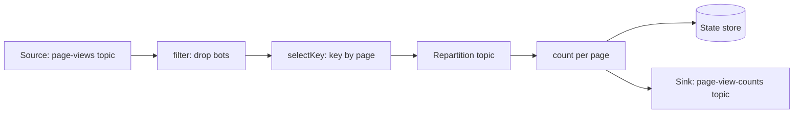
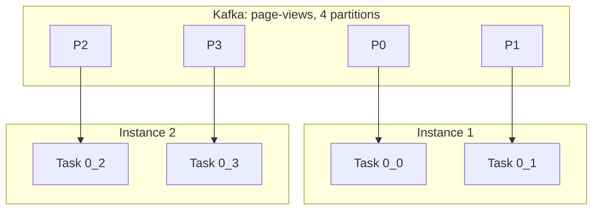

# Kafka Streams Introduction

## Introduction

Sooner or later, a team that uses Kafka wants to do more than move records from A to B. You want to count page views per minute, add customer details to every order, flag a card that is used in two countries within an hour, or keep a running balance per bank account. You can do all of this with a plain consumer and producer, but you end up writing your own state handling, your own crash recovery and your own logic for splitting the work across machines. That code is hard to get right.

Kafka Streams is the library that does this work for you. It is part of Apache Kafka itself (the `org.apache.kafka:kafka-streams` artifact), and it gives you a high-level Java API for filtering, transforming, aggregating, windowing and joining streams of records. Your application reads from Kafka topics and writes back to Kafka topics. State lives in local stores that are backed up to Kafka, so a crashed instance can pick up where it left off.

By the end of this page you will be able to:

- explain what Kafka Streams is and when to pick it over a plain consumer, Apache Flink or ksqlDB;
- describe the parts of an application: topology, tasks, threads, state stores and internal topics;
- build, run and inspect a small Kafka Streams application.

The examples use Kafka 4.3 (the APIs shown are the same across Kafka 4.x) and Java 17 or newer. Java is the native language of Kafka Streams; there is no official port to other languages.

## What Kafka Streams Is, and What It Is Not

The most important fact about Kafka Streams is that it is **a library, not a cluster**. You add a JAR to your service, write a few lines of code and run the service the way you run any other Java program: as a JAR on a VM, a container on Kubernetes, or a Spring Boot app. There is no job manager, no master node and no extra infrastructure. Kafka itself coordinates the instances.

An analogy: Apache Flink and Spark are like renting a factory. You ship your job to the factory and it runs there. Kafka Streams is like a power tool you carry in your own toolbox. It is smaller, but you can use it anywhere you already work.

That design has trade-offs. Here is how it compares with the usual alternatives:

| Option | What it is | Good fit | Weak spot |
| --- | --- | --- | --- |
| Plain consumer and producer | You write the poll loop yourself | Simple per-record work: send an email, call an API | No built-in state, windows or joins |
| Kafka Streams | Java library inside your app | Event-driven microservices that aggregate, join or enrich Kafka data | Input and output must be Kafka; JVM only |
| Apache Flink | Separate distributed processing cluster | Very large state, many sources and sinks, SQL and batch in one engine | A cluster to run and operate |
| Spark Structured Streaming | Micro-batch engine on a Spark cluster | Teams already on Spark, analytics and ML pipelines | Higher latency, heavier runtime |
| ksqlDB | SQL server built on Kafka Streams | Quick SQL pipelines without Java code | Its own servers to run; less flexible than code |

Choose Kafka Streams when your data already lives in Kafka, your team writes Java or Kotlin, and you want stream processing to be "just another service" that you deploy, scale and monitor like the rest. Choose Flink when you need to read from many systems, keep terabytes of state, or offer SQL to analysts. Choose a plain consumer when each record is handled on its own and nothing needs to be remembered.

## The Building Blocks: Topology, Processors and the DSL

A Kafka Streams application is described by a **topology**: a graph of processing steps. Records enter at **source** nodes (which read topics), flow through **processor** nodes (filter, map, count, join...) and leave through **sink** nodes (which write topics).



You build a topology in one of two ways:

- **The Streams DSL** (`StreamsBuilder`, `KStream`, `KTable`). A fluent, declarative API with operators like `filter`, `mapValues`, `groupByKey`, `count`, `windowedBy` and `join`. Use it by default; nearly all applications are written this way.
- **The Processor API** (`Processor`, `ProcessorContext`, state stores you manage yourself). Low-level and imperative: you get each record and decide what to forward. Use it for logic the DSL cannot express, such as custom expiry rules or scheduled work. You can mix the two with `KStream#process` and `KStream#processValues`.

The DSL has two core abstractions, covered in detail in [KStream, KTable and GlobalKTable](./1-kafka-streams-kstream-ktable.mdx):

- A `KStream` is an unbounded sequence of independent events: "user u42 viewed /pricing".
- A `KTable` is a changelog where each new record for a key replaces the previous one: "the view count for /pricing is now 1,204".

## How Kafka Streams Scales and Recovers

Kafka Streams borrows its scaling model from Kafka consumers, so if you know [consumer groups](../4-kafka-consumers/1-kafka-consumer-groups.mdx) you already know most of it.

**application.id.** Every instance of the same app uses the same `application.id`. It serves as the consumer group ID and as the prefix of every internal topic the app creates. Two instances with the same ID share the work; an instance with a different ID is a separate application that reads everything again.

**Tasks.** Kafka Streams splits the topology into sub-topologies and creates one **task** per input partition of each sub-topology. A topic with 6 partitions gives 6 tasks. A task is the unit of parallelism and owns its slice of state.

**Threads and instances.** Tasks are spread across stream threads (`num.stream.threads`, default 1) in all running instances. You scale out by starting another instance with the same `application.id`; Kafka rebalances and moves some tasks to it. Because a task is tied to a partition, the number of input partitions is the ceiling on useful parallelism: with 6 partitions, a seventh thread sits idle.



**State stores and changelogs.** Stateful operators such as `count` keep their state in local **state stores**, RocksDB by default, on the instance's disk. Every update is also written to a compacted **changelog topic** in Kafka. If an instance dies, its tasks move to another instance, which replays the changelog to rebuild the store, then carries on. Kafka is the source of truth; local disk is a fast cache.

**Repartition topics.** When you change the key of a stream and then group or join on the new key, records with the same new key may be in different partitions. Kafka Streams writes them through an internal **repartition topic** so that all records for one key reach the same task. This is automatic but has a cost: an extra write and read through Kafka.

Kafka Streams creates these internal topics itself, named `<application.id>-<name>-changelog` and `<application.id>-<name>-repartition`. Your app needs permission to create topics, or an operator has to create them up front.

:::note
Kafka 4.2 made the new broker-side **streams rebalance protocol** (KIP-1071) generally available, with a limited feature set. It moves task assignment from the clients to the broker, the same way KIP-848 did for plain consumers. It is opt-in with `group.protocol=streams`; the default is still `classic`. See [Testing and Deploying Kafka Streams Applications](./7-kafka-streams-testing-and-deployment.mdx).
:::

## Worked Scenario: A Page View Counter

A content site publishes one record to the `page-views` topic every time someone loads a page. The key is the user ID, the value is the page path. The product team wants a live count of views per page, without bot traffic, in a `page-view-counts` topic that a dashboard reads.

A consumer that keeps a `HashMap` would lose its counts on every restart and could not run on two machines without double counting. Kafka Streams solves both problems.

### Add the Dependency

```xml
<dependency>
    <groupId>org.apache.kafka</groupId>
    <artifactId>kafka-streams</artifactId>
    <version>4.3.1</version>
</dependency>
```

With Gradle: `implementation("org.apache.kafka:kafka-streams:4.3.1")`. The library pulls in `kafka-clients` and RocksDB. Add an SLF4J binding such as Logback to see its logs.

### Create the Topics

```bash
kafka-topics.sh --bootstrap-server localhost:9092 --create --topic page-views --partitions 4 --replication-factor 1
kafka-topics.sh --bootstrap-server localhost:9092 --create --topic page-view-counts --partitions 4 --replication-factor 1
```

### Write the Application

```java
import org.apache.kafka.common.serialization.Serdes;
import org.apache.kafka.streams.KafkaStreams;
import org.apache.kafka.streams.StreamsBuilder;
import org.apache.kafka.streams.StreamsConfig;
import org.apache.kafka.streams.Topology;
import org.apache.kafka.streams.kstream.*;

import java.util.Properties;
import java.util.concurrent.CountDownLatch;

public class PageViewCounts {

    static Topology buildTopology() {
        StreamsBuilder builder = new StreamsBuilder();

        // key = userId, value = page path, e.g. "u42" -> "/pricing"
        KStream<String, String> views = builder.stream(
                "page-views", Consumed.with(Serdes.String(), Serdes.String()));

        views
            .filter((userId, page) -> !userId.startsWith("bot-"))   // drop crawler traffic
            .selectKey((userId, page) -> page)                        // re-key by page
            .groupByKey(Grouped.with(Serdes.String(), Serdes.String()))
            .count(Materialized.as("page-view-counts-store"))         // KTable<String, Long>
            .toStream()
            .to("page-view-counts", Produced.with(Serdes.String(), Serdes.Long()));

        return builder.build();
    }

    public static void main(String[] args) throws InterruptedException {
        Properties props = new Properties();
        props.put(StreamsConfig.APPLICATION_ID_CONFIG, "page-view-counter");
        props.put(StreamsConfig.BOOTSTRAP_SERVERS_CONFIG, "localhost:9092");

        Topology topology = buildTopology();
        System.out.println(topology.describe());   // print the processing graph

        KafkaStreams streams = new KafkaStreams(topology, props);
        streams.setStateListener((newState, oldState) ->
                System.out.println("State " + oldState + " -> " + newState));

        CountDownLatch latch = new CountDownLatch(1);
        Runtime.getRuntime().addShutdownHook(new Thread(() -> {
            streams.close();        // commit offsets, flush stores, leave the group cleanly
            latch.countDown();
        }));

        streams.start();
        latch.await();
    }
}
```

A few things to notice:

- **Serdes** (serializer plus deserializer) are given at every boundary: `Consumed` for input, `Grouped` for the repartition step, `Produced` for output. A missing or wrong serde is the most common cause of startup errors. See [Choosing a Serialization Format](../6-kafka-schemas/0-kafka-serialization-formats.mdx) for real-world formats.
- `Materialized.as("page-view-counts-store")` names the state store. Named stores get stable internal topic names and can be queried; unnamed ones get generated names like `KSTREAM-AGGREGATE-STATE-STORE-0000000003`.
- `streams.close()` in a shutdown hook matters. Without it a killed instance does not leave the group, and the remaining instances wait for a session timeout before taking over.

### Read the Topology

`topology.describe()` prints the graph Kafka Streams built. For this app it shows two sub-topologies split by the repartition topic that `selectKey` plus `groupByKey` required:

```text
Topologies:
   Sub-topology: 0
    Source: KSTREAM-SOURCE-0000000000 (topics: [page-views])
      --> KSTREAM-FILTER-0000000001
    Processor: KSTREAM-FILTER-0000000001 (stores: [])
      --> KSTREAM-KEY-SELECT-0000000002
      <-- KSTREAM-SOURCE-0000000000
    Processor: KSTREAM-KEY-SELECT-0000000002 (stores: [])
      --> page-view-counts-store-repartition-filter
      <-- KSTREAM-FILTER-0000000001
    Processor: page-view-counts-store-repartition-filter (stores: [])
      --> page-view-counts-store-repartition-sink
      <-- KSTREAM-KEY-SELECT-0000000002
    Sink: page-view-counts-store-repartition-sink (topic: page-view-counts-store-repartition)
      <-- page-view-counts-store-repartition-filter

  Sub-topology: 1
    Source: page-view-counts-store-repartition-source (topics: [page-view-counts-store-repartition])
      --> KSTREAM-AGGREGATE-0000000003
    Processor: KSTREAM-AGGREGATE-0000000003 (stores: [page-view-counts-store])
      --> KTABLE-TOSTREAM-0000000007
      <-- page-view-counts-store-repartition-source
    Processor: KTABLE-TOSTREAM-0000000007 (stores: [])
      --> KSTREAM-SINK-0000000008
      <-- KSTREAM-AGGREGATE-0000000003
    Sink: KSTREAM-SINK-0000000008 (topic: page-view-counts)
      <-- KTABLE-TOSTREAM-0000000007
```

Reading this output is a habit worth building. It tells you where repartitioning happens (each one costs a round trip through Kafka) and which stores exist. Pasting it into an online topology visualizer gives you a picture to share in a design review.

### Run It

Start the app, then produce some views and watch the counts:

```bash
kafka-console-producer.sh --bootstrap-server localhost:9092 --topic page-views \
  --property parse.key=true --property key.separator=:
>u1:/pricing
>u2:/docs
>bot-7:/pricing
>u3:/pricing
```

```bash
kafka-console-consumer.sh --bootstrap-server localhost:9092 --topic page-view-counts --from-beginning \
  --formatter-property print.key=true \
  --formatter-property value.deserializer=org.apache.kafka.common.serialization.LongDeserializer
/docs	1
/pricing	2
```

(Older console tools call the option `--property` instead of `--formatter-property`.)

You may see `/pricing 2` appear without the intermediate `/pricing 1`. That is the **record cache** at work: Kafka Streams combines updates to the same key in memory and sends the latest value at commit time, every 30 seconds by default (`commit.interval.ms`). [Stateful Operations and State Stores](./3-kafka-streams-stateful-operations.mdx) explains how to tune it.

### What Happens When You Scale

Start a second copy of the same JAR. Both instances join the `page-view-counter` group, and the 4 tasks of each sub-topology are split between them. If you kill one with `kill -9`, the survivor takes over its tasks after the session timeout, restores the counts from the `page-view-counter-page-view-counts-store-changelog` topic, and continues. No counts are lost, and the dashboard never knows anything happened.

## Common Mistakes

- **Reusing an `application.id` for a different app.** Two different topologies with the same ID join the same group and corrupt each other's offsets and state. Treat the ID as the app's identity and version it when you make breaking topology changes.
- **Running more threads than partitions.** Extra threads get no tasks. Plan the partition count of input topics for the parallelism you will need later.
- **Forgetting serdes.** Without explicit serdes, Kafka Streams falls back to `default.key.serde` and `default.value.serde`, which have no default value. The app fails at startup with "Please specify a key serde", or worse, a wrongly set default produces a `ClassCastException` or garbage at runtime.
- **Treating local state as disposable or as the source of truth.** It is neither. It is a cache of the changelog, and losing it costs a full restore that can take minutes or hours for large stores.
- **Skipping `close()` on shutdown.** Tasks are not handed over until the session timeout expires, so every deploy causes a processing pause.
- **Using Kafka Streams to write to a database.** Output goes to Kafka topics. To land results in a database, use a sink connector from [Kafka Connect](../8-kafka-connect/0-kafka-connect-introduction.mdx).

## Summary

- Kafka Streams is a Java library for stream processing on Kafka. It runs inside your app, with no separate cluster.
- An app is a topology of source, processor and sink nodes, usually built with the DSL.
- Parallelism comes from tasks, one per input partition, spread over threads and instances that share an `application.id`.
- State lives in local stores (RocksDB by default) that are backed up to compacted changelog topics, so failover does not lose state.
- Re-keying causes internal repartition topics; `Topology#describe()` shows where.
- Pick Kafka Streams when data is in Kafka and your team writes JVM code; pick Flink for many sources and very large state; pick a plain consumer when nothing needs to be remembered.

## Further Reading

- [Kafka Streams documentation](https://kafka.apache.org/documentation/streams/): the official overview, quickstart and developer guide.
- [Streams architecture](https://kafka.apache.org/documentation/streams/architecture): tasks, threads, state and fault tolerance in depth.
- [Streams core concepts](https://kafka.apache.org/documentation/streams/core-concepts): topologies, time, duality of streams and tables.
- [Streams upgrade guide](https://kafka.apache.org/documentation/streams/upgrade-guide): API changes in each release, including removals in 4.0.
- [KIP-1071: Streams Rebalance Protocol](https://cwiki.apache.org/confluence/display/KAFKA/KIP-1071%3A+Streams+Rebalance+Protocol): the broker-side task assignment design.
