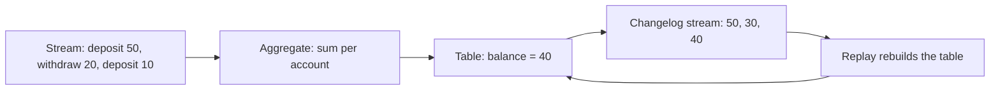

# KStream, KTable and GlobalKTable

## Introduction

Before you write a single operator in Kafka Streams, you make a modeling decision: is this topic a stream of events, or is it a table of current facts? The same bytes in a topic can mean very different things. "Alice paid 20 dollars" and "Alice's balance is 20 dollars" look alike on the wire, but adding up the first kind gives a total, while adding up the second kind gives nonsense.

Kafka Streams makes the decision explicit with three types: `KStream`, `KTable` and `GlobalKTable`. Picking the right one decides how records are interpreted, which operations are available, how much state is kept and whether your joins need the topics to be partitioned the same way.

After this page you will be able to:

- explain the stream-table duality and why both views describe the same data;
- choose between `KStream`, `KTable` and `GlobalKTable` for a given topic;
- handle updates and deletes (tombstones) in tables;
- convert between streams and tables.

## Streams and Tables Are Two Views of the Same Data

Think of a bank account. The **statement** lists every deposit and withdrawal; nothing is ever overwritten. The **balance** is a single number that changes over time. You can get the balance by replaying the statement from the start, and you can get a statement of sorts by writing down the balance every time it changes.

That is the stream-table duality:

- A **stream** is the history: every event, appended forever.
- A **table** is the current state: the latest value per key.
- Aggregating a stream produces a table. Recording every change to a table produces a stream, called its **changelog**.



Kafka itself works this way. A topic is a log, which is a stream. A compacted topic keeps only the latest record per key, which makes it a table stored as a stream. Kafka Streams uses this to back up its state: every local table has a compacted changelog topic, and replaying that topic rebuilds the table on another machine.

## KStream: Every Record Is an Event

A `KStream<K, V>` treats each record as an independent fact. Two records with the same key are two events; the second one does not replace the first.

```java
KStream<String, String> pageViews = builder.stream(
        "page-views", Consumed.with(Serdes.String(), Serdes.String()));
```

Use a `KStream` for things that happened: clicks, payments, sensor readings, log lines, orders placed. Counting a `KStream` counts events. Stateless operations on a `KStream` (filter, map, branch) keep no memory, which makes them cheap, as covered in [Stateless Operations](./2-kafka-streams-stateless-operations.mdx).

## KTable: The Latest Value per Key

A `KTable<K, V>` treats each record as an **upsert**: the new value replaces the old one for that key. A record with a `null` value is a **tombstone** and deletes the key.

```java
KTable<String, String> customers = builder.table(
        "customers",
        Consumed.with(Serdes.String(), Serdes.String()),
        Materialized.<String, String, KeyValueStore<Bytes, byte[]>>as("customers-store"));
```

Use a `KTable` for current facts that change: a customer's profile, a product's price, an account's status, the result of an aggregation. Counting a `KTable` counts keys, not records.

Three details matter in practice.

**A table needs local state.** To know the "current" value, Kafka Streams keeps a state store per task, filled from the topic. When you pass `Materialized.as("customers-store")`, the store gets a stable name, can be read from outside with interactive queries, and is easy to inspect in tests.

**The source topic should be compacted.** Kafka Streams can restore a source `KTable` by re-reading its input topic. If that topic uses time-based deletion, old keys vanish after the retention period and a rebuilt table is missing rows. Create table topics with `cleanup.policy=compact`; see [Retention and Log Compaction](../2-kafka-topics-and-storage/3-kafka-retention-and-compaction.mdx). With `topology.optimization=all`, Kafka Streams reuses the source topic as the store's changelog instead of creating a second copy.

**Downstream sees updates, not inserts.** When you call `customers.toStream()`, you get one record per change. With the record cache on, several quick updates to the same key may be merged into one, so a table emits "at least the final value", not necessarily every step.

## GlobalKTable: A Full Copy on Every Instance

A normal `KTable` is **partitioned**. With 6 partitions and 3 instances, each instance holds about a third of the keys. That is what lets tables grow beyond one machine. It also means a stream can only join a table if the matching keys live on the same instance, which requires the two topics to be **co-partitioned**: same number of partitions, same key, same partitioner.

A `GlobalKTable<K, V>` drops partitioning. Every instance reads **all** partitions of the topic into its own full copy.

```java
GlobalKTable<String, String> products = builder.globalTable(
        "products", Consumed.with(Serdes.String(), Serdes.String()));
```

That buys you two things:

- **No co-partitioning.** A stream with any number of partitions can join it.
- **Lookups by any field.** When joining a `KStream` to a `GlobalKTable`, you give a function that picks the lookup key from the stream record, so the stream does not have to be keyed by it and no repartition topic is created.

And it costs you:

- **Memory and disk on every instance.** Ten instances keep ten full copies.
- **Slower startup.** A global table is fully loaded before processing begins.
- **Weaker time semantics.** A global table is updated by its own thread as fast as it can read, not in step with the stream's timestamps. A join can see a product price that is "newer" than the order being processed.

Use a `GlobalKTable` for small, slowly changing reference data: product catalogs, currency codes, store locations, feature flags. Megabytes to a few gigabytes, read by every record. Use a `KTable` for anything large or fast-changing, like customer profiles for millions of users.

## Comparing the Three

| | `KStream` | `KTable` | `GlobalKTable` |
| --- | --- | --- | --- |
| A record means | A new event | Upsert for its key | Upsert for its key |
| `null` value | An event with no value | Delete the key | Delete the key |
| State kept | None (for stateless ops) | Its partitions only | Whole topic, on every instance |
| Joins need co-partitioning | Yes, with another stream or a table | Yes | No |
| Typical data | Clicks, orders, payments | Profiles, balances, aggregates | Catalogs, lookup codes |
| Topic cleanup policy | `delete` | `compact` | `compact` |

## Converting Between Streams and Tables

You move between the views with a handful of operations:

- `KTable#toStream()` turns a table into its changelog stream. Use it to write an aggregate to a topic.
- `KStream#toTable()` interprets a stream as upserts. Useful when a topic you read as a stream turns out to hold current values.
- `groupByKey()` or `groupBy(...)` followed by `count`, `reduce` or `aggregate` turns a stream into a table. This is the main way tables are made; see [Stateful Operations and State Stores](./3-kafka-streams-stateful-operations.mdx).
- `KTable#groupBy(...)` followed by an aggregation re-groups a table, for example from "customer to city" into "count of customers per city". Because a table row can change, the aggregation gets both an adder (new value) and a subtractor (old value).

```java
// Each customer record: key = customerId, value = city
KTable<String, String> customerCity = builder.table(
        "customer-city", Consumed.with(Serdes.String(), Serdes.String()));

KTable<String, Long> customersPerCity = customerCity
        .groupBy((customerId, city) -> KeyValue.pair(city, customerId),
                 Grouped.with(Serdes.String(), Serdes.String()))
        .count();   // moving a customer from Oslo to Bergen decrements Oslo and increments Bergen
```

## Worked Scenario: An Online Shop

An online shop has three topics:

- `orders`: one record per order placed, key = order ID, value = "productId,quantity". Events, so a **KStream**.
- `customers`: one record whenever a customer signs up, changes tier or deletes their account, key = customer ID. Current facts per customer, millions of keys, so a partitioned **KTable**.
- `products`: the catalog, a few thousand items, key = product ID. Small reference data that every order needs, so a **GlobalKTable**.

The orders are keyed by order ID, not product ID. Joining them to a partitioned products `KTable` would first need a repartition by product ID. With a `GlobalKTable`, the join just extracts the product ID from the value.

```java
import org.apache.kafka.common.serialization.Serdes;
import org.apache.kafka.common.utils.Bytes;
import org.apache.kafka.streams.StreamsBuilder;
import org.apache.kafka.streams.Topology;
import org.apache.kafka.streams.kstream.*;
import org.apache.kafka.streams.state.KeyValueStore;

public class ShopTopology {

    static Topology build() {
        StreamsBuilder builder = new StreamsBuilder();

        // Latest profile per customer; key = customerId, value = tier
        KTable<String, String> customers = builder.table(
                "customers",
                Consumed.with(Serdes.String(), Serdes.String()),
                Materialized.<String, String, KeyValueStore<Bytes, byte[]>>as("customers-store"));

        // Emit every change so we can watch the table evolve
        customers.toStream().to("customer-changes", Produced.with(Serdes.String(), Serdes.String()));

        // Product catalog: small, a full copy on each instance
        GlobalKTable<String, String> products = builder.globalTable(
                "products", Consumed.with(Serdes.String(), Serdes.String()));

        // key = orderId, value = "productId,quantity"
        KStream<String, String> orders = builder.stream(
                "orders", Consumed.with(Serdes.String(), Serdes.String()));

        orders.join(products,
                    (orderId, order) -> order.split(",")[0],              // lookup key: productId
                    (order, productName) -> productName + " x" + order.split(",")[1])
              .to("orders-with-product", Produced.with(Serdes.String(), Serdes.String()));

        return builder.build();
    }
}
```

Feeding this topology the following input (using the test driver from [Testing and Deploying](./7-kafka-streams-testing-and-deployment.mdx), with the record cache turned off so every change is visible):

```text
customers: c1 -> silver
customers: c2 -> gold
customers: c1 -> gold
customers: c2 -> null        (tombstone: c2 deleted their account)
orders:    o1 -> p9,2        (product p9 not in the catalog yet)
products:  p9 -> USB-C cable
orders:    o2 -> p9,1
```

produces:

```text
customer-changes:
KeyValue(c1, silver)
KeyValue(c2, gold)
KeyValue(c1, gold)
KeyValue(c2, null)

customers-store: c1=gold c2=null

orders-with-product:
KeyValue(o2, USB-C cable x1)
```

Three lessons from this output:

1. The table's changelog contains every update, including the tombstone. Anyone consuming `customer-changes` must handle `null` values.
2. After the tombstone, the store no longer has `c2`. A count of the table would be 1, not 4.
3. Order `o1` vanished. An inner join only emits when both sides match, and the product arrived after the order. A `leftJoin` would have emitted `o1` with a `null` product. Lookup tables should be loaded before the events that need them, which is one reason global tables are bootstrapped before processing starts. [Joins](./5-kafka-streams-joins.mdx) covers this timing in depth.

## Common Mistakes

- **Reading a table topic as a stream.** Counting a `customers` stream counts profile updates, not customers. Ask "does a new record replace the old one?" If yes, it is a table.
- **Using a non-compacted topic for a `KTable`.** After retention deletes old segments, restored tables lose keys that were not updated recently.
- **Putting large data in a `GlobalKTable`.** Every instance stores and loads all of it, and startup slows down as the topic grows. Use a partitioned `KTable` and co-partition instead.
- **Ignoring tombstones.** Code that calls `value.split(",")` in a `mapValues` after `toStream()` throws a `NullPointerException` on the first delete.
- **Expecting every intermediate update.** With caching on, a table may skip intermediate values. If you need every change, you need a `KStream`.
- **Joining tables that are not co-partitioned.** Kafka Streams checks partition counts when tasks are assigned and refuses to run with mismatched counts. Different partitioners (for example a non-Java producer that hashes differently) are not detected and silently produce wrong joins.

## Summary

- A stream is a history of events; a table is the latest value per key. Each can be derived from the other.
- `KStream`: every record is a new event. Use it for things that happened.
- `KTable`: every record is an upsert, `null` deletes. Partitioned, backed by a local store and a compacted changelog.
- `GlobalKTable`: a full copy of the topic on every instance. No co-partitioning needed, lookup by any field, but only for small reference data.
- Convert with `toStream`, `toTable` and grouped aggregations; table re-grouping uses an adder and a subtractor.

## Further Reading

- [Streams DSL: KStream, KTable and GlobalKTable](https://kafka.apache.org/documentation/streams/developer-guide/dsl-api.html): the official reference for the three abstractions.
- [Streams core concepts: duality of streams and tables](https://kafka.apache.org/documentation/streams/core-concepts): the theory behind tables as changelogs.
- [Log compaction](https://kafka.apache.org/documentation/#compaction): how Kafka keeps the latest value per key.
- [Topology optimization setting](https://kafka.apache.org/documentation/streams/developer-guide/config-streams.html#topology-optimization): reusing source topics as changelogs and merging repartition topics.
