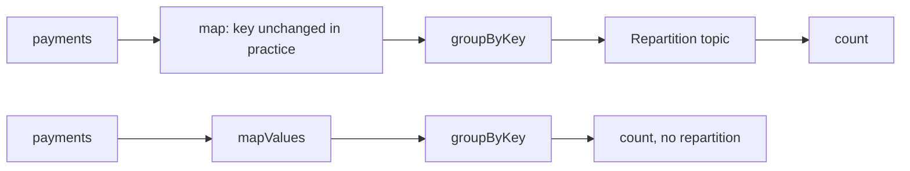

# Stateless Operations: map, filter, branch and more

## Introduction

Most stream processing starts with simple steps: throw away records you do not care about, reshape the ones you do, and send them to the right place. A payments platform drops test transactions, normalizes currency codes, sends card payments to the card team's topic and bank transfers to the bank team's. None of this needs to remember earlier records. Each record is handled on its own.

Kafka Streams calls these **stateless operations**. They are cheap, they scale with the number of partitions, and they need no local storage. They are also where a surprising number of production problems start, because one innocent-looking call (`map` instead of `mapValues`) can add a full round trip through Kafka to your topology.

After this page you will be able to:

- pick the right operator for transforming, filtering, splitting and merging streams;
- tell which operators change the key and what that costs;
- route records to topics chosen at runtime;
- use `processValues` to read record headers and metadata, the replacement for the `transformValues` API removed in Kafka 4.0.

## What Stateless Means

A stateless operator looks at one record, produces zero, one or many records, and forgets. It keeps no state store, writes no changelog and never waits for other records. That has three practical consequences:

- **No recovery cost.** When a task moves to another instance, it starts processing at once; there is nothing to restore.
- **Throughput is bounded by your code.** A `filter` that calls a regex or parses JSON costs CPU per record, but nothing else.
- **No ordering surprises.** Records leave in the order they arrived within a partition.

The opposite is a stateful operator such as `count` or `join`, covered in [Stateful Operations and State Stores](./3-kafka-streams-stateful-operations.mdx).

## Transforming Records

| Operator | Input to output | Can change the key | Typical use |
| --- | --- | --- | --- |
| `mapValues` | 1 to 1 | No | Parse, convert, enrich the value |
| `map` | 1 to 1 | Yes | Build a new key and value together |
| `selectKey` | 1 to 1 | Yes (value untouched) | Re-key before grouping or joining |
| `flatMapValues` | 1 to 0..n | No | Split a batch record into items |
| `flatMap` | 1 to 0..n | Yes | Split and re-key at once |
| `processValues` | 1 to 0..n | No | Access headers, timestamps, state; custom logic |
| `process` | 1 to 0..n | Yes | Full Processor API |

The column that matters most is **can change the key**. Kafka Streams cannot look inside your lambda, so any operator that *can* change the key marks the stream as "may need repartitioning". Nothing happens yet. But if a later step groups or joins by key, Kafka Streams inserts a repartition topic: every record is written to Kafka again and read back so that equal keys land in the same partition.



So the rule is simple: **if you are not changing the key, use the `...Values` variant.** `mapValues` over `map`, `flatMapValues` over `flatMap`, `processValues` over `process`. The `...Values` operators also give you the key as a read-only argument when you need it:

```java
// The key is visible but cannot be replaced
KStream<String, String> labelled = payments.mapValues((paymentId, p) -> paymentId + ":" + p);
```

When you *do* need a new key, for example to group payments by account, change it once with `selectKey` or `map`, as close as possible to the grouping, and only once. Two re-keys followed by one grouping still cost one repartition, but a re-key, a group, another re-key and another group cost two.

`flatMapValues` is the right tool for "one record in, many out" where the key stays the same, such as an order with three line items:

```java
// value = "sku-1;sku-2;sku-3"
KStream<String, String> lineItems = orders.flatMapValues(v -> Arrays.asList(v.split(";")));
```

Returning an empty list drops the record, so `flatMapValues` can filter and transform in one step.

## Filtering

`filter` keeps records where the predicate is true; `filterNot` keeps records where it is false. Both get the key and value:

```java
KStream<String, String> real = payments
        .filter((id, p) -> p != null)                         // tombstones and empty records
        .filterNot((id, p) -> p.startsWith("test-"));         // test accounts
```

Filter as early as possible. Every record you drop before a repartition or a state store saves a network write, a disk write and a changelog write.

## Branching and Merging

To send different kinds of records down different paths, use `split()`. Each `branch` has a predicate; a record goes to the **first** branch whose predicate matches, so order the branches from most to least specific. `defaultBranch()` catches everything else; `noDefaultBranch()` drops it.

```java
Map<String, KStream<String, String>> branches = payments
        .split(Named.as("method-"))
        .branch((id, p) -> p.contains(",card,"), Branched.as("card"))
        .branch((id, p) -> p.contains(",bank,"), Branched.as("bank"))
        .defaultBranch(Branched.as("other"));

KStream<String, String> cardPayments = branches.get("method-card");
```

The map key is the `split` name plus the branch name. If you prefer not to look branches up by string, `Branched.withConsumer(ks -> ks.to("payments-card"))` handles the branch inline.

:::note
The old `KStream#branch(Predicate...)` method that returned an array was removed in Kafka 4.0. Code from older tutorials needs to move to `split()`.
:::

`merge` does the opposite and combines two streams of the same type into one:

```java
KStream<String, String> allRefunds = cardRefunds.merge(bankRefunds);
```

There is no ordering guarantee between the two inputs of a `merge`. Records from each side keep their own order, but they interleave in whatever order they are processed.

Branching is also the cheaper alternative to running the same stream through several `filter` calls. With three filters each record is tested three times on three separate paths; with `split()` it is tested until the first match and sent down exactly one path.

## Side Effects, Debugging and Output

`peek` runs an action and passes the record on unchanged; `foreach` runs an action and ends the stream. Both are meant for logging and metrics. Do not use them to call external systems: Kafka Streams may process a record more than once after a failure, and a side effect cannot be rolled back. For delivering to databases or APIs, write to a topic and use a [sink connector](../8-kafka-connect/2-kafka-connect-sink-connectors.mdx) or a consumer with its own retry logic.

`print(Printed.toSysOut())` dumps records to the console during development.

To write records, use `to`. It takes a fixed topic name or a `TopicNameExtractor` that picks the topic per record:

```java
// Route by currency: payments-usd, payments-eur, ...
payments.to((key, value, recordContext) -> "payments-" + currencyOf(value),
            Produced.with(Serdes.String(), Serdes.String()));
```

Dynamic topics must already exist; Kafka Streams does not create output topics.

`repartition()` forces a repartition at a point you choose and lets you set the partition count and a stable name. Use it when you want to change parallelism (read from a 3-partition topic, process with 12 tasks) or when you want the repartition topic name under your control:

```java
KStream<String, String> byAccount = payments
        .selectKey((id, p) -> accountOf(p))
        .repartition(Repartitioned.<String, String>as("payments-by-account").withNumberOfPartitions(12));
```

## Headers and Metadata with processValues

The DSL lambdas see only the key and value. When you need record headers, the timestamp, or the topic and offset a record came from, drop down to `processValues` with a `FixedKeyProcessor`. It is the Kafka 4.x replacement for `transformValues`, which was removed in 4.0 together with `transform` and `flatTransform`. "Fixed key" means the API makes it impossible to change the key, so no repartition is needed.

```java
import org.apache.kafka.common.header.Header;
import org.apache.kafka.streams.processor.api.FixedKeyProcessor;
import org.apache.kafka.streams.processor.api.FixedKeyProcessorContext;
import org.apache.kafka.streams.processor.api.FixedKeyRecord;

import java.nio.charset.StandardCharsets;

// Appends the "region" header to the value
class AddRegion implements FixedKeyProcessor<String, String, String> {
    private FixedKeyProcessorContext<String, String> context;

    @Override
    public void init(FixedKeyProcessorContext<String, String> context) {
        this.context = context;
    }

    @Override
    public void process(FixedKeyRecord<String, String> record) {
        Header region = record.headers().lastHeader("region");
        String tag = region == null ? "unknown" : new String(region.value(), StandardCharsets.UTF_8);
        context.forward(record.withValue(record.value() + ",region=" + tag));
    }
}

// In the topology:
KStream<String, String> tagged = payments.processValues(AddRegion::new);
```

A record with a `region: eu-west` header becomes `acct-7,card,1999,usd,region=eu-west`; one without becomes `...,region=unknown`. Pass a supplier (`AddRegion::new`), not a shared instance: Kafka Streams creates one processor per task, and sharing one object across tasks causes race conditions.

## Worked Scenario: A Payments Router

A payment gateway writes every payment to `payments`, keyed by payment ID, with the value `accountId,method,amountCents,currency`. Downstream teams want:

- zero or negative amounts and test accounts removed;
- card payments in `payments-card`, bank transfers in `payments-bank`, anything else in `payments-review` for manual checks;
- a copy keyed by account in `payments-by-account`, so the fraud service sees each account's payments in order;
- a copy per currency (`payments-usd`, `payments-eur`) for the treasury team.

A single consumer that produces to five topics would work, but you would write the routing, error handling and scaling yourself. In Kafka Streams it is one small topology, and it is entirely stateless, so it restarts instantly.

```java
import org.apache.kafka.common.serialization.Serdes;
import org.apache.kafka.streams.StreamsBuilder;
import org.apache.kafka.streams.StreamsConfig;
import org.apache.kafka.streams.Topology;
import org.apache.kafka.streams.kstream.*;

import java.util.Locale;
import java.util.Map;
import java.util.Properties;

public class PaymentsRouter {
    // value format: "accountId,method,amountCents,currency"
    static String field(String csv, int i) { return csv.split(",")[i]; }

    static Topology build() {
        StreamsBuilder builder = new StreamsBuilder();
        KStream<String, String> payments = builder.stream("payments");   // default serdes: String

        KStream<String, String> valid = payments
            .filter((id, p) -> p != null && Long.parseLong(field(p, 2)) > 0)   // drop zero/negative amounts
            .filterNot((id, p) -> field(p, 0).startsWith("test-"))           // drop test accounts
            .mapValues(p -> p.toUpperCase(Locale.ROOT))                     // normalize codes; key untouched
            .peek((id, p) -> System.out.println("valid " + id + " " + p));

        Map<String, KStream<String, String>> byMethod = valid
            .split(Named.as("method-"))
            .branch((id, p) -> field(p, 1).equals("CARD"), Branched.as("card"))
            .branch((id, p) -> field(p, 1).equals("BANK"), Branched.as("bank"))
            .defaultBranch(Branched.as("other"));

        byMethod.get("method-card").to("payments-card");
        byMethod.get("method-bank").to("payments-bank");
        byMethod.get("method-other").to("payments-review");

        // Re-key by account so per-account consumers see one ordered stream
        valid.selectKey((id, p) -> field(p, 0))
             .to("payments-by-account");

        // Route by currency to a topic chosen at runtime
        valid.to((id, p, ctx) -> "payments-" + field(p, 3).toLowerCase(Locale.ROOT));

        return builder.build();
    }

    static Properties config() {
        Properties props = new Properties();
        props.put(StreamsConfig.APPLICATION_ID_CONFIG, "payments-router");
        props.put(StreamsConfig.BOOTSTRAP_SERVERS_CONFIG, "localhost:9092");
        props.put(StreamsConfig.DEFAULT_KEY_SERDE_CLASS_CONFIG, Serdes.StringSerde.class);
        props.put(StreamsConfig.DEFAULT_VALUE_SERDE_CLASS_CONFIG, Serdes.StringSerde.class);
        return props;
    }
}
```

With these five input records:

```text
pay-1 -> acct-7,card,1999,usd
pay-2 -> acct-3,bank,50000,eur
pay-3 -> test-1,card,100,usd
pay-4 -> acct-7,crypto,700,usd
pay-5 -> acct-9,card,0,usd
```

the output topics contain:

```text
valid pay-1 ACCT-7,CARD,1999,USD
valid pay-2 ACCT-3,BANK,50000,EUR
valid pay-4 ACCT-7,CRYPTO,700,USD
payments-bank       -> [KeyValue(pay-2, ACCT-3,BANK,50000,EUR)]
payments-by-account -> [KeyValue(ACCT-7, ACCT-7,CARD,1999,USD), KeyValue(ACCT-3, ACCT-3,BANK,50000,EUR),
                        KeyValue(ACCT-7, ACCT-7,CRYPTO,700,USD)]
payments-card       -> [KeyValue(pay-1, ACCT-7,CARD,1999,USD)]
payments-eur        -> [KeyValue(pay-2, ACCT-3,BANK,50000,EUR)]
payments-review     -> [KeyValue(pay-4, ACCT-7,CRYPTO,700,USD)]
payments-usd        -> [KeyValue(pay-1, ACCT-7,CARD,1999,USD), KeyValue(pay-4, ACCT-7,CRYPTO,700,USD)]
```

Notice that `selectKey` followed directly by `to` does **not** create a repartition topic. Writing to `payments-by-account` already partitions by the new key. Repartitioning only happens when a re-keyed stream feeds a grouping or a join inside the same app.

Also notice the `valid` stream is used four times. Kafka Streams does not copy the upstream work; the filter and `mapValues` run once per record and the result fans out to every child.

In a real system the value would be Avro, Protobuf or JSON with a schema rather than CSV, parsed once by a serde instead of `split(",")` in every lambda. See [Schemas and Serialization](../6-kafka-schemas/0-kafka-serialization-formats.mdx).

## Common Mistakes

- **Using `map` when the key does not change.** It marks the stream for repartitioning and costs an extra topic if a grouping follows. Use `mapValues`.
- **Calling external services in `peek`, `foreach` or `mapValues`.** Records can be reprocessed after a crash, and a slow call blocks the whole stream thread. Exceeding `max.poll.interval.ms` gets the instance kicked out of the group.
- **Throwing on bad input.** An exception in a lambda kills the stream thread. Filter malformed records out, send them to a dead letter topic with a branch, or configure a `processing.exception.handler`.
- **Forgetting that branch order matters.** A record matches only the first true predicate. A broad predicate first starves the later branches.
- **Sharing one processor instance in `processValues`.** Always pass a supplier that returns a new object.
- **Writing to dynamic topics that do not exist.** With broker auto-creation disabled (the right default in production), the producer blocks and then fails. Create the topics up front.

## Summary

- Stateless operators handle one record at a time, need no state store and restart instantly.
- Prefer `mapValues`, `flatMapValues` and `processValues`; key-changing operators can add a repartition topic before a later grouping or join.
- `filter` and `filterNot` drop records; do it early.
- `split()` with `branch` and `defaultBranch` routes records down exactly one path; `merge` combines streams without cross-stream ordering.
- `to` accepts a `TopicNameExtractor` for runtime routing; `repartition()` sets partition count and name explicitly.
- `processValues` with a `FixedKeyProcessor` gives access to headers and metadata and replaces the removed `transformValues`.

## Further Reading

- [Streams DSL: stateless transformations](https://kafka.apache.org/documentation/streams/developer-guide/dsl-api.html#stateless-transformations): the full operator list with examples.
- [Processor API](https://kafka.apache.org/documentation/streams/developer-guide/processor-api.html): processors, fixed-key processors and how they connect to the DSL.
- [KIP-418: A method-chaining way to branch KStream](https://cwiki.apache.org/confluence/display/KAFKA/KIP-418%3A+A+method-chaining+way+to+branch+KStream): the design behind `split()`.
- [KIP-820: Extend KStream process with new Processor API](https://cwiki.apache.org/confluence/display/KAFKA/KIP-820%3A+Extend+KStream+process+with+new+Processor+API): introduces `processValues` and `FixedKeyProcessor`.
