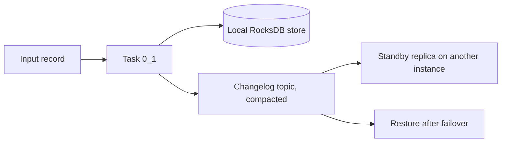

# Stateful Operations and State Stores

## Introduction

A stateless filter only needs the record in front of it. A running bank balance does not: to know that account 1 now holds 35 dollars, you must remember that it held 75 before the last withdrawal. As soon as you count, sum, deduplicate or join, your application needs **state**, and state raises hard questions. Where is it stored? What happens to it when the machine dies? How big can it get? How do other services read it?

Kafka Streams answers these with **state stores**: local, embedded databases (RocksDB by default) that each task owns, backed up continuously to Kafka topics. You get the speed of a local lookup with the durability of Kafka.

After this page you will be able to:

- group a stream and aggregate it with `count`, `reduce` and `aggregate`;
- choose a store type and configure it with `Materialized`;
- explain changelogs, restoration, standby replicas and the record cache;
- read state from outside the topology with interactive queries;
- build custom stateful logic with the Processor API, including expiry.

## Grouping: Deciding What Belongs Together

Every DSL aggregation starts with grouping. Grouping does not compute anything; it decides which records share a result.

- `groupByKey()` groups by the existing key. If the key has not been changed upstream, no repartition is needed.
- `groupBy((k, v) -> newKey)` groups by a new key. It always marks the stream for repartitioning, because records with the same new key may sit in different partitions.

```java
// Ledger entries are already keyed by accountId: no repartition
KGroupedStream<String, Long> byAccount =
        entries.groupByKey(Grouped.with(Serdes.String(), Serdes.Long()));

// Group payments by currency instead: Kafka Streams adds a repartition topic
KGroupedStream<String, String> byCurrency =
        payments.groupBy((id, p) -> currencyOf(p), Grouped.with(Serdes.String(), Serdes.String()));
```

`Grouped.with(...)` sets the serdes for the repartition topic. `Grouped.as("name")` gives that topic a stable name, which matters for upgrades (see [Testing and Deploying](./7-kafka-streams-testing-and-deployment.mdx)).

## Aggregating: count, reduce and aggregate

A grouped stream becomes a `KTable` through one of three operations:

| Operation | Result type | You provide | Example |
| --- | --- | --- | --- |
| `count()` | `Long` | Nothing | Orders per customer |
| `reduce(reducer)` | Same as input value | `(aggValue, newValue) -> result` | Sum of amounts, max temperature |
| `aggregate(init, aggregator)` | Anything | Initial value and `(key, value, agg) -> newAgg` | Average, min/max/count object, list of last 10 items |

Use the simplest one that fits. `reduce` cannot change the type, so to compute an average you need `aggregate` with an accumulator holding a sum and a count.

The result of an aggregation is a `KTable`: each new input record produces an updated value for its key. To write it to a topic, call `toStream().to(...)`.

Grouped **tables** (`KTable#groupBy`) also aggregate, but because a table row can change or disappear, `reduce` and `aggregate` need both an adder and a subtractor. When a customer moves from Oslo to Bergen, the old value is subtracted from Oslo and the new value added to Bergen.

## State Stores: Where the Results Live

Each aggregation is backed by a state store, one per task. You control it with `Materialized`.

```java
KTable<String, Long> balances = byAccount.reduce(
        Long::sum,
        Materialized.<String, Long, KeyValueStore<Bytes, byte[]>>as("balances")
                .withKeySerde(Serdes.String())
                .withValueSerde(Serdes.Long()));
```

Store types:

| Store | Created by | Holds |
| --- | --- | --- |
| Key-value | `count`, `reduce`, `aggregate`, `table()` | Latest value per key |
| Window | Windowed aggregations | Value per key per time window |
| Session | Session-windowed aggregations | Value per key per activity session |
| Versioned key-value | `Stores.persistentVersionedKeyValueStore` | Value per key per point in time, for a history period |

And two implementations:

- **RocksDB (persistent, the default).** Data lives on local disk under `state.dir` (default: a `kafka-streams` folder in the system temp directory), with an in-memory block cache. It can hold far more than the heap. Set `state.dir` to a real, persistent volume in production; the temp directory may be wiped on reboot, forcing a full restore.
- **In-memory.** `Materialized.as(Stores.inMemoryKeyValueStore("name"))`. Faster, no disk, no RocksDB tuning, but bounded by heap and always fully restored after a restart.

Pick RocksDB unless the state is small (well under a gigabyte per instance) and you can afford to rebuild it on every restart.

## Changelogs and Restoration

Every write to a store is also sent to a compacted **changelog topic** named `<application.id>-<store name>-changelog`. That topic, not the local disk, is the source of truth.



When a task starts on an instance, Kafka Streams checks how far the local store is behind the changelog and replays the gap. If the instance restarts with its disk intact, that gap is small and recovery takes seconds. If the task lands on a fresh machine, it replays the whole changelog, which for a 50 GB store can take a long time.

Three settings shorten that gap:

- `num.standby.replicas` (default 0). Each standby is a passive copy of a task's store on another instance, kept up to date by reading the changelog. On failover, a standby becomes active almost immediately. Set it to 1 for stateful apps where recovery time matters.
- `acceptable.recovery.lag` (default 10,000 records). An instance is considered "caught up" for a task if it is within this many records. Kafka Streams only assigns active tasks to caught-up instances.
- `max.warmup.replicas` (default 2) and `probing.rebalance.interval.ms` (default 10 minutes). When a new instance joins, Kafka Streams first warms it up with extra standby-like replicas and moves the active task only once it has caught up. This avoids long pauses on scale-out, at the cost of the new instance taking a while to receive work.

## Caching and Commit Interval

Writing every single update to RocksDB, the changelog and the output topic would be wasteful when a hot key changes thousands of times per second. Kafka Streams puts a **record cache** in front of each store. Updates to the same key are merged in memory, and only the latest value is flushed when the cache fills or the task commits.

Two settings control this:

- `statestore.cache.max.bytes` (default 10 MB, shared by all threads). Set it to 0 to disable caching.
- `commit.interval.ms` (default 30,000 ms with at-least-once, 100 ms with exactly-once). How often offsets are committed and caches flushed.

The trade-off is classic: a larger cache and longer interval mean fewer writes and less downstream traffic, but higher latency and more "bursty" output. A dashboard updated every 30 seconds is fine with the defaults. A fraud check that must react within a second wants `commit.interval.ms` in the low hundreds of milliseconds. In tests you usually set the cache to 0 so every update is visible.

## Interactive Queries: Reading State from Outside

The state in your stores is already a materialized view. Instead of writing balances to a topic and loading them into a database for an API to read, you can query the stores directly:

```java
import org.apache.kafka.common.serialization.Serdes;
import org.apache.kafka.streams.KafkaStreams;
import org.apache.kafka.streams.KeyQueryMetadata;
import org.apache.kafka.streams.StoreQueryParameters;
import org.apache.kafka.streams.state.HostInfo;
import org.apache.kafka.streams.state.QueryableStoreTypes;
import org.apache.kafka.streams.state.ReadOnlyKeyValueStore;

public class BalanceQueries {
    static Long localBalance(KafkaStreams streams, String accountId) {
        ReadOnlyKeyValueStore<String, Long> balances = streams.store(
                StoreQueryParameters.fromNameAndType("balances", QueryableStoreTypes.keyValueStore()));
        return balances.get(accountId);   // null if this instance does not host the key
    }

    static HostInfo whoHas(KafkaStreams streams, String accountId) {
        KeyQueryMetadata meta = streams.queryMetadataForKey(
                "balances", accountId, Serdes.String().serializer());
        return meta.activeHost();          // host:port from that instance's application.server
    }
}
```

Each instance only holds its own partitions. To serve any key from any instance, set `application.server=host:port` on every instance, expose a small HTTP endpoint, and forward requests to the host returned by `queryMetadataForKey`. Stores are only queryable while the app is `RUNNING`; during a rebalance, calls can throw `InvalidStateStoreException`, so retry.

Interactive queries suit read-heavy lookups of the latest value ("what is account 1's balance?"). They are a poor fit for ad-hoc analytics, range scans across all keys, or queries that must survive the app being down. For those, write the table to a topic and sink it into a database.

## Custom State with the Processor API

The DSL covers counting and summing. For anything else, such as deduplication with expiry, "alert if no heartbeat for 5 minutes" or rate limiting, you attach your own store and processor.

The pattern is: build a store with `Stores`, register it with `builder.addStateStore`, and connect it by name to a `process` or `processValues` step. A **punctuator** scheduled with `context.schedule` runs periodically, either on **stream time** (advanced by record timestamps) or **wall-clock time** (advanced by the system clock).

Here is a deduplicator for money transfers. Clients retry on timeouts and sometimes send the same `transferId` twice; we must never apply a transfer twice, but we also do not want to remember every ID forever.

```java
import org.apache.kafka.common.serialization.Serdes;
import org.apache.kafka.streams.KeyValue;
import org.apache.kafka.streams.StreamsBuilder;
import org.apache.kafka.streams.Topology;
import org.apache.kafka.streams.kstream.Consumed;
import org.apache.kafka.streams.kstream.Produced;
import org.apache.kafka.streams.processor.PunctuationType;
import org.apache.kafka.streams.processor.api.FixedKeyProcessor;
import org.apache.kafka.streams.processor.api.FixedKeyProcessorContext;
import org.apache.kafka.streams.processor.api.FixedKeyRecord;
import org.apache.kafka.streams.state.KeyValueIterator;
import org.apache.kafka.streams.state.KeyValueStore;
import org.apache.kafka.streams.state.Stores;

import java.time.Duration;

public class TransferDedup {
    static final String STORE = "seen-transfer-ids";
    static final Duration KEEP = Duration.ofHours(24);

    // Drops any record whose transferId (the key) was already seen in the last 24 hours
    static class DedupProcessor implements FixedKeyProcessor<String, String, String> {
        private FixedKeyProcessorContext<String, String> context;
        private KeyValueStore<String, Long> seen;   // transferId -> timestamp first seen

        @Override
        public void init(FixedKeyProcessorContext<String, String> context) {
            this.context = context;
            this.seen = context.getStateStore(STORE);
            // Every hour of stream time, forget ids older than KEEP so the store does not grow forever
            context.schedule(Duration.ofHours(1), PunctuationType.STREAM_TIME, this::expireOld);
        }

        @Override
        public void process(FixedKeyRecord<String, String> record) {
            if (seen.get(record.key()) == null) {
                seen.put(record.key(), record.timestamp());
                context.forward(record);          // first time: pass it on
            }                                     // duplicate: forward nothing
        }

        private void expireOld(long now) {
            long cutoff = now - KEEP.toMillis();
            try (KeyValueIterator<String, Long> it = seen.all()) {   // always close iterators
                while (it.hasNext()) {
                    KeyValue<String, Long> entry = it.next();
                    if (entry.value < cutoff) seen.delete(entry.key);
                }
            }
        }
    }

    static Topology build() {
        StreamsBuilder builder = new StreamsBuilder();
        builder.addStateStore(Stores.keyValueStoreBuilder(
                Stores.persistentKeyValueStore(STORE), Serdes.String(), Serdes.Long()));

        builder.stream("transfers", Consumed.with(Serdes.String(), Serdes.String()))
               .processValues(DedupProcessor::new, STORE)     // connect the store by name
               .to("transfers-deduped", Produced.with(Serdes.String(), Serdes.String()));
        return builder.build();
    }
}
```

Fed with these records:

```text
09:00:00  tx-100 -> acct-1->acct-2:5000
09:01:00  tx-101 -> acct-2->acct-3:700
09:02:00  tx-100 -> acct-1->acct-2:5000     (client retry)
11:00:00 next day  tx-102 -> acct-4->acct-1:900
11:00:01 next day  tx-100 -> acct-1->acct-2:5000
```

the output is:

```text
KeyValue(tx-100, acct-1->acct-2:5000)
KeyValue(tx-101, acct-2->acct-3:700)
KeyValue(tx-102, acct-4->acct-1:900)
KeyValue(tx-100, acct-1->acct-2:5000)
```

The retry two minutes later is dropped. After 26 hours of stream time the punctuator has expired the old IDs, so a replay of `tx-100` passes again; pick the retention to be longer than any realistic retry window. Because the store is keyed by `transferId` and the input topic is keyed the same way, all copies of one transfer reach the same task. That is what makes local state correct.

Scanning the whole store every hour is fine for thousands of keys. For millions, use a window store, which drops old segments cheaply, instead of deleting keys one by one.

## Worked Scenario: Account Balances for a Ledger

A bank's core system writes every posting to `ledger-entries`, keyed by account ID, with the amount in cents as a `Long` (positive for deposits, negative for withdrawals). Three teams want three numbers per account: the current balance, the number of postings, and the largest single withdrawal.

The alternative, a database with `UPDATE accounts SET balance = balance + ?`, works until the database becomes the bottleneck or the team wants the numbers as a stream. With Kafka Streams each number is a few lines:

```java
import org.apache.kafka.common.serialization.Serdes;
import org.apache.kafka.common.utils.Bytes;
import org.apache.kafka.streams.StreamsBuilder;
import org.apache.kafka.streams.Topology;
import org.apache.kafka.streams.kstream.*;
import org.apache.kafka.streams.state.KeyValueStore;
import org.apache.kafka.streams.state.Stores;

public class LedgerTopology {

    static Topology build() {
        StreamsBuilder builder = new StreamsBuilder();

        // key = accountId, value = signed amount in cents
        KStream<String, Long> entries = builder.stream(
                "ledger-entries", Consumed.with(Serdes.String(), Serdes.Long()));

        KGroupedStream<String, Long> byAccount =
                entries.groupByKey(Grouped.with(Serdes.String(), Serdes.Long()));

        // 1. Running balance: reduce keeps one value of the same type per key
        KTable<String, Long> balances = byAccount.reduce(
                Long::sum,
                Materialized.<String, Long, KeyValueStore<Bytes, byte[]>>as("balances")
                        .withKeySerde(Serdes.String())
                        .withValueSerde(Serdes.Long()));
        balances.toStream().to("account-balances", Produced.with(Serdes.String(), Serdes.Long()));

        // 2. Number of postings per account, kept in memory
        byAccount.count(Materialized.<String, Long>as(Stores.inMemoryKeyValueStore("entry-counts"))
                .withKeySerde(Serdes.String())
                .withValueSerde(Serdes.Long()));

        // 3. Largest single withdrawal: aggregate with its own initial value
        byAccount.aggregate(
                () -> 0L,
                (account, amount, maxSoFar) -> amount < 0 ? Math.max(maxSoFar, -amount) : maxSoFar,
                Materialized.<String, Long, KeyValueStore<Bytes, byte[]>>as("max-withdrawal")
                        .withKeySerde(Serdes.String())
                        .withValueSerde(Serdes.Long()));

        return builder.build();
    }
}
```

With the cache disabled and the input `acct-1: +10000`, `acct-2: +5000`, `acct-1: -2500`, `acct-1: -4000`, the `account-balances` topic receives:

```text
KeyValue(acct-1, 10000)
KeyValue(acct-2, 5000)
KeyValue(acct-1, 7500)
KeyValue(acct-1, 3500)
```

and the stores hold `balances: acct-1 = 3500`, `entry-counts: acct-1 = 3`, `max-withdrawal: acct-1 = 4000`. All three stores are fed by the same grouped stream, so no extra repartition is created. In production you would run this with exactly-once processing so that a crash between updating the store and committing the offset cannot apply a posting twice; see [Exactly-Once Processing](./6-kafka-streams-exactly-once.mdx).

## Common Mistakes

- **Unbounded state.** A store keyed by user ID or request ID grows forever unless something deletes old keys. Use windows, punctuators or tombstones to bound it, and watch disk usage.
- **Leaving `state.dir` in `/tmp`.** A reboot or a tmp cleaner wipes it, and every restart becomes a full restore.
- **No standby replicas for big stores.** With `num.standby.replicas=0`, losing an instance means replaying entire changelogs before processing resumes.
- **Not closing store iterators.** `all()`, `range()` and `fetch()` on window stores return iterators that hold RocksDB resources. Use try-with-resources, or memory leaks build up.
- **Relying on unnamed stores.** Generated names like `KSTREAM-AGGREGATE-STATE-STORE-0000000003` shift when you add an operator, and your app silently starts with empty state under a new changelog. Name every store with `Materialized.as`.
- **Expecting every update downstream.** With the default cache and 30-second commits, intermediate values are merged away. Lower the interval or disable the cache if each step matters.
- **Querying stores during rebalances without retries.** `InvalidStateStoreException` is expected while tasks move.

## Summary

- Aggregations start with `groupByKey` (no repartition) or `groupBy` (repartition), then `count`, `reduce` or `aggregate` produce a `KTable`.
- State lives in per-task stores, RocksDB by default, configured with `Materialized`; in-memory stores suit small state.
- Every store has a compacted changelog topic; restoration replays it, standbys keep a warm copy elsewhere.
- The record cache and `commit.interval.ms` trade latency for fewer writes.
- Interactive queries let you serve store contents directly, with `application.server` and `queryMetadataForKey` to find the right instance.
- The Processor API with `addStateStore`, `processValues` and punctuators covers custom logic such as deduplication with expiry.

## Further Reading

- [Streams DSL: stateful transformations](https://kafka.apache.org/documentation/streams/developer-guide/dsl-api.html#stateful-transformations): aggregations, grouping and their semantics.
- [Memory management](https://kafka.apache.org/documentation/streams/developer-guide/memory-mgmt.html): the record cache, RocksDB memory and commit interval.
- [Interactive queries](https://kafka.apache.org/documentation/streams/developer-guide/interactive-queries.html): local and remote state queries.
- [Processor API](https://kafka.apache.org/documentation/streams/developer-guide/processor-api.html): custom processors, state stores and punctuation.
- [KIP-441: Smooth scaling out for Kafka Streams](https://cwiki.apache.org/confluence/display/KAFKA/KIP-441%3A+Smooth+Scaling+Out+for+Kafka+Streams): warmup replicas and the caught-up assignment logic.
