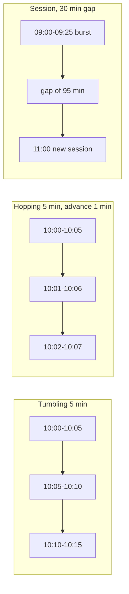
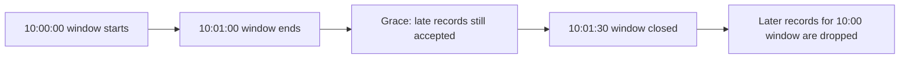

# Windowing and Time Semantics

## Introduction

"How many orders per minute?" sounds like a simple question until you ask which minute. The minute the customer clicked "buy"? The minute the record reached Kafka? The minute your app processed it, perhaps ten minutes late after a deploy? For a dashboard the difference may not matter. For billing, fraud rules or a sensor alarm it matters a lot.

Windowing is how Kafka Streams groups an endless stream into finite buckets of time so you can count, sum or average them. It only works if you are precise about **which clock** you are using and **how long** you wait for stragglers.

After this page you will be able to:

- explain event time, ingestion time and processing time, and extract event time from your payload;
- understand **stream time**, the clock that actually drives windows in Kafka Streams;
- choose between tumbling, hopping, sliding and session windows;
- handle late data with grace periods and emit one final result per window.

## Three Clocks

Every record could be stamped by three different clocks:

| Clock | Set when | Example | Trust it for |
| --- | --- | --- | --- |
| Event time | The event happened, by the producer | The sensor measured 23.0 C at 10:00:40 | Correct business results |
| Ingestion time | The broker appended the record | Broker wrote it at 10:00:41 | When the producer clock is unreliable |
| Processing time | Your app processed it | App saw it at 10:07:12 after a restart | Timeouts, "now"-based logic only |

Kafka Streams uses **event time** by default. It reads the timestamp stored in each Kafka record. The producer sets that timestamp (by default to its current time at `send()`) unless the topic is configured with `message.timestamp.type=LogAppendTime`, in which case the broker overwrites it with ingestion time.

If the real event time lives inside the payload, for example devices that buffer readings offline and upload them hours later, plug in a `TimestampExtractor`:

```java
import org.apache.kafka.clients.consumer.ConsumerRecord;
import org.apache.kafka.streams.processor.TimestampExtractor;

// Value format: "measuredAtEpochMillis,temperature", e.g. "1792231205000,21.5"
public class MeasuredAtExtractor implements TimestampExtractor {
    @Override
    public long extract(ConsumerRecord<Object, Object> record, long partitionTime) {
        try {
            String value = (String) record.value();
            return Long.parseLong(value.substring(0, value.indexOf(',')));
        } catch (RuntimeException e) {
            // Unparseable: fall back to the highest timestamp seen so far on this partition
            return partitionTime >= 0 ? partitionTime : record.timestamp();
        }
    }
}
```

Register it for one source with `Consumed.with(...).withTimestampExtractor(new MeasuredAtExtractor())`, or for all sources with `default.timestamp.extractor`. A record whose extractor returns a negative timestamp is dropped by the default handling, so always return something sensible.

Processing time is almost never what you want for windows: reprocessing old data after a bug fix would put a week of events into the current minute. Kafka Streams uses wall-clock time only for wall-clock punctuators.

## Stream Time: The Clock That Closes Windows

Kafka Streams does not ask the system clock whether a window is over. Each task tracks **stream time**: the largest event timestamp it has seen so far. Stream time only moves forward, and it only moves when records arrive.

This has two important consequences.

**Out-of-order records are normal.** If stream time is 10:01:10 and a record stamped 10:00:50 arrives, it is "late" but can still be counted, as long as its window is still open.

**No data means no progress.** If a sensor goes quiet, stream time for its partition stops. A window that should have closed at 10:02 stays open until the next record arrives, which might be an hour later. This is the most common "my window never emits" surprise, especially in tests and low-traffic environments. When a task reads several partitions (for joins), `max.task.idle.ms` controls how long it waits for data from a lagging partition before moving on.

## Window Types

Kafka Streams offers four window types. The timeline below shows how they group the same clicks:



| Window | Defined by | Overlap | Typical question |
| --- | --- | --- | --- |
| Tumbling | Size | None, each record in exactly one window | Orders per minute, hourly totals |
| Hopping | Size and advance | Yes, a record in size divided by advance windows | 5-minute moving average updated every minute |
| Sliding | Maximum time difference | Yes, windows created only where records exist | "More than 3 failed logins within any 10 minutes" |
| Session | Inactivity gap | None per key, but sessions merge | Visits per user session, machine run duration |

```java
// Tumbling: fixed, non-overlapping 1-minute buckets aligned to the epoch
TimeWindows tumbling = TimeWindows.ofSizeAndGrace(Duration.ofMinutes(1), Duration.ofSeconds(30));

// Hopping: 5-minute windows that start every minute
TimeWindows hopping = TimeWindows.ofSizeAndGrace(Duration.ofMinutes(5), Duration.ofSeconds(30))
                                 .advanceBy(Duration.ofMinutes(1));

// Sliding: any 10-minute span that contains records
SlidingWindows sliding = SlidingWindows.ofTimeDifferenceAndGrace(Duration.ofMinutes(10), Duration.ofMinutes(1));

// Session: a session ends after 30 minutes without activity
SessionWindows sessions = SessionWindows.ofInactivityGapAndGrace(Duration.ofMinutes(30), Duration.ofMinutes(5));

// Apply one with windowedBy, then aggregate as usual
KTable<Windowed<String>, Long> perMinute = clicks.groupByKey().windowedBy(tumbling).count();
```

Some details worth knowing:

- Tumbling and hopping windows are **aligned to the epoch**, not to the first record. A 1-minute window always starts at `hh:mm:00`. A 1-day window starts at midnight UTC, which matters if your business day is in another time zone.
- Hopping windows multiply work and state: a 1-hour window with a 1-minute advance puts each record into 60 windows. If you want "the last 10 minutes, at any moment", sliding windows are usually cheaper because they create windows only when records arrive.
- Session windows are dynamic. When a record falls between two sessions within the gap, the two are merged into one. The result key is a `Windowed<K>` whose window start and end are the first and last event in the session.
- The result key of every windowed aggregation is `Windowed<K>`, carrying the original key plus the window's start and end. Use `windowedKey.key()` and `windowedKey.window().startTime()` to unpack it.

## Late Data and Grace Periods

A window "ends" at its end time but is **closed** only when stream time passes end time plus the **grace period**. Between those points, late records still update the window. After that, they are dropped and counted in the `dropped-records` task metric.



Choosing the grace period is a business trade-off between completeness and latency:

- Mobile apps that batch events while offline may need minutes or hours of grace.
- A data center feed with synchronized clocks may need a few seconds.
- A longer grace keeps more windows in the store and delays final results by the same amount.

The factory methods force you to decide: `ofSizeWithNoGrace` (zero grace) or `ofSizeAndGrace` (explicit). The old `TimeWindows.of(...)` with an implicit 24-hour grace is gone in Kafka 4.x.

## Updates or Final Results

By default a windowed aggregation behaves like any `KTable`: every record produces an updated result for its window, subject to the record cache. Downstream sees 21.5, then 23.0, then 24.5 for the same minute. That is fine for a live chart. It is wrong for an alert ("send an email if the peak exceeds 90 C"), because an early partial value might trigger it, or a later correction might arrive after the email is sent.

Two ways to get **one final result per window**:

- `.emitStrategy(EmitStrategy.onWindowClose())` on the windowed stream, before the aggregation. Results are emitted when the window closes. It is the more efficient option because it reads finished windows straight from the window store.
- `.suppress(Suppressed.untilWindowCloses(BufferConfig.unbounded()))` after the aggregation. It buffers updates in a separate in-memory buffer (backed by its own changelog) and emits the last one when the window closes. It also offers `untilTimeLimit`, for rate-limiting updates without waiting for closure.

Either way, the price is latency: the result arrives after window end plus grace. And if stream time stops (no new records), the final result waits too.

## Worked Scenario: Peak Temperature per Sensor

A factory has hundreds of temperature sensors. Each sends a reading every few seconds to `sensor-readings`, keyed by sensor ID, with the temperature as a `Double` and the measurement time as the record timestamp. Network hiccups mean readings can arrive up to 30 seconds late. The maintenance team wants the peak temperature per sensor per minute.

```java
import org.apache.kafka.common.serialization.Serdes;
import org.apache.kafka.common.utils.Bytes;
import org.apache.kafka.streams.KeyValue;
import org.apache.kafka.streams.StreamsBuilder;
import org.apache.kafka.streams.Topology;
import org.apache.kafka.streams.kstream.*;
import org.apache.kafka.streams.state.WindowStore;

import java.time.Duration;

public class SensorPeaks {

    static Topology build(boolean finalResultsOnly) {
        StreamsBuilder builder = new StreamsBuilder();

        // key = sensorId, value = temperature in Celsius; record timestamp = measurement time
        KStream<String, Double> readings = builder.stream(
                "sensor-readings", Consumed.with(Serdes.String(), Serdes.Double()));

        TimeWindowedKStream<String, Double> windowed = readings
            .groupByKey(Grouped.with(Serdes.String(), Serdes.Double()))
            .windowedBy(TimeWindows.ofSizeAndGrace(Duration.ofMinutes(1), Duration.ofSeconds(30)));

        if (finalResultsOnly) {
            windowed = windowed.emitStrategy(EmitStrategy.onWindowClose());
        }

        windowed
            .reduce(Math::max,                        // peak temperature per sensor per minute
                    Materialized.<String, Double, WindowStore<Bytes, byte[]>>as("peak-temp")
                            .withKeySerde(Serdes.String())
                            .withValueSerde(Serdes.Double()))
            .toStream()
            .map((windowedKey, peak) -> KeyValue.pair(
                    windowedKey.key() + "@" + windowedKey.window().startTime(), peak))
            .to("sensor-peaks", Produced.with(Serdes.String(), Serdes.Double()));

        return builder.build();
    }
}
```

Run both variants (cache disabled) against the same readings for sensor `s1`:

```text
10:00:05  21.5
10:00:40  23.0
10:01:10  22.0
10:00:50  24.5   late, but 10:00 window is open until 10:01:30
10:01:45  22.4   stream time passes 10:01:30: the 10:00 window closes
10:00:55  30.0   too late: dropped
10:02:31  21.0   stream time passes 10:02:30: the 10:01 window closes
```

Default (emit on every update):

```text
KeyValue(s1@2026-10-17T10:00:00Z, 21.5)
KeyValue(s1@2026-10-17T10:00:00Z, 23.0)
KeyValue(s1@2026-10-17T10:01:00Z, 22.0)
KeyValue(s1@2026-10-17T10:00:00Z, 24.5)
KeyValue(s1@2026-10-17T10:01:00Z, 22.4)
KeyValue(s1@2026-10-17T10:02:00Z, 21.0)
```

With `EmitStrategy.onWindowClose()`:

```text
KeyValue(s1@2026-10-17T10:00:00Z, 24.5)
KeyValue(s1@2026-10-17T10:01:00Z, 22.4)
```

Read the two outputs side by side:

- The late 24.5 reading was accepted, because it arrived within the grace period.
- The 30.0 reading was dropped. If that spike was real, nobody will know. If such late spikes matter, increase the grace period or count dropped records and alert on them.
- The final-results variant emits nothing for the 10:02 window yet. It will only close once a reading after 10:03:30 arrives.
- The default variant sends three updates for the 10:00 window. Any consumer must treat later values as corrections that replace earlier ones, keyed by sensor and window start.

To answer "how many separate sessions did each user have?" on a clickstream instead, replace `TimeWindows` with `SessionWindows.ofInactivityGapAndGrace(Duration.ofMinutes(30), Duration.ofMinutes(5))` and `reduce` with `count()`. Clicks by `alice` at 09:00, 09:10, 09:25 and 11:00 produce two sessions: `09:00 to 09:25 clicks=3` and `11:00 to 11:00 clicks=1`.

## Common Mistakes

- **Testing windows without advancing stream time.** Final results never appear because no later record closes the window. In tests, send one more record with a later timestamp.
- **Producers with wrong clocks.** A device with its clock set to 2031 pushes stream time five years ahead, and every normal record afterwards is "late" and dropped. Validate timestamps in a `TimestampExtractor` or use `LogAppendTime` for untrusted producers.
- **Zero grace by accident.** `ofSizeWithNoGrace` drops every out-of-order record whose window has ended. Use it only when you are sure ordering is strict.
- **Huge hopping windows with tiny advances.** A 24-hour window advancing every minute stores 1,440 copies of each aggregate. Use sliding windows or pre-aggregate into small tumbling windows.
- **Assuming local midnight.** Daily windows are aligned to UTC.
- **Triggering side effects on non-final results.** Alerts and payments need `onWindowClose` or `suppress`, not every update.
- **Short changelog retention for windows.** Kafka Streams sets window store retention to window size plus grace by default. If you query old windows interactively, set `Materialized#withRetention` longer.

## Summary

- Kafka Streams uses event time from the record timestamp; a `TimestampExtractor` can take it from the payload.
- Stream time is the highest timestamp seen per task. It closes windows and only advances when records arrive.
- Tumbling windows do not overlap; hopping windows overlap on a fixed schedule; sliding windows follow the records; session windows end after an inactivity gap.
- A window accepts late records until stream time passes its end plus the grace period; later records are dropped and counted.
- Use `EmitStrategy.onWindowClose()` or `suppress(untilWindowCloses(...))` when downstream needs one final result per window.

## Further Reading

- [Streams core concepts: time](https://kafka.apache.org/documentation/streams/core-concepts#streams_time): event time, processing time and stream time.
- [Streams DSL: windowing](https://kafka.apache.org/documentation/streams/developer-guide/dsl-api.html#windowing): reference for all window types.
- [KIP-633: Deprecate 24-hour default grace period](https://cwiki.apache.org/confluence/display/KAFKA/KIP-633%3A+Deprecate+24-hour+Default+Grace+Period+for+Windowed+Operations+in+Streams): why grace must now be explicit.
- [KIP-825: Introduce emit strategy](https://cwiki.apache.org/confluence/display/KAFKA/KIP-825%3A+introduce+a+new+API+to+control+when+aggregated+results+are+produced): the `onWindowClose` design.
- [KIP-450: Sliding windows](https://cwiki.apache.org/confluence/display/KAFKA/KIP-450%3A+Sliding+Window+Aggregations+in+the+DSL): how sliding windows differ from hopping windows.
