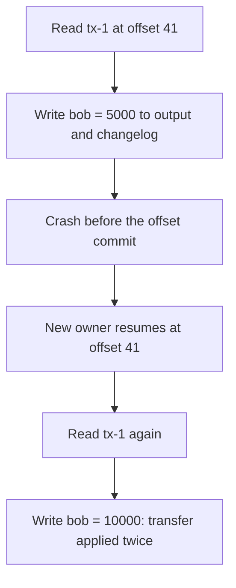
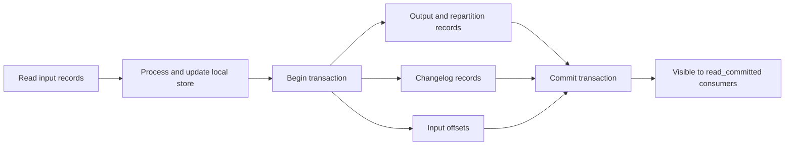

# Exactly-Once Processing in Kafka Streams

## Introduction

Picture a transfer service that turns "Alice sends Bob 50 dollars" into two ledger entries and updated balances. The instance processes the transfer, writes Bob's new balance, and then crashes before it records that the transfer was handled. When another instance takes over, it starts from the last committed offset and processes the same transfer again. Bob is now 100 dollars richer and the bank's books do not balance.

That is the normal behavior of **at-least-once** processing, the default in Kafka Streams. For page view counts, a few double counts after a crash are harmless. For money, inventory or anything that must reconcile, they are not.

Kafka Streams can instead run with **exactly-once semantics** (EOS). With one configuration line, every input record's effects (output records, state store updates and the committed offset) either all happen or none happen, even across crashes and rebalances.

After this page you will be able to:

- explain why at-least-once produces duplicates and how EOS prevents them;
- describe how Kafka transactions make a Kafka Streams step atomic;
- enable `exactly_once_v2` and configure the cluster and consumers it needs;
- know exactly what EOS does not cover, and handle bad records without breaking it.

## Where Duplicates Come From

A Kafka Streams task repeats a simple cycle: read records, update state, write output, and from time to time commit the input offsets. At-least-once commits offsets **after** the output is safely written. If the process dies between writing and committing, the work is redone.



The duplicate is not only in the output topic. The state store's changelog also recorded the first update, so the restored store already contains it, and the replay adds the transfer a second time. The error is now baked into the state.

There are only two ways out: make processing idempotent by hand (deduplicate on a transfer ID, as shown in [Stateful Operations and State Stores](./3-kafka-streams-stateful-operations.mdx)), or make the whole read-process-write step atomic. EOS does the second.

## How Exactly-Once Works

EOS builds on two producer features covered in the producers section: the [idempotent producer](../3-kafka-producers/3-kafka-idempotent-producer.mdx), which removes duplicates caused by retries, and [transactions](../3-kafka-producers/7-kafka-transactions.mdx), which make writes to several partitions atomic.

With `processing.guarantee=exactly_once_v2`, each stream thread uses a transactional producer. Between two commits, everything a task produces goes into one open transaction:

- records sent to output topics;
- records sent to repartition topics;
- updates to changelog topics for its state stores;
- the consumer offsets of the input records, sent with `sendOffsetsToTransaction`.



On commit, the broker's transaction coordinator writes commit markers to every partition involved. If the instance crashes before that, the transaction is aborted (or times out), and:

- consumers with `isolation.level=read_committed` never see the aborted output, including Kafka Streams' own internal consumers of repartition and changelog topics;
- the offsets were not committed, so the new owner reprocesses the input from the last committed point;
- the local state store may contain uncommitted updates, so Kafka Streams does not trust it after an unclean shutdown and restores it from the changelog, which contains only committed data.

Two more mechanisms protect against **zombies**: an instance that froze (long GC pause, network partition), was replaced, and then wakes up and keeps writing. With EOS v2, the producer is tied to the consumer group's generation, so the broker rejects commits from a member that is no longer part of the current group generation. The zombie gets a fencing error and shuts its tasks down instead of committing stale results.

"v2" refers to the design from KIP-447, which uses one producer per stream thread instead of one per task. It scales far better on apps with many partitions. The original `exactly_once` mode, and the `exactly_once_beta` name it was briefly known by, are gone in Kafka 4.x; `exactly_once_v2` is the only exactly-once option.

## Turning It On

On the application:

```java
Properties props = new Properties();
props.put(StreamsConfig.APPLICATION_ID_CONFIG, "transfer-processor");
props.put(StreamsConfig.BOOTSTRAP_SERVERS_CONFIG, "kafka-1:9092,kafka-2:9092,kafka-3:9092");
props.put(StreamsConfig.PROCESSING_GUARANTEE_CONFIG, StreamsConfig.EXACTLY_ONCE_V2);
props.put(StreamsConfig.REPLICATION_FACTOR_CONFIG, 3);   // internal topics survive a broker loss
```

Kafka Streams then adjusts its embedded clients for you:

| Setting | At-least-once | Exactly-once v2 |
| --- | --- | --- |
| `commit.interval.ms` | 30,000 | 100 |
| Producer `enable.idempotence` | true (client default) | true, enforced |
| Producer `transaction.timeout.ms` | n/a | 10,000 |
| Internal consumer `isolation.level` | `read_uncommitted` | `read_committed` |

On the brokers, transactions rely on the internal `__transaction_state` topic. Production defaults expect at least three brokers (`transaction.state.log.replication.factor=3`, `transaction.state.log.min.isr=2`). On a single-broker development cluster, set both to 1 or transactional producers will hang waiting for the topic. EOS v2 needs brokers on version 2.5 or newer, which any Kafka 4.x cluster satisfies.

On **downstream consumers** of your output topics, set `isolation.level=read_committed`. Plain consumers default to `read_uncommitted`; they would see records from aborted transactions and could act on results that officially never happened.

```properties
# Consumer reading account-balances
isolation.level=read_committed
```

## What Exactly-Once Does Not Cover

EOS is precise about its boundaries: **Kafka in, Kafka out**. Everything outside that loop is still at-least-once.

- **External side effects.** An HTTP call, an email or a database write made inside `peek`, `foreach` or a processor happens again on reprocessing. The transaction cannot roll it back. Write an event to a topic instead and let a separate, idempotent consumer perform the effect.
- **Duplicates already in the input.** If an upstream producer sent the same transfer twice (for example a client retry with a new record), EOS processes both, exactly once each. Use idempotent producers upstream and deduplicate on a business ID.
- **Readers that ignore transactions.** A `read_uncommitted` consumer or a sink connector configured that way sees aborted data.
- **Non-deterministic logic.** If your processor uses `System.currentTimeMillis()` or random numbers, reprocessing after an abort can produce a different, though still single, result. This is usually fine, but it means "exactly once" is about effects, not identical output bytes.

## The Cost of Exactly-Once

EOS is not free, which is why it is not the default.

- **Latency.** Downstream `read_committed` consumers only see records after the transaction commits. With a 100 ms commit interval, end-to-end latency rises by up to roughly that much per stage.
- **Throughput.** Each commit adds round trips to the transaction coordinator and writes markers to every involved partition. Expect a modest throughput drop; it shrinks as you raise `commit.interval.ms`, at the cost of latency.
- **Recovery time.** After an unclean shutdown, state stores of affected tasks are restored from their changelogs rather than reused from disk. For large stores this is a real cost; standby replicas reduce it. Recent releases have been moving changelog offsets into the stores themselves (KIP-1035, Kafka 4.3) as groundwork for keeping local state across crashes.
- **Operational rules.** Transactions that time out, brokers with too few in-sync replicas for `__transaction_state`, and old clients all show up as new failure modes to monitor.

A practical rule: use EOS when duplicates change a number someone reconciles (money, stock levels, billing, quotas). Stay with at-least-once for analytics, monitoring and anything where a rare double count after a crash is acceptable, and enjoy the lower latency.

## Bad Records and Exception Handlers

A malformed record is a different problem from a crash, but it interacts with EOS. By default Kafka Streams stops on errors, which is safe but means one bad record halts the whole app. Kafka 4.x gives three handlers, each configurable:

| Config | Called when | Default |
| --- | --- | --- |
| `deserialization.exception.handler` | A record cannot be deserialized | `LogAndFailExceptionHandler` |
| `processing.exception.handler` | Your code throws inside a DSL operator or processor | `LogAndFailProcessingExceptionHandler` |
| `production.exception.handler` | Writing a result fails (too large, serialization) | `DefaultProductionExceptionHandler` |

The `LogAndContinue...` variants skip the record and keep going. Since Kafka 4.2 (KIP-1034), setting `errors.dead.letter.queue.topic.name` makes the built-in handlers also write the failed record, with the error details in headers, to a dead letter topic:

```java
props.put(StreamsConfig.DESERIALIZATION_EXCEPTION_HANDLER_CLASS_CONFIG, LogAndContinueExceptionHandler.class);
props.put(StreamsConfig.PROCESSING_EXCEPTION_HANDLER_CLASS_CONFIG, LogAndContinueProcessingExceptionHandler.class);
props.put(StreamsConfig.ERRORS_DEAD_LETTER_QUEUE_TOPIC_NAME_CONFIG, "transfer-processor-dlq");
```

Under EOS, the dead letter record is written by the same transactional producer as everything else, so a skipped record is either dead-lettered and its offset committed, or neither. Skip only when losing one record from the main flow is acceptable and someone watches the dead letter topic. For a ledger, failing loudly is often the better choice. More on this pattern in [Dead Letter Topics and Retry Topics](../9-kafka-patterns/3-kafka-dead-letter-queues.mdx).

## Worked Scenario: A Transfer Processor

The bank's transfer service publishes requests to `transfer-requests`, keyed by transfer ID, with the value `fromAccount,toAccount,amountCents`. The transfer processor turns each request into a debit and a credit and keeps a running balance per account in `account-balances`.

Each transfer touches two accounts that may live in two different partitions, so the processor re-keys by account and repartitions. Under at-least-once, a crash between writing the debit to the repartition topic and committing the input offset would replay the transfer and debit Alice twice. Under EOS, the repartition writes, the changelog updates, the balance outputs and the input offset commit together or not at all.

```java
import org.apache.kafka.common.serialization.Serdes;
import org.apache.kafka.streams.KafkaStreams;
import org.apache.kafka.streams.KeyValue;
import org.apache.kafka.streams.StreamsBuilder;
import org.apache.kafka.streams.StreamsConfig;
import org.apache.kafka.streams.Topology;
import org.apache.kafka.streams.kstream.*;

import java.util.List;
import java.util.Properties;

public class TransferApp {

    static Topology build() {
        StreamsBuilder builder = new StreamsBuilder();

        // key = transferId, value = "fromAccount,toAccount,amountCents"
        builder.stream("transfer-requests", Consumed.with(Serdes.String(), Serdes.String()))
            // one transfer becomes two ledger entries, keyed by account
            .flatMap((transferId, t) -> {
                String[] f = t.split(",");
                long amount = Long.parseLong(f[2]);
                return List.of(KeyValue.pair(f[0], -amount),    // debit
                               KeyValue.pair(f[1], amount));    // credit
            })
            .repartition(Repartitioned.with(Serdes.String(), Serdes.Long()).withName("entries-by-account"))
            .groupByKey()
            .reduce(Long::sum, Materialized.as("balances"))
            .toStream()
            .to("account-balances", Produced.with(Serdes.String(), Serdes.Long()));

        return builder.build();
    }

    static Properties config() {
        Properties props = new Properties();
        props.put(StreamsConfig.APPLICATION_ID_CONFIG, "transfer-processor");
        props.put(StreamsConfig.BOOTSTRAP_SERVERS_CONFIG, "localhost:9092");
        props.put(StreamsConfig.DEFAULT_KEY_SERDE_CLASS_CONFIG, Serdes.StringSerde.class);
        props.put(StreamsConfig.DEFAULT_VALUE_SERDE_CLASS_CONFIG, Serdes.LongSerde.class);
        // The one line that turns on exactly-once
        props.put(StreamsConfig.PROCESSING_GUARANTEE_CONFIG, StreamsConfig.EXACTLY_ONCE_V2);
        // Production topics need 3 replicas so a transaction survives a broker loss
        props.put(StreamsConfig.REPLICATION_FACTOR_CONFIG, 3);
        return props;
    }

    public static void main(String[] args) {
        KafkaStreams streams = new KafkaStreams(build(), config());
        Runtime.getRuntime().addShutdownHook(new Thread(streams::close));
        streams.start();
    }
}
```

For the requests `tx-1: alice,bob,5000` and `tx-2: bob,carol,1500`, `account-balances` receives (cache disabled):

```text
KeyValue(alice, -5000)
KeyValue(bob, 5000)
KeyValue(bob, 3500)
KeyValue(carol, 1500)
```

Now imagine the instance is killed with `kill -9` right after it wrote `bob = 5000` but before the transaction committed. A `read_committed` reader of `account-balances` never sees that record. The new task owner restores `balances` from the committed changelog (where bob is still absent), reprocesses `tx-1` from the committed offset, and writes `bob = 5000` again, this time inside a transaction that commits. The final result is identical to a run without the crash.

To verify this yourself, run two instances against a three-broker cluster, produce a steady stream of transfers whose amounts sum to zero, kill instances at random, and check with a `read_committed` consumer that the sum of all balances is always zero. Run the same test with `at_least_once` and the sum drifts after a few kills.

## Common Mistakes

- **Downstream consumers left on `read_uncommitted`.** They see aborted records and break the guarantee at the last step.
- **Single-broker dev clusters with default transaction settings.** The transactional producer waits for a `__transaction_state` topic that can never be created with replication factor 3. Set `transaction.state.log.replication.factor=1` and `transaction.state.log.min.isr=1` locally.
- **Side effects inside the topology.** EOS does not undo HTTP calls or database writes. Move them out.
- **Assuming EOS removes upstream duplicates.** Two copies of a request are two records. Deduplicate on a business key.
- **Raising `commit.interval.ms` to seconds for throughput, then wondering about latency.** Downstream sees nothing until each commit.
- **Old names from tutorials.** `exactly_once` and `exactly_once_beta` are not valid values in Kafka 4.x; use `exactly_once_v2`.
- **Skipping bad records silently.** `LogAndContinue` without a dead letter topic loses data without anyone noticing. Pair it with `errors.dead.letter.queue.topic.name` and an alert.

## Summary

- At-least-once can apply an input twice after a crash, and the duplicate also lands in state stores.
- `processing.guarantee=exactly_once_v2` wraps output, repartition and changelog writes plus input offsets in one Kafka transaction per commit.
- Aborted work is invisible to `read_committed` readers; local state is restored from the committed changelog; zombies are fenced.
- EOS covers Kafka in, Kafka out only. External side effects and upstream duplicates need their own handling.
- It costs some latency (100 ms commit interval), throughput and recovery time; use it where results must reconcile.
- Exception handlers plus `errors.dead.letter.queue.topic.name` let you skip bad records without leaving the transactional guarantee.

## Further Reading

- [Streams configuration: processing.guarantee](https://kafka.apache.org/documentation/streams/developer-guide/config-streams.html#processing-guarantee): the official description and requirements.
- [KIP-129: Streams exactly-once semantics](https://cwiki.apache.org/confluence/display/KAFKA/KIP-129%3A+Streams+Exactly-Once+Semantics): the original design.
- [KIP-447: Producer scalability for exactly once semantics](https://cwiki.apache.org/confluence/display/KAFKA/KIP-447%3A+Producer+scalability+for+exactly+once+semantics): the thread-level producer design behind `exactly_once_v2`.
- [KIP-1034: Dead letter queue in Kafka Streams](https://cwiki.apache.org/confluence/display/KAFKA/KIP-1034%3A+Dead+letter+queue+in+Kafka+Streams): the built-in dead letter topic support.
- [Transactions in Apache Kafka (design document)](https://cwiki.apache.org/confluence/display/KAFKA/KIP-98+-+Exactly+Once+Delivery+and+Transactional+Messaging): KIP-98, the transaction protocol EOS is built on.
