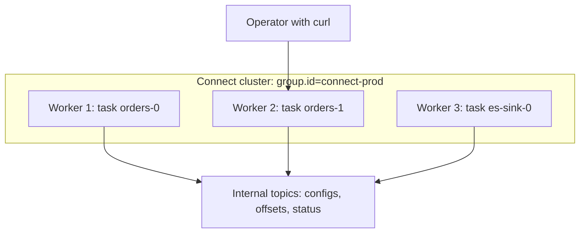

# Kafka Connect Introduction

## Introduction

Sooner or later every Kafka project needs to move data in or out of something that is not Kafka. Orders live in PostgreSQL and need to become events. Events need to land in Elasticsearch so support staff can search them, in S3 so analysts can query them, in Snowflake so finance can report on them. The first instinct is to write a small service for each hop: a loop that reads rows and calls `producer.send()`, or a consumer that writes to the target. The first one takes an afternoon. The tenth one, with retries, offset tracking, schema handling, scaling and monitoring, takes a team.

Kafka Connect is the part of Apache Kafka that turns those integration services into configuration. You run a cluster of generic Connect workers, then submit a JSON document that says "read the `orders` table from this database" or "write the `orders` topic into this index". The worker loads a plugin, called a connector, that knows how to talk to the external system, and handles everything else: parallelism, offset tracking, restarts, serialization and error routing.

After this page you will be able to explain the Connect building blocks (workers, connectors, tasks, converters and transforms), choose between standalone and distributed mode, start a worker locally, drive it through its REST API, and decide when Connect is the right tool and when a hand-written client or a different product is better.

## Why a Framework for Integration

Think of Connect as a power strip. The strip provides the electricity, the fuse and the on/off switch; each appliance only needs the right plug. A connector is the plug for one system. The worker is the strip that every connector shares.

The pieces that every integration needs, and that you would otherwise write and debug yourself, are:

- **Offset tracking.** A source must remember which rows or log positions it already sent; a sink must remember which Kafka offsets it already wrote. Connect stores both in Kafka.
- **Parallelism and failover.** Work is split into tasks that are spread across workers. If a worker dies, its tasks move to the survivors.
- **Serialization.** Converters translate between Kafka bytes and an in-memory record format, so the same connector can produce JSON, Avro or Protobuf by changing one setting.
- **Lightweight transformation.** Single message transforms rename fields, drop columns or reroute records without a separate stream processor.
- **Error handling.** A shared set of `errors.*` settings decides whether a bad record stops the pipeline, is skipped, or is sent to a dead letter topic.
- **Operations.** One REST API to create, pause, restart and inspect every pipeline, and one set of JMX metrics to monitor them.

The ecosystem is the other half of the value. Hundreds of connectors exist: Debezium for database change data capture, JDBC source and sink, Elasticsearch and OpenSearch, Amazon S3, Google Cloud Storage, Apache Iceberg, MongoDB, Snowflake, BigQuery, Salesforce and more. Most are open source or source-available; some are commercial. Check the licence before you depend on one.

## The Building Blocks

Connect has a small vocabulary. Learn these five words and the rest of the documentation becomes readable.

| Term | What it is | Example |
|---|---|---|
| Worker | A JVM process running the Connect runtime and its REST server | A container listening on port 8083 |
| Connector | A configured instance of a connector plugin; it plans the work | `orders-postgres-source` |
| Task | A unit of actual data copying; a connector creates one or more | Task 0 reads tables A and B, task 1 reads C |
| Converter | Turns record keys and values into bytes and back | `JsonConverter`, `AvroConverter` |
| Transform | A small function applied to each record in flight | Drop the `password_hash` field |

A **connector** does not move data itself. It inspects its configuration and the external system, then splits the job into at most `tasks.max` task configurations. A JDBC source with ten tables and `tasks.max=3` might give each task three or four tables. A sink connector usually gets parallelism from topic partitions: with six partitions and `tasks.max=6`, each task consumes one partition.

**Tasks** are where records flow. A source task polls the external system and hands records to the worker, which runs transforms, applies the converter and produces to Kafka. A sink task receives batches of records the worker has consumed, converted and transformed, and writes them out.


Notice the order. On the source side, transforms run before the converter, on structured records. On the sink side, the converter runs first, then the transforms. Transforms never see raw bytes, which is why they can work on field names.

## Standalone and Distributed Mode

A worker runs in one of two modes.

**Standalone mode** is a single process. Connector configurations are passed as files on the command line, and source offsets are stored in a local file named by `offset.storage.file.filename`. There is no failover: if the process dies, the pipeline stops. It is useful for local experiments and for agents that must run on a specific machine, such as tailing a log file on that host.

**Distributed mode** is what production uses. Several workers share a `group.id` and form a Connect cluster. They coordinate through Kafka itself using a group membership protocol similar to consumer groups, and they keep all state in three compacted internal topics:

| Worker setting | Topic holds | Partitions |
|---|---|---|
| `config.storage.topic` | Connector and task configurations | Exactly 1 |
| `offset.storage.topic` | Source connector offsets | Many (25 is the default when auto-created) |
| `status.storage.topic` | Connector and task state such as RUNNING or FAILED | A few (5 by default) |

Because the state is in Kafka, workers are stateless and interchangeable. You can add a worker and tasks are rebalanced onto it; you can kill one and its tasks restart elsewhere. Connectors are created through the REST API of any worker, and the request is forwarded to the cluster leader.



Sink connectors do not use `offset.storage.topic`. A sink task is a Kafka consumer in a group named `connect-` followed by the connector name, and its progress is ordinary committed consumer offsets. That detail matters later: you can watch sink lag with the same tools you use for any consumer group.

## Running a Worker and Using the REST API

The Kafka binary distribution ships `bin/connect-distributed.sh` and `bin/connect-standalone.sh`. A minimal distributed worker configuration for a single local broker looks like this:

```properties
# config/connect-distributed.properties
bootstrap.servers=localhost:9092
group.id=connect-local

# Internal topics; replication factor 1 only because this is a one-broker dev cluster
config.storage.topic=connect-configs
offset.storage.topic=connect-offsets
status.storage.topic=connect-status
config.storage.replication.factor=1
offset.storage.replication.factor=1
status.storage.replication.factor=1

# Default converters for every connector unless overridden
key.converter=org.apache.kafka.connect.json.JsonConverter
value.converter=org.apache.kafka.connect.json.JsonConverter

# REST API
listeners=http://0.0.0.0:8083

# Directories containing connector plugins, one subdirectory per plugin
plugin.path=/opt/kafka/plugins
```

```bash
bin/connect-distributed.sh config/connect-distributed.properties
```

Everything else happens over HTTP. The worker answers on port 8083:

```bash
# Version and the Kafka cluster ID the worker is attached to
curl -s localhost:8083/ | jq
```

```json
{
  "version": "4.3.1",
  "commit": "...",
  "kafka_cluster_id": "MkU3OEVBNTcwNTJENDM2Qk"
}
```

```bash
# Which connector plugins are installed on this worker?
curl -s localhost:8083/connector-plugins | jq '.[].class'
```

Kafka includes only a few plugins out of the box, chiefly the MirrorMaker 2 connectors. The `FileStreamSource` and `FileStreamSink` demo connectors ship as a separate jar in `libs/` and must be added to `plugin.path` before they appear. Real connectors are downloaded and unpacked into the plugin directory, as [Deploying and Operating Connect](./4-kafka-connect-deployment.mdx) shows.

Creating a connector is a `POST` with a name and a config map:

```bash
curl -s -X POST localhost:8083/connectors \
  -H "Content-Type: application/json" \
  -d '{
    "name": "demo-file-source",
    "config": {
      "connector.class": "org.apache.kafka.connect.file.FileStreamSourceConnector",
      "tasks.max": "1",
      "file": "/tmp/input.txt",
      "topic": "demo-lines"
    }
  }'
```

The endpoints you will use daily:

| Method and path | Purpose |
|---|---|
| `GET /connectors?expand=status` | List connectors with their state |
| `POST /connectors` | Create a connector |
| `PUT /connectors/NAME/config` | Create or fully replace a config (idempotent; good for automation) |
| `PATCH /connectors/NAME/config` | Change only some keys; a `null` value removes a key |
| `GET /connectors/NAME/status` | Connector and task state, with the stack trace if FAILED |
| `PUT /connectors/NAME/pause` and `/resume` | Pause and resume processing |
| `PUT /connectors/NAME/stop` | Stop and release tasks; required before editing offsets |
| `POST /connectors/NAME/restart?includeTasks=true&onlyFailed=true` | Restart the failed parts |
| `GET /connectors/NAME/offsets` | Read the connector's offsets |
| `PUT /connector-plugins/CLASS/config/validate` | Validate a config without creating anything |
| `DELETE /connectors/NAME` | Remove a connector |

```bash
curl -s localhost:8083/connectors/demo-file-source/status | jq
```

```json
{
  "name": "demo-file-source",
  "connector": { "state": "RUNNING", "worker_id": "172.18.0.4:8083" },
  "tasks": [ { "id": 0, "state": "RUNNING", "worker_id": "172.18.0.4:8083" } ],
  "type": "source"
}
```

:::note
A connector reported as RUNNING can still have FAILED tasks. Always check the `tasks` array, and alert on task state, not just connector state.
:::

## Worked Scenario: An Online Shop's Data Plumbing

A mid-sized online shop keeps orders, customers and inventory in PostgreSQL. Three teams want that data elsewhere: customer support wants orders searchable in Elasticsearch within seconds, analytics wants every order in S3 as Parquet for their lakehouse, and the warehouse service wants an event whenever stock changes.

The first version was a cron job that queried `orders WHERE updated_at > :last_run` every minute and wrote to Elasticsearch. It missed deletes, double-sent rows when two updates landed in the same second, and fell over whenever Elasticsearch was slow, losing its place.

With Connect the design becomes:

1. A **Debezium PostgreSQL source** connector reads the database's write-ahead log and publishes one event per row change into `shop.public.orders`, `shop.public.customers` and `shop.public.inventory`. Deletes are captured, and nothing is missed while the connector is down because the database keeps the log until Debezium confirms it.
2. An **Elasticsearch sink** consumes `shop.public.orders` and upserts documents keyed by order ID.
3. An **S3 sink** consumes the same topic and writes hourly Parquet files.
4. The warehouse service is an ordinary Kafka consumer of `shop.public.inventory`.

Three JSON documents replace three bespoke services. Each sink keeps its own consumer offsets, so a slow Elasticsearch does not hold back the S3 export. When analytics later wants customers too, they add a topic name to the S3 sink's config with one `PATCH` request.

The team still writes code where it matters. Business logic, such as computing a fraud score, lives in a Kafka Streams application or a normal service, not in a transform. Connect does the moving; applications do the thinking.

## When to Use Connect and When Not To

| Option | Choose it when | Trade-off |
|---|---|---|
| Kafka Connect | A connector exists for your system and the job is moving data with light reshaping | Another cluster to run; a JVM and plugin classpath to manage |
| Your own producer or consumer | The integration is tightly bound to your application logic, or no connector exists | You build offsets, retries, scaling and monitoring yourself |
| Debezium Server | You want CDC but do not run Connect, or the target is not Kafka (Kinesis, Pub/Sub, Redis) | Fewer sink options; single-process deployment |
| Managed connectors (Confluent Cloud, Amazon MSK Connect, Aiven) | You want someone else to run the workers | Cost per connector; restricted plugin choice |
| ELT services (Airbyte, Fivetran) | Batch loads into a warehouse every few minutes are fine | Not a streaming backbone; events do not pass through Kafka |
| Kafka Streams or Flink | You need joins, aggregation or stateful logic | They process data already in Kafka; they are not adapters to external systems |

A good rule: if you would describe the job as "copy X to Y, maybe drop or rename some fields", use Connect. If you would describe it as "when X happens, decide something", write an application.

## Common Mistakes

- Running standalone mode in production. It has no failover, and its offsets sit in a local file that disappears with the container.
- Letting the worker auto-create its internal topics with a replication factor of 1 on a real cluster, or giving `config.storage.topic` more than one partition. Create the three topics yourself, compacted, with replication factor 3.
- Two Connect clusters sharing the same `group.id` or internal topic names. They will overwrite each other's configurations and offsets.
- Checking only the connector state. Tasks fail independently; a RUNNING connector with a FAILED task copies nothing.
- Putting business logic in transforms. If you need lookups, joins or branching rules, use a stream processor.
- Assuming every connector is Apache-licensed. Many popular ones use the Confluent Community License or a commercial licence.

## Summary

- Kafka Connect moves data between Kafka and external systems using reusable connector plugins configured in JSON, instead of hand-written integration services.
- A worker runs connectors; each connector plans the work and creates up to `tasks.max` tasks, which do the copying.
- Converters translate between bytes and structured records; transforms make small per-record changes.
- Distributed mode stores configs, source offsets and status in compacted Kafka topics, so workers are stateless and fail over automatically. Sink progress is ordinary consumer group offsets.
- Everything is managed through a REST API on port 8083; `PUT /connectors/NAME/config` is the idempotent call to use in automation.
- Use Connect for data movement and applications or stream processors for business logic.

## Further Reading

- [Kafka Connect user guide](https://kafka.apache.org/documentation/#connect) - official overview, worker configuration and the REST API reference.
- [KIP-26: Kafka Connect](https://cwiki.apache.org/confluence/display/KAFKA/KIP-26+-+Add+Kafka+Connect+framework+for+data+import%2Fexport) - the original design proposal and its reasoning.
- [KIP-980: Creating connectors in a stopped state](https://cwiki.apache.org/confluence/display/KAFKA/KIP-980%3A+Allow+creating+connectors+in+a+stopped+state) - the `initial_state` field on connector creation.
- [Debezium documentation](https://debezium.io/documentation/reference/stable/) - the most widely used family of source connectors.
- [Source Connectors](./1-kafka-connect-source-connectors.mdx) - the next page, on pulling data into Kafka.
