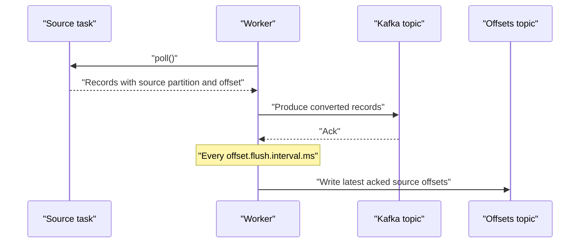

# Source Connectors

## Introduction

A source connector is the inbound half of Kafka Connect: it reads from some external system and turns what it finds into Kafka records. The external system might be a relational database, a message queue, an object store bucket, a SaaS API or a file on disk. Whatever it is, the connector must answer the same three questions: what is new since last time, how do I remember where I am, and what happens if I crash halfway through?

This page explains how source tasks work inside the worker, the difference between polling a system and reading its change log, how source offsets are stored and how you can inspect or rewrite them, how connectors create their own topics, and how to get exactly-once delivery into Kafka. The worked scenario pulls a legacy inventory database into Kafka with the JDBC source connector, then shows when that approach stops being good enough.

By the end you will be able to configure a source connector, predict what it will and will not capture, and recover it when someone asks you to "replay everything since Tuesday".

## How a Source Task Works

A source task is a loop the worker calls over and over. Each call to the task's `poll()` method returns a list of `SourceRecord` objects. Every record carries, besides its key and value, two small maps:

- the **source partition**, which identifies a stream inside the external system, such as one table or one file;
- the **source offset**, which identifies a position within that stream, such as a timestamp and ID, a log sequence number or a byte position.

The worker runs transforms, applies the converter and sends the record to Kafka with a normal producer. Periodically (every `offset.flush.interval.ms`, 60 seconds by default) it writes the latest source offsets for records that Kafka has acknowledged into the `offset.storage.topic`. When the task restarts, it asks the worker for the last stored offset of each source partition and resumes from there.



The gap between "record acknowledged" and "offset flushed" is why sources are at-least-once by default. If the worker dies after producing records but before flushing their offsets, the replacement task re-reads from the older offset and produces those records again. Downstream consumers should be ready for duplicates, or you should turn on exactly-once support, covered below.

## Query-Based Versus Log-Based Capture

There are two fundamentally different ways to get changes out of a database, and the choice shapes everything else.

**Query-based** connectors, such as the JDBC source connector, run a `SELECT` on a schedule and remember the highest timestamp or ID they have seen. They work against almost any database with a JDBC driver and need only read permission. But they can only see the current state of a row at the moment of the query.

**Log-based** connectors, such as Debezium, read the database's own replication log: the PostgreSQL write-ahead log, the MySQL binlog, the SQL Server transaction log. Every insert, update and delete is in that log in commit order, so nothing is missed.

| Aspect | Query-based (JDBC source) | Log-based (Debezium) |
|---|---|---|
| Captures deletes | No, unless you use soft deletes | Yes |
| Captures every intermediate update | No; two updates between polls become one | Yes |
| Old values of a row | No | Yes, with suitable database settings |
| Load on the database | A query per table per poll | Reads the log; little query load |
| Latency | The poll interval, typically seconds | Sub-second |
| Schema requirements | An incrementing ID and/or a reliable updated-at column | None on the tables; logical replication enabled on the server |
| Permissions | Read access | Replication privileges; often a DBA conversation |

An analogy: query-based capture is checking a shop shelf every five minutes and noting what changed; log-based capture is reading the till receipts. The shelf check misses the item that was bought and restocked in between.

## The JDBC Source Connector

Despite its limits, the JDBC source is the quickest way to get a table into Kafka, and it is perfectly adequate for append-only tables and reference data. Its key setting is `mode`:

| `mode` | How it finds new rows | Misses |
|---|---|---|
| `bulk` | Copies the whole table every poll | Nothing, but produces the full table each time |
| `incrementing` | `WHERE id > last_id` on `incrementing.column.name` | Updates and deletes |
| `timestamp` | `WHERE updated_at > last_ts` on `timestamp.column.name` | Deletes; rows sharing a timestamp at a poll boundary |
| `timestamp+incrementing` | Timestamp, with the ID as a tie-breaker | Deletes and intermediate updates only |

```json
{
  "name": "inventory-jdbc-source",
  "config": {
    "connector.class": "io.confluent.connect.jdbc.JdbcSourceConnector",
    "tasks.max": "2",
    "connection.url": "jdbc:postgresql://legacy-db:5432/inventory",
    "connection.user": "kafka_reader",
    "connection.password": "${file:/opt/secrets/db.properties:password}",
    "table.whitelist": "public.stock_levels,public.products",
    "mode": "timestamp+incrementing",
    "timestamp.column.name": "updated_at",
    "incrementing.column.name": "id",
    "timestamp.delay.interval.ms": "2000",
    "poll.interval.ms": "5000",
    "topic.prefix": "legacy.inventory.",
    "topic.creation.default.replication.factor": "3",
    "topic.creation.default.partitions": "6"
  }
}
```

A few lines deserve explanation. `timestamp.delay.interval.ms` makes the connector ignore rows newer than two seconds, giving long-running transactions time to commit so a row with an earlier timestamp does not appear after the connector has moved past it. `topic.prefix` plus the table name gives topics `legacy.inventory.stock_levels` and `legacy.inventory.products`. The password is not in the JSON; it is resolved by a config provider at runtime (see [Deploying and Operating Connect](./4-kafka-connect-deployment.mdx)).

The `updated_at` column must be indexed and must actually change on every update. A column maintained by the application rather than by a trigger is a frequent source of silently missed changes.

## Letting Connectors Create Their Topics

Brokers in production usually have `auto.create.topics.enable=false`, and even when it is on, auto-created topics get broker defaults that are rarely right. Since Kafka 2.6, workers can create topics for source connectors with settings you choose (KIP-158). It is enabled by `topic.creation.enable=true` on the worker, which is the default, and configured per connector:

```properties
# Default group: applies to every topic this connector writes to
topic.creation.default.replication.factor=3
topic.creation.default.partitions=6
topic.creation.default.cleanup.policy=compact

# A named group for topics matching a regex
topic.creation.groups=audit
topic.creation.audit.include=legacy\\.inventory\\.audit.*
topic.creation.audit.cleanup.policy=delete
topic.creation.audit.retention.ms=2592000000
```

If a topic already exists, these settings are ignored. For important topics, many teams still create them explicitly with infrastructure-as-code and leave connector topic creation for development.

## Managing Source Offsets

Sooner or later someone will ask you to re-import a table, or to skip a range of corrupt data. Since Kafka 3.6 (KIP-875) offsets are managed through the REST API instead of by hand-crafting records in the offsets topic.

```bash
# Read current offsets
curl -s localhost:8083/connectors/inventory-jdbc-source/offsets | jq
```

```json
{
  "offsets": [
    {
      "partition": { "protocol": "1", "table": "inventory.public.stock_levels" },
      "offset": { "timestamp_nanos": 0, "incrementing": 48213, "timestamp": 1792233600000 }
    }
  ]
}
```

The exact shape of `partition` and `offset` is defined by each connector, so always read before you write. To change offsets the connector must be **stopped**, not just paused, because a paused task still holds its position in memory:

```bash
# 1. Stop the connector (tasks are shut down, config is kept)
curl -s -X PUT localhost:8083/connectors/inventory-jdbc-source/stop

# 2a. Reset everything: the connector starts from scratch on resume
curl -s -X DELETE localhost:8083/connectors/inventory-jdbc-source/offsets

# 2b. Or rewind a single source partition
curl -s -X PATCH localhost:8083/connectors/inventory-jdbc-source/offsets \
  -H "Content-Type: application/json" \
  -d '{"offsets": [{
        "partition": { "protocol": "1", "table": "inventory.public.stock_levels" },
        "offset": { "timestamp_nanos": 0, "incrementing": 0, "timestamp": 1791936000000 }
      }]}'

# 3. Resume
curl -s -X PUT localhost:8083/connectors/inventory-jdbc-source/resume
```

You can also create a connector already stopped (`"initial_state": "STOPPED"` in the `POST /connectors` body), set its offsets, and then resume it. That is the clean way to migrate a pipeline between Connect clusters.

## Exactly-Once Source Connectors

At-least-once is fine when consumers deduplicate, but some pipelines, such as payments flowing into a ledger, want each source record in Kafka exactly once. Kafka 3.3 added exactly-once support for source connectors (KIP-618). The worker writes the records and their source offsets in one Kafka transaction, so either both become visible or neither does.

It needs a distributed cluster and is switched on in two rolling restarts for an existing cluster: first `exactly.once.source.support=preparing` on every worker, then `enabled`. Then, per connector:

```properties
# Fail at creation if the connector cannot guarantee exactly-once
exactly.once.support=required
# When to commit the transaction: poll (each batch), interval, or connector (connector decides)
transaction.boundary=poll
```

Two caveats. The connector plugin must support it; many do not and will be rejected when `exactly.once.support=required`. And it only covers the hop into Kafka. Consumers must read with `isolation.level=read_committed`, or they will see records from aborted transactions.

## Worked Scenario: A Legacy Inventory Database

A retailer's stock levels live in a fifteen-year-old PostgreSQL database owned by another department. The new pricing service needs stock changes as events. The DBA team will grant read access but not replication privileges, at least not this quarter.

The team deploys the JDBC source connector above. `stock_levels` has an `id` and an `updated_at` column maintained by a trigger, so `timestamp+incrementing` works. Within a day pricing receives changes with about five seconds of latency.

Two months later the problems show up. Discontinued products are deleted from `stock_levels`, and the pricing service never hears about it, so it keeps quoting them. And during a flash sale a product's stock went from 10 to 0 and back to 50 between two polls; pricing saw only 10 then 50, never the sell-out.

The team weighs options. Soft deletes (a `deleted_at` column) would fix the first problem but require changing the legacy application. Shorter polls reduce, but never remove, the second. They take the evidence to the DBA team, who agree to enable logical replication for a dedicated user, and the pipeline moves to Debezium, described in [Change Data Capture with Debezium](./5-kafka-connect-debezium-cdc.mdx). Because the topic names are configured per connector, the pricing service keeps consuming with only a change of topic name and payload shape.

The lesson is not that the JDBC source was a mistake. It delivered value on day one with minimal permissions. The lesson is to know what it cannot see and to decide whether that matters before an incident decides for you.

## Common Mistakes

- Using `timestamp` mode on a column the application forgets to update, or that has no index. The first misses changes; the second puts a full table scan on the database every few seconds.
- Expecting the JDBC source to capture deletes. It cannot; you need soft deletes or log-based CDC.
- Setting `tasks.max` higher than the number of tables for a JDBC source. Extra tasks have nothing to do.
- Editing offsets while the connector is only paused. Stop it first; the API rejects offset changes otherwise.
- Turning on exactly-once at the source and forgetting `isolation.level=read_committed` on consumers.
- Assuming a source connector restart produces no duplicates. Without exactly-once support, records produced since the last offset flush are sent again.

## Summary

- Source tasks return records tagged with a source partition and offset; the worker stores the offsets in Kafka after the records are acknowledged.
- Default delivery is at-least-once; exactly-once source support (KIP-618) wraps records and offsets in one transaction.
- Query-based capture is easy and needs only read access, but misses deletes and intermediate updates; log-based CDC captures everything in commit order.
- The JDBC source's `mode` decides what it can see; `timestamp+incrementing` with a delay interval is the safest polling setup.
- Workers can create source topics with `topic.creation.*` settings.
- Since Kafka 3.6 you read, rewrite and reset offsets with the `offsets` REST endpoints after stopping the connector.

## Further Reading

- [Kafka Connect user guide](https://kafka.apache.org/documentation/#connect) - worker settings, offset management and exactly-once source configuration.
- [KIP-618: Exactly-once support for source connectors](https://cwiki.apache.org/confluence/display/KAFKA/KIP-618%3A+Exactly-Once+Support+for+Source+Connectors) - the design and its limits.
- [KIP-875: First-class offsets support in Kafka Connect](https://cwiki.apache.org/confluence/display/KAFKA/KIP-875%3A+First-class+offsets+support+in+Kafka+Connect) - the stop state and offsets endpoints.
- [KIP-158: Topic creation for source connectors](https://cwiki.apache.org/confluence/display/KAFKA/KIP-158%3A+Kafka+Connect+should+allow+source+connectors+to+set+topic-specific+settings+for+new+topics) - the `topic.creation.*` settings.
- [JDBC source connector configuration](https://docs.confluent.io/kafka-connectors/jdbc/current/source-connector/source_config_options.html) - every mode and option.
- [Sink Connectors](./2-kafka-connect-sink-connectors.mdx) - the other direction.
