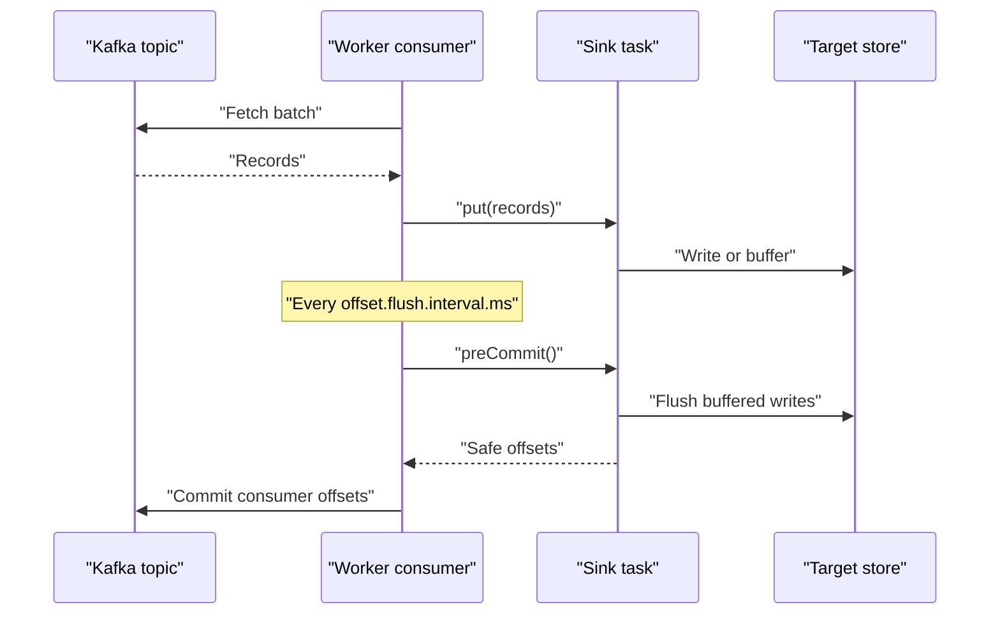

# Sink Connectors

## Introduction

A sink connector is the outbound half of Kafka Connect. It consumes one or more topics and writes the records somewhere else: rows in PostgreSQL, documents in Elasticsearch, Parquet files in S3, tables in Iceberg or Snowflake. Sinks are where most teams first meet Connect, because "get this topic into that store" is the most common integration request there is.

Writing to an external system is harder than reading from Kafka. The target can be slow, can reject a record, can go down for maintenance, and usually knows nothing about Kafka offsets. A sink connector has to balance throughput against latency, and must decide what happens to records that were written to the target but whose offsets were not yet committed when the task crashed.

This page explains how a sink task consumes and commits, how to choose topics and parallelism, what delivery guarantee you actually get, and how to make it effectively exactly-once with idempotent writes. It walks through three common sinks (JDBC, Elasticsearch and S3) and a scenario where a clickstream and an order stream feed different stores from the same Kafka cluster.

## How a Sink Task Works

Every sink connector instance gets a Kafka consumer group named `connect-` followed by the connector name. Its tasks are the members of that group, and the topic partitions are spread across them exactly as they would be across any consumer group. That makes the parallelism rule simple: **a sink cannot have more useful tasks than the topics have partitions**.

The worker runs the consumer loop. For each batch it applies the converter and transforms, then calls the task's `put()` method with a collection of records. A well-behaved task either writes the batch synchronously or buffers it. Periodically, every `offset.flush.interval.ms` (60 seconds by default), the worker asks the task which offsets are safe to commit, via `preCommit()` (which by default calls `flush()`), and then commits those offsets for the consumer group.



If the task crashes after writing to the target but before the commit, the replacement task resumes from the last committed offset and writes those records again. Sinks are therefore **at-least-once** by default. Whether that produces duplicates depends entirely on how the connector writes.

Because the sink is just a consumer group, you monitor it like one:

```bash
kafka-consumer-groups.sh --bootstrap-server localhost:9092 \
  --describe --group connect-orders-es-sink
```

```text
GROUP                   TOPIC            PARTITION  CURRENT-OFFSET  LOG-END-OFFSET  LAG
connect-orders-es-sink  shop.orders      0          184022          184022          0
connect-orders-es-sink  shop.orders      1          183870          184101          231
connect-orders-es-sink  shop.orders      2          184310          184310          0
```

Growing lag on a sink almost always means the target is slower than the topic, not that Kafka is slow.

## Choosing Topics and Parallelism

A sink subscribes either to a list or a pattern, never both:

```properties
# An explicit list
topics=shop.orders,shop.refunds

# Or a regex; new matching topics are picked up automatically
topics.regex=shop\\.(orders|refunds)
```

`topics.regex` is convenient but risky: a test topic named `shop.orders-backup` will match a careless pattern and be written into production. Anchor your patterns and prefer explicit lists for important sinks.

Tune the embedded consumer per connector with `consumer.override.` settings. They are allowed only if the worker's `connector.client.config.override.policy` permits it. The default is `All`; the Kafka documentation now recommends `Allowlist`, and it is due to become the default in Kafka 5.0. A typical override for a sink that writes in large batches:

```properties
consumer.override.max.poll.records=2000
consumer.override.fetch.min.bytes=1048576
consumer.override.fetch.max.wait.ms=500
```

## Delivery Guarantees and Idempotent Writes

At-least-once plus a write that can be safely repeated gives you effectively exactly-once results. There are three common techniques.

| Technique | How it works | Typical sinks |
|---|---|---|
| Upsert by key | The record key becomes the primary key or document ID; replaying overwrites with the same value | JDBC (`insert.mode=upsert`), Elasticsearch, MongoDB, Redis |
| Deterministic files | Files are named from topic, partition and start offset; a rewrite produces the same file | S3, GCS, HDFS sinks with a deterministic partitioner |
| Offsets stored in the target | The sink stores Kafka offsets in the target, in the same transaction as the data, and ignores the committed consumer offsets | Some database and Iceberg sinks |

Plain inserts with no key are the one approach that duplicates on replay. If your sink is an append-only table, include the topic, partition and offset as columns and put a unique constraint on them.

Ordering matters too. With upserts, two updates to the same order must arrive in order, or an older state could overwrite a newer one. Kafka guarantees order within a partition, so make sure the producer keys records by the entity ID. See [Ordering Guarantees and Message Keys](../2-kafka-topics-and-storage/1-kafka-ordering-and-keys.mdx).

Deletes travel as **tombstones**, records with a key and a null value. Each sink has its own switch to turn a tombstone into a delete in the target, and most leave it off by default.

## Three Common Sinks

### JDBC Sink

The Debezium JDBC sink (`io.debezium.connector.jdbc.JdbcSinkConnector`) writes topics into relational tables and understands Debezium change events natively. The Confluent JDBC sink (`io.confluent.connect.jdbc.JdbcSinkConnector`) is an older, widely deployed alternative with similar settings.

```json
{
  "name": "orders-reporting-sink",
  "config": {
    "connector.class": "io.debezium.connector.jdbc.JdbcSinkConnector",
    "tasks.max": "3",
    "topics": "shop.public.orders",
    "connection.url": "jdbc:postgresql://reporting-db:5432/reporting",
    "connection.username": "loader",
    "connection.password": "${file:/opt/secrets/reporting.properties:password}",
    "insert.mode": "upsert",
    "primary.key.mode": "record_key",
    "delete.enabled": "true",
    "schema.evolution": "basic",
    "collection.name.format": "orders",
    "batch.size": "500"
  }
}
```

`insert.mode=upsert` with `primary.key.mode=record_key` makes replays harmless. `delete.enabled=true` turns tombstones into `DELETE` statements; it requires a key-based primary key mode. `schema.evolution=basic` lets the connector add columns when the record schema gains fields; it never drops columns. The default, `none`, fails if the table does not match.

### Elasticsearch Sink

```json
{
  "name": "orders-es-sink",
  "config": {
    "connector.class": "io.confluent.connect.elasticsearch.ElasticsearchSinkConnector",
    "tasks.max": "3",
    "topics": "shop.orders",
    "connection.url": "https://search.internal:9200",
    "key.ignore": "false",
    "schema.ignore": "true",
    "write.method": "upsert",
    "behavior.on.null.values": "delete",
    "batch.size": "1000"
  }
}
```

`key.ignore=false` uses the record key as the document ID, which makes writes idempotent. With `key.ignore=true` the connector generates IDs from topic, partition and offset, which is fine for logs but cannot express updates. `behavior.on.null.values=delete` turns tombstones into document deletes. `schema.ignore=true` lets Elasticsearch infer the mapping; in production many teams create an index template up front instead.

### S3 Sink

```json
{
  "name": "clicks-s3-sink",
  "config": {
    "connector.class": "io.confluent.connect.s3.S3SinkConnector",
    "tasks.max": "12",
    "topics": "web.clicks",
    "s3.bucket.name": "acme-datalake-raw",
    "s3.region": "eu-west-1",
    "storage.class": "io.confluent.connect.s3.storage.S3Storage",
    "format.class": "io.confluent.connect.s3.format.parquet.ParquetFormat",
    "flush.size": "50000",
    "rotate.interval.ms": "600000",
    "partitioner.class": "io.confluent.connect.storage.partitioner.TimeBasedPartitioner",
    "path.format": "'year'=YYYY/'month'=MM/'day'=dd/'hour'=HH",
    "partition.duration.ms": "3600000",
    "locale": "en-US",
    "timezone": "UTC",
    "timestamp.extractor": "Record"
  }
}
```

A file is closed when it reaches `flush.size` records or when `rotate.interval.ms` has passed, whichever comes first. Small values mean fresher data and many tiny files, which query engines hate; large values mean fewer, bigger files and more latency. Parquet needs a schema, so the topic must use a schema-aware converter such as Avro or Protobuf with Schema Registry; see [Single Message Transforms and Converters](./3-kafka-connect-transforms.mdx).

With `timestamp.extractor=Record`, files are partitioned by the record's timestamp, not the time it was written, so replays land in the same folders and file names stay deterministic.

## Worked Scenario: Clickstream and Orders From One Cluster

A travel website produces two very different streams. `web.clicks` carries about 20,000 page-view events per second, each tiny and worthless on its own. `shop.orders` carries a few bookings per second, each worth hundreds of euros.

For clicks, analytics wants hourly Parquet in S3 for their query engine. The S3 sink above with 12 tasks matches the topic's 12 partitions. They pick `flush.size=50000` and a ten-minute rotation: files of roughly 20 MB, available within ten minutes. They considered writing a custom consumer that batches into S3, but would have had to solve file rotation, schema handling and exactly-once file naming themselves.

For orders, the support team wants every booking searchable within seconds. The Elasticsearch sink uses the booking ID as the record key and document ID, so a retry after a timeout overwrites the same document instead of creating a twin. Cancellations are tombstones and become deletes.

The two sinks are independent consumer groups. During a Black Friday traffic spike, the S3 sink's lag climbs to a few minutes while the Elasticsearch sink stays at zero. Nobody is paged for the S3 lag because the alert threshold reflects the data's value: minutes of lag on clicks is fine, thirty seconds on orders is not.

The alternative the team rejected was a single "export everything" connector writing both topics to both stores. It would have tied the latency of high-value orders to the throughput of low-value clicks.

## Popular Sinks at a Glance

| Target | Connector | Idempotent by | Watch out for |
|---|---|---|---|
| PostgreSQL, MySQL, SQL Server | Debezium or Confluent JDBC sink | Upsert on primary key | Table auto-creation picking poor column types |
| Elasticsearch, OpenSearch | Confluent Elasticsearch or OpenSearch sink | Document ID from key | Mapping conflicts reject records |
| Amazon S3, GCS | Confluent S3 or GCS sink | Deterministic file names | Small files from a short rotation |
| Apache Iceberg | Iceberg Kafka Connect sink | Commits coordinated with offsets | Commit interval versus table snapshot count |
| Snowflake | Snowflake Kafka connector | Offsets stored in Snowflake | Credit cost of frequent ingestion |
| MongoDB | MongoDB Kafka connector | Upsert on `_id` | Write-model strategy defaults |

## Common Mistakes

- Setting `tasks.max` higher than the partition count. Extra tasks sit idle; add partitions to the topic if you need more parallelism.
- Using generated IDs or plain inserts, then being surprised by duplicates after a rebalance.
- Forgetting to enable delete handling, so tombstones are silently ignored and deleted entities live forever in the target.
- A `topics.regex` that matches more than intended, such as backup or test topics.
- Tiny S3 files from aggressive rotation. A query engine scanning a million 10 KB files is much slower than one scanning a thousand 10 MB ones.
- Treating sink lag as a Kafka problem. Look at target latency, batch sizes and rejected writes first.

## Summary

- Each sink connector is a consumer group named `connect-` plus the connector name; its useful parallelism is capped by the partition count.
- The worker commits offsets after `preCommit()` every `offset.flush.interval.ms`, so sinks are at-least-once by default.
- Effectively exactly-once results come from idempotent writes: upserts by key, deterministic file names, or offsets stored in the target.
- Tombstones carry deletes, but each sink must be configured to apply them.
- Tune the embedded consumer with `consumer.override.*`, permitted by the worker's override policy.
- Separate sinks for streams with different value and latency needs, so one slow target cannot hold back another.

## Further Reading

- [Kafka Connect user guide](https://kafka.apache.org/documentation/#connect) - sink configuration, `topics.regex` and client overrides.
- [Debezium JDBC sink connector](https://debezium.io/documentation/reference/stable/connectors/jdbc.html) - insert modes, primary key modes and schema evolution.
- [Confluent Elasticsearch sink](https://docs.confluent.io/kafka-connectors/elasticsearch/current/overview.html) - document IDs, write methods and null handling.
- [Confluent S3 sink](https://docs.confluent.io/kafka-connectors/s3-sink/current/overview.html) - partitioners, rotation and exactly-once file naming.
- [Apache Iceberg Kafka Connect](https://iceberg.apache.org/docs/latest/kafka-connect/) - writing topics into Iceberg tables.
- [Consumer Lag: Measuring and Fixing It](../10-kafka-operations/2-kafka-consumer-lag.mdx) - the same tools apply to sink connectors.
