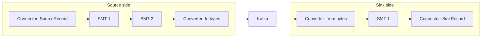

# Single Message Transforms and Converters

## Introduction

A connector knows how to talk to one external system, but it does not decide how records look in Kafka. Two other pluggable pieces do that. **Converters** decide the byte format: plain JSON, JSON with an embedded schema, Avro, Protobuf. **Single message transforms** (SMTs) make small changes to each record on its way through: renaming a field, dropping a sensitive column, routing to a different topic, copying an ID into the key.

Getting these two right is the difference between a topic that every consumer can read safely and one that breaks a downstream team every time a column is added. Most "my connector does not work" questions on forums turn out to be a converter mismatch, not a connector bug.

This page explains where converters and transforms sit in the pipeline, how to choose a converter, the built-in transforms and how to chain them, predicates for applying a transform conditionally, how to write your own transform in Java, and the line beyond which you should reach for a stream processor instead.

## Where Converters and Transforms Run

Inside the worker every record exists in a format-neutral form: a `ConnectRecord` with a key, a value, optional `Schema` objects describing them, headers, a topic and a timestamp. Connectors produce and consume that form. Converters translate it to and from bytes at the Kafka boundary; transforms operate on it in between.



Two consequences follow. Transforms always see structured data with field names, never raw bytes. And a sink's converter must match how the data was written: if the producer wrote Avro and the sink is configured with `JsonConverter`, the sink fails on the first record.

## Choosing a Converter

Converters are set on the worker as defaults and can be overridden per connector. Keys and values are configured separately, because keys are often simple strings while values are structured.

| Converter | Bytes in Kafka | Schema | Use when |
|---|---|---|---|
| `org.apache.kafka.connect.storage.StringConverter` | UTF-8 text | None | Keys that are plain IDs |
| `org.apache.kafka.connect.converters.ByteArrayConverter` | Untouched bytes | None | Passing data through without parsing it |
| `org.apache.kafka.connect.json.JsonConverter` with `schemas.enable=true` | JSON with a `schema` and a `payload` envelope | Inline in every record | Rarely; the schema bloats every message |
| `JsonConverter` with `schemas.enable=false` | Plain JSON | None | Simple pipelines, schemaless sinks such as Elasticsearch |
| `io.confluent.connect.avro.AvroConverter` | Avro plus a schema ID | Schema Registry | Typed pipelines, Parquet output, schema evolution |
| `io.confluent.connect.protobuf.ProtobufConverter` | Protobuf plus a schema ID | Schema Registry | Teams already standardised on Protobuf |
| `io.confluent.connect.json.JsonSchemaConverter` | JSON plus a schema ID | Schema Registry | JSON on the wire with enforced contracts |

`JsonConverter`'s `schemas.enable` defaults to `true`. With that default, a record looks like this, and a sink expecting plain JSON will choke on the envelope (or a sink expecting the envelope will choke on plain JSON):

```json
{
  "schema": {
    "type": "struct",
    "fields": [
      { "field": "order_id", "type": "int64", "optional": false },
      { "field": "status", "type": "string", "optional": true }
    ],
    "optional": false
  },
  "payload": { "order_id": 1042, "status": "PAID" }
}
```

The classic error message is `JsonConverter with schemas.enable requires "schema" and "payload" fields`. It means the sink's converter expects the envelope and the topic has plain JSON. Fix the configuration, not the data.

A typical connector-level override for a Schema Registry pipeline:

```properties
key.converter=org.apache.kafka.connect.storage.StringConverter
value.converter=io.confluent.connect.avro.AvroConverter
value.converter.schema.registry.url=http://schema-registry:8081
```

Sinks that need column types, such as JDBC with auto-create or Parquet in S3, require a schema, so they need either a Schema Registry converter or JSON with the envelope. Schemaless JSON works only for schemaless targets. See [Schema Registry: Why and How](../6-kafka-schemas/1-kafka-schema-registry.mdx) for the registry side.

## The Built-In Transforms

Apache Kafka ships these transforms in the `org.apache.kafka.connect.transforms` package. Most come in `$Key` and `$Value` variants, so `ReplaceField$Value` works on the value and `ReplaceField$Key` on the key.

| Transform | What it does | Typical use |
|---|---|---|
| `InsertField` | Adds a static value or record metadata (topic, partition, offset, timestamp) as a field | Stamp the source topic into a lake table |
| `ReplaceField` | Keeps (`include`), drops (`exclude`) or renames (`renames`) fields | Remove `password_hash`; rename `cust_id` to `customer_id` |
| `MaskField` | Replaces a field's value with an empty value or a fixed replacement | Hide card numbers before they leave the source |
| `ValueToKey` | Builds the key from value fields | Set the key so a sink can upsert |
| `ExtractField` | Replaces the whole key or value with one field | Turn a struct key into a plain ID |
| `HoistField` | Wraps the value in a struct under a field name | Give a primitive value a name |
| `Cast` | Changes field or value types | Turn a string price into a decimal |
| `TimestampConverter` | Converts between timestamp formats | Epoch millis to an ISO string |
| `Flatten` | Flattens nested structs with a delimiter | Nested JSON into flat columns |
| `RegexRouter` | Rewrites the topic name with a regex | Strip a prefix from Debezium topics |
| `TimestampRouter` | Appends a formatted timestamp to the topic | Daily index names in Elasticsearch |
| `SetSchemaMetadata` | Sets schema name and version | Align names with registry subjects |
| `Filter` | Drops records; meaningful only with a predicate | Discard heartbeats or tombstones |
| `InsertHeader`, `DropHeaders`, `HeaderFrom` | Add, remove or copy fields into headers | Move tracing IDs into headers |

Transforms are declared as an ordered list of aliases, each configured under `transforms.ALIAS.`:

```properties
transforms=dropSecrets,keyById,route

# 1. Remove fields nobody downstream should see
transforms.dropSecrets.type=org.apache.kafka.connect.transforms.ReplaceField$Value
transforms.dropSecrets.exclude=password_hash,ssn

# 2. Key each record by its customer ID so sinks can upsert
transforms.keyById.type=org.apache.kafka.connect.transforms.ValueToKey
transforms.keyById.fields=customer_id

# 3. crm.public.customers becomes customers
transforms.route.type=org.apache.kafka.connect.transforms.RegexRouter
transforms.route.regex=crm\\.public\\.(.*)
transforms.route.replacement=$1
```

Order matters: each transform receives the output of the previous one. Here `ValueToKey` runs after `ReplaceField`, which works because `customer_id` survives the first step; had it been in the `exclude` list, the key step would fail. Several transforms, including `ExtractField`, accept `field.syntax.version=V2`, which lets you address nested fields with dot notation, such as `after.customer_id`. The default `V1` only reaches top-level fields.

## Predicates: Applying a Transform Conditionally

By default a transform applies to every record. Predicates (added in Kafka 2.6) restrict it. Three are built in: `TopicNameMatches` (regex on the topic), `HasHeaderKey` (a header is present) and `RecordIsTombstone` (null value). Each transform takes a `predicate` alias and an optional `negate=true`.

```properties
transforms=dropTombstones,maskCard
predicates=isTombstone,isPayments

# Drop tombstones: Filter with a predicate drops exactly the matching records
transforms.dropTombstones.type=org.apache.kafka.connect.transforms.Filter
transforms.dropTombstones.predicate=isTombstone

# Mask card numbers only on the payments topic
transforms.maskCard.type=org.apache.kafka.connect.transforms.MaskField$Value
transforms.maskCard.fields=card_number
transforms.maskCard.replacement=****
transforms.maskCard.predicate=isPayments

predicates.isTombstone.type=org.apache.kafka.connect.transforms.predicates.RecordIsTombstone
predicates.isPayments.type=org.apache.kafka.connect.transforms.predicates.TopicNameMatches
predicates.isPayments.pattern=.*\\.payments
```

`Filter` with `negate=true` keeps only matching records instead, which is a handy way to make a sink ignore everything except one topic in a regex subscription.

## Writing a Custom Transform

When no built-in transform fits, writing one is a small Java class. Here is a transform that lower-cases the `email` field of struct values:

```java
package com.example.connect;

import java.util.Map;
import org.apache.kafka.common.config.ConfigDef;
import org.apache.kafka.connect.connector.ConnectRecord;
import org.apache.kafka.connect.data.Struct;
import org.apache.kafka.connect.transforms.Transformation;

public class LowercaseEmail<R extends ConnectRecord<R>> implements Transformation<R> {

    @Override
    public R apply(R record) {
        if (!(record.value() instanceof Struct value) || value.schema().field("email") == null) {
            return record;                          // tombstones and other shapes pass through untouched
        }
        String email = value.getString("email");
        if (email == null) {
            return record;
        }
        Struct updated = new Struct(value.schema());
        value.schema().fields().forEach(f -> updated.put(f, value.get(f)));
        updated.put("email", email.toLowerCase());
        // newRecord keeps topic, partition, key and timestamp; only the value changes
        return record.newRecord(record.topic(), record.kafkaPartition(),
                record.keySchema(), record.key(), value.schema(), updated, record.timestamp());
    }

    @Override public ConfigDef config() { return new ConfigDef(); }
    @Override public void configure(Map<String, ?> configs) { }
    @Override public void close() { }
}
```

Package it as a jar, place it in a directory under `plugin.path`, restart the workers, and reference it as `transforms.email.type=com.example.connect.LowercaseEmail`. Keep custom transforms pure and fast: they run on every record, on the task thread, and an exception there is handled by the `errors.*` settings described in [Error Handling and Dead Letter Queues in Connect](./6-kafka-connect-error-handling.mdx).

## Worked Scenario: A Fleet of Delivery Vans

A logistics company has 4,000 vans sending GPS and engine telemetry to an MQTT broker. An MQTT source connector brings the messages into Kafka; three consumers need them: a live map, a maintenance model and a data lake.

The raw messages have problems. The van ID is inside the payload, so records arrive unkeyed and a van's readings scatter across partitions out of order. Some firmware versions send a `driver_phone` field that the privacy team does not want stored. And the reading time arrives as a string of epoch seconds, which the lake's Parquet tables cannot partition on.

The team solves all three with transforms on the source connector: `ValueToKey` plus `ExtractField$Key` makes `van_id` the plain string key, so each van's readings stay ordered in one partition; `ReplaceField$Value` with `exclude=driver_phone` drops the phone number before it ever reaches Kafka; and `Cast$Value` followed by `TimestampConverter$Value` (with `unix.precision=seconds`) turns the reading time into a proper timestamp field. Values use the Avro converter so the lake sink can write Parquet.

They considered a Kafka Streams application to do the same reshaping. It would have meant a raw topic holding phone numbers, a second copy of all data, and another service to deploy. The transforms are a dozen lines of config. When the maintenance team later asked for "average engine temperature per van per five minutes", that went into Kafka Streams, because aggregation is not a single-message job.

## Common Mistakes

- Mismatched converters between the writer and a sink, or between `schemas.enable` settings. Check both key and value converters.
- Leaving `JsonConverter` at `schemas.enable=true` for a schemaless pipeline and paying for a full schema inside every message.
- Forgetting the `$Key` or `$Value` suffix, or quoting it in a shell so `$Value` is expanded to an empty string.
- Chaining transforms in the wrong order, so a later transform looks for a field an earlier one removed or renamed.
- Using SMTs for lookups, joins, aggregation or splitting one record into many. A transform maps one record to at most one record; anything more belongs in a stream processor.
- Throwing exceptions from a custom transform for expected data shapes such as tombstones. Pass them through.

## Summary

- Converters turn the worker's internal records into bytes and back; transforms modify records in between and always see structured data.
- Choose converters per key and value; Schema Registry converters give typed, evolvable topics; `JsonConverter` with `schemas.enable=false` gives plain JSON.
- Kafka ships transforms for renaming, dropping, masking, keying, casting, flattening and routing, chained in the order listed in `transforms`.
- Predicates (`TopicNameMatches`, `HasHeaderKey`, `RecordIsTombstone`) with optional `negate` apply a transform only to some records.
- Custom transforms are small Java classes implementing `Transformation`, deployed via `plugin.path`.
- Keep transforms to single-record, stateless changes; use Kafka Streams or Flink for anything else.

## Further Reading

- [Kafka Connect transformations](https://kafka.apache.org/documentation/#connect_transforms) - the official list of built-in transforms and predicates.
- [KIP-66: Single Message Transforms](https://cwiki.apache.org/confluence/display/KAFKA/KIP-66%3A+Single+Message+Transforms+for+Kafka+Connect) - the original design and its deliberate limits.
- [KIP-585: Filter and conditional SMTs](https://cwiki.apache.org/confluence/display/KAFKA/KIP-585%3A+Filter+and+Conditional+SMTs) - where predicates come from.
- [KIP-821: Nested field support in SMTs](https://cwiki.apache.org/confluence/display/KAFKA/KIP-821%3A+Connect+Transforms+support+for+nested+structures) - the `field.syntax.version` setting.
- [Choosing a Serialization Format: JSON, Avro, Protobuf](../6-kafka-schemas/0-kafka-serialization-formats.mdx) - the trade-offs behind the converter choice.
