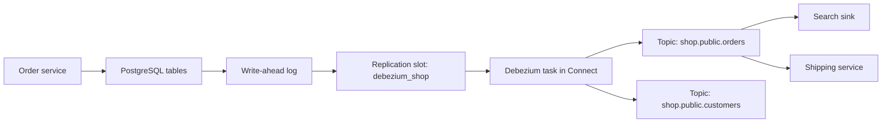

# Change Data Capture with Debezium

## Introduction

Most business data still lives in relational databases, and most of it changes all day. Change data capture (CDC) turns those changes into a stream: every insert, update and delete becomes an event in Kafka, in the order the database committed them. Downstream systems such as search indexes, caches, analytics stores and other microservices can then react within a second, without querying the database and without the application having to publish events itself.

Debezium is the open-source project that does this for PostgreSQL, MySQL, MariaDB, SQL Server, Oracle, Db2, MongoDB and others. It runs as a set of Kafka Connect source connectors. Instead of polling tables, it reads the database's replication log, the same stream a replica database would read, so it sees every change, including deletes, with very little load on the database.

This page explains how Debezium reads PostgreSQL, what a change event looks like, how the initial snapshot and incremental snapshots work, how to configure the database and the connector, how to flatten events for sinks that want plain rows, and the operational traps, above all a replication slot that quietly fills the database's disk. Examples use Debezium 3.7 on Kafka 4.x.

## How Log-Based CDC Works

Every serious database writes changes to a log before applying them to tables, so it can recover after a crash. PostgreSQL calls it the write-ahead log (WAL), MySQL the binlog. Replication works by shipping that log to replicas. Debezium pretends to be a replica.

For PostgreSQL the pieces are:

- **Logical decoding** turns physical WAL records into logical row changes. It requires `wal_level=logical`.
- An **output plugin** formats those changes. Use `pgoutput`, which is built into PostgreSQL 10 and later and available on managed services such as Amazon RDS and Cloud SQL. Debezium's default value for `plugin.name` is `decoderbufs`, which needs a server extension, so set `pgoutput` explicitly.
- A **publication** defines which tables are replicated.
- A **replication slot** is the database's bookmark for one consumer. It remembers the last position Debezium confirmed and keeps all WAL after that position until Debezium confirms it.



The slot is what makes Debezium reliable: if Connect is down for an hour, the changes wait in the WAL and are delivered when it returns. It is also what makes Debezium dangerous, as the operations section explains.

Topics are named `TOPIC_PREFIX.SCHEMA.TABLE`, so with `topic.prefix=shop` the `public.orders` table goes to `shop.public.orders`. The record key is the table's primary key, which keeps all changes to one row in one partition and therefore in order.

## Anatomy of a Change Event

Each record value is an envelope describing one row change. Here is an update to an order, shown as JSON with schemas disabled:

```json
{
  "before": { "id": 1042, "customer_id": 77, "status": "PAID", "total": "129.90" },
  "after":  { "id": 1042, "customer_id": 77, "status": "SHIPPED", "total": "129.90" },
  "source": {
    "version": "3.7.0.Final",
    "connector": "postgresql",
    "name": "shop",
    "ts_ms": 1792310412000,
    "snapshot": "false",
    "db": "shop",
    "schema": "public",
    "table": "orders",
    "txId": 88213,
    "lsn": 31260456
  },
  "op": "u",
  "ts_ms": 1792310412387
}
```

| Field | Meaning |
|---|---|
| `before` | Row state before the change; null for inserts |
| `after` | Row state after the change; null for deletes |
| `source` | Where and when: connector, database, table, transaction ID, log position, commit time |
| `op` | `c` create, `u` update, `d` delete, `r` read during a snapshot, `t` truncate (skipped by default via `skipped.operations`) |
| `ts_ms` | When Debezium processed the event (`ts_us` and `ts_ns` give finer precision) |

Comparing `source.ts_ms` (commit time) with `ts_ms` (processing time) tells you the end-to-end CDC delay for each event.

By default PostgreSQL logs only the primary key of the old row, so `before` contains just `id`. If consumers need full old values, for example to compute "status changed from PAID to SHIPPED", set the table to `REPLICA IDENTITY FULL`. That makes the WAL larger, so do it only for tables that need it.

A delete produces two records: an event with `op: "d"`, `before` set and `after` null, followed by a **tombstone**, a record with the same key and a null value. The tombstone lets log compaction eventually remove the row's history and tells sinks to delete. `tombstones.on.delete` (default `true`) controls it.

## Snapshots: Getting the Existing Rows

The WAL only contains recent changes. When a connector starts for the first time, the tables already hold years of rows. Debezium therefore begins with a **snapshot**: it reads every row of the captured tables, emits them as `op: "r"` events, then switches to streaming from the slot position recorded at the start, so nothing falls in the gap.

| `snapshot.mode` | Behaviour |
|---|---|
| `initial` (default) | Snapshot on first start, then stream |
| `initial_only` | Snapshot, then stop; no streaming |
| `no_data` | Capture schemas only and stream from now; no historical rows |
| `when_needed` | Snapshot if there are no offsets or the stored position is no longer available |
| `always` | Snapshot on every start |
| `configuration_based`, `custom` | Fine-grained or pluggable control |

A snapshot of a 500 GB table takes hours and blocks the start of streaming. **Incremental snapshots** avoid that. They read a table in primary-key chunks (1,024 rows by default, set by `incremental.snapshot.chunk.size`) while streaming continues, and they can be triggered at any time, for example after adding a new table to the include list. You trigger one by inserting a row into a signalling table:

```sql
CREATE TABLE public.debezium_signal (id VARCHAR(42) PRIMARY KEY, type VARCHAR(32) NOT NULL, data VARCHAR(2048));

INSERT INTO public.debezium_signal (id, type, data)
VALUES ('resnap-2026-10-17', 'execute-snapshot',
        '{"data-collections": ["public.order_lines"], "type": "incremental"}');
```

The connector must be told about the table with `signal.data.collection`, and the table must be captured, which is why it appears in `table.include.list` below. Signals can also be sent through a Kafka topic if the connector cannot write to the database.

## Setting Up PostgreSQL and the Connector

On the database:

```properties
# postgresql.conf
wal_level = logical
max_replication_slots = 10        # one per Debezium connector, plus headroom
max_wal_senders = 10
max_slot_wal_keep_size = 50GB     # PostgreSQL 13+: cap on WAL a slot may retain
```

```sql
-- A dedicated user with replication rights and read access to the captured tables
CREATE ROLE debezium WITH LOGIN REPLICATION PASSWORD 'change-me';
GRANT SELECT ON public.orders, public.order_lines, public.customers, public.debezium_signal TO debezium;
GRANT CREATE ON DATABASE shop TO debezium;   -- lets Debezium create its publication
ALTER TABLE public.orders REPLICA IDENTITY FULL;   -- full "before" images for this table
```

Then register the connector:

```json
{
  "name": "shop-postgres-cdc",
  "config": {
    "connector.class": "io.debezium.connector.postgresql.PostgresConnector",
    "tasks.max": "1",
    "database.hostname": "postgres",
    "database.port": "5432",
    "database.user": "debezium",
    "database.password": "${file:/opt/connect/secrets/shop-db.properties:password}",
    "database.dbname": "shop",
    "topic.prefix": "shop",
    "plugin.name": "pgoutput",
    "slot.name": "debezium_shop",
    "publication.name": "dbz_shop",
    "publication.autocreate.mode": "filtered",
    "table.include.list": "public.orders,public.order_lines,public.customers,public.debezium_signal",
    "column.exclude.list": "public.customers.password_hash",
    "signal.data.collection": "public.debezium_signal",
    "snapshot.mode": "initial",
    "heartbeat.interval.ms": "10000",
    "decimal.handling.mode": "string",
    "key.converter": "org.apache.kafka.connect.json.JsonConverter",
    "key.converter.schemas.enable": "false",
    "value.converter": "org.apache.kafka.connect.json.JsonConverter",
    "value.converter.schemas.enable": "false"
  }
}
```

```bash
# PUT .../config takes only the inner config object; it creates or updates idempotently
jq .config shop-postgres-cdc.json | curl -s -X PUT localhost:8083/connectors/shop-postgres-cdc/config \
  -H "Content-Type: application/json" -d @-
```

Notes on the choices. A Debezium PostgreSQL connector always runs a single task, because there is one log to read. Give each connector its own `slot.name` and `publication.name`; the defaults (`debezium` and `dbz_publication`) collide as soon as you have two. `publication.autocreate.mode=filtered` creates a publication for only the included tables; the default `all_tables` publishes everything. `decimal.handling.mode=string` avoids the default `precise` mode, which encodes `NUMERIC` columns as binary that shows up as unreadable base64 in JSON.

:::tip
Unchanged large values (PostgreSQL TOAST columns) are not in the WAL for an update unless the table has `REPLICA IDENTITY FULL`. Debezium then emits the placeholder `__debezium_unavailable_value` for them. Sinks that upsert whole rows will overwrite real data with it, so either use `FULL` or handle the placeholder.
:::

For MySQL the model is similar but uses the binlog: the server needs `binlog_format=ROW` and `binlog_row_image=FULL`, each connector needs a unique numeric `database.server.id`, and Debezium keeps the history of table schema changes in a single-partition topic configured with `schema.history.internal.kafka.topic` and `schema.history.internal.kafka.bootstrap.servers`.

## Flattening Events for Sinks

Many sinks want plain rows, not envelopes. Debezium's `ExtractNewRecordState` transform replaces the envelope with the `after` state and can copy metadata into fields or headers:

```properties
transforms=unwrap
transforms.unwrap.type=io.debezium.transforms.ExtractNewRecordState
# Keep tombstones so downstream deletes still work (other options: drop, rewrite, rewrite-with-tombstone, delete-to-tombstone)
transforms.unwrap.delete.tombstone.handling.mode=rewrite-with-tombstone
# Adds __op, __table and __source_ts_ms fields to each row
transforms.unwrap.add.fields=op,table,source.ts_ms
```

With `rewrite-with-tombstone`, a delete becomes the old row plus `__deleted: "true"`, followed by a tombstone, so both soft-delete and hard-delete consumers are served. Put the transform on the sink connector rather than the source if some consumers want the full envelope; the Debezium JDBC sink reads envelopes natively and needs no transform at all.

## Operating Debezium Safely

The replication slot keeps WAL until Debezium confirms it. If the connector is stopped, failed or deleted while the slot remains, the WAL grows without bound and eventually fills the database disk. This is the most common Debezium incident, and it takes down the primary database, not just the pipeline.

```sql
-- How much WAL is each slot holding back?
SELECT slot_name, active,
       pg_size_pretty(pg_wal_lsn_diff(pg_current_wal_lsn(), confirmed_flush_lsn)) AS retained
FROM pg_replication_slots;
```

```text
   slot_name    | active | retained
----------------+--------+----------
 debezium_shop  | t      | 18 MB
 debezium_old   | f      | 212 GB
```

Alert on retained WAL, drop slots of decommissioned connectors with `SELECT pg_drop_replication_slot('debezium_old');`, and set `max_slot_wal_keep_size` as a last-resort cap. If the cap is hit, PostgreSQL invalidates the slot and the connector needs a new snapshot, which is better than a full disk.

A quieter version of the problem: if the captured tables rarely change but other tables in the same server change a lot, Debezium has nothing to confirm and the slot still holds WAL. `heartbeat.interval.ms` makes Debezium emit heartbeat records to a `__debezium-heartbeat` topic and confirm its position regularly; `heartbeat.action.query` can additionally write to a tiny heartbeat table so there is always a change to see.

Monitor the streaming MBean `debezium.postgres:type=connector-metrics,context=streaming,server=shop`, especially `MilliSecondsBehindSource` and `Connected`, alongside the normal Connect task status.

Finally, schema changes. Adding a nullable column is handled automatically: new events simply carry the field. Renaming or dropping columns changes the event shape and can break consumers, so treat captured tables as a public contract, or publish curated events instead with the outbox pattern described in [The Transactional Outbox Pattern](../9-kafka-patterns/1-kafka-outbox-pattern.mdx).

## Worked Scenario: Orders to Search and Shipping

An online furniture shop's order service writes to PostgreSQL. The shipping service needs to know when an order is paid, and support wants to search orders by customer name. The first plan was "dual writes": after committing to the database, the order service also publishes to Kafka. In testing, a crash between the commit and the publish left paid orders that shipping never heard about, and a failed publish after a successful commit could not be undone.

With Debezium, the database commit is the only write. The connector above captures `orders`, `order_lines` and `customers`. Shipping consumes `shop.public.orders` and acts on events where `before.status` is `PENDING` and `after.status` is `PAID`, which is why `orders` has `REPLICA IDENTITY FULL`. An Elasticsearch sink with `ExtractNewRecordState` keeps the search index in step. When the team later adds `returns` to the capture list, they trigger an incremental snapshot for it with one `INSERT` into the signal table, without restarting or re-snapshotting anything else.

Six months in, the Connect cluster was down over a long weekend after a network change. The slot held 40 GB of WAL by Monday; the disk alert they had set at 70% fired on Saturday, and the on-call engineer fixed the network before it mattered. When Connect came back, Debezium caught up in twelve minutes with no lost changes. A full build-out of this pipeline is in [Project: Database Changes to a Search Index with Debezium](../14-kafka-projects/2-kafka-project-cdc-to-search.mdx).

## Common Mistakes

- Leaving a slot behind after deleting a connector, or letting a connector sit failed for days, until the WAL fills the disk.
- Two connectors sharing the default `slot.name` or `publication.name`.
- Leaving `plugin.name` at its default `decoderbufs` on a server that only has `pgoutput`.
- Expecting full `before` images without `REPLICA IDENTITY FULL`, or turning it on for every table and doubling WAL volume.
- Exposing raw table events as a cross-team contract, then breaking consumers with a column rename.
- Forgetting that events are at-least-once: after a restart, some changes are delivered again, so consumers must be idempotent.
- Using a blocking initial snapshot on a huge table when an incremental snapshot would keep streaming flowing.

## Summary

- Debezium reads the database's replication log, so it captures every insert, update and delete in commit order with little database load.
- On PostgreSQL it uses logical decoding with `pgoutput`, a publication for the tables and a replication slot as its bookmark.
- Each event carries `before`, `after`, `source` metadata and an `op` code; deletes are followed by a tombstone.
- An initial snapshot loads existing rows; incremental snapshots, triggered through a signal table, load tables in chunks while streaming continues.
- `ExtractNewRecordState` flattens events for sinks that want plain rows.
- Monitor replication slot lag, use heartbeats, cap WAL retention and drop unused slots; a forgotten slot can fill the primary database's disk.

## Further Reading

- [Debezium PostgreSQL connector](https://debezium.io/documentation/reference/stable/connectors/postgresql.html) - setup, every property and the event format.
- [Debezium MySQL connector](https://debezium.io/documentation/reference/stable/connectors/mysql.html) - binlog settings and the schema history topic.
- [New record state extraction](https://debezium.io/documentation/reference/stable/transformations/event-flattening.html) - all `ExtractNewRecordState` options.
- [Debezium signalling and incremental snapshots](https://debezium.io/documentation/reference/stable/configuration/signalling.html) - signal channels and actions.
- [PostgreSQL logical decoding](https://www.postgresql.org/docs/current/logicaldecoding.html) - how slots and output plugins work underneath.
- [Error Handling and Dead Letter Queues in Connect](./6-kafka-connect-error-handling.mdx) - what to do when a sink cannot apply a change event.
