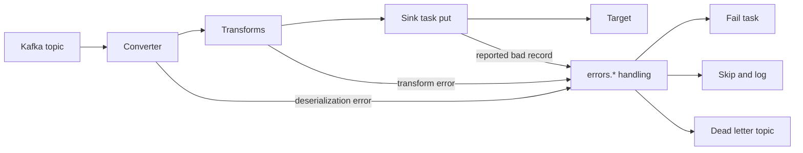

# Error Handling and Dead Letter Queues in Connect

## Introduction

Every pipeline eventually meets a record it cannot handle. A producer writes a message that is not valid JSON. A field that was always a number arrives as a string. A row violates a constraint in the target table. An Elasticsearch mapping rejects a document. And beyond bad records, the systems themselves fail: the database restarts, the network blips, the target throttles.

By default Kafka Connect takes the cautious route: the first problem stops the task, and nothing moves until a human looks. That is the right default for a bank ledger and the wrong one for a clickstream where one malformed click should not block millions of good ones. Connect gives you a set of `errors.*` settings to choose, per connector, between stopping, retrying, skipping and setting aside.

This page explains which failures those settings cover and which they do not, how tolerance, retries and logging interact, how dead letter queue (DLQ) topics work for sink connectors, what context Connect attaches to a dead-lettered record, and how to inspect and replay those records. The scenario compares the policy for a ledger sink with the policy for an analytics sink.

## Kinds of Failure

Not every error is the same, and the right response differs:

| Failure | Example | Typical response |
|---|---|---|
| Transient system error | Database failover, network timeout, HTTP 429 | Retry with backoff; the record is fine |
| Bad record: cannot deserialize | Invalid JSON, unknown Avro schema ID | Skip or dead-letter; retrying never helps |
| Bad record: cannot transform | A transform expects a field that is missing | Skip or dead-letter |
| Bad record: rejected by target | Constraint violation, mapping conflict | Dead-letter if the connector supports it |
| Connector or configuration bug | Wrong credentials, missing table | Fail and alert; every record will fail |

The `errors.*` framework handles failures in the stages Connect itself controls: the converter, the transforms, and (for sources) producing to Kafka. Failures inside a connector's own code, such as writing to the target, are covered only when the connector reports them back through the framework. Transient errors raised as `RetriableException` are retried by the worker; anything else that escapes the connector fails the task.



## Tolerance, Retries and Logging

Four settings decide what happens to a failed record. All are set per connector.

| Setting | Default | Meaning |
|---|---|---|
| `errors.retry.timeout` | `0` | How long to retry a converter, transform or produce step that failed with a retriable error, such as Schema Registry being unreachable; `-1` retries forever |
| `errors.retry.delay.max.ms` | `60000` | Upper bound on the exponential backoff between retries |
| `errors.tolerance` | `none` | `none` fails the task on the first error; `all` skips records that still fail after retries |
| `errors.log.enable` | `false` | Log every error with the task, stage and exception |
| `errors.log.include.messages` | `false` | Also log the record's key, value and headers |

The defaults give fail-fast behaviour: no retries, no tolerance. A safer starting point for most sinks retries briefly before deciding:

```properties
# Retry for up to 5 minutes with backoff capped at 30 s
errors.retry.timeout=300000
errors.retry.delay.max.ms=30000

# Then skip the record instead of failing the task
errors.tolerance=all

# And say so in the worker log
errors.log.enable=true
errors.log.include.messages=false
```

Keep `errors.log.include.messages=false` when records can contain personal or financial data, because the full record ends up in your log platform.

`errors.tolerance=all` on its own is dangerous: it skips silently except for a log line. Without a DLQ or an alert on the `total-records-skipped` metric, a schema change upstream can make a sink drop every record for days while its status says RUNNING.

## Dead Letter Queues for Sink Connectors

A DLQ is a Kafka topic where a sink connector puts records it gave up on, so the pipeline keeps flowing and nothing is lost. Think of the post office's undeliverable mail room: the letter is not thrown away, it is set aside with a note saying why.

```properties
errors.tolerance=all
errors.deadletterqueue.topic.name=dlq.orders-es-sink
errors.deadletterqueue.topic.replication.factor=3
errors.deadletterqueue.context.headers.enable=true
```

A DLQ requires `errors.tolerance=all`. It is available for sink connectors only; a source connector that tolerates errors can only skip and log, because the record never had a Kafka offset to point back to.

The record written to the DLQ is the **original** record as it was consumed, with its raw key and value bytes, not the half-converted version. That is what makes it replayable: once the cause is fixed, the bytes can go through the same pipeline again.

With `errors.deadletterqueue.context.headers.enable=true` (off by default), Connect adds headers explaining the failure:

| Header | Content |
|---|---|
| `__connect.errors.topic`, `__connect.errors.partition`, `__connect.errors.offset` | Where the record came from |
| `__connect.errors.connector.name`, `__connect.errors.task.id` | Which connector and task failed |
| `__connect.errors.stage` | `KEY_CONVERTER`, `VALUE_CONVERTER`, `TRANSFORMATION`, `TASK_PUT` and so on |
| `__connect.errors.class.name` | The converter, transform or connector class involved |
| `__connect.errors.exception.class.name`, `__connect.errors.exception.message`, `__connect.errors.exception.stacktrace` | The error itself |

Records rejected inside the connector's `put()` reach the DLQ only if the connector uses the errant record reporter API (KIP-610). Debezium's JDBC sink, the Elasticsearch sink and most actively maintained sinks do; check your connector's documentation before relying on it. If the connector does not, a target-side rejection fails the task regardless of your `errors.*` settings.

## Inspecting and Replaying the DLQ

Start by reading the headers to see why records failed:

```bash
kafka-console-consumer.sh --bootstrap-server localhost:9092 \
  --topic dlq.orders-es-sink --from-beginning --max-messages 1 \
  --property print.headers=true --property print.key=true
```

```text
__connect.errors.topic:shop.orders,__connect.errors.partition:4,__connect.errors.offset:918233,__connect.errors.connector.name:orders-es-sink,__connect.errors.task.id:1,__connect.errors.stage:VALUE_CONVERTER,__connect.errors.class.name:org.apache.kafka.connect.json.JsonConverter,__connect.errors.exception.class.name:org.apache.kafka.connect.errors.DataException,__connect.errors.exception.message:Converting byte[] to Kafka Connect data failed due to serialization error: ...	1042	{"order_id":1042,"status":"PAID",
```

Here a producer wrote truncated JSON. Group failures by stage and exception class before acting; ten thousand identical errors usually have one cause.

Once the cause is fixed, there are three ways to replay:

1. **Fix the data and re-produce** it to the original topic with a small script or tool. Best when the records themselves were wrong.
2. **Run a replay sink**: a second instance of the same sink connector that reads the DLQ topic. Best when the sink's config or the target was wrong and the records are fine. Give it its own DLQ so failures do not loop.
3. **Discard** with a written record of why, when the data has no value, such as test traffic.

```json
{
  "name": "orders-es-sink-replay",
  "config": {
    "connector.class": "io.confluent.connect.elasticsearch.ElasticsearchSinkConnector",
    "topics": "dlq.orders-es-sink",
    "connection.url": "https://search.internal:9200",
    "key.ignore": "false",
    "schema.ignore": "true",
    "write.method": "upsert",
    "errors.tolerance": "all",
    "errors.deadletterqueue.topic.name": "dlq.orders-es-sink-replay",
    "errors.deadletterqueue.context.headers.enable": "true",
    "transforms": "toOrders",
    "transforms.toOrders.type": "org.apache.kafka.connect.transforms.RegexRouter",
    "transforms.toOrders.regex": ".*",
    "transforms.toOrders.replacement": "shop.orders"
  }
}
```

The `RegexRouter` renames the topic so the replayed documents land in the `shop.orders` index rather than one named after the DLQ. Ordering is not preserved between the DLQ and the main topic, so with upserts a replayed old version could overwrite a newer one. Replays are safest for records whose entities have not changed since, or for sinks that compare versions.

## Source Connectors and Connector-Specific Settings

For source connectors, `errors.tolerance=all` covers converter and transform failures and, since Kafka 3.2, records the producer cannot send, such as a record larger than the topic's `max.message.bytes`. Skipped source records are only logged, so turn on `errors.log.enable` and alert on `total-records-skipped`.

Some connectors add their own layer. Debezium's `event.processing.failure.handling.mode` (default `fail`; also `warn` and `skip`) decides what happens when Debezium cannot parse a change from the database log. Leave it at `fail` for anything that matters: a skipped change event means the downstream copy is silently wrong.

Connect does not restart failed tasks on its own. Restart them with `POST /connectors/NAME/restart?includeTasks=true&onlyFailed=true`, from an alert handler or an operator; Strimzi's `KafkaConnector` resource offers an automatic restart option with backoff.

## Worked Scenario: A Ledger Sink and an Analytics Sink

A bank streams account transactions through a topic `ledger.transactions`. Two sinks read it.

The first writes into the reconciliation database that finance uses to balance the books. A missing transaction is a regulatory problem; a delayed one is an inconvenience. The team keeps `errors.tolerance=none`. The JDBC sink reports transient database errors as retriable, so the worker redelivers the batch and rides out a failover; anything else stops the task. A FAILED task pages the on-call engineer. Stopping is the feature: the reconciliation database is always a correct prefix of the topic, never a copy with holes.

The second writes the same transactions into an analytics store for dashboards. Here a handful of missing records changes nothing, but a stopped pipeline makes dashboards stale for everyone. This sink uses `errors.tolerance=all` with a DLQ and context headers, plus an alert when the DLQ receives more than 100 records in ten minutes.

One morning a new mobile app release sends transactions with `amount` as a string. The analytics sink dead-letters them and keeps going; the alert fires; the app team fixes the release; a replay sink reloads the 4,300 dead-lettered records after a `Cast` transform is added. The ledger sink is unaffected because the reconciliation pipeline uses Avro with a registered schema, and the producer's serializer rejected the bad records before they ever reached Kafka. That contrast, failing at the producer against tolerating at the sink, is a design choice worth making on purpose. For DLQ patterns outside Connect, see [Dead Letter Topics and Retry Topics](../9-kafka-patterns/3-kafka-dead-letter-queues.mdx).

## Common Mistakes

- `errors.tolerance=all` without a DLQ or an alert on skipped records. The pipeline looks healthy while discarding data.
- Expecting a DLQ for a source connector. Sources can only skip and log.
- Assuming target-side rejections go to the DLQ when the connector does not use the errant record reporter; they fail the task instead.
- Leaving `errors.deadletterqueue.context.headers.enable` at its default `false`, so dead-lettered records arrive with no explanation.
- Replaying a DLQ into the same connector with the same DLQ, creating a loop.
- Logging full record contents with `errors.log.include.messages=true` on topics that carry personal data.
- Treating a growing DLQ as normal. Every record in it is a decision someone has not made yet; give each DLQ an owner.

## Summary

- Connect's `errors.*` settings handle failures in converters, transforms, producing (sources) and, when the connector reports them, sink writes.
- The default is fail-fast: no retries and `errors.tolerance=none`. Add `errors.retry.timeout` to ride out transient errors.
- `errors.tolerance=all` skips bad records; pair it with logging, metrics alerts and, for sinks, a dead letter topic.
- DLQ records keep the original bytes; context headers record the source position, stage and exception.
- Replay by fixing data and re-producing, or by running a replay sink over the DLQ with its own DLQ.
- Choose the policy by the data's value: stop the pipeline for a ledger, tolerate and set aside for analytics.

## Further Reading

- [Kafka Connect error reporting](https://kafka.apache.org/documentation/#connect_errorreporting) - the official `errors.*` reference.
- [KIP-298: Error handling in Connect](https://cwiki.apache.org/confluence/display/KAFKA/KIP-298%3A+Error+Handling+in+Connect) - the design of tolerance, retries, logging and the DLQ.
- [KIP-610: Error reporting in sink connectors](https://cwiki.apache.org/confluence/display/KAFKA/KIP-610%3A+Error+Reporting+in+Sink+Connectors) - how connectors send rejected records to the DLQ.
- [KIP-779: Allow source tasks to handle producer exceptions](https://cwiki.apache.org/confluence/display/KAFKA/KIP-779%3A+Allow+Source+Tasks+to+Handle+Producer+Exceptions) - tolerance for records that cannot be produced.
- [Debezium PostgreSQL connector properties](https://debezium.io/documentation/reference/stable/connectors/postgresql.html#postgresql-connector-properties) - `event.processing.failure.handling.mode` and related settings.
- [Designing for Failure](../13-kafka-best-practices/3-kafka-failure-handling-practices.mdx) - failure handling beyond Connect.
