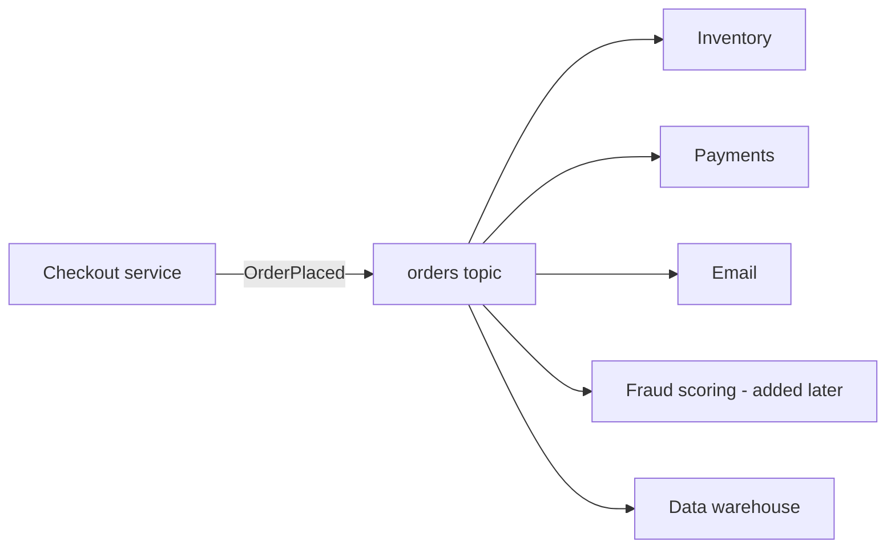
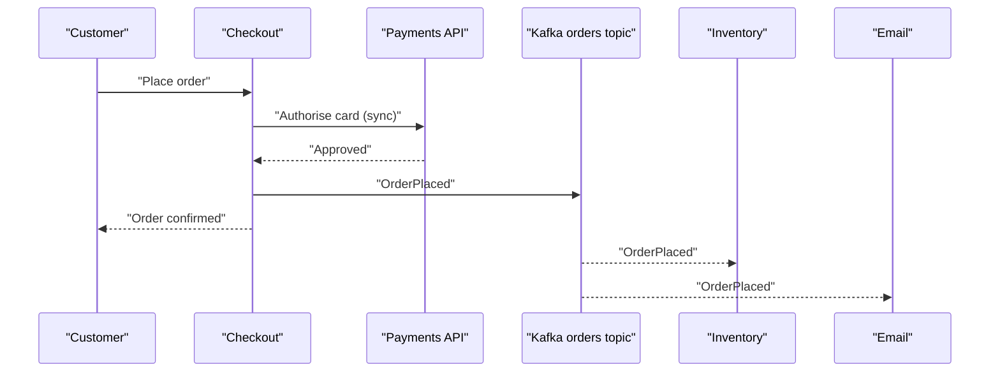

# Event-Driven Architecture with Kafka

## Introduction

Most systems start with services calling each other over HTTP. The checkout service calls inventory, then payments, then shipping, then email, and waits for each one. It works until one of those services is slow or down, and then checkout is slow or down too. Every new feature that needs to know about orders means another call added to checkout, so the busiest code in the company keeps growing.

Event-driven architecture turns this around. Instead of telling other services what to do, a service announces what happened ("order 8812 was placed") and anyone who cares reacts on their own schedule. Kafka is a natural home for those announcements because it stores them durably, in order per key, and lets any number of independent consumers read them at their own pace.

After this page you will be able to tell the three styles of events apart, decide which interactions should stay synchronous, design topics and event contracts for an event-driven system, and recognise the new failure modes that events bring with them. The rest of this section builds on these ideas: the outbox, idempotent consumers, sagas and the others are all answers to problems that appear once you go event-driven.

## Commands, Events and the Direction of Coupling

A command is a request addressed to one receiver: "reserve 2 units of SKU-17". The sender knows who will act and usually needs to know whether it worked. An event is a statement of fact about the past: "order 8812 was placed with 2 units of SKU-17". The sender does not know or care who listens.

The difference is the direction of dependency. With commands, checkout depends on inventory, payments and email; it must know their addresses, their APIs and their availability. With events, those services depend on checkout's event contract, and checkout depends on nothing downstream. Adding a fraud-scoring service tomorrow means deploying a new consumer, not editing and redeploying checkout.

An analogy: a command is a phone call, an event is a notice pinned on a board. The phone call gets you an immediate answer but both people must be free at the same moment. The notice can be read by anyone, any time, and the writer can go home.



## Three Styles of Events

Not all events carry the same amount of information, and the choice has big consequences.

**Event notification.** The event says that something changed and little else: `{"type":"OrderPlaced","orderId":"8812"}`. Consumers who need details call back to the order service. Events stay small and the schema rarely changes, but you have quietly reintroduced runtime coupling: if the order service is down, every consumer stalls on its callback, and a burst of events becomes a burst of API calls against the producer.

**Event-carried state transfer.** The event carries everything a typical consumer needs: customer ID, line items, prices, shipping address. Consumers never call back; they can keep their own local copy of the data they care about. This is the style that delivers the decoupling people expect from events, at the cost of larger messages and a schema that must be evolved carefully.

**Event sourcing.** The events are not a side effect of the state, they are the state. The current order is computed by replaying every event for it. This is a much bigger commitment and gets its own page: [Event Sourcing and CQRS](./2-kafka-event-sourcing-and-cqrs.mdx).

| Style | Event size | Consumer calls back? | Runtime coupling | Typical use |
|---|---|---|---|---|
| Notification | Tiny | Yes | Medium | Cache invalidation, "something changed, go look" |
| State transfer | Medium to large | No | Low | Most service-to-service integration |
| Event sourcing | Medium | No | Low | Ledgers, audit-heavy domains |

For most teams the default should be event-carried state transfer, with the payload shaped around what consumers need rather than a dump of the producer's database row.

## When to Stay Synchronous

Events are not a replacement for every call. A request belongs on a synchronous path when the caller cannot proceed without the answer and a human is waiting for it. "Is this username taken?" and "what is the price of this cart?" are queries; putting them on Kafka gives you a slower, more complex HTTP call. [Request-Reply over Kafka](./5-kafka-request-reply.mdx) covers the narrow cases where that trade is worth it.

A useful test: if the right answer to "what should happen when the downstream service is down for ten minutes?" is "the user sees an error", stay synchronous. If the answer is "it should catch up later", publish an event.

In practice the two coexist. In our order system, checkout calls payments synchronously to authorise the card, because the customer is staring at a spinner. Everything after that (reserving stock, sending the confirmation email, updating loyalty points, feeding analytics) happens through events.

## Designing Topics and Event Contracts

**Topic per event stream, not per consumer.** Name topics after the business fact, owned by the producing team: `orders.order-placed.v1` or simply `orders` with an event type field. Never create `orders-for-email`; that bakes a consumer into the producer and brings back the coupling you were trying to remove.

**One topic or many?** Put events that must be read in order relative to each other into the same topic with the same key. `OrderPlaced`, `OrderPaid` and `OrderCancelled` for one order must not be processed out of order, so they belong in one `orders` topic keyed by order ID. Unrelated facts (customer profile changes, say) go elsewhere. [Ordering Guarantees and Message Keys](../2-kafka-topics-and-storage/1-kafka-ordering-and-keys.mdx) explains why ordering only holds within a partition.

**Key by the entity.** The key decides the partition. Keying order events by `orderId` keeps each order's history in order and spreads load evenly. Keying by `customerId` would keep a customer's orders in order but risk hot partitions for large business customers.

**Make the contract explicit.** An event schema is a public API. Register it in a schema registry with a compatibility rule so that a producer cannot ship a change that breaks consumers. See [Schema Evolution and Compatibility Rules](../6-kafka-schemas/4-kafka-schema-evolution.mdx).

**Put metadata in headers.** Event ID, event type, the time it occurred, the producing service and a correlation ID are useful to every consumer and to tracing tools. Headers keep them separate from the business payload.

Here is a producer for the order system using event-carried state transfer:

```java
import org.apache.kafka.clients.producer.*;
import org.apache.kafka.common.serialization.StringSerializer;
import java.nio.charset.StandardCharsets;
import java.time.Instant;
import java.util.Properties;
import java.util.UUID;

public class OrderEventPublisher {
    public static void main(String[] args) {
        Properties props = new Properties();
        props.put(ProducerConfig.BOOTSTRAP_SERVERS_CONFIG, "localhost:9092");
        props.put(ProducerConfig.KEY_SERIALIZER_CLASS_CONFIG, StringSerializer.class.getName());
        props.put(ProducerConfig.VALUE_SERIALIZER_CLASS_CONFIG, StringSerializer.class.getName());
        // acks=all and idempotence are the defaults since Kafka 3.0; set them to make intent visible
        props.put(ProducerConfig.ACKS_CONFIG, "all");
        props.put(ProducerConfig.ENABLE_IDEMPOTENCE_CONFIG, "true");

        try (Producer<String, String> producer = new KafkaProducer<>(props)) {
            String orderId = "8812";
            // The payload carries what consumers need, so nobody has to call back
            String payload = """
                {"orderId":"8812","customerId":"c-301","currency":"EUR",
                 "lines":[{"sku":"SKU-17","qty":2,"unitPrice":19.90}],
                 "shipTo":{"country":"DE","postcode":"10115"}}
                """;
            ProducerRecord<String, String> record = new ProducerRecord<>("orders", orderId, payload);
            record.headers()
                  .add("event-id", UUID.randomUUID().toString().getBytes(StandardCharsets.UTF_8))
                  .add("event-type", "OrderPlaced".getBytes(StandardCharsets.UTF_8))
                  .add("occurred-at", Instant.now().toString().getBytes(StandardCharsets.UTF_8));

            producer.send(record, (meta, ex) -> {
                if (ex != null) ex.printStackTrace();
                else System.out.printf("OrderPlaced -> %s-%d@%d%n", meta.topic(), meta.partition(), meta.offset());
            });
        }
    }
}
```

```text
OrderPlaced -> orders-4@1187
```

## Worked Scenario: Untangling a Checkout Service

An online shop's checkout endpoint made five HTTP calls in sequence: payments, inventory, email, loyalty and analytics. Median latency was 900 ms. During a marketing email blast, the email provider throttled the email service, its calls timed out after 5 seconds, and checkout requests piled up until the load balancer started returning 503s. The shop lost orders because a non-essential confirmation email was slow.

The team kept one synchronous call, card authorisation, and replaced the rest with a single `OrderPlaced` event on the `orders` topic.



Each downstream service got its own consumer group, so each tracks its own position in the topic. Checkout latency fell to about 250 ms. The next time the email provider throttled, the email consumer's lag grew to forty minutes and then drained. Nobody outside the email team noticed.

The team also had to solve problems that did not exist before:

- **Writing the order and publishing the event atomically.** If checkout saves the order and crashes before publishing, the order exists but nobody hears about it. They adopted the [Transactional Outbox Pattern](./1-kafka-outbox-pattern.mdx).
- **Duplicates.** Kafka's consumers deliver at least once by default, so the email service must not send two confirmations. See [Idempotent Consumers and Deduplication](./4-kafka-idempotent-consumers.mdx).
- **Poison messages.** One malformed event must not block all email forever. See [Dead Letter Topics and Retry Topics](./3-kafka-dead-letter-queues.mdx).
- **Out-of-stock after payment.** Inventory can now fail after the customer saw "confirmed". The business process needs compensation, which is a saga: [Sagas and Long-Running Workflows](./6-kafka-sagas.mdx).

The alternative they considered was keeping HTTP and adding a circuit breaker plus a background job queue for email. That would have fixed the specific outage but not the coupling: every new consumer would still be a code change in checkout. Kafka won because the analytics, fraud and loyalty teams could subscribe without asking.

They also considered RabbitMQ, which would have handled the fan-out well. Kafka was chosen because the data team wanted to replay months of order events into new models, and a retained log supports that while a queue that deletes on acknowledgement does not. If you only need task distribution, compare with [RabbitMQ](/docs/middleware/rabbitmq).

## The Costs You Take On

Event-driven systems trade one kind of complexity for another, and it is worth being honest about the bill.

**Eventual consistency.** After checkout returns, the inventory count is briefly stale. Screens that read across services must tolerate that, and support staff need to understand it.

**Harder debugging.** There is no single stack trace for "why did this order not ship". You need correlation IDs carried in headers through every hop, and tracing that follows them. Consumer lag becomes a first-class metric.

**Implicit flows.** In a request chain the flow is written down in one place. With events it is spread across every subscriber, and nobody may know the full picture. Keep a catalogue of topics, producers and consumers, and consider orchestration for flows that must be visible as a whole.

**Contract discipline.** A field renamed by the producer breaks consumers you have never met. Schemas and compatibility checks are not optional at scale.

## Common Mistakes

- Publishing "events" that are really commands in disguise (`SendWelcomeEmail`), which couples the producer to one consumer's job.
- Using event notification everywhere, then watching every consumer hammer the producer's API with callbacks after each event.
- Leaking the producer's database schema as the event schema, so every table refactor breaks downstream teams.
- Writing to the database and to Kafka as two separate steps without an outbox, and losing events on crashes.
- Choosing keys without thinking about ordering, so `OrderCancelled` is processed before `OrderPlaced`.
- Moving user-facing queries onto Kafka and making them slower and harder to reason about than the HTTP call they replaced.
- Forgetting that every consumer must be safe to run twice on the same event.

## Summary

- Events state facts about the past; commands ask one receiver to act. Events reverse the direction of coupling.
- Prefer event-carried state transfer so consumers never need to call the producer back.
- Keep synchronous calls for answers a user is waiting for; publish events for work that can catch up later.
- Name topics after business facts, key by the entity whose order matters and treat the schema as a public API.
- Going event-driven brings eventual consistency, duplicates, poison messages and dual-write risk; the rest of this section addresses each one.

## Further Reading

- [Apache Kafka documentation: Use cases](https://kafka.apache.org/uses) - the project's own list of event-driven workloads.
- [Apache Kafka documentation](https://kafka.apache.org/documentation/) - design section on the log, consumer groups and ordering.
- [Martin Fowler: What do you mean by "Event-Driven"?](https://martinfowler.com/articles/201701-event-driven.html) - the origin of the notification, state transfer and event sourcing distinction.
- [Kafka Connect Introduction](../8-kafka-connect/0-kafka-connect-introduction.mdx) - moving events between Kafka and other systems without custom code.
