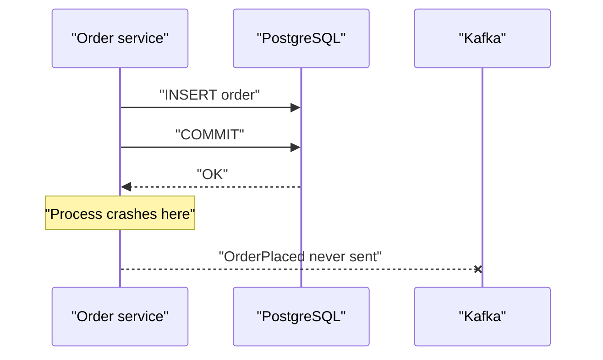
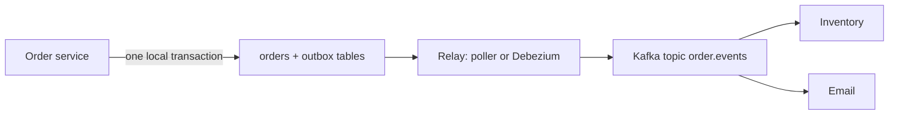

# The Transactional Outbox Pattern

## Introduction

A service that saves something to its database and then announces it on Kafka is doing two writes to two systems. There is no transaction that spans PostgreSQL and a Kafka cluster, so sooner or later one write succeeds and the other does not. The order is saved but the `OrderPlaced` event never goes out, or the event goes out for an order that was rolled back. This is called the dual-write problem, and it is the most common source of "missing events" in event-driven systems.

The transactional outbox fixes it by turning two writes into one. The service writes the business row and an event row into the same database, in the same local transaction. A separate process then copies event rows from that outbox table to Kafka. Either both rows exist or neither does, and the copy step can retry until it succeeds.

After this page you will be able to explain exactly where dual writes fail, design an outbox table, choose between a polling publisher and change data capture with Debezium, and handle the duplicates and ordering issues the pattern leaves for you.

## Where Dual Writes Fail

Consider the obvious code:

```java
@Transactional
public void placeOrder(Order order) {
    orderRepository.save(order);                 // write 1: database
    kafkaTemplate.send("orders", order.id(), toJson(order)); // write 2: Kafka
}
```

There are several ways this goes wrong.

1. **Crash between the two writes.** The database commit happens when the method returns, but if the process is killed after `send` was queued and before the producer flushed, the event is lost while the order commits. Reverse the order and you get the opposite failure.
2. **Rollback after send.** If the database transaction fails at commit (a constraint violation, a deadlock, a lost connection), the event is already on its way to Kafka. Consumers now react to an order that does not exist.
3. **Kafka unavailable.** If the broker is unreachable, you must choose between failing the user's request because of a messaging outage or saving the order and silently dropping the event.

Moving the send to after commit only changes which failure you get. Wrapping both in a distributed two-phase commit (XA) is not an option either: Kafka does not take part in XA transactions, and even where XA is available it is slow and fragile.



## The Outbox Idea

Instead of sending to Kafka, the service inserts an event row into an `outbox` table in the same transaction as the business change. A relay process reads the outbox and publishes to Kafka. Because the business row and the event row commit together, there is no window in which one exists without the other.



A good outbox table looks like this. The column names match the defaults of Debezium's outbox router, which saves configuration later.

```sql
CREATE TABLE outbox (
    id            UUID         PRIMARY KEY,      -- event ID, becomes a header; consumers dedupe on it
    aggregatetype VARCHAR(255) NOT NULL,         -- e.g. 'order'; decides the target topic
    aggregateid   VARCHAR(255) NOT NULL,         -- e.g. the order ID; becomes the Kafka key
    type          VARCHAR(255) NOT NULL,         -- e.g. 'OrderPlaced'
    payload       JSONB        NOT NULL,
    created_at    TIMESTAMPTZ  NOT NULL DEFAULT now()
);
```

And the service code becomes a single transaction with two inserts:

```java
@Transactional
public void placeOrder(Order order) {
    orderRepository.save(order);
    outboxRepository.save(new OutboxEvent(
        UUID.randomUUID(),
        "order",                 // aggregatetype
        order.id(),              // aggregateid -> Kafka key, keeps one order's events in order
        "OrderPlaced",
        toJson(order)));
    // No Kafka call here. If the commit fails, neither row exists.
}
```

The service no longer depends on Kafka being up to accept orders. If the cluster is down for ten minutes, events accumulate in the outbox and flow out when it returns.

## Relay Option 1: A Polling Publisher

The simplest relay is a scheduled job that selects unpublished rows, sends them, and marks them done.

```java
@Scheduled(fixedDelay = 500)
@Transactional
public void relay() {
    // SKIP LOCKED lets several relay instances run without picking the same rows
    List<OutboxEvent> batch = jdbc.query("""
        SELECT id, aggregatetype, aggregateid, type, payload
        FROM outbox
        ORDER BY created_at
        LIMIT 500
        FOR UPDATE SKIP LOCKED
        """, outboxRowMapper);

    for (OutboxEvent e : batch) {
        ProducerRecord<String, String> rec =
            new ProducerRecord<>("order.events", e.aggregateId(), e.payload());
        rec.headers().add("id", e.id().toString().getBytes(StandardCharsets.UTF_8));
        rec.headers().add("type", e.type().getBytes(StandardCharsets.UTF_8));
        producer.send(rec);
    }
    producer.flush();   // wait until Kafka has acknowledged every record in the batch
    jdbc.batchUpdate("DELETE FROM outbox WHERE id = ?",
        batch.stream().map(e -> new Object[]{e.id()}).toList());
}
```

Polling is easy to understand and needs no extra infrastructure. Its weaknesses are latency (bounded by the poll interval), extra load on the database, and ordering subtleties: `created_at` from concurrent transactions does not reflect commit order, so two events for the same order committed close together can be read in the wrong order if they were written by different transactions. Running several pollers with `SKIP LOCKED` also allows events for one aggregate to be published by different instances in parallel. If per-key order matters, either run a single active poller or partition the work by `aggregateid`.

## Relay Option 2: Change Data Capture with Debezium

The more robust relay reads the database's own transaction log (the PostgreSQL write-ahead log, the MySQL binlog) instead of querying the table. Debezium, running as a Kafka Connect source connector, sees every committed insert into `outbox` in commit order and with very low latency. Its outbox event router transform turns each row into a clean Kafka record: the topic comes from `aggregatetype`, the key from `aggregateid`, the value from `payload`, and the event `id` goes into a header.

```json
{
  "name": "orders-outbox",
  "config": {
    "connector.class": "io.debezium.connector.postgresql.PostgresConnector",
    "database.hostname": "orders-db",
    "database.port": "5432",
    "database.user": "debezium",
    "database.password": "${file:/secrets/db.properties:password}",
    "database.dbname": "orders",
    "topic.prefix": "ordersdb",
    "plugin.name": "pgoutput",
    "table.include.list": "public.outbox",
    "tombstones.on.delete": "false",
    "transforms": "outbox",
    "transforms.outbox.type": "io.debezium.transforms.outbox.EventRouter",
    "transforms.outbox.route.by.field": "aggregatetype",
    "transforms.outbox.route.topic.replacement": "${routedByValue}.events",
    "transforms.outbox.table.field.event.key": "aggregateid",
    "transforms.outbox.table.fields.additional.placement": "type:header:type",
    "transforms.outbox.table.expand.json.payload": "true",
    "value.converter": "org.apache.kafka.connect.json.JsonConverter",
    "value.converter.schemas.enable": "false"
  }
}
```

With `route.topic.replacement` set to `${routedByValue}.events`, rows with `aggregatetype = 'order'` land in `order.events`. Because Debezium reads the log, the service can even delete the outbox row in the same transaction it inserted it: the insert is still in the log, and the table never grows. Otherwise, a small cleanup job deletes rows older than a day.

[Change Data Capture with Debezium](../8-kafka-connect/5-kafka-connect-debezium-cdc.mdx) covers connector setup, replication slots and snapshots in depth.

| | Polling publisher | Debezium CDC |
|---|---|---|
| Extra infrastructure | None | Kafka Connect cluster, DB replication permissions |
| Latency | Poll interval, typically 100 ms to seconds | Tens of milliseconds |
| Database load | Repeated queries and deletes | Reads the log; near zero query load |
| Ordering | Needs care with concurrent commits | Commit order from the log |
| Failure modes | Poller stuck or slow | Replication slot lag can fill the DB disk |
| Best fit | Small teams, low volume, no Connect yet | Many services, high volume, strict ordering |

## Worked Scenario: A Payments Ledger That Lost Refund Events

A fintech's refund service wrote a `refunds` row and then published `RefundIssued` so the ledger service could post the accounting entry. Once a month, reconciliation found refunds with no ledger entry. The cause was always the same: a pod evicted by Kubernetes between commit and send, or a broker leader election that made the send time out after commit. Each missing entry was a manual ticket for the finance team.

The team rejected three alternatives. Sending to Kafka first and then committing produced ledger entries for refunds that had rolled back, which is worse. Kafka transactions do not help, because they make writes atomic across Kafka partitions, not across Kafka and PostgreSQL. A nightly reconciliation job that re-published missing events would have reduced the damage but left a window of up to a day in which the ledger was wrong.

They introduced an `outbox` table and a Debezium connector with the event router. The refund service's code got simpler: no producer, no retry logic, no Kafka client at all. After the change, reconciliation found zero missing entries. It did find a handful of duplicated ones in the first week, when the Connect worker restarted before committing its source offsets and replayed a few seconds of log. The ledger consumer had to become idempotent, keyed on the event ID header, which leads to the main caveat of this pattern.

:::warning
The outbox guarantees at-least-once publishing, not exactly-once. A relay can always publish a row and crash before recording that it did, so the same event can appear twice. Every consumer of outbox events must deduplicate, usually on the event ID. See [Idempotent Consumers and Deduplication](./4-kafka-idempotent-consumers.mdx).
:::

## Variations and Related Patterns

**Listen to yourself.** Some teams avoid the outbox by publishing to Kafka first and having the service consume its own event to update the database. This makes Kafka the source of truth and is a step towards event sourcing. It works, but the service cannot read its own write immediately, which complicates request handling.

**Plain CDC on business tables.** Debezium can stream the `orders` table directly, without an outbox. That is fine for replicating data into a search index or warehouse, but it leaks the table schema as the event contract and gives you row changes, not business events. "Status column changed from 2 to 5" is not as useful as `OrderShipped`. The outbox lets you design the event deliberately.

**The inbox.** The mirror image on the consumer side: store the incoming event ID in an `inbox` table in the same transaction as the business change, to dedupe and to make processing atomic with consumption.

## Common Mistakes

- Calling Kafka inside a database transaction and believing that `@Transactional` covers both.
- Using a random key, or no key, for outbox records, which destroys per-aggregate ordering on the topic.
- Running several polling relays in parallel without thinking about per-key ordering.
- Never cleaning the outbox table, so it grows to hundreds of millions of rows and slows every insert.
- Forgetting that a PostgreSQL replication slot keeps WAL until Debezium reads it; a stopped connector can fill the database disk. Monitor slot lag.
- Treating the outbox as exactly-once and skipping consumer-side deduplication.
- Putting huge payloads in the outbox when a reference and a smaller event would do.

## Summary

- A database write followed by a Kafka send is two writes with no shared transaction; crashes and rollbacks lose or invent events.
- The outbox writes the event into the same database transaction as the business change, so they commit together.
- A relay copies outbox rows to Kafka: a polling job is simple, Debezium CDC is faster, cheaper on the database and preserves commit order.
- Key outbox records by aggregate ID to keep each entity's events in order.
- The pattern gives at-least-once delivery; consumers must deduplicate on the event ID.

## Further Reading

- [Debezium Outbox Event Router](https://debezium.io/documentation/reference/stable/transformations/outbox-event-router.html) - reference for the SMT, its options and defaults.
- [Debezium PostgreSQL connector](https://debezium.io/documentation/reference/stable/connectors/postgresql.html) - replication slots, `pgoutput` and snapshot modes.
- [Apache Kafka documentation: Kafka Connect](https://kafka.apache.org/documentation/#connect) - how source connectors track offsets.
- [Transactions and Exactly-Once Producing](../3-kafka-producers/7-kafka-transactions.mdx) - what Kafka transactions do and do not cover.
