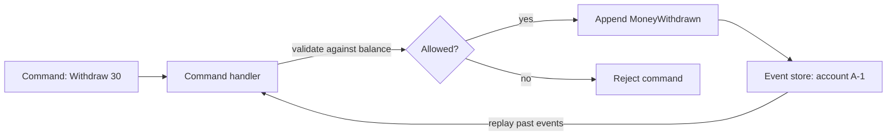
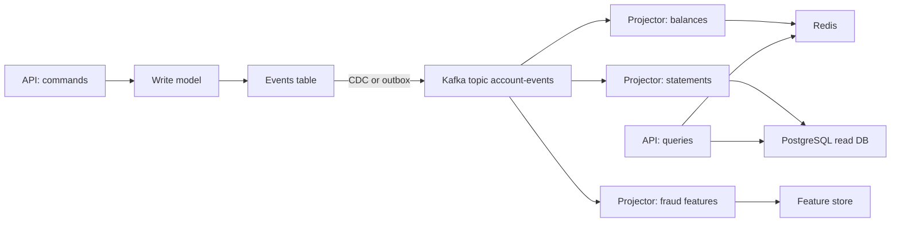

# Event Sourcing and CQRS

## Introduction

Most applications store the current state of things: the account balance is 120, the order status is SHIPPED. When the state changes, the old value is overwritten. Event sourcing stores the changes instead: deposited 100, withdrew 30, deposited 50. The current state is whatever you get when you replay those events from the beginning. A bank statement is the everyday example: the balance at the bottom is derived from the list of transactions above it, and nobody would accept a bank that only kept the balance.

CQRS, Command Query Responsibility Segregation, is the companion idea: use one model to handle writes (commands) and separate, purpose-built models to answer reads (queries). Event sourcing makes CQRS natural, because once you have a stream of events you can build as many read models from it as you like.

Kafka is often mentioned in the same breath as event sourcing, and it is a superb tool for half of the job and a poor tool for the other half. After this page you will understand both patterns, know which half Kafka should play, be able to build a read model from a topic, and judge whether your domain needs event sourcing at all.

## Event Sourcing in One Picture

An aggregate (an account, an order, a shopping cart) is the unit of consistency. In an event-sourced system, handling a command means three steps: load the aggregate's past events, replay them to rebuild its current state, and decide whether the command is allowed. If it is, append one or more new events. The events are immutable and the append is the only write.



What you gain:

- **A perfect audit trail.** Every change is recorded with why it happened, not just the result.
- **Time travel.** You can compute the state at any past moment, which regulators and debuggers both love.
- **New views of old data.** A new report can be built by replaying history, including events from before the report existed.
- **Natural integration.** The events are already there for other services to consume.

What it costs: a different programming model, schema evolution of events that live forever, more moving parts, and the eventual consistency of read models.

## The Hard Requirement: Optimistic Concurrency per Aggregate

The step that trips people up is the append. Two withdrawal commands for account A-1 arrive at the same time on two instances. Both load the same history (balance 50), both decide a withdrawal of 40 is fine, both append. The balance is now -30, and the rule "no overdraft" was broken although each handler checked it.

An event store prevents this with an expected-version check: "append this event to stream A-1 only if its last version is still 17". The second writer gets a conflict, reloads and re-validates. That check is the single most important feature of an event store.

Kafka does not have it. A producer cannot say "append to this partition only if the last offset for key A-1 is X". Topics are also not organised per aggregate: one partition holds millions of aggregates, so loading one account's history means scanning a whole partition, and there is no index by key.

| Event store requirement | Dedicated store (EventStoreDB, a SQL events table) | Kafka topic |
|---|---|---|
| Append with expected version | Yes | No |
| Read one aggregate's events quickly | Yes, stream per aggregate | No, scan the partition |
| Millions of small streams | Yes | Not as topics; partitions are coarse |
| Fan-out to many consumers | Limited, often polling | Excellent |
| Retain and replay at high throughput | Moderate | Excellent |

The practical consequence: in most event-sourced systems the authoritative event store is a database (a table with a unique constraint on `(aggregate_id, version)` is enough to start), and Kafka distributes those events to everything else. The [Transactional Outbox Pattern](./1-kafka-outbox-pattern.mdx), or CDC on the events table itself, connects the two.

:::note
There is a way to use Kafka itself as the write side safely: route all commands for an aggregate to a single-threaded owner. Partition commands by aggregate ID and let a Kafka Streams application, which owns that partition exclusively, validate them against a local state store and emit events. Only one processor ever handles a given account, so there is no concurrent append. This works well, but it is a bigger architectural commitment than an events table.
:::

## CQRS: Separate Models for Reading and Writing

Even without event sourcing, write and read needs often pull in opposite directions. The write side wants a normalised model that enforces rules. The read side wants denormalised, pre-joined data shaped for each screen: "orders by customer, newest first, with product names" for the account page, "revenue per hour by region" for the dashboard, full-text search for support.

CQRS gives each need its own store. The write model emits events; projectors consume them and update read models.



Kafka is excellent here. Each projector is a consumer group with its own offsets, so one slow projector does not hold up the others. A new read model starts from offset zero and catches up. A buggy projector can be fixed, its read store dropped, and its offsets reset to rebuild from scratch. That ability to rebuild is the reason to keep events in Kafka with long or infinite retention (`retention.ms=-1`), or with tiered storage to keep it affordable.

## Building a Read Model with Kafka Streams

Kafka Streams can turn an event stream into a continuously updated table. Here, a balance read model aggregates `MoneyDeposited` and `MoneyWithdrawn` events into a state store, and also writes the result to a compacted topic that other services can consume.

```java
import org.apache.kafka.common.serialization.Serdes;
import org.apache.kafka.streams.*;
import org.apache.kafka.streams.kstream.*;
import java.util.Properties;

public class BalanceProjection {
    public static void main(String[] args) {
        Properties props = new Properties();
        props.put(StreamsConfig.APPLICATION_ID_CONFIG, "balance-projection");
        props.put(StreamsConfig.BOOTSTRAP_SERVERS_CONFIG, "localhost:9092");
        props.put(StreamsConfig.PROCESSING_GUARANTEE_CONFIG, StreamsConfig.EXACTLY_ONCE_V2);

        StreamsBuilder builder = new StreamsBuilder();
        // Key = account ID, value = signed amount in cents, e.g. "+10000" or "-3000"
        KStream<String, String> events =
            builder.stream("account-events", Consumed.with(Serdes.String(), Serdes.String()));

        KTable<String, Long> balances = events
            .mapValues(v -> Long.parseLong(v))          // "+10000" parses to 10000
            .groupByKey(Grouped.with(Serdes.String(), Serdes.Long()))
            .reduce(Long::sum, Materialized.as("balances-store"));

        // Publish the latest balance per account to a compacted topic
        balances.toStream().to("account-balances", Produced.with(Serdes.String(), Serdes.Long()));

        KafkaStreams streams = new KafkaStreams(builder.build(), props);
        Runtime.getRuntime().addShutdownHook(new Thread(streams::close));
        streams.start();
    }
}
```

Create the output topic as compacted so it keeps only the latest balance per account, forever:

```bash
kafka-topics.sh --bootstrap-server localhost:9092 --create \
  --topic account-balances --partitions 6 --replication-factor 3 \
  --config cleanup.policy=compact
```

Compaction works like a snapshot of the latest state per key, while the original `account-events` topic keeps the full history. [Retention and Log Compaction](../2-kafka-topics-and-storage/3-kafka-retention-and-compaction.mdx) explains the mechanics, and [Stateful Operations and State Stores](../7-kafka-streams/3-kafka-streams-stateful-operations.mdx) covers the state store side.

## Worked Scenario: A Wallet Service

A mobile wallet company needed three things regulators kept asking for: proof of every balance change, the ability to answer "what was this customer's balance on 3 March at 14:00", and fraud models trained on full transaction history.

Their first design stored `balance` in a `wallets` table and wrote an `audit_log` row on each update. Audits found gaps: a hotfix script had updated balances directly, bypassing the audit code. The audit log was a second source of truth that could disagree with the first.

They moved to event sourcing for the wallet aggregate only. The write side is a PostgreSQL `wallet_events` table with a unique constraint on `(wallet_id, version)`. A command handler loads a wallet's events (with a snapshot every 500 events to keep loading fast), validates, and inserts the new event with the next version. A concurrent writer hits the unique constraint and retries. Debezium streams `wallet_events` into a Kafka topic keyed by wallet ID with infinite retention.

From that topic, independent consumers build a Redis balance cache for the app, a PostgreSQL statement database for the history screen, and a feature pipeline for fraud. When the fraud team needed a new feature ("number of top-ups in the last hour before each transfer"), they replayed two years of events into a new projection over a weekend.

The alternatives they rejected: using Kafka as the only event store failed the concurrency requirement, because two app instances could both approve withdrawals against the same balance. EventStoreDB was a strong candidate, but the team already ran PostgreSQL with good backups and tooling, and a single events table met their scale. Plain CRUD with better audit triggers was the cheapest option, but it could not give them replayable history for the fraud team.

They deliberately did not event-source everything. The customer profile, notification preferences and product catalogue stayed plain CRUD tables, because nobody needed their history and the extra complexity bought nothing.

## When Not to Use Event Sourcing

Event sourcing pays off in domains where history is the product: ledgers, wallets, trading, insurance claims, logistics tracking, anything with heavy audit requirements. It is overkill for most CRUD screens. Warning signs that you are adopting it for the wrong reasons:

- Nobody can name a question that needs historical state.
- The team plans to event-source every table in the system.
- The main motivation is "it goes well with Kafka".

CQRS on its own is much cheaper and often enough: keep a normal database for writes, publish events through an outbox, and build read models from them.

## Common Mistakes

- Using a Kafka topic as the write-side event store without a single-writer-per-aggregate design, and losing invariants to concurrent appends.
- Creating one topic per aggregate instance (one per account), which explodes the partition count.
- Setting a short retention on the event topic and later discovering a read model cannot be rebuilt.
- Designing events as generic `FieldChanged` records instead of business facts, which makes replays meaningless.
- Changing event schemas incompatibly; old events live forever and must still deserialize. Upcast old versions on read.
- Expecting read models to be immediately consistent with the write model, and showing users stale data after their own action without handling it.

## Summary

- Event sourcing stores changes, not current state; state is a replay of events.
- An event store needs append-with-expected-version per aggregate. Kafka does not provide it, so the write side is usually a database table or a single-writer Streams design.
- Kafka shines at distributing events to many projectors and at rebuilding read models by replay.
- CQRS separates write and read models; Kafka Streams and compacted topics make building read models straightforward.
- Event-source only the aggregates whose history matters; CQRS with an outbox is often enough.

## Further Reading

- [Martin Fowler: Event Sourcing](https://martinfowler.com/eaaDev/EventSourcing.html) - the classic description of the pattern.
- [Martin Fowler: CQRS](https://martinfowler.com/bliki/CQRS.html) - what CQRS is and when it hurts more than it helps.
- [Kafka Streams documentation](https://kafka.apache.org/documentation/streams/) - KTables, state stores and interactive queries.
- [KStream, KTable and GlobalKTable](../7-kafka-streams/1-kafka-streams-kstream-ktable.mdx) - the stream-table duality that underpins read models.
