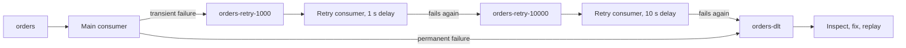

# Dead Letter Topics and Retry Topics

## Introduction

A Kafka consumer processes a partition in order. That is a feature until one record cannot be processed: a malformed JSON payload, a reference to a customer that does not exist, a downstream API that rejects it every time. If the consumer keeps retrying, every record behind it waits. If it skips the record, the data is gone. This single stuck record is called a poison message, and handling it badly is one of the most common causes of Kafka outages in application teams.

Kafka has no built-in dead letter queue for consumers. Unlike RabbitMQ or SQS, the broker does not count delivery attempts or move messages anywhere. Dead letter topics and retry topics are patterns you build in the consumer (or get from a framework such as Spring Kafka), using ordinary topics.

After this page you will be able to separate transient from permanent failures, choose between blocking retries, retry topics and a dead letter topic, implement each with plain Java and with Spring Kafka, and run a safe process for inspecting and replaying dead letters.

## Two Kinds of Failure

Before choosing a mechanism, classify the error. The right handling is completely different.

**Transient failures** will probably succeed if you try again later: a timeout calling the payment provider, a database failover, HTTP 503, a rate limit. Retrying is correct; the question is how long to wait and whether to block while waiting.

**Permanent failures** will fail every time no matter how often you retry: invalid JSON, a missing required field, a schema that cannot be deserialized, a business rule violation such as a negative quantity. Retrying wastes time and blocks the partition. The record should go straight to a dead letter topic for a human or a fix.

| Error | Kind | Handling |
|---|---|---|
| `SerializationException`, bad JSON | Permanent | Dead letter immediately |
| Validation failed, unknown enum value | Permanent | Dead letter immediately |
| HTTP 503, socket timeout, DB failover | Transient | Retry with backoff |
| HTTP 429 rate limited | Transient | Retry with longer backoff |
| HTTP 400 from downstream | Usually permanent | Dead letter |
| Referenced entity not found yet | Often transient (events out of order across topics) | Retry a few times, then dead letter |

## Option 1: Blocking Retries in the Consumer

The simplest approach retries inside the poll loop, with backoff, a few times. While it retries, the partition does not advance.

This is the right default when order matters and failures are short. A bank ledger consumer must not apply transaction 105 before 104, so it is better to pause for a few seconds than to reorder. Keep the total retry time well under `max.poll.interval.ms` (5 minutes by default), or the group coordinator will decide the consumer is dead and trigger a rebalance.

The weakness is obvious when the outage is long: a downstream system that is down for an hour stops the whole partition for an hour, including records that do not even touch that system.

## Option 2: A Dead Letter Topic

When a record fails permanently, or exhausts its retries, the consumer publishes it to a dead letter topic (DLT) and moves on. The DLT is a normal Kafka topic, often named `<topic>.DLT` or `<topic>-dlt`. The original record is copied with its key and value untouched, plus headers explaining what went wrong.

```java
import org.apache.kafka.clients.consumer.*;
import org.apache.kafka.clients.producer.*;
import org.apache.kafka.common.header.Headers;
import java.nio.charset.StandardCharsets;
import java.time.Duration;
import java.util.List;

public class PaymentEventsConsumer {
    private final Consumer<String, String> consumer;
    private final Producer<String, String> dltProducer;

    PaymentEventsConsumer(Consumer<String, String> c, Producer<String, String> p) {
        this.consumer = c;
        this.dltProducer = p;
    }

    void run() {
        consumer.subscribe(List.of("payments"));
        while (true) {
            for (ConsumerRecord<String, String> rec : consumer.poll(Duration.ofMillis(500))) {
                try {
                    processWithRetry(rec, 3);                  // short blocking retries for transient errors
                } catch (PermanentFailure | RetriesExhausted e) {
                    sendToDlt(rec, e);                         // park it and keep the partition moving
                }
            }
            consumer.commitSync();                             // commit only after each record is handled or parked
        }
    }

    private void sendToDlt(ConsumerRecord<String, String> rec, Exception e) {
        ProducerRecord<String, String> dead =
            new ProducerRecord<>("payments.DLT", rec.key(), rec.value());
        Headers h = dead.headers();
        rec.headers().forEach(h::add);                         // keep the original headers (trace IDs, event ID)
        h.add("dlt.original.topic", rec.topic().getBytes(StandardCharsets.UTF_8));
        h.add("dlt.original.partition", Integer.toString(rec.partition()).getBytes(StandardCharsets.UTF_8));
        h.add("dlt.original.offset", Long.toString(rec.offset()).getBytes(StandardCharsets.UTF_8));
        h.add("dlt.exception.class", e.getClass().getName().getBytes(StandardCharsets.UTF_8));
        h.add("dlt.exception.message", String.valueOf(e.getMessage()).getBytes(StandardCharsets.UTF_8));
        // Block until the DLT write is acknowledged; committing past a record we failed to park loses it
        try {
            dltProducer.send(dead).get();
        } catch (Exception sendFailed) {
            throw new IllegalStateException("Could not write to DLT, stopping", sendFailed);
        }
    }

    // processWithRetry, PermanentFailure and RetriesExhausted omitted for brevity
}
```

Two details matter. First, wait for the DLT send to be acknowledged before committing the offset; otherwise a broker hiccup loses the record entirely. Second, carry the original topic, partition, offset and exception as headers so that whoever inspects the DLT can find the context without guessing.

Deserialization errors deserve special care: if the consumer's deserializer throws, your processing code never sees the record. Use a deserializer wrapper that catches the exception and hands you the raw bytes (Spring Kafka's `ErrorHandlingDeserializer` does this), or consume with `ByteArrayDeserializer` and deserialize yourself.

## Option 3: Non-Blocking Retry Topics

For transient failures that may last minutes, there is a middle ground. Instead of retrying in place, the consumer publishes the failed record to a retry topic and moves on. A separate consumer reads the retry topic, waits until the record is old enough, and tries again. After several levels with growing delays, the record lands in the DLT.



The main partition never blocks, so one broken downstream does not stop healthy traffic. The price is ordering: a record that went to retry will be processed after later records for the same key. That is fine for "send a notification" or "index a document", and wrong for "apply a ledger entry".

The delay is implemented by the retry consumer comparing the record timestamp with the current time and pausing the partition (`consumer.pause`) until the record is due, rather than sleeping inside the poll loop.

Spring for Apache Kafka (4.x shown; `@BackOff` lives in `org.springframework.kafka.annotation`) implements the whole thing with one annotation:

```java
import org.springframework.kafka.annotation.*;
import org.springframework.kafka.retrytopic.TopicSuffixingStrategy;
import org.springframework.kafka.support.KafkaHeaders;
import org.springframework.messaging.handler.annotation.Header;
import org.springframework.stereotype.Component;

@Component
public class NotificationListener {

    @RetryableTopic(
        attempts = "4",                                         // 1 original attempt + 3 retries
        backOff = @BackOff(delay = 1000, multiplier = 10.0),   // 1 s, 10 s, 100 s
        exclude = {ValidationException.class},                  // permanent: go straight to the DLT
        topicSuffixingStrategy = TopicSuffixingStrategy.SUFFIX_WITH_INDEX_VALUE)
    @KafkaListener(topics = "notifications", groupId = "notifier")
    public void onEvent(String payload) {
        notificationSender.send(parse(payload));                // throws on failure
    }

    @DltHandler
    public void onDeadLetter(String payload,
                             @Header(KafkaHeaders.DLT_EXCEPTION_MESSAGE) String error) {
        alerts.raise("Notification dead-lettered: " + error);
    }
}
```

With these settings Spring creates `notifications-retry-0`, `notifications-retry-1`, `notifications-retry-2` and `notifications-dlt`. Without the suffixing strategy, the default names include the delay instead, such as `notifications-retry-1000`. For blocking retries with a DLT and no retry topics, Spring's `DefaultErrorHandler` combined with a `DeadLetterPublishingRecoverer` publishes to `<topic>.DLT` by default.

## Choosing an Approach

| | Blocking retries | Retry topics | DLT only |
|---|---|---|---|
| Preserves per-key order | Yes | No | Yes, for records that succeed |
| Partition blocked during outage | Yes | No | No |
| Extra topics | None | Several per source topic | One |
| Complexity | Low | Medium to high | Low |
| Good for | Ledgers, state machines, short blips | Notifications, indexing, webhooks | Validation and deserialization failures |

Most production consumers combine them: a few quick blocking retries for blips, then either retry topics or straight to the DLT.

## Worked Scenario: A Notification Service and a Bad Template

A notification service consumes `notifications` (40 partitions) and sends email and push messages through third-party providers. One morning a marketing team published a campaign with a template that referenced a missing variable. Every event for that campaign threw a rendering exception. The consumer retried forever with a fixed one-second delay, and the partitions that held those events stopped. Password-reset emails, which shared those partitions, were delayed by two hours. Support was flooded.

The fix had three parts. Rendering errors were classified as permanent and sent straight to `notifications-dlt` with the template ID in a header. Provider timeouts and HTTP 5xx responses went through three retry topics at 1 second, 1 minute and 10 minutes, so a provider outage no longer blocked other traffic. Password resets were moved to their own topic with its own consumer group, because their latency requirement was different from marketing's.

The alternatives considered were dropping failed messages after N retries (simple, but a lost password-reset email is a lost customer) and moving to RabbitMQ, which has native dead-lettering and per-message TTL. The team stayed on Kafka because the rest of the pipeline was there and replaying a campaign from the log was valuable, but they acknowledged that if they were only distributing notification jobs, a queue with built-in dead lettering would have been less code. [Queues for Kafka: Share Groups (Preview)](../4-kafka-consumers/7-kafka-share-groups.mdx) describes Kafka's own move towards per-message acknowledgement and delivery counts. The full build of this service is the subject of [Project: A Notification Service with Retries and Dead Letters](../14-kafka-projects/5-kafka-project-notification-service.mdx).

## Operating the Dead Letter Topic

A DLT that nobody watches is just a slower way of losing data.

- **Alert on it.** Any record arriving in a DLT should raise an alert or at least increment a dashboard counter with a threshold.
- **Give it long retention.** Days or weeks, so a holiday weekend does not delete evidence.
- **Make replay a tool, not a script.** Once the bug is fixed, a replay job reads the DLT, optionally filters by exception or time, and republishes the original key and value to the original topic (from the header). Consumers must be idempotent, because a replayed record may already have partially succeeded.
- **Do not replay blindly.** A record that failed validation will fail again; fix the data or the code first.

```bash
# How many records are waiting in the dead letter topic?
kafka-get-offsets.sh --bootstrap-server localhost:9092 --topic notifications-dlt

# Look at the most recent dead letters with their headers
kafka-console-consumer.sh --bootstrap-server localhost:9092 \
  --topic notifications-dlt --from-beginning --max-messages 5 \
  --property print.headers=true --property print.key=true
```

For Kafka Connect pipelines, the framework has built-in DLQ support for sink connectors through `errors.tolerance` and `errors.deadletterqueue.topic.name`; see [Error Handling and Dead Letter Queues in Connect](../8-kafka-connect/6-kafka-connect-error-handling.mdx).

:::warning
Do not send transient failures straight to the DLT "to keep things moving" without a replay process. During a downstream outage you will dead-letter thousands of good records, and someone will have to replay them all by hand.
:::

## Common Mistakes

- Retrying forever in the poll loop, blocking the partition and eventually exceeding `max.poll.interval.ms`.
- Committing the offset before the DLT write is acknowledged, losing the record if the write fails.
- Dead-lettering without headers, so nobody knows where a record came from or why it failed.
- Using retry topics for consumers that require strict per-key ordering.
- Sleeping in the poll loop to implement retry delays instead of pausing partitions.
- Treating deserialization failures as unreachable because the deserializer throws before your code runs.
- Having no alert on the DLT and discovering months of dead letters during an audit.

## Summary

- Kafka has no broker-side DLQ for consumers; dead letter and retry topics are consumer-side patterns.
- Classify errors: retry transient ones, dead-letter permanent ones immediately.
- Blocking retries keep order but stall the partition; retry topics keep traffic flowing but give up order.
- Copy the original key and value to the DLT, add context headers, and wait for the acknowledgement before committing.
- Alert on DLTs, keep them long enough, and replay with a tool once the cause is fixed, into idempotent consumers.

## Further Reading

- [Spring for Apache Kafka: Non-Blocking Retries](https://docs.spring.io/spring-kafka/reference/retrytopic.html) - `@RetryableTopic`, topic naming and DLT handling.
- [Spring for Apache Kafka: Publishing Dead-letter Records](https://docs.spring.io/spring-kafka/reference/kafka/annotation-error-handling.html) - `DefaultErrorHandler` and `DeadLetterPublishingRecoverer`.
- [Apache Kafka documentation: Consumer configs](https://kafka.apache.org/documentation/#consumerconfigs) - `max.poll.interval.ms` and related liveness settings.
- [KIP-932: Queues for Kafka](https://cwiki.apache.org/confluence/display/KAFKA/KIP-932%3A+Queues+for+Kafka) - share groups with per-record acknowledgement and delivery counts.
