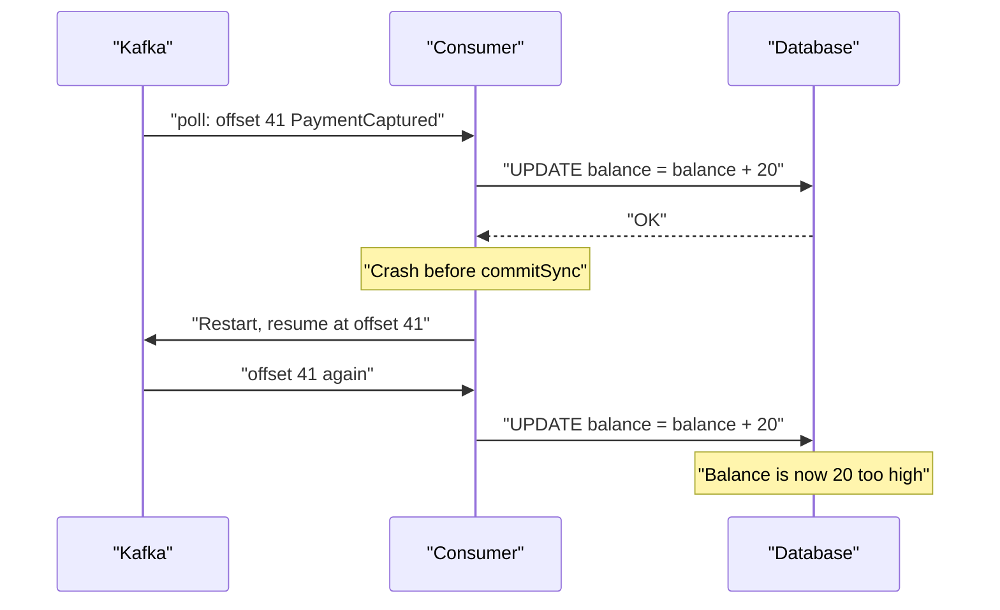

# Idempotent Consumers and Deduplication

## Introduction

Sooner or later every Kafka consumer processes the same record twice. A consumer crashes after charging a card but before committing its offset, restarts, and charges the card again. A rebalance moves a partition to another instance that re-reads the last uncommitted batch. An outbox relay republishes an event after a restart. None of these are bugs in Kafka; they are what at-least-once delivery means.

You cannot make duplicates impossible across the boundary between Kafka and an external system such as a database, an email provider or a payment API. What you can do is make processing a duplicate harmless. An operation is idempotent when doing it twice has the same effect as doing it once. "Set the balance to 120" is idempotent; "add 20 to the balance" is not.

After this page you will be able to list where duplicates come from, choose between natural idempotence, a deduplication table and Kafka transactions, implement each correctly, and avoid the subtle race conditions that make naive deduplication fail.

## Where Duplicates Come From

Duplicates enter at several points, and the fix for one does not fix the others.

| Source | What happens | Fixed by |
|---|---|---|
| Producer retry | Broker wrote the batch but the ack was lost; producer resends | Idempotent producer (on by default since Kafka 3.0) |
| Upstream application | Outbox relay or a user double-click sends the same business event twice | Consumer deduplication on an event ID |
| Consumer crash before commit | Records processed, offset not committed, reprocessed on restart | Idempotent processing or atomic commit |
| Rebalance | Partition revoked mid-batch; new owner starts at last committed offset | Same as above, plus committing on revoke |
| Manual replay | Offsets reset to reprocess history | Idempotent processing |

The idempotent producer, covered in [The Idempotent Producer](../3-kafka-producers/3-kafka-idempotent-producer.mdx), only removes the first row: duplicates created by the producer's own retries within one session. It knows nothing about the business meaning of a record, so it cannot detect that an upstream service sent the same `PaymentRequested` twice. Everything else is the consumer's job.

The core problem is a window between doing the work and recording that it was done:



## Technique 1: Natural Idempotence

The cheapest deduplication is none at all: design the operation so that repeating it is harmless.

- **Upserts instead of inserts.** `INSERT ... ON CONFLICT (order_id) DO UPDATE` writes the same row however often it runs.
- **Absolute values instead of increments.** An event carrying "stock for SKU-17 is now 38" is idempotent; "stock decreased by 2" is not. This is a reason to prefer state-carrying events where you can.
- **Version guards.** Apply an update only if it is newer than what you have: `UPDATE products SET price = ?, version = ? WHERE id = ? AND version < ?`. Replays and old duplicates become no-ops. This also protects against out-of-order delivery.
- **Idempotency keys downstream.** Many payment and email APIs accept an idempotency key header. Pass the event ID; the provider will refuse to act twice.

```sql
-- Search index projection: replaying the same event any number of times leaves one correct row
INSERT INTO product_search (product_id, name, price_cents, source_version)
VALUES (:id, :name, :price, :version)
ON CONFLICT (product_id) DO UPDATE
SET name = EXCLUDED.name,
    price_cents = EXCLUDED.price_cents,
    source_version = EXCLUDED.source_version
WHERE product_search.source_version < EXCLUDED.source_version;
```

When this is possible, prefer it. It needs no extra table, no cleanup and no coordination.

## Technique 2: A Processed-Events Table in the Same Transaction

When the operation is inherently not idempotent (posting a ledger entry, incrementing a counter), record which events you have processed and check before acting. The critical detail is that the record and the business change must commit in the same database transaction. Otherwise you have just moved the window.

Each event needs a stable, unique ID chosen by the producer, usually a UUID in a header or the payload. Do not use the Kafka offset as the ID: a republished or replayed event gets a new offset, and the same offset can carry different data after a topic is recreated.

```sql
CREATE TABLE processed_events (
    consumer_group VARCHAR(100) NOT NULL,
    event_id       UUID         NOT NULL,
    processed_at   TIMESTAMPTZ  NOT NULL DEFAULT now(),
    PRIMARY KEY (consumer_group, event_id)
);
```

```java
import org.apache.kafka.clients.consumer.*;
import java.nio.charset.StandardCharsets;
import java.sql.*;
import java.time.Duration;
import java.util.List;
import java.util.UUID;

public class LedgerConsumer {
    private static final String GROUP = "ledger-poster";

    void run(Consumer<String, String> consumer, Connection db) throws SQLException {
        db.setAutoCommit(false);
        consumer.subscribe(List.of("payments"));
        while (true) {
            ConsumerRecords<String, String> records = consumer.poll(Duration.ofMillis(500));
            for (ConsumerRecord<String, String> rec : records) {
                UUID eventId = UUID.fromString(
                    new String(rec.headers().lastHeader("event-id").value(), StandardCharsets.UTF_8));
                try {
                    // Claim the event first. The primary key makes a concurrent or repeated claim fail.
                    try (PreparedStatement claim = db.prepareStatement(
                            "INSERT INTO processed_events (consumer_group, event_id) VALUES (?, ?) " +
                            "ON CONFLICT DO NOTHING")) {
                        claim.setString(1, GROUP);
                        claim.setObject(2, eventId);
                        if (claim.executeUpdate() == 0) {   // 0 rows: already processed, skip it
                            db.rollback();
                            continue;
                        }
                    }
                    postLedgerEntry(db, rec.value());      // the non-idempotent work, same transaction
                    db.commit();                           // claim and ledger entry commit together
                } catch (SQLException e) {
                    db.rollback();
                    throw e;                               // let the error handler retry or dead-letter
                }
            }
            consumer.commitSync();                         // offsets are now just an optimisation
        }
    }

    private void postLedgerEntry(Connection db, String json) throws SQLException { /* ... */ }
}
```

Notice that the Kafka offset commit has become an optimisation. If the consumer crashes before `commitSync`, it re-reads some records, and each one is skipped by the claim. Correctness lives in the database.

Two subtle points:

- **Insert-then-act, not check-then-act.** A `SELECT` to see whether the event exists, followed by processing, is a race: two instances (say, during a rebalance) can both see "not processed" and both act. Inserting the claim with a unique constraint makes the database arbitrate.
- **Cleanup.** The table grows forever unless you prune it. Keep entries longer than the longest possible redelivery window (retention of the topic plus any replay you might do), then delete old rows in a scheduled job or use table partitioning by day.

## Technique 3: Store the Offset with the Result

A variant of the same idea is to keep the consumer's offsets in your own database instead of in Kafka. Each transaction writes the business change and the new offset for that partition. On startup (and on partition assignment) the consumer reads the stored offset and calls `seek`. Because offset and result commit atomically, every record is applied exactly once to that database.

This works well for a single sink with one consumer group, such as a projection into PostgreSQL. It does not deduplicate events that were published twice upstream, because those arrive at different offsets. Combine it with an event ID check if the producer side can duplicate.

## Technique 4: Kafka Transactions for Kafka-to-Kafka Processing

When the consumer's only output is more Kafka records (read from one topic, transform, write to another), Kafka can do the bookkeeping itself. A transactional producer writes the output records and the consumer's offsets in one atomic transaction; downstream consumers with `isolation.level=read_committed` never see output from aborted attempts. Kafka Streams turns this on with a single setting:

```properties
# Kafka Streams application config
processing.guarantee=exactly_once_v2
```

This is the only true exactly-once path in Kafka, and it stops at the cluster boundary. The moment your consumer calls an HTTP API or writes to a database, the external write is outside the transaction, and you are back to techniques 1 to 3. [Transactions and Exactly-Once Producing](../3-kafka-producers/7-kafka-transactions.mdx) and [Exactly-Once Processing in Kafka Streams](../7-kafka-streams/6-kafka-streams-exactly-once.mdx) cover the details.

:::tip
"Exactly-once" in Kafka marketing means exactly-once effects inside Kafka. For anything that leaves Kafka, aim for at-least-once delivery plus idempotent processing. That combination is what people actually run in production.
:::

## Choosing a Technique

| Technique | Extra storage | Handles upstream duplicates | Works with external side effects | Effort |
|---|---|---|---|---|
| Natural idempotence | None | Yes | Yes, if the operation allows it | Low |
| Processed-events table | One table, needs pruning | Yes | Yes, if side effect is in the same DB | Medium |
| Offset stored with result | Offset table | No | Same DB only | Medium |
| Kafka transactions | None | No | No, Kafka outputs only | Low with Streams |
| Downstream idempotency key | Provider-side | Yes | Yes, for that provider | Low |

## Worked Scenario: Double Loyalty Points

A retailer's loyalty service consumed `OrderPaid` events and inserted a row into `points_ledger` crediting 1 point per euro. During a rolling deploy, consumer instances were stopped every few minutes. Each stop triggered a rebalance, and the partitions moved to another instance that resumed at the last committed offset. Auto-commit ran every 5 seconds, so up to 5 seconds of events were processed twice. Customers noticed doubled points; finance noticed a liability on the balance sheet.

The team first tried committing synchronously after every record. Duplicates dropped but did not vanish, because a crash between the database commit and the offset commit still replayed one record. Throughput also fell sharply. They considered Kafka transactions, but the output was a database row, not a Kafka record, so transactions could not help.

The final design used the `OrderPaid` event's `event-id` header as a deduplication key. The loyalty service inserts into `processed_events` and `points_ledger` in one PostgreSQL transaction, as in the code above, and commits Kafka offsets every few seconds as before. Throughput returned to normal and duplicates went to zero, including the handful caused by the order service's outbox relay restarting. A nightly job deletes `processed_events` rows older than 30 days; the `orders` topic retains 7 days, so a duplicate can never arrive after its record is pruned.

They also changed the event: it now carries the computed points value, so the projection that shows the customer's total became a natural-idempotent upsert of "total points as of order X" in a separate read model.

## Common Mistakes

- Believing `enable.idempotence=true` on the producer makes the consumer side idempotent.
- Deduplicating on the Kafka offset instead of a producer-assigned event ID.
- Check-then-act: selecting to see whether an event was processed and then processing it, racing with another instance.
- Writing the processed-event marker in a different transaction (or a different store, such as Redis) from the business change.
- Never pruning the deduplication table, or pruning it more aggressively than the topic's retention.
- Assuming Kafka transactions cover database writes or HTTP calls made inside the consumer.
- Using increments in event payloads when an absolute value would make the consumer naturally idempotent.

## Summary

- At-least-once delivery means duplicates; aim to make them harmless rather than impossible.
- Natural idempotence (upserts, absolute values, version guards, downstream idempotency keys) is the cheapest fix.
- For non-idempotent work, claim the event ID with a unique constraint in the same transaction as the business change.
- Storing offsets with results gives exactly-once into one database but does not catch upstream duplicates.
- Kafka transactions give exactly-once only for Kafka-to-Kafka processing.

## Further Reading

- [Apache Kafka documentation: Message Delivery Semantics](https://kafka.apache.org/documentation/#semantics) - how at-most-once, at-least-once and exactly-once arise.
- [KIP-98: Exactly Once Delivery and Transactional Messaging](https://cwiki.apache.org/confluence/display/KAFKA/KIP-98+-+Exactly+Once+Delivery+and+Transactional+Messaging) - the design of idempotent and transactional producers.
- [At-Most-Once, At-Least-Once and Exactly-Once](../4-kafka-consumers/4-kafka-delivery-semantics.mdx) - the consumer side of delivery guarantees.
- [Offsets, Commits and Where to Resume](../4-kafka-consumers/3-kafka-offsets-and-commits.mdx) - commit strategies and storing offsets externally.
