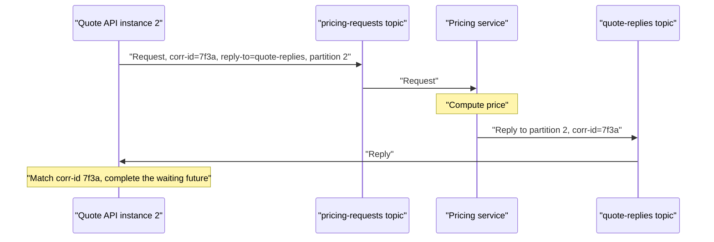

# Request-Reply over Kafka

## Introduction

Kafka is built for one-way messages: a producer writes, consumers read later, and nobody waits. Yet teams regularly need an answer back. A pricing engine must return a quote, a credit check must return approve or decline, a document converter must return the converted file's location. When the rest of the system already talks through Kafka, it is tempting to make these calls over Kafka too.

Request-reply over Kafka works, and frameworks support it, but it is a pattern to choose deliberately. You are building a synchronous call on top of an asynchronous log, and you inherit the latency, partitioning and failure behaviour of both. After this page you will understand how replies find their way back to the right caller, be able to implement it with Spring's `ReplyingKafkaTemplate` and with the plain Java client, and know when a direct HTTP or gRPC call is the better choice.

## The Mechanics: Reply Topics and Correlation IDs

A request-reply exchange over Kafka needs three pieces of information on each request:

1. **A correlation ID.** A unique value the requester generates. The responder copies it onto the reply so the requester can match the reply to the waiting call.
2. **A reply address.** The topic (and optionally the partition) where the requester listens for replies. The responder reads it from a header rather than hard-coding it.
3. **A timeout.** How long the requester waits before giving up. Without it, a lost reply leaks a waiting thread or future forever.



The hard part is getting the reply to the right instance. If the requester runs as six instances, the reply must reach the one that is holding the pending future, not whichever instance happens to own the reply partition. There are three common approaches:

| Approach | How | Trade-off |
|---|---|---|
| Reply partition per instance | Each instance is manually assigned a fixed partition of a shared reply topic and puts its number in a header | Simple and efficient; needs a stable instance-to-partition mapping |
| Reply topic per instance | Each instance creates or owns its own reply topic | Clean isolation; many topics, and cleanup when instances go away |
| Shared group, all instances read all replies | Every instance consumes every reply and discards those it does not recognise | Easy, but wasteful and does not scale |

Using consumer groups on the reply topic usually breaks request-reply: a rebalance can move the partition carrying your reply to another instance, which does not know the correlation ID.

## Implementing It with Spring for Apache Kafka

Spring's `ReplyingKafkaTemplate` handles correlation, reply headers and timeouts. On the requester side:

```java
import org.apache.kafka.clients.producer.ProducerRecord;
import org.springframework.context.annotation.Bean;
import org.springframework.context.annotation.Configuration;
import org.springframework.kafka.core.ProducerFactory;
import org.springframework.kafka.core.ConsumerFactory;
import org.springframework.kafka.listener.ContainerProperties;
import org.springframework.kafka.listener.KafkaMessageListenerContainer;
import org.springframework.kafka.requestreply.ReplyingKafkaTemplate;
import org.springframework.kafka.requestreply.RequestReplyFuture;
import org.springframework.kafka.support.TopicPartitionOffset;
import java.time.Duration;

@Configuration
class ReplyConfig {
    @Bean
    KafkaMessageListenerContainer<String, String> replyContainer(ConsumerFactory<String, String> cf) {
        // This instance listens on its own fixed partition of the shared reply topic
        int myPartition = Integer.parseInt(System.getenv().getOrDefault("REPLY_PARTITION", "0"));
        ContainerProperties props = new ContainerProperties(new TopicPartitionOffset("quote-replies", myPartition));
        return new KafkaMessageListenerContainer<>(cf, props);
    }

    @Bean
    ReplyingKafkaTemplate<String, String, String> replyingTemplate(
            ProducerFactory<String, String> pf, KafkaMessageListenerContainer<String, String> container) {
        ReplyingKafkaTemplate<String, String, String> t = new ReplyingKafkaTemplate<>(pf, container);
        t.setDefaultReplyTimeout(Duration.ofSeconds(2));    // fail fast; callers get a TimeoutException
        return t;
    }
}

// In a controller or service:
// ProducerRecord<String, String> req = new ProducerRecord<>("pricing-requests", cartId, cartJson);
// RequestReplyFuture<String, String, String> future = replyingTemplate.sendAndReceive(req);
// String quote = future.get(2, TimeUnit.SECONDS).value();
```

When the reply container is assigned explicit partitions, the template adds the reply topic and partition headers to each request for you, along with a correlation ID header. On the responder side, `@SendTo` with no value tells Spring to publish the return value to whatever reply topic and partition the request asked for, and to copy the correlation ID:

```java
import org.springframework.kafka.annotation.KafkaListener;
import org.springframework.messaging.handler.annotation.SendTo;
import org.springframework.stereotype.Component;

@Component
class PricingResponder {
    @KafkaListener(topics = "pricing-requests", groupId = "pricing")
    @SendTo   // reply destination comes from the request's headers
    public String price(String cartJson) {
        return pricingEngine.quote(cartJson).toJson();
    }
}
```

The responder is an ordinary consumer group, so it scales horizontally like any other: add instances up to the number of partitions in `pricing-requests`.

## Implementing It with the Plain Java Client

Without Spring the pattern is still short. The requester keeps a map from correlation ID to a `CompletableFuture`, and a background thread consumes the reply partition and completes futures.

```java
import org.apache.kafka.clients.consumer.*;
import org.apache.kafka.clients.producer.*;
import org.apache.kafka.common.TopicPartition;
import java.nio.charset.StandardCharsets;
import java.time.Duration;
import java.util.List;
import java.util.Map;
import java.util.UUID;
import java.util.concurrent.*;

public class KafkaRequester implements AutoCloseable {
    private final Producer<String, String> producer;
    private final Consumer<String, String> replyConsumer;
    private final int replyPartition;
    private final Map<String, CompletableFuture<String>> pending = new ConcurrentHashMap<>();
    private final ExecutorService poller = Executors.newSingleThreadExecutor();
    private final CountDownLatch ready = new CountDownLatch(1);
    private volatile boolean running = true;

    public KafkaRequester(Producer<String, String> p, Consumer<String, String> c, int replyPartition) {
        this.producer = p;
        this.replyConsumer = c;
        this.replyPartition = replyPartition;
        poller.submit(this::pollReplies);                 // the consumer is only ever touched by this thread
        try {
            ready.await(10, TimeUnit.SECONDS);            // do not send requests before we know where replies start
        } catch (InterruptedException e) {
            Thread.currentThread().interrupt();
        }
    }

    public CompletableFuture<String> request(String key, String body, Duration timeout) {
        String corrId = UUID.randomUUID().toString();
        CompletableFuture<String> f = new CompletableFuture<>();
        pending.put(corrId, f);
        f.orTimeout(timeout.toMillis(), TimeUnit.MILLISECONDS);  // completes exceptionally if no reply arrives
        f.whenComplete((r, e) -> pending.remove(corrId));        // always clean up, success or timeout

        ProducerRecord<String, String> rec = new ProducerRecord<>("pricing-requests", key, body);
        rec.headers()
           .add("correlation-id", corrId.getBytes(StandardCharsets.UTF_8))
           .add("reply-topic", "quote-replies".getBytes(StandardCharsets.UTF_8))
           .add("reply-partition", Integer.toString(replyPartition).getBytes(StandardCharsets.UTF_8));
        producer.send(rec, (m, ex) -> { if (ex != null) f.completeExceptionally(ex); });
        return f;
    }

    private void pollReplies() {
        // assign, not subscribe: no consumer group rebalance can take our replies away
        TopicPartition tp = new TopicPartition("quote-replies", replyPartition);
        replyConsumer.assign(List.of(tp));
        replyConsumer.seekToEnd(List.of(tp));             // old replies belong to calls that already timed out
        replyConsumer.position(tp);                       // forces the lazy seek to resolve now
        ready.countDown();
        while (running) {
            for (ConsumerRecord<String, String> r : replyConsumer.poll(Duration.ofMillis(100))) {
                var h = r.headers().lastHeader("correlation-id");
                if (h == null) continue;
                CompletableFuture<String> f = pending.get(new String(h.value(), StandardCharsets.UTF_8));
                if (f != null) f.complete(r.value());     // late replies for timed-out calls are ignored
            }
        }
        replyConsumer.close();
    }

    @Override public void close() { running = false; poller.shutdown(); }
}
```

For the reply partition, a StatefulSet in Kubernetes gives each pod a stable ordinal (`pricing-api-0`, `pricing-api-1`) that maps naturally to a partition number. Create the reply topic with at least as many partitions as instances.

## The Costs

Every request now involves two produce calls and two fetches, plus whatever batching delay the producers and consumers add. Tuned for latency (`linger.ms=0`, a low `fetch.max.wait.ms` on the reply consumer), round trips of a few to tens of milliseconds are achievable on a healthy cluster. That is still several times a direct gRPC call, and the tail latency is worse whenever a consumer group rebalances or a partition leader moves.

Failure handling is also different. With HTTP, a dead responder means an immediate connection error. With Kafka, the request sits in the topic and the caller simply times out. When the responder recovers it may process a backlog of requests whose callers gave up long ago, doing useless work. Include a deadline in the request headers and have responders drop requests that are already past it.

:::warning
If a human is waiting on the result and the responder is a single logical service, request-reply over Kafka is usually the wrong tool. Use HTTP or gRPC with timeouts and retries, and keep Kafka for the events that follow.
:::

## When Request-Reply over Kafka Makes Sense

It earns its place in a few situations:

- **Work that takes seconds to minutes**, such as document rendering, video thumbnails or ML inference on a GPU pool. Requests queue up durably during bursts instead of overwhelming the workers or being rejected.
- **Responders that cannot accept inbound connections**, for example services in a locked-down network segment that can only reach the Kafka cluster.
- **Audit requirements** where every request and reply must be retained and replayable.
- **Load levelling** in front of a scarce resource, where the queue depth is the back-pressure signal.

## Worked Scenario: Insurance Quotes Behind a Legacy Rating Engine

An insurer's quote website needed prices from a rating engine that ran on a small pool of on-premises servers. A complex quote took 2 to 8 seconds. During TV advertising slots, quote requests spiked tenfold, and the HTTP calls to the rating engine either timed out or knocked it over, which then failed the overnight batch jobs too.

The team put Kafka between them. The quote API publishes a `QuoteRequested` record to `rating-requests` (12 partitions) with a correlation ID, its reply partition and a deadline 20 seconds out. The rating engine consumes at its own steady rate and replies on `rating-replies`. The website shows a "calculating your quote" page and waits on the reply, up to 15 seconds. During an ad spike the request topic's lag climbs, quote times stretch from 4 to 12 seconds, and the rating engine runs at full but safe utilisation. Requests past their deadline are skipped without being priced.

The alternatives they considered were scaling the rating engine (blocked by licensing costs per server), and a plain job queue in RabbitMQ with reply queues, which RabbitMQ supports natively through `reply_to` and `correlation_id` properties. They chose Kafka because every quote and its price also had to be retained for regulatory audit and fed into an analytics pipeline, and both already consumed from Kafka. Had audit not mattered, RabbitMQ's built-in reply-to support would have been a reasonable fit; see [RabbitMQ](/docs/middleware/rabbitmq).

They kept the fast paths synchronous: address lookup and vehicle registration lookup remained HTTP calls with 300 ms timeouts.

## Common Mistakes

- Using a consumer group on the reply topic, so rebalances deliver replies to instances that are not waiting for them.
- No timeout on the requester, leaking futures and threads when replies never come.
- No deadline on the request, so a recovering responder burns capacity on requests nobody is waiting for.
- Reading the reply topic from the beginning on startup and matching replies to calls from a previous process.
- Putting user-facing, sub-100 ms lookups on Kafka and wondering why p99 latency doubled.
- Forgetting that the responder may process a request twice; requests with side effects need idempotency.

## Summary

- Request-reply over Kafka needs a correlation ID, a reply address in headers, and a timeout.
- Route replies to the waiting instance with a fixed reply partition or topic per instance, not a consumer group.
- Spring's `ReplyingKafkaTemplate` and `@SendTo` handle the plumbing; the plain client needs a map of pending futures.
- It is slower and fails differently from HTTP or gRPC; prefer those for fast, user-facing queries.
- It fits long-running work, load levelling, restricted networks and audited exchanges.

## Further Reading

- [Spring for Apache Kafka: ReplyingKafkaTemplate](https://docs.spring.io/spring-kafka/reference/kafka/sending-messages.html) - request-reply configuration, reply partitions and timeouts.
- [ReplyingKafkaTemplate API](https://docs.spring.io/spring-kafka/api/org/springframework/kafka/requestreply/ReplyingKafkaTemplate.html) - correlation strategy and header names.
- [Apache Kafka documentation: Producer configs](https://kafka.apache.org/documentation/#producerconfigs) - `linger.ms` and other latency settings.
- [Event-Driven Architecture with Kafka](./0-kafka-event-driven-architecture.mdx) - deciding which interactions should be events and which should stay synchronous.
