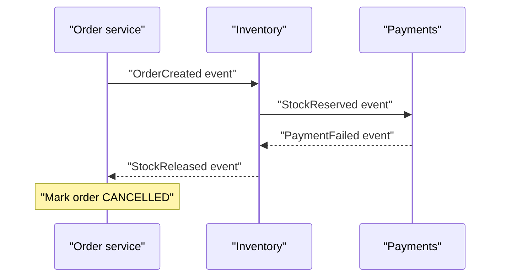
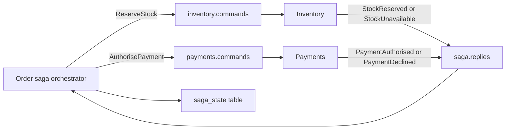

# Sagas and Long-Running Workflows

## Introduction

Booking a trip means reserving a flight, a hotel and a rental car, then charging the card. In a monolith with one database, that is a single transaction: if the card is declined, everything rolls back. Split those steps across four services with four databases and the single transaction is gone. There is no practical distributed transaction that spans them all, and Kafka will not provide one.

A saga is the replacement. It breaks the business transaction into a sequence of local transactions, one per service, each publishing an event or a command when it finishes. If a later step fails, the saga runs compensating actions to undo the earlier steps: cancel the hotel, release the flight seat. The system is never atomically consistent, but it always ends up in a consistent state.

After this page you will be able to design a saga with compensations, choose between choreography and orchestration, implement an orchestrator on Kafka, handle the anomalies that sagas allow, and decide when a dedicated workflow engine is a better tool than hand-built sagas.

## Why Not a Distributed Transaction?

Two-phase commit (2PC) coordinates several resources so they all commit or all roll back. It exists for databases and some message brokers through XA, but it is a poor fit for microservices:

- Every participant must support it; Kafka, most NoSQL stores and every third-party HTTP API do not.
- Participants hold locks while waiting for the coordinator, so one slow service slows everyone.
- If the coordinator dies at the wrong moment, participants can be stuck "in doubt" until a human intervenes.
- It couples the availability of every service: the transaction succeeds only if all are up at once.

Sagas give up atomicity and isolation in exchange for availability and loose coupling. Each step commits immediately and on its own.

## Compensation, Not Rollback

Each step that changes state needs a compensating action that semantically undoes it. Compensation is not a database rollback; the original change was committed and other parts of the system may already have seen it.

| Step | Action | Compensation |
|---|---|---|
| 1 | Create order in PENDING state | Mark order CANCELLED |
| 2 | Reserve stock | Release reservation |
| 3 | Authorise payment | Void authorisation |
| 4 | Book courier pickup | Cancel pickup |
| 5 | Mark order CONFIRMED | None needed; this is the final step |

Some actions cannot be undone: an email was sent, money was transferred out, a physical package left the warehouse. Order the steps so that irreversible actions come last, after every step that can still fail. This last-step-before-no-return is often called the pivot transaction. Steps after it must be retried until they succeed, because there is no going back.

Compensations must themselves be idempotent and retryable. A "release reservation" command may be delivered twice; a compensation that fails must be retried, not abandoned, or the saga leaves the system half-done.

## Choreography: Services React to Each Other's Events

In a choreographed saga there is no central coordinator. Each service listens for events and publishes its own.



Choreography is natural on Kafka and adds no new component. For a short saga of two or three steps it is often the simplest correct design.

It degrades as the saga grows. The workflow exists only as the sum of every service's subscriptions, so answering "what happens after payment fails?" means reading four codebases. Adding a step means changing several services. Cycles appear, where services react to each other's compensation events in unexpected ways. And there is no single place to ask "which orders are stuck halfway?"

## Orchestration: One Service Owns the Workflow

In an orchestrated saga, a dedicated orchestrator tells each participant what to do through command topics and listens for their replies. The orchestrator stores the saga's state: which steps have completed and what to do next.



The workflow is now explicit, in one place, and participants only know their own commands. The orchestrator can time out steps that never answer, and you can query its state store for stuck sagas. The cost is one more service to run and a central component that every flow depends on.

| | Choreography | Orchestration |
|---|---|---|
| Where the workflow lives | Spread across subscribers | In the orchestrator |
| Coupling | Services depend on each other's events | Participants depend only on the orchestrator's commands |
| Adding a step | Change several services | Change the orchestrator |
| Visibility of in-flight sagas | Hard; needs tracing | Query the saga state |
| Timeouts | Each service must handle its own | Central |
| Best for | 2 to 3 steps, stable flows | 4 or more steps, branching, frequent change |

## Implementing an Orchestrator on Kafka

The orchestrator is a consumer of `saga.replies` and a producer to the command topics. Its state lives in a database table, updated in the same transaction as the outbox rows for the next command, so a crash can never lose a decision or send a command for a step that was not recorded. That is the [Transactional Outbox Pattern](./1-kafka-outbox-pattern.mdx) applied to the orchestrator itself.

```java
import org.springframework.transaction.annotation.Transactional;

// Sketch: sagaRepository, outbox, processedReplies and the command records are application classes.
public class OrderSagaOrchestrator {

    enum Step { RESERVING_STOCK, AUTHORISING_PAYMENT, BOOKING_COURIER, COMPENSATING, DONE, FAILED }

    // Called for every record on saga.replies, inside one database transaction.
    // Replies carry the saga ID as the Kafka key, so all replies for one saga arrive in order.
    @Transactional
    public void onReply(String sagaId, Reply reply) {
        if (!processedReplies.markIfNew(reply.eventId())) return;   // replies can be redelivered

        SagaState s = sagaRepository.findForUpdate(sagaId);          // row lock: one decision at a time
        switch (s.step()) {
            case RESERVING_STOCK -> {
                if (reply.type().equals("StockReserved")) {
                    s.advanceTo(Step.AUTHORISING_PAYMENT);
                    outbox.command("payments.commands", sagaId,
                        new AuthorisePayment(sagaId, s.customerId(), s.amountCents()));
                } else {                                              // StockUnavailable
                    s.failWith("out of stock");
                    outbox.command("orders.commands", sagaId, new CancelOrder(sagaId));
                }
            }
            case AUTHORISING_PAYMENT -> {
                if (reply.type().equals("PaymentAuthorised")) {
                    s.advanceTo(Step.BOOKING_COURIER);
                    outbox.command("shipping.commands", sagaId, new BookCourier(sagaId, s.address()));
                } else {                                              // PaymentDeclined: undo step 2
                    s.advanceTo(Step.COMPENSATING);
                    outbox.command("inventory.commands", sagaId, new ReleaseStock(sagaId));
                }
            }
            case COMPENSATING -> {
                if (reply.type().equals("StockReleased")) {
                    s.failWith("payment declined");
                    outbox.command("orders.commands", sagaId, new CancelOrder(sagaId));
                }
            }
            default -> { /* late or duplicate reply for a finished saga: ignore */ }
        }
        sagaRepository.save(s);   // state change and outbox rows commit together
    }
}
```

A scheduled job finds sagas whose current step has been waiting longer than its timeout and either resends the command (participants are idempotent, so this is safe) or starts compensation.

Key the command and reply topics by saga ID. All messages for one saga then land on one partition and are processed in order, and different sagas run in parallel across partitions.

:::tip
Make every participant command idempotent by including the saga ID. "Reserve stock for saga 91c2" processed twice should reserve once. That single rule lets the orchestrator retry freely, which is what makes timeouts safe.
:::

## Sagas Are Not Isolated

Because each step commits on its own, other transactions see intermediate states. Between "stock reserved" and "payment declined", the shop may show the item as out of stock to another customer, who goes elsewhere. A report may count an order that is later cancelled. These are the anomalies you accept in exchange for no global locks.

Common countermeasures:

- **Semantic locks.** Mark records with a state such as PENDING so other operations treat them carefully. A pending order is not shown to the warehouse yet.
- **Commutative updates.** Design operations that give the same result in any order, such as adding and subtracting from a balance rather than setting it.
- **Re-reading values.** Check that data has not changed before the final step, and fail or retry if it has.
- **Reordering steps.** Put steps most likely to fail first, so compensation is rare and cheap.

## Worked Scenario: Food Delivery Orders

A food delivery platform's order flow had grown into a choreography of six services: orders, restaurant acceptance, payments, courier dispatch, promotions and notifications. A promotions bug published a `DiscountRejected` event that payments interpreted as a failure, which triggered a refund, which restaurant acceptance interpreted as a cancellation, while dispatch had already assigned a courier. Customers received food they had been refunded for. Nobody could draw the whole flow from memory, and diagnosing incidents took hours of grepping through six repositories.

The team moved to an orchestrated saga. A new `order-saga` service owns the flow: authorise payment, request restaurant acceptance (with a five-minute timeout), apply the promotion, dispatch a courier, capture payment. Capturing the payment is the pivot step and comes only after the restaurant accepts and a courier is assigned. Each participant consumes its own command topic and replies on `order-saga.replies`. The saga state table answers "show all orders stuck waiting for restaurant acceptance for more than five minutes", which became an operations dashboard.

They evaluated a workflow engine, Temporal, which offers durable timers, retries, versioned workflow code and a UI for every running instance. It was a strong fit for the flow's timeouts and branching. They chose a Kafka-based orchestrator because the team had deep Kafka expertise, every participant already consumed from Kafka, and they did not want to introduce and operate a new stateful cluster for a single workflow. They agreed to revisit the decision if more than a few workflows needed orchestration, at which point hand-written state machines become their own maintenance burden.

## When to Use a Workflow Engine Instead

A hand-built orchestrator is a small workflow engine. Once you need durable timers measured in days, human approval steps, versioning of in-flight workflows when the code changes, or dozens of different workflows, a dedicated engine (Temporal, Camunda, AWS Step Functions and similar) usually costs less than building those features yourself. These engines can still use Kafka for the events that start workflows and for the events they emit.

Kafka Streams is another option for sagas whose state fits naturally in a keyed state store, with exactly-once processing between the reply topic, the state store and the command topics. It removes the separate database but makes the saga logic harder to inspect.

## Common Mistakes

- Designing the happy path and forgetting compensations, or writing compensations that are not idempotent.
- Placing irreversible steps (charging a card, sending an email) before steps that can still fail.
- Updating saga state and publishing the next command as two separate writes instead of using an outbox.
- No timeouts, so a participant that never replies leaves sagas stuck forever.
- Letting choreography grow past three or four steps until nobody understands the flow.
- Treating sagas as isolated and being surprised by other users seeing intermediate states.
- Keying saga messages randomly, so replies for one saga are processed out of order.

## Summary

- A saga replaces a distributed transaction with a sequence of local transactions plus compensating actions.
- Put irreversible steps after the pivot; everything after it must be retried until it succeeds.
- Choreography suits short, stable flows; orchestration makes longer flows explicit, observable and easier to change.
- An orchestrator on Kafka stores saga state and the next command in one transaction, keys messages by saga ID and enforces timeouts.
- Sagas lack isolation; use semantic locks and careful step ordering, and consider a workflow engine when workflows multiply.

## Further Reading

- [microservices.io: Saga pattern](https://microservices.io/patterns/data/saga.html) - choreography and orchestration compared, with examples.
- [Hector Garcia-Molina and Kenneth Salem: Sagas (1987)](https://www.cs.cornell.edu/andru/cs711/2002fa/reading/sagas.pdf) - the original paper that introduced the idea.
- [Apache Kafka documentation: Design](https://kafka.apache.org/documentation/#design) - ordering and delivery guarantees the saga relies on.
- [Idempotent Consumers and Deduplication](./4-kafka-idempotent-consumers.mdx) - making participants and compensations safe to retry.
