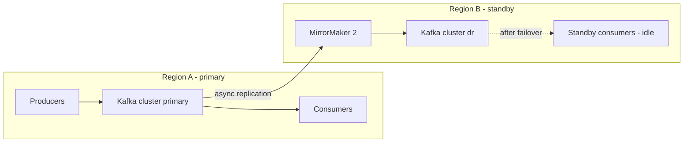
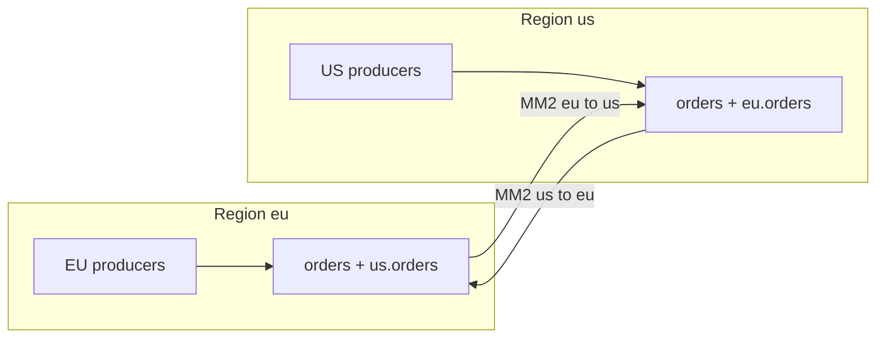

# Multi-Region and Disaster Recovery Topologies

## Introduction

A single Kafka cluster with replication factor 3 spread over three availability zones survives a broker failure, a disk failure and the loss of a whole zone. It does not survive the loss of a region: a cloud provider's regional outage, a fibre cut that isolates a data centre, or an operator mistake that deletes topics. If your business cannot stop when that happens, you need Kafka in more than one location.

There is no single right topology. Each one trades latency, cost, complexity and how much data you can lose. After this page you will be able to state your recovery objectives, choose between a stretched cluster, active-passive replication and active-active replication, configure MirrorMaker 2 for disaster recovery, and plan a failover that actually works when you need it.

## Start with RPO and RTO

Two numbers drive every decision:

- **RPO (recovery point objective):** how much data you can afford to lose, measured in time. RPO zero means no acknowledged write may ever be lost.
- **RTO (recovery time objective):** how long you can be down before service resumes.

A clickstream pipeline might accept an RPO of a few minutes and an RTO of an hour. A payments ledger may need an RPO of zero and an RTO of minutes. Be honest here: RPO zero across regions requires synchronous replication, and synchronous replication across hundreds of kilometres adds that round trip to every write.

| Topology | RPO | RTO | Write latency | Complexity |
|---|---|---|---|---|
| Single cluster, multi-AZ | Zero within the region; total loss if the region goes | Region outage = full outage | Lowest | Low |
| Stretched cluster across regions | Zero | Near zero, automatic | Adds inter-region round trip | High; needs three locations |
| Active-passive with MirrorMaker 2 | Seconds to minutes of replication lag | Minutes; manual or scripted failover | Unaffected | Medium |
| Active-active with MirrorMaker 2 | Seconds to minutes per region | Low; traffic shifts to the other region | Unaffected | High |

## Topology 1: A Stretched Cluster

A stretched cluster is one Kafka cluster whose brokers live in several regions or data centres. Each partition's replicas are spread across locations using rack awareness (`broker.rack` set to the region), and producers use `acks=all` with `min.insync.replicas=2`, so every acknowledged write exists in at least two locations.

```properties
# server.properties on a broker in region eu-west-1
broker.rack=eu-west-1
default.replication.factor=3
min.insync.replicas=2
# Let consumers read from a replica in their own region instead of the leader (KIP-392)
replica.selector.class=org.apache.kafka.common.replica.RackAwareReplicaSelector
```

```properties
# consumer config in eu-west-1
client.rack=eu-west-1
```

Because it is one cluster, failover is automatic: if a region disappears, partition leaders move to surviving replicas and clients reconnect. Consumer offsets live in the same cluster, so no translation is needed. RPO is zero.

The catch is geography. Every `acks=all` write waits for a replica in another location, so the network round trip between locations is added to produce latency. Between availability zones a few milliseconds apart this is fine; between regions 80 ms apart it is usually not. The KRaft controller quorum also needs a majority to survive: with three controllers in two locations, losing the location that holds two of them stops the cluster. A stretched cluster therefore needs three locations, even if the third only hosts a controller.

Use a stretched cluster when you have three sites with low latency between them (often metro-area data centres or cloud zones) and you need RPO zero. [KRaft: How Kafka Runs Without ZooKeeper](../0-kafka-fundamentals/3-kafka-kraft-and-metadata.mdx) explains the quorum rules.

## Topology 2: Active-Passive with MirrorMaker 2

The most common disaster recovery setup runs two independent clusters. Producers and consumers use the primary; MirrorMaker 2 (MM2) continuously copies topics, configurations and consumer group offsets to a standby cluster in another region. If the primary region fails, applications switch to the standby.



MirrorMaker 2 is built on Kafka Connect and runs three connectors: a source connector that copies records and topic configs, a checkpoint connector that translates consumer group offsets, and a heartbeat connector that proves the link is alive. MirrorMaker 1 was removed in Kafka 4.0, so MM2 is the tool in current Apache Kafka. Run it in the destination region, so that it reads remotely and writes locally; a failed remote write is harder to recover from than a failed remote read.

```properties
# mm2.properties - run with: bin/connect-mirror-maker.sh config/mm2.properties
clusters = primary, dr
primary.bootstrap.servers = kafka-a1.eu-west.example.com:9092,kafka-a2.eu-west.example.com:9092
dr.bootstrap.servers = kafka-b1.eu-central.example.com:9092,kafka-b2.eu-central.example.com:9092

# One direction only: primary -> dr
primary->dr.enabled = true
primary->dr.topics = orders.*, payments.*, customers.*
primary->dr.groups = .*

# Keep topic names identical so applications need no change after failover
replication.policy.class = org.apache.kafka.connect.mirror.IdentityReplicationPolicy

# Write translated offsets into the dr cluster's consumer groups
sync.group.offsets.enabled = true
sync.group.offsets.interval.seconds = 10
emit.checkpoints.interval.seconds = 10

replication.factor = 3
checkpoints.topic.replication.factor = 3
heartbeats.topic.replication.factor = 3
offset-syncs.topic.replication.factor = 3
```

**Topic naming.** By default MM2 prefixes replicated topics with the source cluster alias, so `orders` becomes `primary.orders` on the standby. That prevents loops in active-active setups. For one-way disaster recovery, `IdentityReplicationPolicy` keeps names identical so applications can fail over by changing only their bootstrap servers.

**Offset translation.** Offsets differ between clusters: record 5,000 on the primary may be record 4,870 on the standby. The checkpoint connector periodically maps committed group offsets across, and `sync.group.offsets.enabled` writes them into the standby's groups (only while those groups have no active members there). Translation is approximate and lags by the checkpoint interval, so after failover consumers typically reprocess some records. Consumers must be idempotent; see [Idempotent Consumers and Deduplication](./4-kafka-idempotent-consumers.mdx).

**What you lose.** Replication is asynchronous. Records acknowledged on the primary but not yet copied when the region fails are lost, or at least unavailable until the region returns. Monitor MM2 replication latency; that number is your real RPO.

[Replicating Clusters with MirrorMaker 2](../10-kafka-operations/5-kafka-mirrormaker.mdx) covers deploying, sizing and monitoring MM2 in depth.

## Topology 3: Active-Active

In active-active, both regions serve producers and consumers at the same time, and each cluster replicates to the other. Users in Europe write to the European cluster, users in America to the American one.

With the default replication policy, each cluster holds its local `orders` topic and a replica of the other region's topic as `us.orders` or `eu.orders`. The prefix stops MM2 from copying records back to where they came from. Consumers that need the global view subscribe to both, for example with a pattern such as `.*orders`.



Active-active removes idle standby capacity and keeps writes local and fast. It also gives up something important: there is no global order. Two updates to the same customer made in different regions at nearly the same time arrive in different orders in each region. Unless your data is naturally partitioned by region (each customer homed in one region) or your consumers can merge conflicting updates, you will get divergent state. Active-active is a data-modelling decision as much as an infrastructure one.

## Worked Scenario: A Payments Processor Plans for a Region Outage

A payments processor ran Kafka in one cloud region across three zones. A regulator asked for a documented plan to resume processing within 30 minutes of losing the region, with no more than a minute of data at risk.

They evaluated a stretched cluster across two regions plus a third for a KRaft controller. It met RPO zero, but the 25 ms round trip between their regions pushed p99 produce latency for authorisation events from 8 ms to over 60 ms, which broke their card network latency budget. Active-active was rejected because a card's authorisation and capture had to be ordered, and splitting a card's events across regions would allow captures without authorisations.

They chose active-passive. MM2 runs in the standby region, replicating all payment topics with `IdentityReplicationPolicy` and syncing group offsets every 10 seconds. Steady-state replication latency is under two seconds, inside the one-minute RPO. Producers write through an outbox, so payment records not yet replicated when the primary fails are still in the primary database's outbox; a region-independent recovery job republishes them to the standby after failover, and idempotent consumers absorb the duplicates.

The runbook, practised every quarter:

1. Declare the primary lost. Stop all producers pointing at it to avoid split brain if it comes back.
2. Stop MirrorMaker 2 so it does not overwrite offsets on the standby.
3. Switch application bootstrap servers to the standby cluster, through DNS or configuration.
4. Start consumers; they resume from the last synced offsets and reprocess a few seconds of records.
5. Later, rebuild the old primary as the new standby with MM2 replicating in the opposite direction, and fail back in a planned window.

The first drill took 95 minutes, mostly because three services had the primary's broker addresses hard-coded. After fixing that and automating steps 2 and 3, drills take 12 minutes.

:::warning
A disaster recovery setup that has never been failed over is a hypothesis, not a plan. Schedule regular failover drills, measure RTO and RPO, and fix what breaks. Failing back is usually harder than failing over; drill that too.
:::

## Other Options

**Cluster Linking and commercial replication.** Confluent Platform and Confluent Cloud offer Cluster Linking, which replicates at the broker level with offsets preserved, so no offset translation is needed. Some managed services offer their own cross-region replication. These simplify failover at the cost of vendor lock-in.

**Backups are not replication.** Replication copies mistakes too: a topic deleted on the primary or a bad producer that writes garbage will flow to the standby. Point-in-time recovery needs a separate backup strategy, such as tiered storage snapshots or sinking topics to object storage. See [Backup and Recovery Strategies](../10-kafka-operations/8-kafka-backup-and-recovery.mdx).

**Do you need Kafka in two regions at all?** If the data can be regenerated from upstream databases, and an hour of downtime is acceptable, a single multi-AZ cluster plus infrastructure-as-code to rebuild elsewhere may be the cheapest honest answer.

## Common Mistakes

- Choosing a topology before writing down RPO and RTO with the business.
- Stretching a cluster across two regions only, so losing one region loses the KRaft quorum.
- Leaving MM2's default prefixing in a one-way DR setup, then discovering at failover that every application subscribes to `orders` but the standby only has `primary.orders`.
- Assuming translated offsets are exact, and running non-idempotent consumers that double-process after failover.
- Running MM2 in the source region, so a regional outage also takes out the replicator's write path.
- Forgetting to replicate ACLs, schemas in the schema registry, and client credentials, so the standby cluster has data but nobody can read it.
- Never drilling a failover or failback.

## Summary

- Decide RPO and RTO first; they rule topologies in or out.
- A stretched cluster gives RPO zero and automatic failover but adds inter-region latency and needs three locations for the KRaft quorum.
- Active-passive with MirrorMaker 2 is the common choice: asynchronous replication, `IdentityReplicationPolicy`, synced group offsets and a practised runbook.
- Active-active keeps writes local but loses global ordering; it only works when data is partitioned by region or conflicts can be merged.
- Replication is not backup, translated offsets are approximate, and an untested failover plan is not a plan.

## Further Reading

- [KIP-382: MirrorMaker 2.0](https://cwiki.apache.org/confluence/display/KAFKA/KIP-382%3A+MirrorMaker+2.0) - design of MM2, replication policies and offset checkpoints.
- [KIP-392: Allow consumers to fetch from closest replica](https://cwiki.apache.org/confluence/display/KAFKA/KIP-392%3A+Allow+consumers+to+fetch+from+closest+replica) - follower fetching with `client.rack`.
- [Apache Kafka documentation: Geo-Replication](https://kafka.apache.org/documentation/#georeplication) - running and configuring MirrorMaker 2.
- [KIP-720: Deprecate MirrorMaker v1](https://cwiki.apache.org/confluence/display/KAFKA/KIP-720%3A+Deprecate+MirrorMaker+v1) - why MM1 was retired in favour of MM2.
