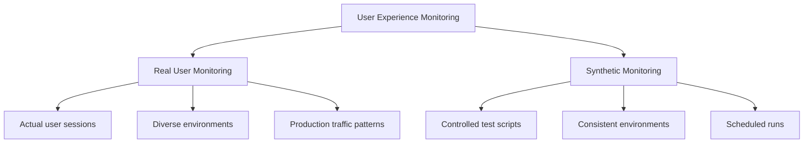
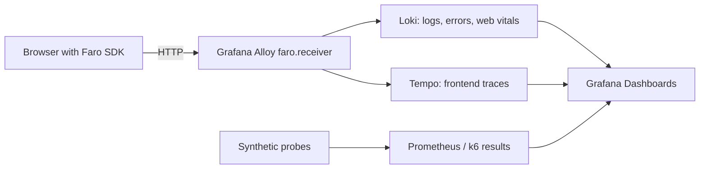

# User Experience Monitoring

## Introduction

User Experience Monitoring (UX Monitoring) is a critical aspect of modern application observability that focuses on measuring and analyzing the performance of applications from the end-user's perspective. Unlike traditional backend monitoring, UX monitoring helps you understand how users actually experience your application in terms of speed, reliability, and overall satisfaction.

In this guide, we'll explore how to implement User Experience Monitoring using Grafana and related tools, enabling you to:

- Track real user interactions with your applications
- Measure key frontend performance metrics
- Identify and resolve user-impacting issues quickly
- Correlate frontend issues with backend problems

## Key Concepts in User Experience Monitoring

### The Frontend Monitoring Gap

Traditional monitoring often focuses on infrastructure and backend services, leaving a significant gap in understanding the actual user experience. UX Monitoring bridges this gap by providing visibility into:

- Page load times
- Frontend errors
- User interactions
- Navigation patterns
- Browser/device performance

### Core UX Metrics

The foundation of effective UX monitoring is tracking the right metrics. These typically include:

1. **Web Vitals**
   - Largest Contentful Paint (LCP): Measures loading performance
   - First Input Delay (FID): Measures interactivity
   - Cumulative Layout Shift (CLS): Measures visual stability

2. **Application Performance Metrics**
   - Time to First Byte (TTFB)
   - Time to Interactive (TTI)
   - First Contentful Paint (FCP)
   - Total Blocking Time (TBT)

3. **User Behavior Metrics**
   - Session duration
   - Error rate
   - Conversion rate
   - Bounce rate

### Real User Monitoring vs. Synthetic Monitoring

UX Monitoring can be divided into two complementary approaches:



| Aspect | Real User Monitoring (RUM) | Synthetic Monitoring |
| --- | --- | --- |
| Data source | Real browsers of real users | Scripted probes from fixed locations |
| Coverage | Every page and device users actually hit | Only the journeys you script |
| Works with no traffic | No | Yes (detects outages at 3 AM) |
| Baseline consistency | Noisy (varied networks and devices) | Very consistent |
| Best for | Understanding true user experience | Availability checks and regression detection |

In practice you use both: synthetic checks tell you *that* something broke, and RUM tells you *how many* users were affected and *how badly*.

:::note
In March 2024, Google replaced First Input Delay (FID) with **Interaction to Next Paint (INP)** as the Core Web Vital for responsiveness. New dashboards should track LCP, INP, and CLS.
:::

## Architecture of UX Monitoring with Grafana

A typical open-source setup collects telemetry in the browser with the **Grafana Faro Web SDK**, receives it with **Grafana Alloy**, and stores it in Loki (logs, events, measurements) and Tempo (traces):



If you use Grafana Cloud, the Frontend Observability feature provides a hosted collector endpoint and prebuilt dashboards, but the SDK side is the same.

## Implementing Real User Monitoring

### Step 1: Instrument the Frontend with Faro

Install the SDK packages:

```bash
npm install @grafana/faro-web-sdk @grafana/faro-web-tracing
```

Initialize Faro as early as possible in your application's entry point:

```javascript
import { getWebInstrumentations, initializeFaro } from '@grafana/faro-web-sdk';
import { TracingInstrumentation } from '@grafana/faro-web-tracing';

initializeFaro({
  url: 'https://faro-collector.example.com/collect',
  app: {
    name: 'my-shop',
    version: '1.4.2',
    environment: 'production',
  },
  instrumentations: [
    // Errors, console logs, web vitals, sessions, and page views
    ...getWebInstrumentations(),
    // Traces for fetch/XHR requests, linked to backend traces
    new TracingInstrumentation(),
  ],
});
```

With this in place, Faro automatically captures unhandled errors, Core Web Vitals, and session information.

### Step 2: Record Custom Events and Measurements

Automatic data is a good start, but business-relevant interactions usually need explicit instrumentation:

```javascript
import { faro } from '@grafana/faro-web-sdk';

// Associate telemetry with a user (avoid sending personal data)
faro.api.setUser({ id: 'user-8421' });

// Track a business event
function onCheckoutCompleted(order) {
  faro.api.pushEvent('checkout_completed', {
    items: String(order.items.length),
    paymentMethod: order.paymentMethod,
  });
}

// Report a handled error with context
async function loadRecommendations() {
  try {
    const res = await fetch('/api/recommendations');
    if (!res.ok) throw new Error(`Recommendations failed: ${res.status}`);
    return await res.json();
  } catch (err) {
    faro.api.pushError(err);
    return [];
  }
}

// Record a custom timing measurement
const start = performance.now();
renderProductGrid();
faro.api.pushMeasurement({
  type: 'product_grid_render',
  values: { duration_ms: performance.now() - start },
});
```

### Step 3: Receive the Data with Grafana Alloy

Configure Alloy to accept Faro payloads and forward them to Loki and Tempo:

```hcl
faro.receiver "frontend" {
  server {
    listen_address       = "0.0.0.0"
    listen_port          = 12347
    cors_allowed_origins = ["https://shop.example.com"]
  }

  output {
    logs   = [loki.write.default.receiver]
    traces = [otelcol.exporter.otlp.tempo.input]
  }
}

loki.write "default" {
  endpoint {
    url = "http://loki:3100/loki/api/v1/push"
  }
  external_labels = {
    job = "faro",
  }
}

otelcol.exporter.otlp "tempo" {
  client {
    endpoint = "tempo:4317"
    tls {
      insecure = true
    }
  }
}
```

Restrict `cors_allowed_origins` to your own domains so that other sites cannot send data to your collector.

### Step 4: Query UX Data in Grafana

Faro writes each signal to Loki as a logfmt-formatted line with a `kind` field (`log`, `exception`, `measurement`, or `event`). You can query them with LogQL.

Frontend error rate:

```logql
sum(count_over_time({job="faro"} | logfmt | kind="exception" [5m]))
```

75th percentile Largest Contentful Paint (the percentile Google uses to assess Core Web Vitals):

```logql
quantile_over_time(0.75,
  {job="faro"} | logfmt | kind="measurement" | lcp != "" | unwrap lcp [15m]
)
```

Count of completed checkouts:

```logql
sum(count_over_time({job="faro"} | logfmt | kind="event" | event_name="checkout_completed" [1h]))
```

Field names can vary between SDK versions, so inspect a few raw log lines in Explore before building panels.

## Implementing Synthetic Monitoring

### HTTP Probes with the Blackbox Exporter

The Prometheus Blackbox Exporter checks endpoints from the outside. Once it is scraped by Prometheus, you can chart availability and latency:

```promql
# Availability over the last hour (1 = up, 0 = down)
avg_over_time(probe_success{job="blackbox", instance="https://shop.example.com"}[1h])

# Total probe duration, including DNS, TLS, and transfer
probe_duration_seconds{job="blackbox"}
```

### Browser Checks with k6

For full user journeys, a k6 browser test drives a real Chromium instance and automatically reports Web Vitals metrics such as `browser_web_vital_lcp`:

```javascript
import { browser } from 'k6/browser';
import { check } from 'k6';

export const options = {
  scenarios: {
    ui: {
      executor: 'shared-iterations',
      options: {
        browser: { type: 'chromium' },
      },
    },
  },
  thresholds: {
    browser_web_vital_lcp: ['p(75) < 2500'],
    browser_web_vital_cls: ['p(75) < 0.1'],
  },
};

export default async function () {
  const page = await browser.newPage();
  try {
    await page.goto('https://shop.example.com/');
    const heading = await page.locator('h1').textContent();
    check(heading, {
      'home page heading is visible': (h) => h !== null && h.length > 0,
    });
  } finally {
    await page.close();
  }
}
```

Run it on a schedule (for example, from CI or with Grafana Cloud Synthetic Monitoring) and send the results to Grafana to track trends.

## Building a UX Dashboard

A useful UX dashboard answers three questions: *Is the site up? Is it fast? Are users succeeding?* A typical layout:

| Row | Panels | Data source |
| --- | --- | --- |
| Availability | Probe success %, probe latency by region | Prometheus (Blackbox / synthetic) |
| Core Web Vitals | p75 LCP, INP, CLS with thresholds colored green/amber/red | Loki (Faro measurements) |
| Errors | Frontend exceptions over time, top error messages | Loki (Faro exceptions) |
| Business flow | Checkouts, sign-ups, funnel drop-off | Loki (Faro events) |
| Correlation | Slow frontend requests linked to backend traces | Tempo |

Use Google's published thresholds for Web Vitals coloring: LCP good at 2.5 s or less, INP good at 200 ms or less, CLS good at 0.1 or less.

## Alerting on User Experience

Alert on symptoms users actually feel rather than on every metric:

- **Availability**: synthetic probe failing from more than one location for 5 minutes
- **Performance**: p75 LCP above 4 seconds for 15 minutes
- **Errors**: frontend exception rate more than double the baseline for the same hour last week
- **Business**: checkout events drop to zero during normal trading hours

Requiring failures from multiple locations, or sustained over a time window, greatly reduces false alarms caused by a single flaky probe.

## Real-World Example: Diagnosing a Slow Checkout

1. The UX dashboard shows p75 INP on the checkout page rising from 150 ms to 600 ms after a release.
2. Filtering the Faro data by app version shows the regression only affects the new version.
3. Frontend traces in Tempo show the "Place order" click triggers a request to `/api/shipping-quote` that now takes 450 ms.
4. Following the trace into the backend reveals a new uncached call to an external shipping API.
5. Adding a cache brings INP back under 200 ms, and the checkout event rate recovers.

This end-to-end path, from user symptom to backend root cause, is the main value of combining RUM, tracing, and backend metrics in one place.

## Best Practices

- **Track percentiles, not averages**: p75 and p95 reveal the experience of slower users that averages hide
- **Segment the data**: break metrics down by page, browser, device type, country, and app version
- **Respect privacy**: avoid sending personal data, mask sensitive form fields, and comply with consent requirements
- **Sample when needed**: high-traffic sites may need to sample sessions to control storage costs
- **Tag releases**: always set the app version so regressions can be tied to deployments

## Summary

User Experience Monitoring closes the gap between backend health and what users actually see. In this guide you learned how to:

- Choose the right UX metrics, including Core Web Vitals (LCP, INP, CLS)
- Combine Real User Monitoring and Synthetic Monitoring
- Instrument a web application with the Grafana Faro Web SDK and receive the data with Grafana Alloy
- Query frontend errors, performance, and business events with LogQL
- Run synthetic HTTP and browser checks with the Blackbox Exporter and k6
- Build dashboards and alerts focused on user-facing symptoms

## Additional Resources

- [Grafana Faro Web SDK](https://github.com/grafana/faro-web-sdk)
- [Grafana Alloy documentation](https://grafana.com/docs/alloy/latest/)
- [k6 browser module](https://grafana.com/docs/k6/latest/using-k6-browser/)
- [Web Vitals](https://web.dev/articles/vitals)

## Exercises

1. Add the Faro Web SDK to a small web application and confirm that errors and Web Vitals appear in Loki.
2. Build a dashboard panel showing p75 LCP per page, with thresholds colored by Google's Web Vitals ranges.
3. Write a k6 browser script that logs in and adds an item to a cart, and set thresholds on LCP and CLS.
4. Create an alert that fires only when a synthetic check fails from at least two locations.
5. Instrument a custom business event and build a funnel panel showing drop-off between steps.
