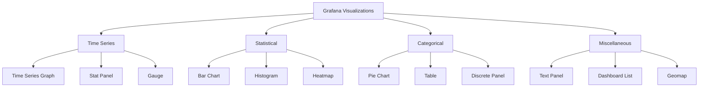
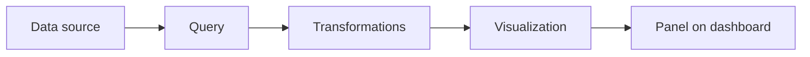
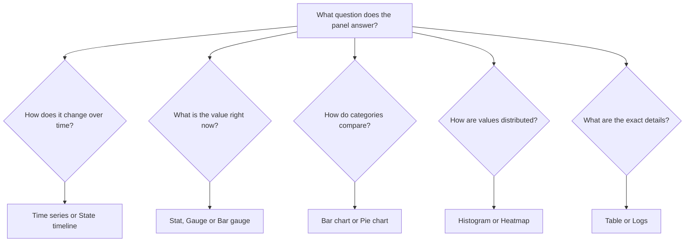

# Visualization Basics

## Introduction

Data visualization is the graphical representation of information and data. In Grafana, visualizations are the building blocks of dashboards that transform your raw data into meaningful, actionable insights. This guide introduces you to visualization fundamentals in Grafana and helps you understand how to choose the right visualization type for your data.

## Why Visualizations Matter

Raw data can be difficult to analyze. Visualizations help by:

- Making patterns and trends immediately visible
- Enabling quick comparison between different metrics
- Highlighting outliers and anomalies
- Communicating complex information in an accessible format
- Supporting data-driven decision making

## Understanding Grafana's Visualization Library

Grafana offers a rich collection of visualization types, each designed for specific data presentation needs:



The diagram groups visualizations by purpose, but in practice many panels (such as Stat and Gauge) can work with both time series and single-value data. The current Grafana visualization list includes:

| Visualization | Best for |
|---------------|----------|
| **Time series** | Showing how one or more metrics change over time |
| **Stat** | Highlighting a single important number, optionally with a sparkline |
| **Gauge** / **Bar gauge** | Showing a current value relative to a minimum, maximum and thresholds |
| **Bar chart** | Comparing values across categories |
| **Histogram** | Showing the distribution of values |
| **Heatmap** | Showing the distribution of values over time, such as latency buckets |
| **Pie chart** | Showing parts of a whole when there are only a few categories |
| **Table** | Displaying detailed, multi-column data that people need to read exactly |
| **State timeline** / **Status history** | Showing discrete states (up/down, on/off) over time |
| **Logs** | Displaying log lines from sources such as Loki or Elasticsearch |
| **Node graph** / **Traces** / **Flame graph** | Showing relationships, distributed traces and profiling data |
| **Geomap** | Plotting data on a map using coordinates or location names |
| **Text** | Adding notes, instructions or links in Markdown or HTML |

## Anatomy of a Panel

Every visualization in Grafana lives inside a **panel**. A panel has three main parts:



1. **Queries**: Retrieve data from a data source such as Prometheus, InfluxDB, Loki or a SQL database.
2. **Transformations**: Optionally reshape the results, for example by joining queries, renaming fields, filtering rows or computing new fields.
3. **Visualization and options**: Choose the visualization type and configure how the data is displayed.

The options for a panel are grouped into sections in the panel editor:

- **Panel options**: Title, description and transparency
- **Visualization-specific options**: Settings such as legend placement, tooltip mode or line style
- **Standard options**: Unit, minimum, maximum, decimals, display name and color scheme
- **Thresholds**: Values at which the color changes, for example green below 70 and red above 90
- **Value mappings**: Rules that translate raw values into text or colors, such as mapping `1` to "Up" and `0` to "Down"
- **Data links**: Links to other dashboards or external systems that include values from the clicked data point
- **Overrides**: Settings that apply only to specific fields or series

## Creating Your First Visualization

Follow these steps to add a visualization to a dashboard:

1. Open a dashboard, or create a new one from **Dashboards > New > New dashboard**.
2. Click **Add visualization** (or **Add > Visualization** on an existing dashboard).
3. Select a data source.
4. Write a query in the query editor. For example, with Prometheus:

```text
100 - (avg by (instance) (rate(node_cpu_seconds_total{mode="idle"}[5m])) * 100)
```

5. In the visualization picker on the right, select **Time series**.
6. Under **Standard options**, set the unit to **Percent (0-100)**.
7. Under **Thresholds**, add a threshold at `80` with a red color.
8. Give the panel a title such as "CPU Usage" and click **Save dashboard**.

This query calculates the CPU usage per instance as a percentage, based on the fraction of time the CPUs spent idle over the last five minutes.

## The Panel JSON Model

Behind the scenes, every panel is stored as JSON in the dashboard model. You can view it by opening the panel menu and selecting **Inspect > Panel JSON**. A simplified version of the CPU panel above looks like this:

```json
{
  "type": "timeseries",
  "title": "CPU Usage",
  "datasource": {
    "type": "prometheus",
    "uid": "prometheus"
  },
  "targets": [
    {
      "refId": "A",
      "expr": "100 - (avg by (instance) (rate(node_cpu_seconds_total{mode=\"idle\"}[5m])) * 100)",
      "legendFormat": "{{instance}}"
    }
  ],
  "fieldConfig": {
    "defaults": {
      "unit": "percent",
      "min": 0,
      "max": 100,
      "thresholds": {
        "mode": "absolute",
        "steps": [
          { "color": "green", "value": null },
          { "color": "red", "value": 80 }
        ]
      }
    },
    "overrides": []
  },
  "options": {
    "legend": { "displayMode": "list", "placement": "bottom" },
    "tooltip": { "mode": "multi" }
  }
}
```

Understanding this structure is useful when you want to copy panels between dashboards, review dashboard changes in version control, or provision dashboards automatically.

## Choosing the Right Visualization

The most important decision is matching the visualization to the question you want the panel to answer:



Some practical guidelines:

- **Trends and rates** (requests per second, CPU usage): use a **Time series** panel.
- **Key performance indicators** (current error rate, uptime): use a **Stat** panel, which is readable at a glance.
- **Capacity** (disk usage, memory usage against a limit): use a **Gauge** or **Bar gauge** with thresholds.
- **Comparisons between a small number of items** (requests per service): use a **Bar chart**.
- **Latency distributions**: use a **Heatmap** for distributions over time, or a **Histogram** for a single time range.
- **Inventories and top-N lists** (hosts with their versions and status): use a **Table**.
- **Service status** (up/down over the last 24 hours): use a **State timeline**.

## Real-World Example: A Web Service Dashboard

A typical dashboard for a web service combines several visualization types, each answering a different question:

| Panel | Visualization | Example query (Prometheus) |
|-------|---------------|----------------------------|
| Requests per second | Stat | `sum(rate(http_requests_total[5m]))` |
| Error rate | Gauge with thresholds | `sum(rate(http_requests_total{status=~"5.."}[5m])) / sum(rate(http_requests_total[5m])) * 100` |
| Traffic by endpoint | Time series | `sum by (handler) (rate(http_requests_total[5m]))` |
| Latency distribution | Heatmap | `sum by (le) (rate(http_request_duration_seconds_bucket[5m]))` |
| Instance status | State timeline | `up{job="web"}` |
| Slowest endpoints | Table | `topk(10, histogram_quantile(0.95, sum by (le, handler) (rate(http_request_duration_seconds_bucket[5m]))))` |

A common layout puts the Stat and Gauge panels in the top row for a quick health check, the time series and heatmap panels in the middle for trends, and the table at the bottom for detailed investigation.

## Best Practices

1. **Start with a question.** Every panel should answer one clear question. If you cannot describe the question, the panel probably is not needed.
2. **Always set units.** A value of `0.25` means little; `250 ms` or `25%` is immediately clear.
3. **Use thresholds and color with intent.** Reserve red for problems and keep the rest of the dashboard calm, so that problems stand out.
4. **Keep it simple.** Avoid too many series in one panel; use legends, overrides or separate panels instead.
5. **Use consistent time ranges.** Panels on the same dashboard should normally share the dashboard time range so they can be compared.
6. **Add context.** Use panel descriptions to explain what a metric means and what to do when it looks wrong.
7. **Avoid pie charts for many categories.** Bar charts are easier to read when there are more than a handful of items.

## Summary

- Visualizations turn raw data into patterns, comparisons and alerts that people can understand quickly
- Grafana offers many visualization types, including time series, stat, gauge, bar chart, histogram, heatmap, table, pie chart, state timeline, logs and geomap
- Every panel combines queries, optional transformations and a visualization with its options
- Standard options, thresholds, value mappings and overrides control how values are formatted and colored
- Panels are stored as JSON, which makes them easy to copy, version and provision
- Choosing the right visualization starts with the question the panel needs to answer

The following pages in this section look at each major visualization type in detail.

## Additional Resources

- [Grafana visualizations documentation](https://grafana.com/docs/grafana/latest/panels-visualizations/visualizations/)
- [Grafana panel editor documentation](https://grafana.com/docs/grafana/latest/panels-visualizations/panel-editor-overview/)
- [Grafana Play](https://play.grafana.org/), a public demo instance with example dashboards

## Exercises

1. Create a new dashboard and add one panel each of the Time series, Stat, Gauge and Table types using the same query. Compare what each one communicates.
2. Add thresholds and a unit to a Stat panel so that it turns red when the value exceeds a limit you choose.
3. Create a value mapping that displays `1` as "Up" and `0` as "Down" in a State timeline panel.
4. Open **Inspect > Panel JSON** for one of your panels, change the title and unit in the JSON, and apply the change.
5. Sketch a dashboard for a service you know: list the questions it should answer and choose a visualization for each one.
